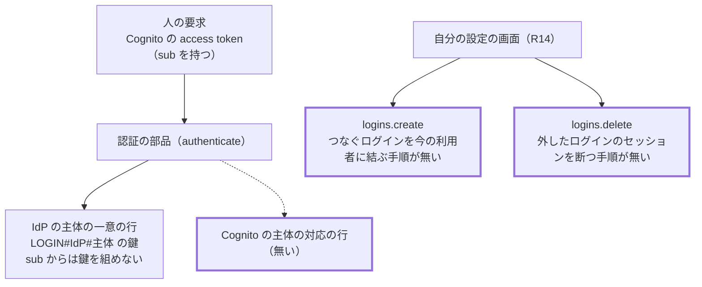
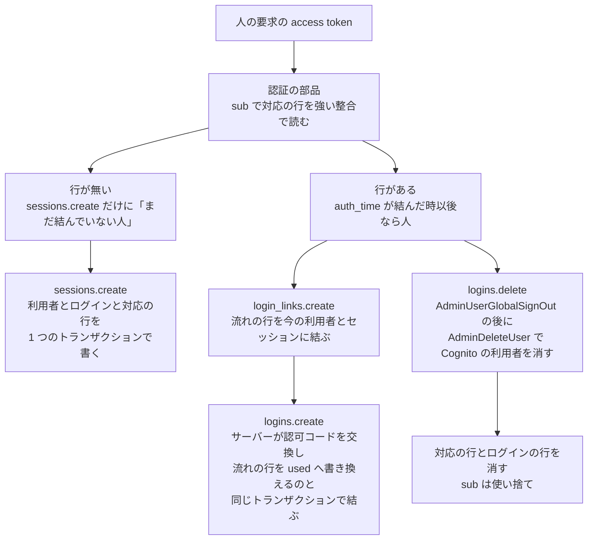

# 人の認証: Cognito の access token から利用者を引き、ログインをつなぐ・外す流れを安全に通す（#2）

承認済みの設計では、人の要求が持つ Cognito の access token が IdP の主体を持たないため、認証が利用者を引けず、ログインをつなぐ・外す流れにも別の利用者へ結べる隙が残っていた。Cognito の `sub` ごとに利用者を引く行（Cognito の主体の対応の行）を置き、ログインをつなぐ流れをサーバーが今の利用者とそのセッション（IdP でのサインイン 1 回ごとに Cognito が作る、refresh token を持つ単位）に結ぶ。ログインを外すときは、その Cognito の利用者をサインアウトさせてから消し、対応の行も消して `sub` を使い捨てにする。1 人に複数の IdP を結ぶ方法は、Cognito の組み込みの連携（`AdminLinkProviderForUser`）と比べて自前の対応の行を採った（決定 1）。決めたことは下の 4 つの決定に、行と手順の細部は全体の設計（[データの文書](../docs/design/data.md#cognito-の主体の対応の行)・[API の文書](../docs/design/api.md#冪等の鍵)・[詳細設計](../docs/design/detail.md#関数の仕様)・[画面の文書](../docs/design/screens.md)・[プラットフォームの文書](../docs/design/platform.md#資源ごとの形)）と [#2 の詳細設計](./issue-2-design-detail.md) にある。公式文書に無く確かめていない 2 つは「未確認のこと」に、実装の前に確かめる手順とともに置く。

## 今の姿

要求仕様は [issue-2-requirements.md](./issue-2-requirements.md) に、承認済みの設計は [issue-2-design.md](./issue-2-design.md) にある。変更の位置は次の図の太枠である。

- 人の要求の認証は、Cognito の access token の署名・発行元・クライアント・期限・種類を照らす。token から利用者を引く行は無い。サインインは IdP の主体の一意の行（`LOGIN#<IdP>#<主体>`。IdP は `google` か `github`、主体は各 IdP の識別子）を読んで利用者を引くと決めている（[プラットフォームの文書](../docs/design/platform.md) の決定 99）が、access token が持つのは Cognito の利用者の `sub` で、この鍵を組めない
- 初めてサインインした人は、まだ利用者の行を持たない。利用者を作る `sessions.create` に届く前に、認証が主体を決められない
- ログインの組の行と IdP の主体の一意の行は `user_id` だけを持つ。ログインを外す操作は、外すログインに当たる Cognito の利用者を引けない
- `logins.create` の流れ（IdP へ移って戻る）と、ログインを外した後に残るセッションの扱いは、承認済みの設計に手順が無い
- 冪等の鍵は主体の利用者・操作の名前・鍵の 3 つの組で区切る。利用者がまだ無い初めてのサインインの区切りは決めていない
- 画面の地図は 14 本の HTTP の経路で、サインインの戻りは `/` で受ける。CDN は地図の経路に `index.html` を返す（[画面の文書](../docs/design/screens.md) の決定 38）

## 文脈と制約

- Cognito は IdP のアカウントごとに別の Cognito の利用者（別の `sub`）を作る。そのため、組み込みの連携を使わない限り、Cognito の `sub` とログインの組は 1 対 1 に当たる。federated の利用者の `username` は `<IdP の名前>_<IdP の識別子>` の形で、消した後に同じ IdP のアカウントでサインインし直すと Cognito は同じ形の `username` で利用者を作る（[Linking federated users](https://docs.aws.amazon.com/cognito/latest/developerguide/cognito-user-pools-identity-federation-consolidate-users.html)）
- Cognito の access token は IdP の主体を持たない。IdP と主体は、token の `username` で利用者プールを読み（`AdminGetUser`）、属性 `identities` から得る
- access token を refresh token で取り直しても、IdP でサインインした時刻（`auth_time`）は変わらない
- `AdminUserGlobalSignOut` は、その Cognito の利用者のすべてのセッションの refresh token を取り消す。`AdminDeleteUser` は利用者を消すが、消した利用者の token の扱いを文書は書いていない（[AdminDeleteUser](https://docs.aws.amazon.com/cognito-user-identity-pools/latest/APIReference/API_AdminDeleteUser.html)）。どちらの呼び出しも、クライアントで打ち切っても Cognito に届いた要求の実行は取り消せない
- 組み込みの連携 `AdminLinkProviderForUser` は、IdP のアカウント（`SourceUser`）を既存の利用者（`DestinationUser`）へ結ぶ。結ぶ先は federated の利用者でもよい。結べるのは結ぶ元がまだ一度もサインインしていない間だけで、サインインした後に結ぶには先にその利用者を消す。1 人に結べるのは 5 つまでで、ふつうは事前の作成か事前サインアップの引き金（Pre sign-up Lambda）で結ぶ。外すのは `AdminDisableProviderForUser` で、外した IdP のアカウントは次のサインインで新しい利用者になる（[AdminLinkProviderForUser](https://docs.aws.amazon.com/cognito-user-identity-pools/latest/APIReference/API_AdminLinkProviderForUser.html)・[AdminDisableProviderForUser](https://docs.aws.amazon.com/cognito-user-identity-pools/latest/APIReference/API_AdminDisableProviderForUser.html)・[Linking federated users](https://docs.aws.amazon.com/cognito/latest/developerguide/cognito-user-pools-identity-federation-consolidate-users.html)）
- 事前サインアップの引き金が受けるのは IdP から写した属性で、`clientMetadata` を渡せるのは `SignUp`・`AdminCreateUser` などの API だけである。IdP からのサインインでは、流れを始めた利用者を引き金へ渡す値が文書に無い（[Pre sign-up Lambda trigger](https://docs.aws.amazon.com/cognito/latest/developerguide/user-pool-lambda-pre-sign-up.html)）
- access token の有効期間は、アプリのクライアントごとに 5 分から 1 日の間で決める。managed login はブラウザーに 1 時間の cookie を置き、その間は認証し直さずにサインインできる（[Understanding the access token](https://docs.aws.amazon.com/cognito/latest/developerguide/amazon-cognito-user-pools-using-the-access-token.html)・[TokenValidityUnitsType](https://docs.aws.amazon.com/cognito-user-identity-pools/latest/APIReference/API_TokenValidityUnitsType.html)）
- 認可の URL の `identity_provider` はブラウザーの側で変えられる。PKCE は認可コードと流れを結ぶだけで、流れを始めたときに選んだ IdP を保証しない
- Cognito が既存のブラウザーセッションを使うと、選んだ IdP で認証し直さずに token が返る。`prompt=login` は managed login でだけ効く。Cognito は `prompt` を IdP へ渡すが、Google が文書にする値は `none`・`consent`・`select_account` で、`login` を含まない
- 画面のアプリのクライアントは、シークレットを持たない公開クライアントである。トークンの端点との交換は本文に `client_id` を要る
- 形の正本では、要求全体の理由（`unauthorized` など）を要素の理由に使えない
- `aws-jwt-verify` は時計を受けず、`exp` と `nbf` を実時刻で照らす
- 全体の設計の I16（1 つの IdP のアカウントは 1 人の利用者だけに結ぶ）と決定 99 の一意の行は決め直さない
- 1 子 1 スプリント（[開発の計画](../docs/design-process/issue-24/plan.md)の決まり）。CI は AWS の資格情報を持たない

## 解き方の全体像

- 認証は Cognito の `sub` で対応の行を読み、行があって token の `auth_time` が行を結んだ時以後なら人として通す。行が無い主体は、`sessions.create` にだけ「まだ結んでいない人」として渡る
- 結ぶ値（IdP と主体）は要求の本文から採らず、検証した token の `username` で利用者プールを読んで得る。結ぶ token は 5 分の内のサインインだけを受ける
- ログインをつなぐ流れは `login_links.create` で始まり、サーバーが流れの `code_verifier` で認可コードを交換し、流れを 1 回だけ使う。戻りは連携専用の戻り先 `/me/logins/return` で受ける
- ログインを外すと、その Cognito の利用者をサインアウトさせてから消し、対応の行とログインの行を消して、外した `sub` に境の時刻だけを持つ外した主体の行を残す。外したログインの古い token は、対応の行が無く境の前のサインインのため 401 `session_ended` になり、利用者プールでも引けない（`AdminGetUser` が利用者を返さないか、作り直した別の `sub` を返す）

## 決定の記録

### 決定 1: 認証が access token から利用者を引くため、Cognito の組み込みの連携でなく、Cognito の `sub` ごとの自前の対応の行を置く

- **質問**: IdP の主体を持たない Cognito の access token から、どの行で利用者を引くか。1 人に複数の IdP のログインを結ぶのを、Cognito の組み込みの連携と自前の対応の行のどちらで持つか
- **選んだ案**: `db-users` に Cognito の主体の対応の行（`COGNITO#<Cognito の sub>` / `COGNITO`）を置く。行は結んだ利用者・`cognito_username`・IdP と主体・結ぶのに使った token の `auth_time`（`bound_auth_time`）を持ち、状態を持たない（行があることが結んでいることである）。認証はこの行を強い整合で読み、行があって `auth_time` が `bound_auth_time` 以後の token だけを人として通し、前なら 401 `session_ended` にする。行が無い主体は `sessions.create` にだけ「まだ結んでいない人」（`newcomer`）として渡り、ほかの操作は 401 `session_ended` にする（そのセッションの token は取り直しても通らない）。結ぶ IdP と主体は、検証した token の `username` で利用者プールを読んで得て（読んだ利用者の `sub` が token の `sub` と違うか、利用者が無ければ 401 `unauthorized`）、`auth_time` が 5 分（`LOGIN_BIND_FRESH_MS`）の内のサインインだけを結ぶ。ログインの組の行と IdP の主体の一意の行に `cognito_sub` と `bound_auth_time` を写し、`logins.delete` はそこから対応の行の鍵を組む。利用者の行に結んだログインの数（`login_count`）を持たせ、外すときは「2 以上」だけを条件に 1 引く（版は条件にしない。呼び名の変更など別の書き換えで外れ、最後のログインと取り違えないため）。`sessions.create` の冪等の鍵は、主体の利用者の代わりに Cognito の `sub` と token の `auth_time` の組で区切る（refresh token で取り直した送り直しは同じ組になり、外した後にサインインし直すと別の組になる）。`sessions.create` は、IdP の主体の一意の行が別の `cognito_sub` を持つときは、その IdP のアカウントの Cognito の利用者が作り直されたとして（同じ `username` を利用者プールで読むと token の `sub` が返るため、前の `sub` の利用者はもう無い）、そのログインを一意の行の利用者のまま今の `sub` へ付け替える（前の対応の行を消し、新しい対応の行を書き、2 つのログインの行の `cognito_sub` と `bound_auth_time` を「前の `cognito_sub`」を条件に書き換える）。決定 3 で Cognito の利用者を消した後に行を消せなかったログインと、運用で Cognito の利用者を消したログインは、これでサインインし直すだけで戻る
- 採らなかった案: Cognito の組み込みの連携（`AdminLinkProviderForUser`）で 1 人を 1 つの Cognito の利用者にまとめる。次の 4 つで採らない。(1) つなぐログインは、本人がそのアカウントでサインインして確かめる流れで得る（決定 2）が、そのサインインで Cognito が別の利用者を作るため、結ぶにはその利用者を消してから結ぶ 2 回の呼び出しが要り、どちらも DynamoDB のトランザクションに入らない。事前サインアップの引き金で結ぶには流れを始めた利用者を引き金へ渡す値が要るが、IdP からのサインインでは渡せない。メールなどの属性で結ぶと、文書が警告する「信頼しない属性で既存の利用者としてサインインさせる」隙になる。(2) まとめた利用者の access token は、どの IdP でサインインしたかを持たないため、外したログインのセッションだけを断てない。断つには `AdminUserGlobalSignOut` で残すログインのセッションまで取り消すことになる。(3) 結ぶ先の利用者は最初のログインそのもので、そのログインを外したときに残りの連携がどうなるかを文書が書いていない。最後の 1 つでなければどのログインも外せる、という要求（F1）を文書の範囲で満たせない。(4) IdP の主体と利用者の結び付きを、利用者プールの属性 `identities` と DynamoDB の IdP の主体の一意の行（I16・決定 99）の 2 か所で持つことになり、片方だけが書けたときに食い違う。連携した後と外した後の `sub` の振る舞いも文書に無い（下の「未確認のこと」の (a)）。組み込みの連携の利点は、1 人が Cognito の利用者 1 つで済み（月の利用者の数の課金が 1 人分）、対応の行が 1 人 1 行になることだが、上の 4 つを越えない
- 採らなかった案: IdP と主体を要求の本文から受けて結ぶ（本人確認を済ませていないログインを利用者へ結べる）
- 採らなかった案: `sessions.create` の冪等の鍵も主体の利用者で区切る（初回の書き込みの後に応答を失って送り直すと、主体が「まだ結んでいない人」から人へ変わり、初回の確定した結果を引けない）
- 採らなかった案: `sessions.create` の冪等の鍵を Cognito の `sub` だけで区切る（外した後に Cognito が同じ `sub` で利用者を作り直したとき（「未確認のこと」の (a)）、外す前の鍵で前の利用者の結果が返る）
- 採らなかった案: 最後のログインを外さない照らしを、外す 3 行の条件だけで行う（別々のログインを同じ時に外す 2 つの要求が、互いにもう一方が残ると読んで両方通る）
- **代償**: `db-users` に行の種類が 1 つ増え、人の要求ごとに対応の行の強い整合の読みが 1 回増える。初めてのサインインとログインをつなぐときに利用者プールの読み（`AdminGetUser`）が 1 回増える。IdP でサインインしてから 5 分を過ぎた token では結べず、サインインし直しになる。IdP のアカウントごとに Cognito の利用者ができるため、ログインを 2 つ結んだ人は月の利用者の数の課金で 2 人に数える
- 根拠: Value 9 / Value 4（MVV バージョン 2）

### 決定 2: つなぐログインを今の利用者がそのセッションで始めた流れで得たものに限るため、`login_links.create` で流れを今の利用者とセッションに結び、認可コードをサーバーが交換して流れを 1 回だけ使う

- **質問**: `logins.create` が結ぶログインが、今の利用者が自分のセッションで始めた連携で得たものであることを、どこで照らすか
- **選んだ案**: 操作 `login_links.create` を足す（F1・人だけ・書く・受け持ちは #4）。ハンドラーは `code_verifier` と流れの ID を作り、ログインをつなぐ流れの行（`USER#<利用者>` / `LINK#<流れの ID>`）に今の利用者・要求の Cognito の `sub`・セッションの識別子（token の `origin_jti`）・開始元の対応の行の `bound_auth_time`（結んだ時のサインインの時刻）・選んだ IdP・`code_verifier`・10 分（`LOGIN_LINK_TTL_MS`）の期限を書き、認可の URL を返す。URL は `identity_provider`（選んだ IdP）と IdP ごとの `prompt`（Google は `select_account`、GitHub は `login`。Google が文書にする値に `login` は無い）と PKCE を持つ。画面は連携専用の戻り先 `/me/logins/return` で戻りを受け、通常のサインインの戻りより先に見て、控えた流れの ID と `state` が同じときだけ `logins.create` へ送る。`logins.create` は交換と確定の 2 つの要素で行う。交換の要素では、ハンドラーが流れの行を照らし、サーバーがその行の `code_verifier` と `client_id` で認可コードを交換し、得た token を `verifyLoginToLink` で照らす（`auth_time` は流れの行の `created_at` 以後に限る。`prompt` はブラウザーの側で変えられる指定のため頼らない）。照らしたつなぐ主体は、流れの行を「`open`・期限の前」を条件に `open` から `verified` へ書き換えて残し（同じ書き換えで `code_verifier` を消す。認可コードは 1 回だけ使え、交換の後に要らない）、画面はつなぐアカウント（IdP と表示の名前）を出して、利用者が「つなぐ」を押したときだけ確定の要素を送る。表示の名前は利用者プールの属性 `email` で、得られないアカウントは確定へ進めず要素の 409 `account_unidentifiable` にする。画面は確定を送る前に控えの段を確定待ちへ進めて保存し、読み直しの後に確定を送り直すのはその段の控えからだけにする。交換の結果は `used` へ進めても残す（同じ鍵でも交換の要素の指紋が違う送り直しには返さず 422 `idempotency_key_reused` にする）。画面は交換の応答を受けられないか、503 か要素の 409 `in_progress` を受けたら、認可コードの消費や結果の保存の成否を応答から決められないため、控えたまま同じ要素と同じ冪等の鍵で送り直す。保存した交換の結果があればそれを受けて続け、認可コードを消費した後に交換の結果を保存できなかった流れは、送り直しが Cognito に断られて要素の 409 `link_invalid` を受けるため、それを受けてから控えを消して `login_links.create` から始め直す。確定の要素が流れの行に残したつなぐ主体で結ぶ。利用者プールから得た IdP が流れの行の IdP と違えば、既に結んだことより先に要素の 409 `link_invalid` にする。選んだ IdP で既に結んだ主体は要素の 409 `already_linked` にする。流れの行は結ぶのと同じトランザクションで、「`verified`・期限の前」を条件に `verified` から `used` へ書き換え（`open` の流れは交換の前のため確定せず要素の 409 `link_invalid` にする。つなぐ主体の候補を消し、確定した要素の冪等の鍵と結んだログインを残す）、開始元の対応の行がまだあり、同じ利用者へ同じ `bound_auth_time` で結んでいることを条件に照らす。結果の分からない送り直しには、ハンドラーが `used` の流れの行から、同じ冪等の鍵のときだけ初回の成功を返す。CDN は `/me/logins/return` にも `index.html` を返す（最後の区切りに `.` を持たない path を `/index.html` に書き換える CloudFront Function）
- 採らなかった案: 画面がつなぐログインの token を要求で渡し、`state` と PKCE を画面の側だけで照らす（別の流れで得た直近の token を API へ直に渡すと、別の利用者へ結べる）
- 採らなかった案: 流れを Cognito の `sub` だけに結ぶ（`sub` は同じログインの別のサインインでも同じで、認可コードの交換の間に開始元のログインが外されても結べる）
- 採らなかった案: 交換で得た token の `auth_time` を新しさの境（5 分）だけで照らし、交換したらすぐ結ぶ（`prompt=login` を外した認可の URL では Cognito の既存のブラウザーセッションが流れを始める前のサインインを返し、利用者が見ないまま意図しないアカウントを結べる）
- 採らなかった案: 結果の分からない送り直しの成否を、画面がログインの一覧の増減で決める（別のタブや端末が同じ時に同じ IdP の別のアカウントをつなぐと、失敗した流れまで成功と出す）
- 採らなかった案: 連携の戻りも通常のサインインの戻り先 `/` で受ける（連携の `state` はサーバーが作り、通常のサインインの状態の控えに無いため、通常のサインインの戻りの処理が受けられない）
- 採らなかった案: 認可の URL で IdP と認証し直しを指定しない（Cognito が既存のブラウザーセッションを使い、既に結んだ主体か 5 分を過ぎたサインインの token が返って、つなげない）
- 採らなかった案: 流れの外れを要素の 401 で返し、既に結んだ主体と確定の衝突を同じ理由で返す（401 は要求全体の理由で要素に使えず、画面が「別のアカウントを選び直す」と「始め直す」を分けられない）
- 採らなかった案: 既に結んだことを、選んだ IdP と違うことより先に照らす（流れを外れた戻りに、選び直しの案内が出る）
- 採らなかった案: S3 の 403・404 を `index.html` に替える誤りの応答の設定で、直に開いた path を返す（無いビルドの出力や Service Worker のファイルまで `index.html` で隠す）
- **代償**: 操作が 1 つ（`login_links.create`）、行の種類が 1 つ、画面の戻り先が 1 つ、配信の CloudFront Function が 1 つ増える。Cognito の利用者プールに managed login の見た目を割り当て、アプリのクライアントに認可コードの付与・PKCE・token の取り消しと 2 つの戻り先を許す設定が要る。連携は始めてから 10 分の内に、同じブラウザーで終える必要がある
- 根拠: Value 9 / Value 4（MVV バージョン 2）

### 決定 3: 外したログインの token を通さず、待つ仕組みも持たないため、`AdminUserGlobalSignOut` の後に `AdminDeleteUser` でその Cognito の利用者を消し、対応の行も消して `sub` を使い捨てにする

- **質問**: ログインを外した後に、その Cognito の利用者のセッションをどう断ち、同じ IdP のアカウントでいつから結び直させるか
- **選んだ案**: `logins.delete` は、外すログインの組の行と対応の行を強い整合で読んで照らした後（要素の `bound_auth_time` が行と同じこと・最後のログインでないこと）、要求元の照らし（[データの文書の人の書き込みの要求元の照らし](../docs/design/data.md#人の書き込みの要求元の照らし) の「要求の中で同期に外へ働きかける操作」）を打ってから、要求の中で Cognito を次の順に呼ぶ。(1) 対応の行の `cognito_username` で `AdminGetUser` を打ち、利用者が無いか、返った `sub` が対応の行の `cognito_sub` と違えば（前の利用者はもう無い）、(2) と (3) を飛ばす。(2) `AdminUserGlobalSignOut` でその利用者のすべての refresh token を取り消す。(3) `AdminDeleteUser` でその利用者を消す。(2) と (3) の `UserNotFoundException` は済んだとして進める。呼び出しが失敗したら行を変えずに要素を確定せず（要求全体の 503 `unavailable`。冪等の鍵の済みの行を書かない）、同じ冪等の鍵の送り直しが、1 回目の途中の印の期限の後に (1) からやり直す（期限の前は 409 `in_progress`）。3 つが済んだら、ログインの組の行・IdP の主体の一意の行・対応の行を消し、利用者の行の `login_count` を 1 引くのを 1 つのトランザクションで確定する。同じトランザクションで、外した `sub` の外した主体の行（`COGNITO#` / `UNBOUND`）に、Cognito の呼び出しが済んだ後の時刻を境（`unbound_at`）として書く。消した Cognito の利用者のサインインはどれも境の前にある。外したログインの古い token は、対応の行が無く `auth_time` が境の前のため認証で 401 `session_ended` になり、`sessions.create` も結ばない（同じ `sub` が作り直されても）。結ぶトランザクション（`sessions.create` の初めてのサインインと付け替え・`logins.create` の確定）は、結ぶサインインの `auth_time` が境より後であることを条件に照らし直すため、認証の読みや連携の交換の後に外しが確定しても、外す前のサインインを結ばない。同じ IdP のアカウントでサインインし直すと Cognito が利用者を作り直し、境より後の新しいサインインとして結ぶ。対応の行が無く境にも入らない token（まだ結んでいない）は、ほかの操作に 401 `unauthorized` を返し（後で `sessions.create` が結びうるため、`session_ended` を返さない）、画面はこれをセッションの取り消しの確定と扱わない。行が持つのは境の時刻だけで、失効の状態・世代・借り・待つ期間は持たない
- 採らなかった案: 対応の行を消さずに失効の待ち（`signing_out`）・外した回数（`binding_epoch`）・失効の境（`revoked_before`）を持ち、`AdminUserGlobalSignOut` を外した世代の借りで 1 つに限り、応答を失った呼び出しの結果の分からない期間（15 分）を待ってから結び直させる（前の設計。Cognito の利用者を残すため、同じ `sub` を結び直す前に失効を待つ仕組みが要り、行の状態・借り・予定の行・見回りが増える。待つ期間の長さの根拠も文書に無い）
- 採らなかった案: 対応の行を消すだけで境を残さない（行が無いことだけでは、まだ結んでいない token と外したログインの token を見分けられない。Cognito が同じ `sub` で利用者を作り直したとき、外す直前のサインインの古い token が、新しいサインインの `sessions.create` より先に結べる。交換の後に候補が別の経路で結ばれてから外されると、古い `verified` の候補から外した `sub` を結び、その `sub` の期限内の古い access token が通る）
- 採らなかった案: 先に行を消し、Cognito の呼び出しを後で行う予定の行に回す（呼び出しが済む前に同じ IdP のアカウントでサインインし直すと、残った Cognito の利用者（同じ `sub`）へ結び、その後に予定の呼び出しが結び直した利用者を消す。防ぐには呼び出しが済むまで結ばせない状態が要る）
- 採らなかった案: `AdminUserGlobalSignOut` だけを呼び、Cognito の利用者を残す（サインインし直しが同じ `sub` になり、外す前のセッションと見分ける境を行に残す要がある）
- 採らなかった案: `AdminDeleteUser` だけを呼ぶ（消した利用者の refresh token を Cognito が断つかを文書が書いていない。先に `AdminUserGlobalSignOut` で取り消す）
- 採らなかった案: 外すログインのセッションだけを選んで取り消す（Cognito の利用者はログインと 1 対 1 で、外すログインのセッションはその Cognito の利用者のすべてのセッションに当たる。`AdminUserGlobalSignOut` はその全部を取り消す）
- **代償**: `logins.delete` が要求の中で Cognito を最大 3 回呼び、応答が遅くなる。Cognito の呼び出しが済んだ後に行を消すトランザクションが外れると（同じ時に別のログインを外した・画面が読んだ後に結び直した）、ログインは結んだまま Cognito の利用者だけが消える。その間、そのログインの access token は期限まで通り（refresh token は取り消し済みのため、長くて access token の有効期間）、そのログインでサインインし直すと `sessions.create` が今の `sub` へ付け替えて戻る（決定 1）。応答を失った `AdminDeleteUser` が Cognito で後から処理されるか、同じログインを同じ時に外す別の要求（別のタブや端末）の `AdminUserGlobalSignOut`・`AdminDeleteUser` が遅れて届き、その間に同じ IdP のアカウントでサインインし直して作り直した利用者を消すと、そのセッションは取り直しで続かずサインインし直しになる（Cognito の管理の呼び出しは federated の利用者を `username` でしか指せず、作り直した利用者を世代で見分けて避けられない。外したログインで人として通ることは無く、サインインし直せば付け替えで同じ利用者に戻るため、呼び出しを直列にする借りを持たずにこの代償を受ける）。別々のログインを同じ時に外す 2 つの要求も、どちらも書く前の照らしを通って両方の Cognito の利用者を消しうる。確定のトランザクションは `login_count` の条件で片方だけを通し、残ったログインは結んだまま Cognito の利用者だけが消えるため、上と同じくサインインし直しで戻る（最後のログインは表で外れない）
- 根拠: Value 9 / Value 17（MVV バージョン 2）

### 決定 4: 認証の読みの後に状態が変わっても、鍵を取り違えても通さないため、1 回だけの token の確定の条件と、期限と鍵と署名の本文の照らしを書き足す

- **質問**: 認証の部品が読んで照らした後に、ランナーのレーンや DB の用意の状態が変わったとき、期限を照らす時計と検証の鍵の種別が想定と違うとき、Webhook の本文が受け口で変わったときに、要求をどう断つか
- **選んだ案**: ランナーの引き換えの token は、レーンが終わっておらず、今の世代が token の世代と同じで、その世代を引き換え済みと記していないことを、引き換えのハンドラーが返す値と同じ `writeAtomically` の条件にする。DB の用意の token も、用意が作成中か差し替えの途中で、用意の ID が同じで、その用途を使い終えていないことを同じく確定の条件にする。認証の部品は読んで断るだけにする。Cognito の `exp` は必須にし、`exp` と `nbf` は注入した時計だけで照らす（`aws-jwt-verify` の照らしは `graceSeconds` を無限にして止める）。Ed25519 の JWT は、検証の鍵が Ed25519 の公開鍵でなければ照らさずに `unavailable` にし、ヘッダーの `alg` は `EdDSA` だけを受ける。GitHub の Webhook は本文を受けたままのバイト列で HMAC を取る
- 採らなかった案: 1 回だけの確定を引き換え済みの印だけで照らす（認証の読みの後にレーンが取り消された・世代が進んだ・用意が終わったときに、古い要求が確定して接続の情報や資格情報を受け取れる）
- 採らなかった案: Cognito の期限を `aws-jwt-verify` の実時刻で照らす（注入した時計で有効な token も、その時計で照らす前に断られ、時計を差し替えたテストと処理が食い違う）
- 採らなかった案: ヘッダーの `alg` だけを照らす（`node:crypto` の `verify` は鍵の種別で方式を選ぶため、設定した鍵が別の方式でも通る）
- 採らなかった案: Webhook の本文を受け口で文字列に直してから HMAC を取る（直した本文は GitHub が署名したバイト列と違いうる）
- **代償**: 引き換えと DB の用意のハンドラーは、条件つきの書き込みを確定に入れる責務を持つ。Cognito の期限の照らしを `aws-jwt-verify` の外で持つ
- 根拠: Value 9 / Value 11（MVV バージョン 2）

## 影響と危険

- **働く範囲**: このリポジトリの全体の設計の 5 本（`docs/design/api.md`・`data.md`・`detail.md`・`platform.md`・`screens.md`）と [#2 の詳細設計](./issue-2-design-detail.md)。利用先のリポジトリは無い
- **プロジェクトごとに違うもの**: 無し。IdP の名前を `google`・`github` に当てる値と Cognito の設定は、設置する人の設定のファイルから受ける
- **当たるモード**: standard
- **実装の分け方**:

| 受け持つもの | 中身 |
| --- | --- |
| #78（U4a 認証） | 認証の部品（`authenticate`）と、対応の行の読み手（Cognito の `sub` から利用者を引く）。決定 1 の認証の照らしと「まだ結んでいない人」の主体（`origin_jti` を必須にして人の主体の `sessionId` に入れ、セッションの取り消しの行で断つ）、冪等の鍵の主体の部分（`idempotencyPrincipalKey`）、操作の記録の `newcomer` の扱い、決定 4。受け入れ条件: `exp` を過ぎた access token で送った `sessions.delete` が、取り消しの行がまだ無いときに `exp` から `SESSION_DELETE_EXPIRED_GRACE_MS` の内なら認証を通り、#4 のハンドラーが行を書いて `revoked_at` を成功で返す（その後、同じ `origin_jti` の期限内の token はほかの操作で 401 になる）こと、その長さを越えた token と、ほかの操作に送った期限切れの token は 401 になることを、認証とハンドラーを通す結合のテストで確かめる |
| #4（利用者とチーム） | 対応の行の書き手（`sessions.create`・`logins.create`・`logins.delete` のトランザクション）、決定 2 のつなぐ流れ（`login_links.create`・`logins.create` のつなぐ照らし・画面の戻り）と、その前提の Cognito の設定と配信の CloudFront Function（[プラットフォームの文書の Cognito の行](../docs/design/platform.md#資源ごとの形)。連携を有効にする変更より先に反映する。受け入れ条件: スタックのテストがアプリのクライアントの `CallbackURLs` に `/`・`/me/logins/return`・`/signed-out` の 3 つ、`LogoutURLs` に `/signed-out` だけ、managed login を使える状態（利用者プールのドメインの `ManagedLoginVersion` が 2 であることと、同じスタックの画面のアプリのクライアントの ID を参照する `AWS::Cognito::ManagedLoginBranding` が 1 件あることを、それぞれ照らす）、`email` の属性の対応づけがあることを照らす。設置した環境で `/me/logins/return` を `redirect_uri` にした認可の要求が戻り先の誤りにならず戻ること、画面のサインアウトの 7. が送るのと同じパラメーター（`response_type=code`・`client_id`・`redirect_uri=/signed-out`・`scope=openid`・`state`・`code_challenge`・`code_challenge_method=S256`・`prompt=none`。[画面の文書のサインアウトで消す](../docs/design/screens.md#サインアウトで消す)）の要求が、ブラウザーセッションの無いときに `login_required` で `/signed-out` へ戻ることを、画面の遷移の URL を組む関数の出力で確かめる。加えて IdP ごとに、Cognito のブラウザーセッションとその IdP の 2 つのアカウントのサインインを持つブラウザーで、連携の URL がアカウントの選びの画面を出し、別のアカウントを選んでつなげることを確かめる（[詳細設計の `verifyLoginToLink`](../docs/design/detail.md#関数の仕様)）。これを満たすまで画面の設定の値はその連携の IdP を有効にしない）、決定 3 の外し（`AdminGetUser`・`AdminUserGlobalSignOut`・`AdminDeleteUser` の順の呼び出しと、行の削除）と `sessions.create` のログインの付け替え（決定 1）。受け入れ条件に次を含める: (a) `logins.delete` の成功の後、外したログインの access token が認証で 401 `session_ended` になり、`AdminGetUser` がその `username` で前の `sub` の利用者を返さない。(b) Cognito の呼び出しが失敗したとき、行は変わらず、同じ冪等の鍵の送り直しが最初からやり直して成功する。(c) `AdminGetUser` が利用者を返さないか別の `sub` を返すとき、`AdminUserGlobalSignOut` と `AdminDeleteUser` を呼ばずに行を消す。(d) Cognito の利用者を消した後に行を消すトランザクションが外れたログインで、サインインし直すと `sessions.create` が今の `sub` へ付け替えて同じ利用者に戻る。(e) 実装の前に下の「未確認のこと」の 2 つを確かめる。(f) 主体が人のすべての書く操作（人だけの操作に限らない。まだ結んでいない人の `sessions.create` と `sessions.delete` を除き、既にある利用者の `sessions.create` は含む）の要求元の照らしで、要素ごとの操作は要素ごとに、同期に外へ働きかける操作は働きかける前に照らし、照らしの外れた要求では「行う予定」の行も外への処理も起きない。(g) `sessions.delete` のセッションの取り消しの行を refresh token の寿命より長く残し、画面のサインアウトが RevokeToken・端末の認証の状態の削除・Cognito の `/logout` への遷移をこの順で行う（[データの文書のセッションの取り消しの行](../docs/design/data.md#セッションの取り消しの行)・[画面の文書のサインアウトで消す](../docs/design/screens.md#サインアウトで消す)）。(h) 外した主体の行の境の前のサインインの token が、認証のどの操作でも 401 `session_ended` になり、同じ `sub` の利用者を作り直した `AdminGetUser` の偽の応答でも `sessions.create` で結ばれず、交換の後に候補を結んで外した流れの確定が要素の 409 `link_invalid` になる。対応の行が無く境にも入らない token のほかの操作は 401 `unauthorized` になる。(i) 呼び名の変更で利用者の行の版が進んでも、ログインが 2 つ以上残る `logins.delete` の確定が最後のログインの 409 にならない |
| #6・#13 | 決定 4 のランナーの引き換えと DB の用意の確定の条件（各経路のハンドラー。[API の文書の受け持ち](../docs/design/api.md)） |

- **同じファイルを触る別の変更**:
  - #79（U5a2 行の版の読み手と書き手）は `packages/contracts/src/rows/users.ts`・`src/tables.ts`・`test/rows.test.ts` を触る。#78 も同じファイルに対応の行・つなぐ流れの行・セッションの取り消しの行・外した主体の行の形を足し、同じ変更で `TABLES` の `users` の TTL を有効にし（`ttlAttribute` を `expire_at`。`rows.test.ts` の TTL を持つ表と行の期待もそろえる）、秒の `expire_at` を作る `expireAtSeconds` を足す（つなぐ流れ・セッションの取り消し・外した主体の行の書き手 #4 はこれで書く）。先にマージした方の後で、もう一方が行の形と版の読み手をつなぐ
  - #4 は同じ全体の設計の節（データの文書の Cognito の主体の対応の行・詳細設計の `verifyLoginToLink`）を実装で読み、手順を変えるときはこの設計を直す
- **壊れうる箇所**:
  - 対応の行が無い・結んでいない主体の扱いを誤ると、人の要求がすべて 401 になるか、外したログインで人として通る。認証の単体テストで、`auth_time` が `bound_auth_time` の前と同じ時刻・対応の行が無いときの `sessions.create` とほかの操作を縛る（[詳細設計のテスト](../docs/design/detail.md)）
  - `sessions.create` の付け替えを誤ると、別の利用者のログインを今の `sub` へ結べる。付け替えるのは、利用者プールで読んだ利用者の `sub` が token の `sub` と同じで、IdP の主体の一意の行が別の `cognito_sub` を持つときだけで、結ぶ先は一意の行の利用者に限る（本文や token から利用者を採らない）
  - 「未確認のこと」の (a) で `sub` が作り直しの後も同じだったときも、外した主体の行の境で外す前の token は結ばれず通らない。設計を変える要は無いが、結果を記す
  - `/me/logins/return` と `/signed-out` を直に開いて `index.html` が返ることは、配信の試しで確かめる。CloudFront Function と Cognito の設定（managed login・許可済みのコールバック `/`・`/me/logins/return`・`/signed-out`・サインアウトの戻り先 `/signed-out`・`email` の属性の対応づけ。[プラットフォームの文書の Cognito の行](../docs/design/platform.md#資源ごとの形)）は #4 が `infra/` のアプリのスタックで作る（下の実装の分け方の #4 の受け入れ条件）。設定が無いと連携の認可の要求が戻り先の検証で止まるため、連携を有効にするのはこの設定の反映の後に限る

## 未確認のこと

公式文書に書いておらず、この設計の時点で確かめていないことを置く。CI は AWS の資格情報を持たず、検証には IdP（Google）のテスト用のアカウントでのブラウザーのサインインが要るため、この設計の工程では実測していない。どちらも実装（#4）の前に、作り物の名前の検証用の利用者プールで確かめ、結果をこの節と [データの文書の Cognito の主体の対応の行](../docs/design/data.md#cognito-の主体の対応の行) に書く。確かめに使う AWS の資格情報は手元の profile から受け、検証用の利用者プールと IdP のクライアントは確かめの後に消す。

| 項目 | 未確認のこと | この設計の頼り方 | 確かめる手順 |
| --- | --- | --- | --- |
| (a) 消して再サインインした後の `sub` | `AdminDeleteUser` で消した federated の利用者を、同じ IdP のアカウントでサインインし直して作り直したとき、`sub` が新しくなるか。組み込みの連携で結んだ後と外した後の `sub` も文書に無い | 新しくなることに頼らない。同じ `sub` が返っても、外した主体の行が境の時刻を持ち、認証と結ぶトランザクションが境の前のサインインの token を断つため、外す前のセッションの token は結び直しの前にも後にも通らない。`sessions.create` の冪等の鍵も `auth_time` を含むため、外す前の結果は返らない | 1. 検証用の利用者プールに Google の IdP を足し、テスト用のアカウントでサインインして access token の `sub` と `username` を控える。2. `AdminUserGlobalSignOut` と `AdminDeleteUser` を打つ。3. 同じアカウントでサインインし直し、`sub` が控えと違うかと、`username` が同じかを記す。4. 2. の前に控えた access token で `GetUser` を打ち、Cognito の端点が断るかを記す（API は対応の行で断つため、結果は設計を変えない） |
| (b) access token の有効期間の下限 | 文書は 5 分から 1 日と書く（文脈と制約）。設定した値どおりの `exp` になるかは確かめていない。決定 3 の代償の「Cognito の利用者だけが消えたログインの access token が通る長さ」はこの有効期間で決まる | 設定の値（[プラットフォームの文書の Cognito の行](../docs/design/platform.md#資源ごとの形)）を長さの上限として読む。短くするほど代償の間が短くなる | 1. 検証用の利用者プールに `AccessTokenValidity` を 5 分にしたアプリのクライアントを作り、4 分では作れないことを確かめる。2. 5 分のクライアントでサインインし、access token の `exp` と `iat` の差が 300 秒であることを確かめる |

## 同じ PR に載せた行の版の詳細設計の直し（#79）

単位 PR #79（U5a2 行の版の読み手と書き手）の cross-review は 5 ラウンドの上限まで毎ラウンド新しい指摘が出て、直しが詳細設計 `issue-2-design-detail.md` の行の版の節を広げた。単位 PR に設計を変える直しを入れない決まりに合わせ、その差分をこの設計 PR へ移した。認証の決定 1〜4 とは独立で、#79 は承認の後に同じ節に合わせてマージする。

| 直したところ | 中身 |
| --- | --- |
| `rowCodec` の引数 | `downgradable` を足す。書き手を前の版へ戻せる間だけ `true` で、`false` なら `writeVersion` は `latest.version` に限る |
| `writeRow`・`rowUpdateOf` | `downgradable` の間は、`upgrade(downgrade(行))` が元の行に戻らない行（前の版で表せない値を失う行）を書かずに投げる。比べは集合とバイナリを中身まで比べ、変換には `structuredClone` の写しを渡す |
| `RowCodecError` | 固定の理由の符号 `code` を持たせ、移しのログは符号だけを出す（鍵の値を出さない） |
| 移し（`migrateTable`） | 読めない行と上げると値を失う行は書かずに拒み、`refused` に数えて続ける。拒んだ行を事後条件に含め、拒んだ行の復旧の手順を書く |
| 版を上げる子の手順 | 手順 4 から戻すときは、機能の止め・変換・確認の後に `downgradable` を戻す順にする |

## この設計から外して #6 へ移したもの

この PR の cross-review（round 2・3）の直しで、実行の文書 `docs/design/execution.md` のホステッドのランナーの起動（開始を求める心拍・最初の心拍の確定と見回りの起こし直しの排他・`RunTask` の試行の番号・前のタスクの停止の確かめ・片付け）と、それに合わせた API の文書のランナーの 2 つの経路（`/v1/runner/exchanges/create`・`/v1/runner/heartbeats/create`）の要求と応答を書き足していた。認証の 4 つの決定の外のため、利用者の決定（2026-11-21）でこの PR から外し、差分をそのまま実行の課題 #6 の本文の「#84 から移した設計の差分」へ移した。この PR の実行の文書とランナーの 2 つの経路は、元の設計（sprint/issue-2）のままである。

決定 4 のうちこの PR に残すのは、ランナーの引き換えの token を 1 回だけ確定する条件（詳細設計の `authenticate` の受け口 `runner`）と、引き換え済みと記した後に応答を失ったタスクが接続の情報を受けられないことまでである。そのレーンを起こし直す手順は #6 が決める。

## この設計に入れず受け持ちへ回したもの

この PR の cross-review（2026-11-21、5 ラウンド）は上限まで収束せず、修正担当の直しの一部が 4 つの決定の外へ設計を広げた。承認済みの設計を広げる直しは分けて出す決まりに合わせ、次を戻して受け持ちへ回した（コミット 4be904e）。

| 戻した直し | 指摘 | 回した先 |
| --- | --- | --- |
| 同期に外へ働きかける操作の確定の順と冪等の再送の応答（`dispatch` の外への処理・`delivery_unknown`） | r1-9・r2-6・r2-7・r3-6・r3-7・r4-1・r5-2 | [#94](https://github.com/devbasex/nd-factory/issues/94)（新規） |
| 表の移しの一時の失敗の起こし直し・操作の記録の行の扱い・記録の行の版上げの順 | r1-14・r1-15・r2-9 | [#88](https://github.com/devbasex/nd-factory/issues/88) の本文 |
| GitHub のサインインと連携を仲介の IdP を登録した設置に限る（F1 の範囲の変更。未決定） | r1-7 | [#86](https://github.com/devbasex/nd-factory/issues/86) の本文 |

## 用語

| 語 | 意味 | 反映 |
| --- | --- | --- |
| セッション | IdP でのサインイン 1 回ごとに Cognito が作る、refresh token を持つ単位。access token の `origin_jti` で見分ける。同じログインでもサインインごとに別になる。Cognito の「ブラウザーセッション」は managed login の側の別のもので、この文書ではその名前で書き分ける | 追加 |
| Cognito の主体の対応の行 | Cognito の `sub` ごとに、結んだ利用者と結んだ時のサインインの時刻（`bound_auth_time`）を持つ行（`COGNITO#` / `COGNITO`）。ログインを外すと消す | 追加 |
| まだ結んでいない人 | 検証した Cognito の access token を持つが、対応の行を持たない主体（`newcomer`）。`sessions.create` だけに渡る | 追加 |
| ログインをつなぐ流れ | `login_links.create` が今の利用者とセッションに結んで始め、`logins.create` が 1 回だけ使う連携の流れ（`LINK#<流れの ID>`） | 追加 |
| ログインの付け替え | IdP のアカウントの Cognito の利用者が作り直されて `sub` が変わったとき、`sessions.create` がそのログインを同じ利用者のまま新しい `sub` へ結び直すこと | 追加 |
