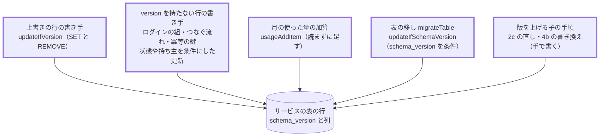
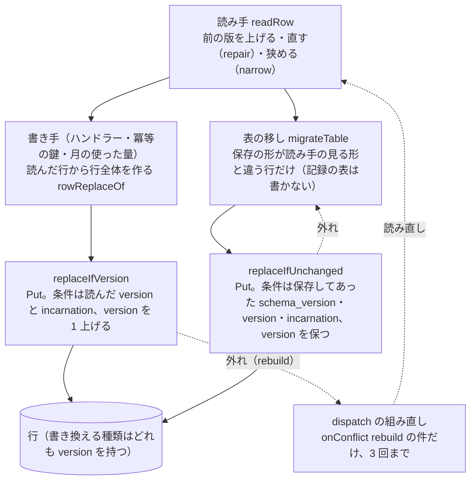

# 行の書き手: 表の移しと並んで書いても、行の形と中身が食い違わない（#2 #109）

行の版の書き手の決まりは、書き換えを列ごとの `SET` と `REMOVE` で組み、`version` を持たない行や読まずに足す行を例外の手順で扱っていたため、表の移しと並ぶたびに新しい食い違いが見つかり、PR #78 と PR #110 の cross-review が収束しなかった（[#109](https://github.com/devbasex/nd-factory/issues/109)）。書き換えはどれも読んだ行から作った行全体の置き換えにし、書き換える行の種類はどれも `version` を持たせ、表の移しは読み手が見る形と保存の形が違う行を書き直す 1 つの規則にする。行の直しと前の版へ戻す前の書き換えも手で書かず、行の版の読み手に足す関数として反映し、表の移しで書き直す。指摘ごとの採否は [決定の記録](#決定の記録) の後の [指摘ごとの決定](#指摘ごとの決定) に、採らなかった案は各決定に、外部の調査は付録にある。

## 今の姿

要求仕様は [issue-2-requirements.md](./issue-2-requirements.md) に、承認済みの設計は [issue-2-design.md](./issue-2-design.md) の決定 9 に、行の版の詳細は [詳細設計の表の移し](./issue-2-design-detail.md#表の移し) にある。この設計が扱う課題は #109 で、指摘の全文は課題の本文とコメントにある。変更の位置は次の図の太枠である。

- 行の版の読み手と書き手（[#79](https://github.com/devbasex/nd-factory/pull/79)、`packages/contracts/src/row-codec.ts`）は、行の種類ごとに読み手が受ける 2 つの版（`latest`・`previous`）と、書き手が出す版（`writeVersion`）を持つ。書き換えの `set` と `remove` は `rowUpdateOf` が読んだ行の列から作る
- 条件つきの書き込み（U3、`packages/core/src/conditional-write.ts`）は、上書きの行を `updateIfVersion`（読んだ `version` を条件に `SET`・`REMOVE` して `version` を 1 上げる）で、表の移しを `updateIfSchemaVersion`（`schema_version = from` を条件に `version` を上げずに書く）で組む。`updateIfSchemaVersion` は `set` の `schema_version` が `from` より大きいことを求める
- 表の移しは `version` を上げない。そのため、通常の書き換えが前の版の行を読んだ後に移しが先に確定しても、書き換えの `version` の条件は通る。書き換えの `remove` は読んだ前の版の行の列から作るため、移しが足した次の版の列（索引の鍵など）が消えずに残りうる（指摘 r3-1）
- `version` を持たないのに書き換える行の種類が 4 つある。ログインの組と IdP の主体の一意の行（ログインの付け替えで `cognito_sub` と `bound_auth_time` を書き換える）、ログインをつなぐ流れの行（`open → verified → used`）、冪等の鍵（借りから済みへ、借りの取り直し）である。答えの行も `claimed_generation` と `ndf_event_seqs` を空のときに 1 回だけ書き足す。これらの行と移しが並ぶと、`schema_version` の条件だけでは同じ版のうちの書き換えを見つけられない。今の設計はこれを「移しと前の版の書き手を同時に走らせない」運用の順で避けている（指摘 r3-2・r4-4・r5-5・r5-6・r5-8）
- 冪等の鍵の確定（`settleIdempotency`）と取り直し（`takeOver`）は、持ち主・状態・指紋を条件にした列の更新で、読んだ `schema_version` も `rowUpdateOf` も使わない（指摘 r4-1）
- 月の使った量の加算（`usageAddItem`）は、行を読まずに作成と加算を 1 つの更新の式で行い、`schema_version` を書き手の版にする。前の版の行に足すと、変換せずに新しい版の印だけを付ける（指摘 r4-2・r5-1〜r5-3・r6-1・r7-1）
- 版を上げる子の手順の 2c（拒んだ行の直し）と 4b（前の版へ戻す前の書き換え）は、運用者が手で書き換える手順で、使う書き込みと条件が決まっていない（指摘 r4-3・r4-4・r5-5〜r5-8）
- `writeAtomically` は 1 回の確定で、条件の外れを件の番号と扱いへ訳して返す。表が断った理由（`ValidationError` など）が並ぶときは、条件の外れより先に元の例外を投げる。組み直しは持たない（指摘 r5-4・r6-2 は、戻した直しが足した組み直しへの指摘である）
- 冪等の鍵は、中身の違う送り直しを借りの期限によらず 422 `idempotency_key_reused` にする（[API の文書の冪等の鍵](../docs/design/api.md#冪等の鍵) と `claimIdempotency` の実装が一致している）。PR #110 で戻した直しは、期限を過ぎた借りを中身によらず取り直す形に変えようとした（指摘 #110 の r3-2・r4-2・r4-3）

指摘をまとめて 1 本で扱うのは、どれも同じ部品の同じ欠け（行の書き手が、表の移しと並んで書くときに何を条件にし何を書くかの決まり）から出ているためである。

## 文脈と制約

- DynamoDB の `TransactWriteItems` の `Put` は条件式を持てて、行全体を渡した項目で置き換える。1 つのトランザクションは 100 件までで、同じ行を 2 回指せない。取り消しの理由は件の順に並び、外れていない件は `None` になる（外部の調査の S1）
- DynamoDB の楽観ロックの標準の形は、行に版の数を持たせ、読んだ版と同じときだけ書いて版を上げ、外れたら読み直してやり直すものである（外部の調査の S2）
- 版を上げる手順は「広げる → 移す → 縮める」の並行の変更（expand / contract）で、両方の版を読める間に書き手と既存の行を移し、誰も前の版を使わなくなってから前の版を捨てる（外部の調査の S3）
- 冪等の鍵の標準は、同じ鍵を中身の違う要求に使うと 422、1 回目が処理中なら 409 である（外部の調査の S4・P1）
- 今ある行はどれも版 1 で、運用する環境に表はまだ無い。行の形を変えても移す既存の行は無い
- 単位 PR に設計を変える直しを入れない決まり（709ae36）があり、この設計の承認の後に、書き手の直しと表の移しを実装の単位で作る
- この設計の範囲は #109 の受け入れ条件に限る。#94（同期に外へ働きかける操作の確定の順）・#106（`logins.delete` の同時の外し）・#111・#112（`return_existing` の再送）・#113（確定しなかった全部か無かの借り）・#119・#120 は入れない。境は [影響と危険](#影響と危険) に書く

## 解き方の全体像

- 行を書き換える書き込みは、どれも読んだ行を読み手（`readRow`）で今の形にし、書き換えた行全体を書き手の版で `Put` する。条件は読んだ行に保存してあった `version` と行の世代（`incarnation`。行を作るたびに新しくする値）だけで、書いた行は書き手の版の形をそのまま満たす。前の版の列も、移しが足した列も、書き手の行に無ければ残らない
- 書き換える行の種類は、どれも `version` と `incarnation` を持つ。`version` を持たないのは、作った後に書き換えない行（追記だけの行・作ると消すだけの行・期限で消える行）だけになる
- 表の移しは、読み手が見る形を書き手の版で書いた行が、保存してある行と違う行だけを書き直す。条件は保存してあった `schema_version`・`version`・`incarnation` で、`version` を上げないため、並んだ書き手を外さない。外れたら強い整合で読み直してやり直す。行の種類に当たらない行は拒んだ行に数える。追記だけの操作の記録の表は書き直さない
- 拒んだ行の直しと、前の版へ戻す前の書き換えは、行の版の読み手に足す関数（`repair`・`narrow`）として反映し、表の移しが書き直す。運用者が行を手で書き換える手順は無くなる
- 月の使った量の加算と利用者の行の `login_count` の足し引きは、読んで足した行全体を置き換える。並んだ書き込みに外れたときは、`dispatch` がそのハンドラーを呼び直して組み直す（`onConflict: "rebuild"`）。`writeAtomically` は組み直しを持たない
- 委任の最後に使った時刻は、委任の行と別の行に置く。使うたびの書き込みで委任の行の `version` を上げない

## 決定の記録

### 決定 1: 移しに先を越された書き換えが古い列を残さないよう、書き換えは読んだ行から作った行全体の置き換えにする

- 質問: 通常の書き換えが前の版の行を読んだ後に表の移しが確定すると、書き換えの `remove` に移しが足した列が載らない（r3-1）。書き換えをどう組めば、どちらが先に確定しても行が書き手の版の形を満たすか
- 選んだ案: 書き換えは、読んだ行を `readRow` で今の形にし、書き換えた行を `rowReplaceOf`（`rowUpdateOf` を置き換える）で書き手の版の行全体にし、`replaceIfVersion` で `Put` する。条件は読んだ行に保存してあった `version` と `incarnation`（決定 8。と操作ごとの `extra`）で、`version` を読み手の見る形の値から 1 上げる。`updateIfVersion` と `rowUpdateOf` の `set`・`remove` は無くす。行の列を一部だけ書き換える書き込みは作らない（例外を持たない。数の足し引きは決定 6 の組み直し、委任の最後に使った時刻は決定 10 の別の行で扱う）
- 採らなかった案:
  - 通常の書き換えにも読んだ `schema_version` を条件に足し、外れたら読み直して `set` と `remove` を組み直す（r3-1 の示した案）。移しが確定するたびに並んだ書き手が外れ、組み直しの回数と終わり（r5-4）・ほかの取り消しの理由との優先（r6-2）を決め続けることになる。読んだ行の列から `remove` を作る限り、行に何が残るかは読んだ時と書いた時の差に左右される
  - 表の移しでも `version` を上げ、書き手の `version` の条件で外す。人が画面で読んだ版を持って送る書き換えが、裏の移しのために 409 `version_mismatch` になる
- 代償: 書き換えの前に行を読む（今の書き手の決まりも読んだ `version` と行を使うため、増える読みは読まずに書いていた月の使った量の加算と冪等の鍵の確定だけ）。`Put` は行全体を送るため、書き込みの要求が大きくなる（DynamoDB の書き込みの費用は更新でも行全体の大きさで数えるため、費用は変わらない）
- 根拠: 書いた行が書き手の版の zod を通ることを書き込みの組み方だけで保証でき、移しとの順に左右される規則が消える。Value 17・Value 12（MVV バージョン 2）

### 決定 2: 同じ版のうちの書き換えを移しと書き手が見つけられるよう、書き換える行の種類はどれも `version` を持つ

- 質問: `version` を持たずに書き換える行（ログインの組・IdP の主体の一意の行・ログインをつなぐ流れの行・冪等の鍵・答え）は、`schema_version` の条件では同じ版のうちの書き換えを見つけられない（r3-2・r4-4・r5-5・r5-8）。どう見つけるか
- 選んだ案: 作った後に書き換える行の種類は、どれも上書きの行の基の形（`overwriteRow`）にし、`version` を持たせる。書き換えは決定 1 の `replaceIfVersion`、消すのは新しく足す `deleteIfVersion`（読んだ `version` を条件に消す）で行う。状態の遷移の条件（`state = open` など）は、ハンドラーが読んだ行で照らし、確定の条件は読んだ `version` にする（読んだ後に別の書き換えが確定すれば `version` が変わるため、状態と持ち主の条件は `version` の条件に含まれる）。`version` を持たないのは、作った後に書き換えない行（追記だけの行・作ると消すだけの行・期限で消える行）だけになり、その行を書き換えるのは表の移しだけになる
- 採らなかった案:
  - 行の種類ごとに「書き換えの印」の列（状態・持ち主）を決め、移しと直しの条件に足す。ログインの組と IdP の主体の一意の行は、付け替えで状態の列を変えずに `cognito_sub` と `bound_auth_time` を書き換えるため、印になる列が無い。種類ごとの印を書き手が守っているかを検査する手立ても要る
  - 行のすべての列の一致を条件にする。冪等の鍵の行の要素の結果は大きく、条件の式の上限を超えうる（今の設計が採らなかった理由と同じ）
  - 今の設計の運用の順（移しと前の版の書き手を同時に走らせない、4b でその行の種類の経路を止める）を保つ。経路を止める間、ログインをつなぐ・冪等の鍵の使う操作が止まり、順を外したときの誤りを書き込みが見つけない
- 代償: 5 つの行の種類（ログインの組・IdP の主体の一意の行・ログインをつなぐ流れの行・冪等の鍵・答え）の形に `version` の列が増える。運用する環境に行はまだ無いため、移す行は無い
- 根拠: どの書き換えも同じ 1 つの条件（読んだ `version`）で見つけられ、行の種類ごとの例外の手順が無くなる。Value 10・Value 17（MVV バージョン 2）

### 決定 3: 移しが書き手と並んでも取りこぼさないよう、移しは保存の形が読み手の見る形と違う行を書き直し、外れたら読み直す

- 質問: 表の移しは、どの行を書き直し、何を条件にし、条件が外れたらどうするか。今の決まりは `schema_version` が前の版の行だけを書き、外れたら飛ばすため、移しが読んだ後に直された行は前の版のまま `skipped` になり、`migrate_done` の `refused = 0` を満たしうる（r5-6）
- 選んだ案: `migrateTable` は行ごとに、読み手（`readRow`）が見る形を `rowReplaceOf` で書き手の版の行全体にし、保存してある行と列の中身まで比べる。同じなら書かない。違えば `replaceIfUnchanged`（`version` を保つ `Put`）で書く。条件に使う値と書く値は分ける。条件は保存してあった行の `schema_version`・`version`・`incarnation` の値そのもの（列が無ければ「無いこと」、行の形を外れた値でもその値との一致）で、書く行の `version` と `incarnation` は読み手が見る形（`repair` で直した値）にする。外れたら強い整合でその行を読み直し、消えていれば飛ばし、あればもう一度同じ手順を通す。1 行につき `MIGRATE_ROW_ATTEMPTS`（3 回）の書き込みで確定しなければ、理由の符号 `contended` で拒んだ行に数える。行の種類の `writeVersion` が `latest.version` でないとき（1 段目と、書き手を戻した状態）は、その種類の行を書かない。どの行の種類の `skPattern` にも当たらない行は、書かずに理由の符号 `row_kind_unknown` で拒んだ行に数える（飛ばした行を数えないと、実データを飛ばした走査でも `refused = 0` になる）。行の種類ごとに、`keyOf` が組む鍵が自分の `skPattern` に当たることをテストで縛る
- 採らなかった案:
  - 直しの前に移しと非同期の起こし直しを止め、走っている移しの終わりを待ってから直す手順を、取りこぼしを防ぐ仕組みとして使う（r5-6 の示した案）。決定 4 で直しは手で書かず移しが書くため、手で書く直しと移しが並ぶ場面は無い。並んだ書き手との外れは読み直しで取りこぼさない。ただし、直す前のコードの移しが直した値を上書きしないよう、直しのコードを反映する前に 3a と同じに移しを止めて待つ（PR #122 の r1-4、決定 4）。これは取りこぼしでなく、古いコードの書き込みを排出するための止めである
  - 外れた行を飛ばしたままにし、`skipped` も 0 になるまで全走査を繰り返す。書き手が多い表では `skipped` が 0 にならず、終わりを決められない
  - 条件にも書く値にも、読み手が見る形（`repair` の後）の `version` を使う。`repair` が欠けた `version` を補った行や誤った `version` を直した行では、条件が保存の値と合わずに外れ続け、直せない
- 代償: 行ごとに書き手の行全体を作って比べる計算が増える（行の数に比例する。書かない行の書き込みの費用は掛からない）。通常の書き手も同じに条件を保存してあった値にする（決定 8）ため、`repair` で `version` や `incarnation` を直した行も、移しが書き直す前から書き換えられる
- 根拠: 「書き直すか」を版の数でなく読み手が見る形との違いで決めるため、版上げ・直し・狭めを 1 つの手順で扱え、`refused = 0` の全走査が「どの行も読み手の見る形で保存されている」ことを表す。Value 13・Value 14（MVV バージョン 2）

### 決定 4: 拒んだ行の直しと前の版へ戻す前の書き換えをレビューとテストに通すため、手で書かずに読み手の関数として反映し、移しで書き直す

- 質問: 版を上げる子の手順の 2c（移しが拒んだ行の直し）と 4b（`downgradable: false` の後に前の版へ戻すための書き換え）は、どの書き込みで、何を条件に書くか（r4-3・r4-4・r5-5・r5-7・r5-8）
- 選んだ案: 行を手で書き換える手順を無くす。直しは次のどちらかの反映で出し、反映の後に移しを最初から起こし直す
  - 前の版の決まりとして正しい値を `previous.schema`・`upgrade`・`downgrade` が表せないときは、それらを直す
  - 値そのものが誤った行（前の書き手の誤りで形を外れた値）は、`rowCodec` に足す `repair`（保存の形を通らない行を、通る行へ直す関数）で直す。`readRow` は行がその版の形を通らないときだけ `repair` を通し、直した行を読む
  - 4b は、`rowCodec` に足す `narrow`（次の版だけの値を前の版で表せる値へ狭める関数）を、その値を作る機能を止める反映と一緒に `downgradable: true` のまま出す。`readRow` は今の形にした後に `narrow` を通す。読み手がどれも狭めた値を見るため、書き手も狭めた値から書き、移しが狭めた行へ書き直す。`narrow` は `writeVersion` が前の版の組でも許す（4c の後に 3b で `writeVersion` だけを戻すため）
  - `repair` と `narrow` の反映（2c と 4a）の前に、3a と同じに移しの Lambda を止めて走っている移しの終わりを待つ。移しの置き換えは `version` を保つため、直す前のコードの移しが読んだ行の変換の結果は、直した後の移しの置き換えと同じ条件を通り、直した値を上書きしうるためである。反映で止めを解き、移しは反映の後に最初から起こす
  - 理由の符号ごとの直しの表は [詳細設計の版を上げる子の手順](./issue-2-design-detail.md#版を上げる子の手順) に置く（`row_invalid` と `downgrade_invalid` を含む）
- 採らなかった案:
  - 2c で前の版の形のまま直す書き換えと、検証した次の版へ直に書く書き換えを、`updateIfSchemaVersion` に状態の条件の引数を足して運用者が書く（r4-3・r5-5・r5-8 の示した案）。手で書く値はレビューとテストを通らず、条件の付け忘れを書き込みが見つけない。決定 2 で状態の条件は `version` に含まれ、引数が要らない
  - 4b で `version` を持たない行の経路を止めてから書き換える（今の設計と r4-4 の示した案の一方）。決定 2 で `version` を持たない書き換えが無くなり、止める経路が無い
- 代償: `rowCodec` の引数が 2 つ増える（`repair` と `narrow`、どちらも省ける）。直しのたびにコードの反映が要る（レビューとテストを通すための費用で、直す値の誤りを減らす）。元の値は 2a のバックアップに残る
- 根拠: どの行の書き込みも、反映したコードの読み手と書き手と移しだけが行う。Value 14・Value 13（MVV バージョン 2）

### 決定 5: 月の使った量の加算が版の違う行でも誤らないよう、読んで足した行全体を置き換える

- 質問: 月の使った量の加算は、行の作成と並んだ加算の原子性を保ちつつ、前の版の行・次の版の行・ほかの版の書き手が書いた行へどう足すか（r4-2・r5-1・r5-2・r5-3・r6-1・r7-1）
- 選んだ案: 加算は読んで足す形にする。ハンドラーは月の使った量の行を強い整合で読み（無ければ無い）、`readRow` で今の形にし、通貨が違えば今のとおり要素の 409 `state_mismatch` を返し、同じなら `used_amount_minor` に費用を足した行全体を `usageAddItem` で組む。行が無ければ `putIfAbsent`、あれば `replaceIfVersion` で、どちらも `onConflict: "rebuild"` を付ける。並んだ加算に外れたら、決定 6 の組み直しで読み直して足し直す。費用の記録の行は今のとおり `putIfAbsent` で同じトランザクションに入れ、同じ区間の 2 回目は足さない。行の鍵は `COST#<時刻>#<区間の ID>` で、時刻は区間の終わりの事象の時刻（ランナーが区間ごとに 1 回決めて送り、送り直しでも変えない。[詳細設計の費用の記録の鍵の時刻](./issue-2-design-detail.md#決めた書き方)）にする。ハンドラーは要求を受けた時刻や組み直しの時刻をこの鍵に使わない（使うと同じ区間の送り直しと組み直しが別の行として通り、月の使った量に 2 回足す）。使える量の判定は、組んだ行の加算の後の値で行う（確定した値と同じ）
- 採らなかった案:
  - 読まずに足す更新を保ち、条件を「行が無い、または書き手の版で通貨が同じ」にし、外れたら読んで変換してから足す（戻した直しの案）。作成の式に載せる列と除く列（r5-2）、版ごとの列の名前と単位（r5-3）、両版の書き手が並ぶ間の版の往復（r6-1）、金額に従う列の古さ（r7-1）を、どれも加算の式の側で決め続けることになる
- 代償: 加算の前に強い整合の読みが 1 回増える。同じチームのレーンが同時に費用を書くと外れて組み直す（区間ごとの書き込みで、外れは並んだ加算が確定したときだけ起こる）
- 根拠: 加算した行も読み手と書き手を通るため、版の違い・列の名前・従う列は行の版の読み手と書き手だけが扱う。Value 13・Value 17（MVV バージョン 2）

### 決定 6: 組み直しの終わりと誤りの優先を 1 か所で決めるため、組み直しは `writeAtomically` に置かず、`dispatch` が `rebuild` の件だけを 3 回まで行う

- 質問: 条件が外れた件の組み直しをどこで行い、いつ終え、ほかの取り消しの理由とどちらを先にするか（r5-4・r6-2）
- 選んだ案: `writeAtomically` は今のとおり 1 回の確定で、表が断った理由（`ValidationError` など）があれば元の例外を投げ、無くて条件の外れがあれば `{ ok: false; failed }` を返す。`ConflictRule` に `rebuild`（外れたら読み直して組み直す）を足す。`dispatch` は、確定が `ok: false` で、外れた件がどれも `rebuild` の件（要求元の照らし・記録の行・冪等の鍵の済みの行が外れていない）のときだけ、その件を返したハンドラーを、借りた冪等の鍵をそのままに呼び直し（ハンドラーは行を読み直す）、組み直したトランザクションを確定し直す。1 つのトランザクションの組み直しは `DISPATCH_REBUILD_LIMIT`（3 回）までで、各回の前に残り時間を照らす。使い切ったら要求全体の 503 `unavailable` にする（呼び手は同じ冪等の鍵で送り直せる）。`rebuild` を付けるのは、サーバーが読んだ行から作る書き換え（月の使った量の加算と、利用者の行の `login_count` の足し引き）だけで、利用者が読んだ版を持って送る書き換えは今のとおり 409 `version_mismatch` にする
  - `logins.delete` と `logins.create` の利用者の行は、読んだ利用者の行の `login_count` を足し引きした行全体を `replaceIfVersion`（`onConflict: "rebuild"`）で書く。別のタブの呼び名の変更や、別のログインを外す並んだ要求に外れたら、`dispatch` がハンドラーを呼び直す。ハンドラーは行を読み直し、「最後のログイン」の判別（`login_count` が 2 未満なら書き込みを返さずに最後のログインの 409）を読み直した `login_count` で行う。`logins.delete` の呼び直しでは Cognito の利用者が先の呼び出しで消えているため、`AdminGetUser` が利用者を返さず、サインアウトと消しを打たずに確定へ進む（[データの文書のログインを外す](../docs/design/data.md#cognito-の主体の対応の行) の手順のとおり）。組み直しを使い切った 503 は、確定のトランザクションが外れたときと同じく、Cognito の利用者が消えてログインが残り、付け替えで戻る
- 採らなかった案:
  - `writeAtomically` が外れた件を位置ごとに組み直す（戻した直しの案）。組み直しに要る読みと変換を条件つきの書き込みの部品が持つことになり、件ごとの枠と全体の上限（r5-4）・取り消しの理由の優先（r6-2）をその部品の中で決め続けることになる
  - 件ごとに組み直しの枠を持つ（r5-4 の示した案）。決定 1 で移しは書き手を外さないため、移しが行を順に移すことで外れが続く場面が無い。外れは並んだ書き手の確定のときだけで、要求ごとの上限で足りる
- 代償: `dispatch` の確定の後に分岐が 1 つ増える
- 根拠: 取り消しの理由の分類は `writeAtomically` だけが持ち、組み直しの判断は要素とハンドラーを知る `dispatch` だけが持つ。Value 11・Value 12（MVV バージョン 2）

### 決定 7: 冪等の鍵の取り直しと確定を移しと並んでも誤らせないよう、読んだ・書いた `version` を条件に行全体を置き換え、中身の違う送り直しは借りの状態によらず 422 のままにする

- 質問: 冪等の鍵の借りの取り直し・確定・手放しを、行の版の書き手の決まりにどう載せるか（r4-1）。期限を過ぎた借りを中身の違う要求で取り直してよいか（#110 の r3-2・r4-2・r4-3）
- 選んだ案:
  - 冪等の鍵の行は決定 2 で `version` を持つ。`claimIdempotency` は借りの行を `putIfAbsent`（`version` 1）で書き、`fresh` のときに書いた行を返す。行があれば強い整合で読み、`readRow` で今の形にして照らす。取り直し（24 時間を過ぎた行・借りの期限を過ぎた同じ中身の行）は、新しい借りの行全体を `replaceIfVersion`（読んだ `version` が条件）で書き、書いた行を返す
  - `settleIdempotency` は、`claimIdempotency` が返した借りの行から、状態を済みにし要素の結果を足した行全体を `replaceIfVersion`（借りの行の `version` と `incarnation` が条件。決定 8）で組む。持ち主・状態・指紋の条件は、取り直されれば `version` が変わるため `version` の条件に含まれる
  - 全部か無かで確定しなかったときの手放しは、借りの行の `version` と `incarnation` を条件にした `deleteIfVersion` で消す。確定も同じ 2 つを条件にする（手放した後や表の期限で消えた後に、別の要求が同じ鍵で `version` 1 の借りを作り直しても、`incarnation` が違うため前の借りの確定と手放しが新しい借りを書き換えない）
  - 中身の違う送り直しは、借りの状態と期限によらず 422 `idempotency_key_reused` にする。今の API の文書と実装のとおりで、詳細設計にも、指紋の照らしを借りの期限の照らしより先に行うことを書く
- 採らなかった案:
  - 期限を過ぎた未確定の借りを、中身によらず取り直す（#110 で戻した直しの案）。外へ働きかけ始めた借りを別の中身で上書きしうる（#110 の r4-3）。働きかけ始めたかを行に持たせて分ける案は、同期に外へ働きかける操作の確定の順（#94）を決める前に行の形を決めることになる
- 代償: 後始末が時間内に終わらずに残った借りへ、直した中身を同じ鍵で送ると、24 時間 422 になる（呼び手は新しい鍵を作る）。これをどう和らげるかは #113 が扱う
- 根拠: 鍵は 1 つの中身に結ぶ（外部の調査の S4・P1）。行の書き換えは決定 1・2 と同じ規則で、冪等の鍵だけの例外を持たない。Value 4・Value 17（MVV バージョン 2）

### 決定 8: 消して同じ鍵で作り直した行を取り違えないよう、書き換える行は行の世代 `incarnation` を持ち、書き換え・消し・移しの条件にする

- 質問: `schema_version` と `version` は、行を消して同じ鍵で作り直すと最初の値に戻る。冪等の鍵（手放しと表の期限で消えた後に同じ鍵で借り直す）・ログインの組と IdP の主体の一意の行（外して結び直す）では、移しや前の借りの確定が読んだ後に行が作り直されると、条件が通って新しい行を古い中身で上書きしうる（PR #122 の r1-2）。どう見分けるか
- 選んだ案: 記録の表を除くどの行も、`version` の有無によらず `incarnation`（行を作るときに書き手が作る UUID v4。置き換えと移しで変えない）を持つ。`putIfAbsent` が新しい値を入れ、`replaceIfVersion` と `deleteIfVersion` は読んだ行の `version` と `incarnation` を条件にし、`replaceIfUnchanged` は保存してあった `incarnation` も条件にする。`version` を持たない行（作った後に書き換えない行）も、同じ鍵で作り直されうる。たとえばセッションの取り消しの行（`REVOKED#<origin_jti>`）は、取り消しから `SESSION_REVOKED_KEEP_MS`（31 日）で表の期限に消える。一方、`sessions.delete` は `exp` から `SESSION_DELETE_EXPIRED_GRACE_MS`（30 日）まで後発の access token を受けるため、消えた後に同じ鍵で作り直されうる。鍵の形や期限の長さの組で作り直しを防ぐ前提に頼らず、移しの条件の `incarnation` で、前の行を読んだ移しが作り直した行を外す
  - 条件に使う値と書く値を、通常の書き手でも移し（決定 3）と同じに分ける。`readRow` は読み手が見る形の行と一緒に、保存してあった `schema_version`・`version`・`incarnation` の値そのもの（列が無ければ「無いこと」）を返す。`replaceIfVersion` と `deleteIfVersion` の条件は保存してあった値にする。`replaceIfVersion` が書く `version` は読み手の見る形の値に 1 足した値、`incarnation` は読み手の見る形の値にする。`repair` が欠けた `incarnation` を鍵から決まる値で補った行は、条件が「`incarnation` が無いこと」になり、移しが済む前でも通常の書き換えと消し（委任の取り消しを含む）が通る。作り直した行は `putIfAbsent` が入れた `incarnation` を必ず持つため、この条件に外れ、前の行を読んだ書き手は作り直した行を書き換えない。並んだ 2 つの書き手がどちらも補った値を読んだときは、先に確定した側が `incarnation` を書くため、後の側が外れる
  - `replaceIfVersion` と `deleteIfVersion` は、`replaceIfUnchanged` と同じに `attribute_exists(pk)` を必ず条件に入れる。`version` と `incarnation` の両方を補った行では 2 つの列の条件がどちらも「無いこと」になり、読んだ後に行が消えると、鍵に何も無くても条件が通って、`Put` が読んだ古い中身で行を作り直すためである
  - `incarnation`（と、書き換える行の種類に新しく足す `version`）を必須の列にする U3b は、その前の書き手が保存した行（利用者の行など）を読めるよう、同じ単位で旧形式の補い（`repairIdentity`。列が無いときだけ `incarnation` を鍵から決まる値で、`version` を 1 で補う `repair`）をその行の種類に持たせる。補いが無いと、U3b の反映から移しの U5b2 までの間、旧形式の行が `readRow` の形の検査に外れ、その行の読み取りと更新が止まる。新しく作る行は `putIfAbsent` が、置き換える行は `replaceIfVersion` が `incarnation` を保存するため、旧形式の行は書き換えられるたびに減り、残りは U5b2 の移しが書き直す
- 採らなかった案:
  - `version` を作り直しで 1 に戻さず、消すときに墓の行を残して続きの値から作る。消した行が残り続け、表の期限で消える冪等の鍵では墓も消える
  - 移しの条件に行のすべての列の一致を足す。冪等の鍵の行の要素の結果は大きく、条件の式の上限を超えうる（決定 2 と同じ）
  - `version` を持たない行は同じ鍵で作り直さない鍵の形にし、セッションの取り消しの行は `SESSION_REVOKED_KEEP_MS` を受付の期限（refresh token の寿命と access token の寿命と `SESSION_DELETE_EXPIRED_GRACE_MS` の和）より長くする。行の種類を足すたびに、鍵の形と期限の長さの組が作り直しを防いでいるかを確かめ続けることになり、書き込みはその誤りを見つけない
  - 補った値を持つ行を、通常の書き手を有効にする前に移しで書き直し終える。移しが拒んだ行や `contended` の行は書き直されないまま残り、その行の書き換え（漏れた委任の取り消しを含む）が直すまで止まる
- 代償: 記録の表を除くどの行にも列が 1 つ増える。`repair` が `incarnation` を補うときは、同じ行で読むたびに同じ値になるよう鍵から決まる値にする。`readRow` の戻り値に保存してあった値が増える
- 根拠: 条件が「読んだ時と同じ行の、同じ版」を表し、作り直しの間の長さによらず取り違えない。Value 13・Value 17（MVV バージョン 2）

### 決定 9: 操作の記録の追記だけの約束を崩さないよう、表の移しは記録の表の行を書き直さない

- 質問: 表の移しは行を `Put` で置き換えるが、`writeAtomically` は記録の表（`db-audit`）への追記でない書き込みを `AuditAppendOnlyError` で拒み、移しの走査が途中で止まる（PR #122 の r1-1）。記録の行の版上げと直しを移しの対象にするか
- 選んだ案: 対象にしない。`migrateTable` は記録の表を走査しても書かず、保存の形が読み手の見る形と違う行は理由の符号 `append_only` で拒んだ行に数える。記録の行の種類の版上げは、手順の 4（`downgradable: false`）と次の版上げの手順の 1 へ進む前に、前の版の行が表の期限（`AUDIT_RETENTION_DAYS`）で消え、保存の `schema_version` の数えで 0 になるのを待つ。手順の 4 へ進む条件は、移しの拒みのうち `append_only` のほかが 0 で、この数えを通ることである（`append_only` には、`repair` で読み手にだけ直す今の版の記録の行も、保存の値を変えないため残り続ける）。記録の行の直しは `repair` で読み手にだけ効かせ、保存の値は変えない（元の値を記録として残す）
  - 手順の 4 の後に記録の行の種類の書き手を前の版へ戻すとき（4a から 4c）は、読み手の互換で戻す。`narrow` は記録の行の保存の値を変えないため、次の版だけで表せる値を持つ行は `append_only` のまま残る。4c では、記録の表の `append_only` を `refused` の判定から除く（ほかの符号が 0 なら 3 へ進む）。代わりに、その行の種類の `rowCodec` の `latest`（次の版）と `narrow` を、表の期限で次の版の行が消え、下の版ごとの数え（詳細設計の手順の 5）で次の版の行が 0 になるまで外さない（3b の後は移しがその行の種類を飛ばすため、次の版の記録の行が残っていても `append_only` は 0 になる。`append_only` の数では決めない）。前の版の書き手に戻した後も、読み手は次の版の行を読めて狭めた値を見る。次の版の形を外すのは、版を下げる反映か次の版上げの手順の 1 だけである
  - 行の種類のある版の読み手を外してよいか（前の版の行と、戻した後の次の版の行が残っていないか）は、`append_only` の数で決めない。`append_only` は書き手の版の行と保存の行の比べの結果で、`narrow` を通しても値の変わらない次の版の行を数えず、3b の後は移しがその行の種類を飛ばすためである。代わりに、書かない数え（`countRowVersions`。読みだけの権限の `census` の Lambda）で、その版を書く書き手を無くした後に、保存してある `schema_version` ごとに行を数え、その版の行が 0 であることを確かめてから外す（[詳細設計の版を上げる子の手順](./issue-2-design-detail.md#版を上げる子の手順) の 5）。記録の表に限らず、どの表の行の種類の読み手を外すときも同じ確かめを通す
- 採らなかった案:
  - 記録の行の種類では手順の 4 の後に書き手を前の版へ戻さない（戻せなくなる制約として書く）。記録の形を変えた反映の障害が `AUDIT_RETENTION_DAYS` 日の間直せなくなり、その間は誤った書き手で記録が書かれ続ける
  - 移しだけが使う記録の表への置き換えの経路を足す。通常の書き手の追記だけの検査を保っても、記録の行を書き換える権限と経路が残り、記録が後から変わらないこと（I9）を権限と部品の両方で守れなくなる
- 代償: 記録の行の形を変える版上げは、`AUDIT_RETENTION_DAYS` 日より早く次の段へ進めない。戻した後も、記録の行の種類の次の版の形と `narrow` を同じ日数だけ残す。記録の行の形は `dispatch` だけが作るため、形を変える頻度は低い
- 根拠: 記録は書いた時の値のまま残す。Value 9・Value 13（MVV バージョン 2）

### 決定 10: 委任を使うたびに取り消しが外れないよう、委任の最後に使った時刻を別の行に置く

- 質問: `authenticate` は委任の最後に使った時刻を「今の値が 1 時間より前」を条件にした列の更新で書く（PR #122 の r1-8・r1-13）。決定 1 で列の一部だけの書き換えを作らないため、委任の行全体を `replaceIfVersion` で置き換えると、使うたびに委任の行の `version` が上がり、一覧で読んだ版を持って送る `delegations.revoke` が、使われている委任ほど 409 `version_mismatch` になる。漏れた token の取り消しが通りにくい
- 選んだ案: 最後に使った時刻を、委任の行（`DELEGATION#<委任>`）と別の行「委任の使った時刻」（`db-users` / `USER#<利用者>` / `DELEGATION_USED#<委任>`。`delegation_id`・`user_id`・`last_used_at`・`version`・`incarnation`）に置き、委任の行から `last_used_at` を外す。`authenticate` は委任の行と同じ読みでこの行も強い整合で読む（2 つの読みは並べてよい）
  - 時刻の行の作成と置き換えは、委任の認証に成功した後だけ行う。成功は、読んだ委任の行で秘密の部分の SHA-256 が一致し、期限の内で、取り消されておらず、委任の範囲のプロジェクトと委任した人が今見られるプロジェクト（認可と同じ `ScopeReader` の `seatsOf` と `projectsOfTeams` から、認可と同じ式で求める）が重なることである（席を 1 つでも持つかだけでは照らさない。範囲のチームの席を失い別のチームの席だけを残す人の委任は認可が拒むため、時刻を進めない）。どれかに外れた要求では、時刻の行を読んでいても書かない（認証に失敗した要求で、利用者が取り消しの判断に使う時刻を進めない）
  - 成功したら、行が無ければ `putIfAbsent`、`last_used_at` が `DELEGATION_TOUCH_MS` より前なら読んだ行に保存してあった `version` と `incarnation` を条件に行全体を `replaceIfVersion` で置き換える。どちらも、読んだ委任の行に保存してあった `version` と `incarnation` の一致を照らす件（書かない条件の照らし）と一緒に `writeAtomically` で確定する。認証の読みの後に `delegations.revoke` が確定すると委任の行の `version` が上がるため、取り消しと並んだ `authenticate` は時刻の行を作り直さず、書き換えない。外れても操作は続け、`warn` を出す
  - 時刻の行は委任の行と同じ長さだけ残す。委任の行は取り消しと期限切れの後も `revoked_at` と `expires_at` を持って残り（表の期限を持たない）、`delegations.list` が取り消し・期限切れの委任も示すため、時刻の行も表の期限を持たず消さない。委任の行を消す書き込み（今は無い。利用者の削除などで足すとき）は、同じ `writeAtomically` で時刻の行も `deleteIfVersion` で消す。時刻の行は、委任の行が無い間には作られず残らない
  - `delegations.list` は 2 つの行を合わせて返す
- 採らなかった案:
  - 委任の行全体を使うたびに置き換える。上の取り消しの 409 が起きる
  - `version` を上げず版を条件にしない列の更新を、決定 1 の例外として残す。移しと並ぶと、移しが前に読んだ時刻で置き換えて時刻を戻し、列の名前を変える版上げでは前の版の列だけを書き足し、移しとの順の議論がまた要る
- 代償: 委任の主体の要求ごとに強い整合の読みが 1 回増える（委任の行と並べて読む）。行の種類が 1 つ増える
- 根拠: 取り消しの通りやすさを使う頻度に左右させない（漏れた token の害を抑える）。どの書き込みも決定 1 の規則のままで例外を持たない。Value 9・Value 17（MVV バージョン 2）

## 指摘ごとの決定

| 指摘 | 決定 | 扱う決定 | 理由 |
| --- | --- | --- | --- |
| r3-1（移しの後に通常の更新が新版の列を残す） | 採る（示した案と違う形で） | 決定 1 | 書き換えを行全体の置き換えにし、移しの後でも古い列が残らないようにする。`schema_version` の条件と組み直しは採らない（移しのたびに書き手が外れる） |
| r3-2（つなぐ流れの同じ版の遷移が `updateIfSchemaVersion` で止まる） | 採る | 決定 1・2 | つなぐ流れの行に `version` を持たせ、同じ版の遷移を `replaceIfVersion` で書く。遷移元の状態はハンドラーが読んだ行で照らし、確定の条件は読んだ `version` |
| r4-1（`settle_once` の経路が読んだ版を条件にしない） | 採る | 決定 7 | 取り直しと確定を、読んだ・書いた `version` を条件にした行全体の置き換えにする |
| r4-2（月の使った量の加算が旧版に足して新版の印を付ける） | 採る | 決定 5 | 読んで足した行全体を置き換え、行が無い月は `putIfAbsent`、外れは組み直し |
| r4-3（2c の直しが同じ版への書き換えを拒まれ、2d が再検査しない） | 採る（示した 2 案のどちらでもない形で） | 決定 3・4 | 直しは読み手の関数か形の直しとして反映し、移しが書き直す。移しは読み手の見る形と違う行を書くため、直した行も次の全走査で書く |
| r4-4（4b がつなぐ流れの行の遷移を書き戻しうる） | 採る | 決定 2・4 | つなぐ流れの行も `version` を持ち、4b は `narrow` と移しで行う。移しは読んだ `version` を条件にし、外れたら読み直す |
| r5-1（加算 (a) が条件外れの後に新版になった行で失敗する） | 採る（前提を無くす形で） | 決定 5・6 | 読まずに足す (a) と (b) の分けを無くす。外れたら読み直して足し直す |
| r5-2（加算 (a) の初期化の列に `pk`・`sk` などが入る） | 採らない | 決定 5 | 列を一部だけ初期化する更新を作らない。行を作るのは `writeRow` を通した行全体の `putIfAbsent` |
| r5-3（加算式の列名と単位が版で変わると誤る） | 採る（変換する形で） | 決定 5 | 加算は今の形（`latest`）の行に行い、書き手の版への変換は `writeRow` が行う。加算の式は列の名前を持たない |
| r5-4（`writeAtomically` の再送を全体 2 回で打ち切る） | 採らない（前提を無くす） | 決定 1・6 | `writeAtomically` は組み直しを持たない。組み直しは `dispatch` が `rebuild` の件だけ 3 回まで行い、移しは書き手を外さないため、移しによる外れの連続は起きない |
| r5-5（2c の状態の条件を渡す口が無い） | 採らない（前提を無くす） | 決定 2・4 | 状態の条件は `version` の条件に含まれ、2c は手で書かない |
| r5-6（2c の修復と移しが並ぶと前の版のまま `refused = 0` になる） | 採る（示した順でなく移しの規則で） | 決定 3 | 移しは外れたら読み直してやり直し、直しの後の全走査は読み手の見る形と違う行をすべて書く。取りこぼしを防ぐための止めは要らない（直しのコードの反映の前の止めは、古いコードの移しを排出するために #122 r1-4 で足した） |
| r5-7（2c に `row_invalid` と `downgrade_invalid` の処置が無い） | 採る | 決定 4 | 理由の符号ごとの直しの表に、2 つの符号と `contended`・`version_unsupported` を足す |
| r5-8（`updateIfSchemaVersion` に状態の条件が無い） | 採らない（前提を無くす） | 決定 2・4 | r5-5 と同じ |
| r6-1（両版の Lambda が重なる間に加算が版を往復して失敗する） | 採る | 決定 5 | 条件は `version` だけで、行がどちらの版で書かれても足せる。重なる間の加算をテストに足す |
| r6-2（組み直しと `ValidationError` の優先が無い） | 採る | 決定 6 | 取り消しの分類は `writeAtomically` の今の優先（断った理由が先）のままで、組み直しは `ok: false` のときだけ |
| r7-1（金額と `version` だけの更新で従う列が古いまま） | 採る | 決定 5 | 行全体を `writeRow` で作るため、金額に従う列も同じ書き込みで作り直す。異なる版の書き手が足した後の往復をテストする |
| #110 r3-2（後始末の間に合わない借りが 24 時間 422） | 採らない（#113 へ） | 決定 7 | 行の版の書き手の決まりでなく、確定しなかった借りの扱いの課題で、#113 が同じ事象を扱う。この設計は中身の違いを 422 にする今の契約を変えない |
| #110 r4-2（API と詳細設計の 422 の条件を揃える） | 採る | 決定 7 | API の文書のとおり、借りの状態と期限によらず中身の違いは 422。詳細設計にも照らしの順を書く |
| #110 r4-3（外へ働きかけ始めた借りを別の中身で取り直す） | 採らない（#94 へ） | 決定 7 | 中身の違う取り直しを許さないため、この設計の下では起きない。働きかけ始めた借りを同じ中身で再開するときの扱いは #94 が扱う |
| #122 r1-1（移しが記録の表へ `Put` して止まる） | 採る（対象にしない形で） | 決定 9 | 記録の表は書き直さず `append_only` で数える。移し専用の書き込みの経路は作らない |
| #122 r1-2（作り直した行を `schema_version` と `version` で見分けられない） | 採る | 決定 8 | 行の世代 `incarnation` を書き換え・消し・移し・冪等の鍵の確定と手放しの条件に足す |
| #122 r1-3（`repair` で直した `version` を移しが書き戻せない） | 採る | 決定 3 | 条件は保存してあった値、書く値は読み手の見る形の値に分ける |
| #122 r1-4（直す前のコードの移しが直した値を上書きする） | 採る（排出する形で） | 決定 4 | 2c と 4a の反映の前に 3a と同じに移しを止めて待つ |
| #122 r1-5（3b で `narrow` が残り `rowCodec` が起動で投げる） | 採る | 決定 4 | `narrow` を `writeVersion` が前の版の組でも許し、4a から 3b への戻しをテストする |
| #122 r1-6（行の種類に当たらない行を数えず `refused = 0` になる） | 採る | 決定 3 | `row_kind_unknown` で拒んだ行に数え、`keyOf` と `skPattern` の一致をテストで縛る |
| #122 r1-7・r1-12（`login_count` の引き算が版の条件で外れ、最後のログインと取り違える） | 採る（組み直しの形で） | 決定 6 | `replaceIfVersion` に `rebuild` を付け、読み直した `login_count` で最後のログインを判別する |
| #122 r1-8・r1-13（委任の最後に使った時刻の更新が規則に無い） | 採る（別の行の形で） | 決定 10 | 委任の使った時刻の行を分け、`replaceIfVersion` で書く。委任の行の `version` を上げない |
| #122 r1-9（U3b が後の U5b2 の `rowReplaceOf` を使う） | 採る | — | `rowReplaceOf` の導入と今の呼び手の切り替えを U3b に移す（[既にマージした実装への影響と直す単位](#既にマージした実装への影響と直す単位)） |
| #122 r1-10（費用の記録の鍵の時刻が送り直しで変わりうる） | 採る | 決定 5 | 鍵の時刻を区間の終わりの事象の時刻に限り、受けた時刻と組み直しの時刻を使わない |
| #122 r1-14（知らせの行が `updateIfVersion` を指す） | 採る | 決定 1 | `replaceIfVersion` で行全体を組む書き方に直す |
| #122 r2-1（セッションの取り消しの行が期限で消えた後に同じ鍵で作り直され、前の行を読んだ移しが上書きする） | 採る（行の世代の形で） | 決定 8 | 記録の表を除くどの行にも `incarnation` を持たせ、移しの条件にする。鍵の形と期限の長さの組には頼らない |
| #122 r2-2（`repair` で補った `incarnation` が保存行に無く、通常の書き換えと消しが外れ続ける） | 採る（条件の付け方で） | 決定 3・8 | 通常の書き手も、条件は保存してあった値（無ければ無いこと）、書く値は読み手の見る形の値にする |
| #122 r2-3（記録の行の種類を手順の 4 の後に戻すと `append_only` で `refused = 0` を満たせない） | 採る（読み手の互換で戻す形で） | 決定 9 | 4c で記録の表の `append_only` を判定から除き、次の版の形と `narrow` を表の期限で 0 になるまで残す |
| #122 r2-4（認証に失敗した要求でも使った時刻が進みうる） | 採る | 決定 10 | 時刻の行の作成と置き換えは、秘密・期限・取り消し・席の照らしを通した後だけ行う |
| #122 r2-5（使った時刻の行を消す手順が無く、取り消しと並ぶと作り直される） | 採る（委任の行と同じ寿命の形で） | 決定 10 | 委任の行は取り消しと期限切れの後も残るため、時刻の行も表の期限を持たず同じ長さ残す。書き込みに委任の行の `version` と `incarnation` の照らしを入れ、取り消しの後に作り直さない。委任の行を消す書き込みを足すときは同じトランザクションで消す |
| #122 r3-1（`append_only` が 0 でも読み手を外すと、比べで同じになる次の版の行や 3b の後に飛ばす行が読めなくなる） | 採る | 決定 9 | 読み手を外す条件を、書かない数え（`countRowVersions`）で保存の `schema_version` ごとに対象の版の行が 0 であることにする。どの表の行の種類でも同じ確かめを通す |
| #122 r3-2（両列を補った行が消えた後に `replaceIfVersion` が古い中身で作り直す） | 採る | 決定 8 | `replaceIfVersion` と `deleteIfVersion` に `attribute_exists(pk)` を必ず入れ、消えた行のテストを足す |
| #122 r3-3（U3b で必須にした `incarnation` を補う `repair` が後の U5b2 にある） | 採る | 決定 8 | `repair` と旧形式の補い `repairIdentity` を U3b に移し、新規作成と置き換えで `incarnation` を保存するところまで U3b に含める |
| #122 r4-1（戻した後の次の版の形を外す条件が `append_only` の 0 のまま残る） | 採る | 決定 9 | 次の版の `latest` と `narrow` を外す条件を、版ごとの数えで次の版の行が 0 になることにする |
| #122 r4-2（記録の表では `repair` で直る今の版の行が `append_only` に残り、`refused = 0` を満たせず再走査を繰り返す） | 採る | 決定 9 | 手順の 4 へ進む条件を、記録の表では `append_only` のほかの拒みが 0 で、版ごとの数えで前の版の行が 0 であることにする。移しの完了のログに理由の符号ごとの数を載せる |
| #122 r4-3（数えの完了に走査の識別が無く、5a より前に始めた走査の 0 件を採りうる） | 採る | 決定 9 | 数えの起動ごとに `census_id` を持たせ、最初の起動の `started_at` と一緒に続きの起動と完了のログへ引き継ぐ。5b は起こした `census_id` で 5a の後に始めた走査の完了だけを採る |

## 影響と危険

- 働く範囲: このリポジトリのサービスの表の書き手と表の移しだけ。利用先のリポジトリと NDF の契約には働かない。設定と引数で受ける値は増えない
- 当たるモード: `standard`（#2 のスプリント）

### 既にマージした実装への影響と直す単位

| 実装 | 直す中身 | 直す単位 |
| --- | --- | --- |
| #79 の `row-codec.ts`（`rowUpdateOf`） | `rowUpdateOf` を `rowReplaceOf`（行全体を返す）に置き換え、今の呼び手（テスト）を切り替える | 新しく足す単位 U3b（行の書き手の直し。U3b の書き手が `replaceIfVersion` へ `rowReplaceOf` の戻り値を渡すため、U3b の中で先に入れる） |
| #79 の `row-codec.ts`（`rowCodec`・`readRow` の `repair` と `stored`） | `rowCodec` に `repair` を足し、`readRow` と `rowReplaceOf` がそれを通す。`readRow` は保存してあった `schema_version`・`version`・`incarnation` の値も返す。旧形式の補い `repairIdentity` を足す（U3b の書き手が条件に `stored` を使い、U3b の行の形が旧形式の行を `repairIdentity` で読むため、どれも U3b で入れる） | U3b |
| #79 の `row-codec.ts`（`rowCodec`・`readRow` の `narrow`） | `rowCodec` に `narrow` を足し、`readRow` がそれを通す | U5b2（使うのは表の移しと版を上げる子の手順だけ） |
| 版の数え（新設） | 書かない数え `countRowVersions` と、表の読みだけの権限の `census` の Lambda | U5b2（版を上げる子の手順の 5 で使う） |
| U3 の `conditional-write.ts`（`updateIfSchemaVersion`） | `replaceIfUnchanged` に置き換える | U5b2 |
| U3 の `conditional-write.ts`（`putIfAbsent`・`updateIfVersion`・`ConflictRule`） | `putIfAbsent` が `incarnation` を入れ、`updateIfVersion` を `replaceIfVersion`（条件は保存してあった `version` と `incarnation`）に置き換え、`deleteIfVersion` と `ConflictRule` の `rebuild` を足す。`writeAtomically` は変えない | U3b |
| U5a の行の形（ログインの組・IdP の主体の一意の行・ログインをつなぐ流れの行・冪等の鍵・答え・`version` を持つ行の全部・委任・記録の表を除く `version` を持たない行） | 書き換える行は基の形を `overwriteRow` にし、`version` と `incarnation` を持たせる。`version` を持たない行には `incarnation` を持たせる。列を足した行の種類のどれにも `repairIdentity` を持たせ、U3b より前の書き手が保存した行を読めるようにする。新しく作る行（`putIfAbsent`）と置き換える行（`replaceIfVersion`）は `incarnation` を保存する。委任の行から `last_used_at` を外し、委任の使った時刻の行を足す。生成物を作り直す | U3b |
| U3 の `idempotency.ts` | `claimIdempotency` が借りの行を返し、取り直しと `settleIdempotency` を `replaceIfVersion` で組む | U3b |
| U3 の `usage-limit.ts`（`usageAddItem`） | 読んだ行を受けて足した行全体を組む署名にする | U3b |
| U4 の `auth/authenticate.ts`（`touchDelegation`） | 委任の使った時刻の行を読み、委任の認証に成功した後だけ、委任の行の照らしと一緒に `putIfAbsent` か `replaceIfVersion` で書く | U3b |
| #110 の `dispatch` | `settleIdempotency` に借りの行を渡し、手放しを `deleteIfVersion` にし、`rebuild` の組み直しを足す | U3b |
| #118 の `api-fn`・`user-store` | 変えない（`ensureUser` は `putIfAbsent` と `writeAtomically` だけを使う） | — |

U3b は U5b2 の前に作る。U5b2 のテスト（移しと書き手が並ぶ場面）が `replaceIfVersion` と `rowReplaceOf` を使うためである。U3b は U5b2 に依らずに作れる（`rowReplaceOf`・`repair`・`repairIdentity` を U3b が入れ、`narrow` と版の数えは U5b2 が足す）。U3b を反映した時点で、旧形式の行は `repairIdentity` で読め、通常の書き換えで `incarnation` を持つ行へ置き換わる（U5b2 の移しを待たずに読み取りと更新が通る）。U3b は書き手の部品とその呼び手だけを直し、ハンドラーは作らない。実装計画（[issue-2-plan.md](./issue-2-plan.md)）へ U3b を足すのは、この設計の承認の後の計画の工程で行う。

### 範囲の外との境

| 課題 | 境 |
| --- | --- |
| #78（認証の行の形と読み手） | 認証の行の列とその意味は変えない。共通の列の `version`（書き換える行の決まり、決定 2）と `incarnation`（決定 8）を足し、委任の最後に使った時刻を別の行へ移す（決定 10。委任は人の認証の行でなく、`authenticate` の委任の照らしの書き込みだけを変える） |
| #94（同期に外へ働きかける操作） | 外へ働きかけ始めた借りの再開と、確定の順は扱わない。この設計は中身の違う取り直しを許さないことだけを決める |
| #106（`logins.delete` の同時の外し） | 外しの手順と Cognito の呼び出しの順は扱わない。外すときの行の消しは `deleteIfVersion` で読んだ `version` を条件にする |
| #111・#112（同じ対象の鍵・`return_existing` の再送） | `return_existing` の扱いは変えない。`rebuild` は別の扱いとして足す |
| #113（確定しなかった全部か無かの借り） | 借りの手放しの書き込みの形（`deleteIfVersion`）だけを決める。間に合わなかった借りの扱いは扱わない |
| #119（確定時の条件の外れを 401 にする） | 外れた件の結果への訳し方は、`rebuild` の分岐を足すほかは変えない |
| #120（API の起点の依存の形） | 触らない |

### 壊れうる箇所と扱い

- 書き換えの前の読みを忘れた書き手は、行全体を作れないため `replaceIfVersion` を組めない（型と事前条件で落ちる）
- `Put` は書き手の行に無い列を消す。書き手が `readRow` を通さずに行を作ると、列を落としうる。`rowReplaceOf` が `writeRow` を通して書き手の版の zod で照らし、鍵の違いを投げる
- `repair` と `narrow` は読み手の値を変える。テストで、直す行と直さない行を両方通す（[テスト設計](#テスト設計)）
- 書きかけの文書: 無し。同じファイルを触る別の変更: 詳細設計の行の版の節は #2 の他の単位も読むため、この PR のマージの後に U3b と U5b2 が読む

### このリポジトリだけの事情

- 無し（この設計はサービスの表の書き手の部品の決まりで、ブランチの運用やリリースの形に依らない）

## 用語

| 語 | 意味 | 反映 |
| --- | --- | --- |
| 行の置き換え | 読んだ行から作った行全体を、条件つきの `Put` で書く書き換え | 追加（設計文書の中だけで使い、用語集へは足さない。部品の名前の説明のため） |
| 組み直し | 条件が外れた書き込みを、ハンドラーが行を読み直して組み、確定し直すこと | 追加（同上） |
| 委任の使った時刻の行 | 委任の最後に使った時刻を持つ、委任の行と別の行。委任の認証に成功した後だけ書き、委任の行と同じ長さ残る | 追加（同上。データの文書の `db-users` の行にも書く） |

## テスト設計

| 縛る振る舞い | 落ちるべき壊し方 |
| --- | --- |
| 移しが先に確定した前の版の行を書き手が `replaceIfVersion` で書くと、移しが足した列（索引の鍵）も、書き手の行に無ければ残らない | 書き手が読んだ行の列から `remove` を作る実装に戻す |
| ログインをつなぐ流れの `open → verified → used` が同じ版のまま確定し、読んだ後に別の遷移が確定していれば外れる | `version` を上げない・`version` の条件を落とす |
| 移しは読み手の見る形と同じ行を書かず、違う行だけを書く。外れたら読み直し、3 回で確定しなければ `contended` で拒む | 外れた行を飛ばしたままにする・同じ行を毎回書く |
| `repair` を足した前の版の誤った行が、読み手で直した形で読め、移しの後に保存の形も直る。直さない行はそのまま | `repair` を形を通る行にも当てる |
| `narrow` を足すと、読み手と書き手と移しの後の行がどれも前の版で表せる | 書き手が `narrow` を通さずに書く |
| 月の使った量の加算が、前の版の行・次の版の行・行の無い月のどれにも足せ、2 段目の重なる間に前の版と次の版の書き手が交互に足しても失敗せず、足した後の行が `upgrade(downgrade(行))` で戻る | 加算を読まずに足す式に戻す・金額に従う列を作り直さない |
| `dispatch` は `rebuild` の件だけが外れたときにハンドラーを呼び直し、3 回で 503 にする。`ValidationError` と条件の外れが並ぶと組み直さずに元の例外になる | 断った理由より先に組み直す・`version_mismatch` の件も組み直す |
| 冪等の鍵の確定は、取り直された後に外れ、移しの後には通る。中身の違う送り直しは借りの期限の後も 422 | 持ち主の条件だけで確定する・期限の後に中身の違いで取り直す |
| 手放した借りを別の要求が同じ鍵で `version` 1 から借り直すと、前の借りの確定・手放しと、前の行を読んだ移しが外れる | `incarnation` を条件から落とす |
| 移しは `repair` で `version` を補った行（列が無い）と直した行（形を外れた値）を、保存の値を条件にして直した値で書く | 条件に直した値を使う・書く値に保存の値を使う |
| 移しは記録の表を書かず `append_only` で数え、走査を最後まで続ける。どの行の種類にも当たらない行は `row_kind_unknown` で数える。どの行の種類も `keyOf` の鍵が自分の `skPattern` に当たる（主体に改行や `#` を含む値でも） | 記録の表へ `Put` する・当たらない行を数えずに飛ばす |
| 4a の `rowCodec`（`narrow` あり）から `writeVersion` だけを前の版へ戻した組が読み込みで投げず、読み手は狭めた値を見る | `narrow` に `writeVersion` が次の版であることを求める |
| `logins.delete` は、呼び名の変更で利用者の行の版が進んだ後でも組み直して確定し、別々のログインを外す並んだ 2 つの要求の後の方は読み直した `login_count` で最後のログインの 409 になる | 利用者の行の外れを組み直さずに最後のログインの 409 にする・読んだ版を条件にしない |
| 委任を使っても委任の行の `version` は変わらず、使った時刻の行が 1 時間ごとに書き換わる | 委任の行を置き換える・列の更新で書く |
| 秘密の部分が違う・期限を過ぎた・取り消した委任の token の要求では、時刻の行が作られず書き換わらない（時刻の行が無い場合も古い場合も） | 時刻の行の有無と古さだけで書く・認証の照らしの前に書く |
| 認証の読みの後に `delegations.revoke` が確定すると、並んだ `authenticate` の時刻の行の作成と置き換えが外れ、取り消しの後に時刻の行が作り直されない。取り消した委任の行と時刻の行はどちらも残り、委任の行の無い時刻の行は無い | 委任の行の照らしを落とす・時刻の行に表の期限を付ける |
| `repair` が `incarnation` を補った行（保存の行に列が無い）を、移しの前に通常の `replaceIfVersion` と `deleteIfVersion` で書き換え・消せる。同じ鍵で作り直した行（`incarnation` あり）は、前の行を読んだ書き手から書き換わらない | 条件に補った値を使う・「無いこと」の条件を落とす |
| セッションの取り消しの行を移しが読んだ後に、表の期限で消えて同じ鍵で作り直されると、移しの置き換えが `incarnation` の違いで外れ、前の `revoked_at` と `expire_at` で上書きしない | `version` を持たない行の条件から `incarnation` を落とす |
| 記録の行の種類を手順の 4 の後に 4a から 4c で戻すと、`append_only` が残っても 3 へ進め、戻した後も読み手が次の版の記録の行を狭めた値で読む | `append_only` を `refused` の判定に入れる・戻すときに次の版の形を外す |
| 版の数えは、`narrow` で値の変わらない次の版の記録の行と、3b の後の行の種類の次の版の行を、保存の `schema_version` のとおりに数え、書き込みを 1 件もしない | 数えを移しの比べや `writeVersion` で絞る・`append_only` の数で代える |
| `repair` が `version` と `incarnation` の両方を補った行を読んだ後に行が消えると、`replaceIfVersion` は外れて行を作らず、`deleteIfVersion` も外れる | `attribute_exists(pk)` を `expect` が `value` のときだけ入れる |
| U3b の後、`incarnation`（と新しく足した `version`）の無い U3b より前の行が `readRow` で読め、通常の書き換えの後は `incarnation` を保存した行になる。新しく作る行は `incarnation` を持つ | 旧形式の補いを U5b2 まで入れない・置き換えで `incarnation` を書かない |

細かい観点は [詳細設計の表の移し](./issue-2-design-detail.md#表の移し) の単体テストの観点 にある。

## どこを変えるか

詳細設計は別ファイル [issue-2-design-detail.md](./issue-2-design-detail.md) の「表の移し」と「横断の部品」の節にある（新設する関数が 2 つ以上あり、既存の関数のシグネチャを変えるため）。

| 文書 | 変える所 |
| --- | --- |
| `issues/issue-2-design-detail.md` | 表の移しの関数の仕様・版を上げる子の手順・並行と排他・単体テストの観点。横断の部品の `updateIfVersion` の行。サービスの表の月の使った量と冪等の鍵の行 |
| `docs/design/detail.md` | `claimIdempotency`・`settleIdempotency`・`updateIfVersion`・`usageAddItem` の仕様と並行の表と単体テストの観点。委任の最後に使った時刻の書き方（認証に成功した後だけ・委任の行の照らしと一緒に） |
| `docs/design/data.md` | 共通の列の `version` と `incarnation` を持つ行の決まり（`incarnation` は記録の表を除くどの行にも持たせる）。`logins.create` と `logins.delete` の利用者の行の書き方。委任の使った時刻の行の寿命（委任の行と同じ長さ残し、取り消しの後に作り直さない） |

## 設計の結果

- 触るファイル（この PR）: `issues/issue-2-design-row-writers.md`（新設）・`issues/issue-2-design-detail.md`・`docs/design/detail.md`・`docs/design/data.md`
- 触るファイル（実装の単位）: U3b は `packages/contracts/src/row-codec.ts`（`rowReplaceOf`・`repair`・`repairIdentity`・`readRow` の `stored`）・`packages/core/src/conditional-write.ts`・`idempotency.ts`・`usage-limit.ts`・`auth/authenticate.ts`・`dispatch/dispatch.ts`・`dispatch/types.ts`・`packages/contracts/src/rows/` の行の形とそのテスト。U5b2 は `packages/contracts/src/row-codec.ts`（`narrow`）・`apps/api/src/entries/migrate.ts`・`apps/api/src/entries/census.ts`・`infra/lib/app-stack.ts`（`migrate` と `census` の Lambda）・`packages/core/src/conditional-write.ts`（`replaceIfUnchanged`）とそのテスト
- 増える仕組み: `ConflictRule` の `rebuild` と `dispatch` の組み直し（決定 5 の加算と決定 6 の `login_count` に要る）、`rowCodec` の `repair` と `narrow`（決定 4 の直しに要る）、`deleteIfVersion`（決定 2 の消しに要る）、行の世代 `incarnation`（決定 8）、委任の使った時刻の行（決定 10）
- 減る仕組み: `updateIfVersion` の `set`・`remove`、`updateIfSchemaVersion`、`rowUpdateOf` の `remove`、`version` を持たない書き換えの運用の順、2c と 4b の手で書く書き換え、加算の読まずに足す式、委任の最後に使った時刻の列の更新

## 未確認のまま残ること

- 同じチームのレーンが同時に費用を書く頻度の実測は無い。組み直しの上限 3 回で足りない頻度なら、503 の数として運用で見える（`dispatch` の組み直しの使い切りを `warn` で出す）

## 外部の調査

### 標準・仕様

| ID | 対象 | 中身 | 出典 |
| --- | --- | --- | --- |
| S1 | DynamoDB `TransactWriteItems` | `Put` は条件式を持ち、項目を置き換える。100 件まで・同じ行を 2 回指せない。取り消しの理由は件の順で、外れていない件は `None` | https://docs.aws.amazon.com/amazondynamodb/latest/APIReference/API_TransactWriteItems.html（2026-11-22 取得） |
| S2 | DynamoDB の版の数による楽観ロック | 行に版の数を持たせ、読んだ版と同じときだけ書き、書くたびに上げる。外れたら読み直してやり直す。トランザクションの `Put` でも同じ | https://docs.aws.amazon.com/amazondynamodb/latest/developerguide/DynamoDBMapper.OptimisticLocking.html（2026-11-22 取得） |
| S3 | 並行の変更（expand / contract） | 両方の版を受ける形に広げ、使い手を移し、使われなくなってから前の版を縮める | https://martinfowler.com/bliki/ParallelChange.html（2026-11-22 取得） |
| S4 | IETF の Idempotency-Key ヘッダーの草案（-09） | 同じ鍵を中身の違う要求に使うと 422、1 回目が処理中なら 409 | https://datatracker.ietf.org/doc/html/draft-ietf-httpapi-idempotency-key-header（2026-11-22 取得） |

### 主要な製品

| ID | 対象 | 中身 | 出典 |
| --- | --- | --- | --- |
| P1 | Stripe の冪等の要求 | 鍵は 24 時間以上で消せる。来た引数を 1 回目と比べ、違えば誤りにする。検証に落ちた・並んだ要求と衝突したときは結果を残さず、送り直せる | https://docs.stripe.com/api/idempotent_requests（2026-11-22 取得） |

### ライブラリとサービス

| ID | 対象 | 比べた結果 |
| --- | --- | --- |
| L1 | AWS SDK for Java の `DynamoDBMapper`（`@DynamoDBVersionAttribute`） | 版の数の楽観ロックと `Put` の置き換えを持つが、Java の部品でこのリポジトリ（TypeScript）では使えない。形（読んだ版を条件に置き換えて上げる）だけを採る（S2） |
| L2 | `@aws-sdk/lib-dynamodb`（使っている） | 条件式つきの `Put` をそのまま送れる。`replaceIfVersion` と `replaceIfUnchanged` は今の `createDb` の `put` の写しで送れ、新しい依存は要らない |

### 確かめられなかったこと

- 無し
