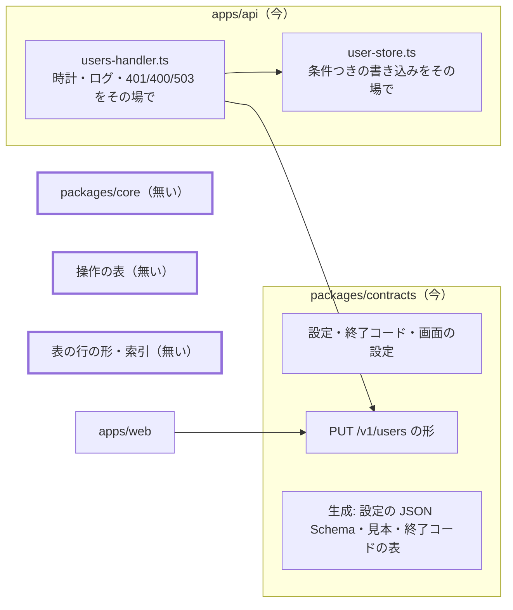
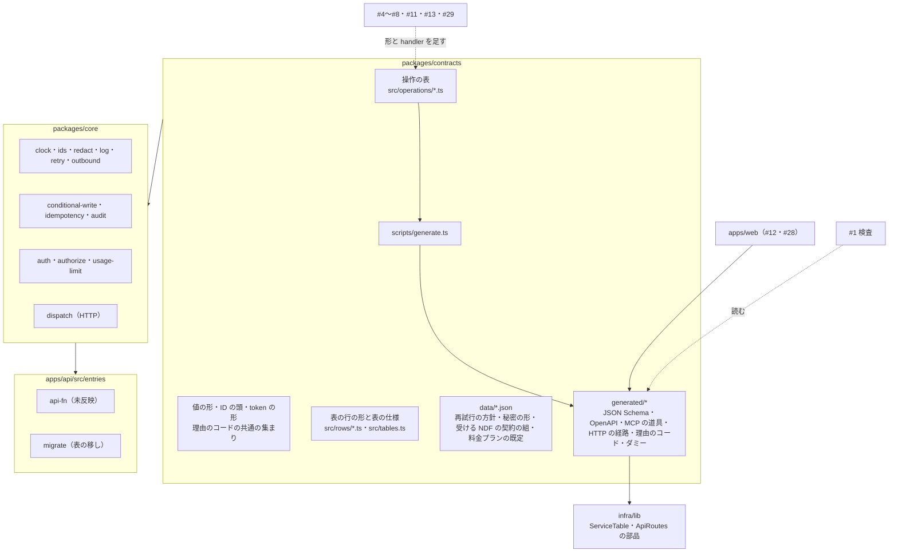
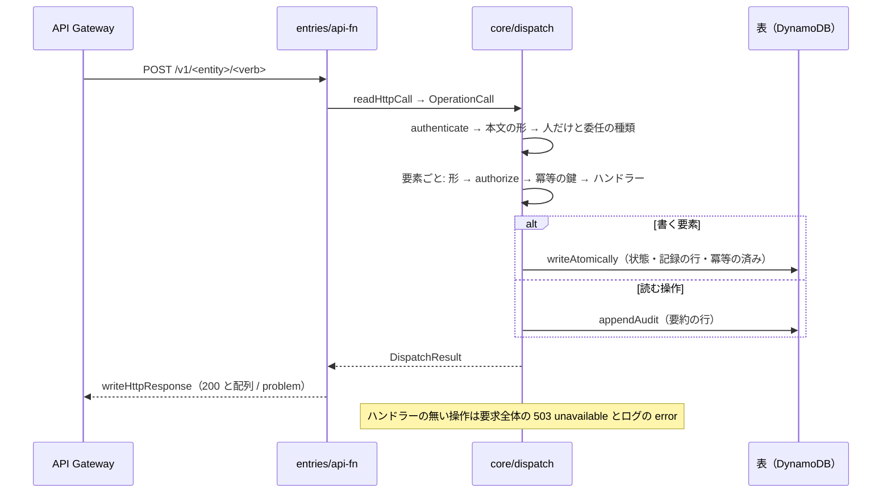
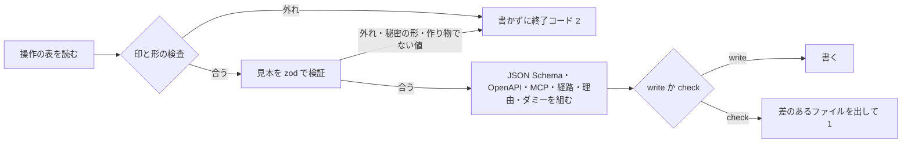

# 形の正本と横断の部品: 1 つの操作の表から型・API・MCP の道具・ダミーデータを作り、どの入口の要求も同じ判定と記録を通る（#2）

各コンテキストの子と画面の子が、操作の定義を書く枠・認可の判定・操作の記録の書き手・表の列を持たず、同じ処理と列を子ごとに書きかねない（[要求仕様](./issue-2-requirements.md)）。全体の設計の操作の一覧の全行を印つきで 1 つの操作の表に登録し、そこから JSON Schema・OpenAPI・MCP の道具の定義・HTTP の経路の登録・ダミーデータを生成する。横断の部品は `packages/core/` の 1 か所に置き、サービスの表の 19 の行と 3 つの索引の列を決め、MCP の受け口の関数は #11 へ渡す（決定 7）。比べた案は各決定に、ライブラリの比べは「外部の調査」に、ファイルと関数の粒度は [詳細設計](./issue-2-design-detail.md) にある。

## 今の姿

要求仕様は [issue-2-requirements.md](./issue-2-requirements.md) にある。変更の位置は次の図の太枠である。

- 形の正本は、骨組みの 1 本の HTTP の経路の形（`src/users-api.ts`）と設定の形だけを持つ。生成のスクリプト（`scripts/generate.ts`）は 3 つの生成物を書き、`write`・`check` の 2 つの打ち方を持つ
- 骨組みの API の関数は、依存の注入（`now`）・1 行の JSON のログ・`attribute_not_exists(pk)` の書き込み・条件の外れの見分け・本文の検査の順を自分の中に持つ。これらは [開発の計画の横断の部品が引き継ぐもの](../docs/design-process/issue-24/plan.md#横断の部品が引き継ぐもの) が引き継ぎ先を決めている
- 横断の部品の関数の仕様・異常系・並行と排他は全体の詳細設計（[detail.md](../docs/design/detail.md)）が決めている。この課題はファイルの単位・型の項目の並び・操作の表の形・生成物の置き場・ダミーデータの作り方・表の列を決める

## 文脈と制約

- 全体の設計で決めた次のものは決め直さない
  - 呼び出しの規約と値の形（[API の文書](../docs/design/api.md#呼び出しの規約)）
  - 操作の一覧の名前と印
  - 横断の部品の最上位の関数のシグネチャと異常系（[detail.md](../docs/design/detail.md)）。例外は MVV 版 2 の Value 15 に照らして直した 4 つの作り方で、全体の設計（api.md の決定 48・55・detail.md の関数の表と再利用の表）をこの Pull Request で直した（決定 17）
  - 表と鍵と共通の列（[データの文書](../docs/design/data.md#表と鍵)）
  - 依存の向き
- 操作ごとの要素の項目・型・理由のコードは受け持つ子が書く（[api.md の決定 56](../docs/design/api.md#決定-56-要素の形と理由のコードを-2-か所に持たないため形の正本の操作の定義だけに置き全体の設計には決まりと受け持つ子を書く)）。この課題は枠と印を持ち、形を代わりに決めない
- NDF との契約は #41 の設計（PR #42、決定 104〜108。承認されマージ済み）を正とする
- 並行する #1（検査）と #13（インフラ）と、触るファイルを分ける。#1 とは「形の往復」の検査で、#13 とは `packages/contracts/` と `infra/lib/` で重なりうる
- 1 子 1 スプリント（plan.md の決まり）。CI は AWS の資格情報を持たない

## 解き方の全体像

- 操作の表は全体の設計の操作の一覧の全行（利用者向けの 66 の操作と、ランナー・手元のマシン・DB の用意のタスクの 9 の HTTP の経路）を印つきで持つ。要素の形がまだ無い操作は「形の未定」の印と受け持つ子の番号を持ち、受け持つ子が形と見本とハンドラーを足す
- `npm run generate` が操作の表から生成物を `packages/contracts/generated/` へ書き、`check` が古い生成物を落とす。画面（#12・#28）・検査（#1）・CDK の部品は生成物か操作の表を読む。画面（React 19）は形の正本の呼び出しの口と `z.infer` の型で操作を呼び、ダミーの送り手で生成したダミーデータを読む
- 横断の部品は `packages/core/` の 1 か所にあり、`apps/` の実行の時のコードは部品を通してだけ時計・ID・ログ・外部の呼び出し・条件つきの書き込みを使う。骨組みの `PUT /v1/users` も部品を通す形に置き換わる
- サービスの表の 19 の行と 3 つの索引の列が行の形（zod）と表の仕様にあり、表を書く子は `ServiceTable` の部品で表と索引を作る。表の移しの読み手は今と 1 つ前の版を読む

## ドメインモデル

### コンテキスト

この課題は業務のコンテキストを持たず、すべてのコンテキストが使う共有の核（形の正本と横断の部品）を作る。

| コンテキスト | この課題との関係 |
| --- | --- |
| 共有の核（形の正本・横断の部品） | この課題が持つ。業務の規則を持たず、呼び出しの規約・値の形・判定と記録の順を持つ |
| 利用者とチーム・プロジェクト・実行・人の判断と知らせ・委任・使える量 | 操作の形・ハンドラー・`ScopeReader` の中身を足す（#4〜#8・#11・#29） |

### 集約

この課題は集約を足さない。サービスの表の 19 の行の列は、全体の設計の集約（[データの ER 図](../docs/design/data.md#er-図)）の属性を列へ下ろしたもので、集約の境界と持ち主は変えない。

### 不変条件

| # | この課題での守り方 |
| --- | --- |
| I2（判定の部品） | `authorize` が見えない要素を存在しないときと同じ 404 `not_found` で返し、見えない要素の役割を照らさない |
| I9 | `dispatch` が状態の書き込みと記録の行と冪等の鍵の済みの行を 1 つの `writeAtomically` で確定し、記録を書けなければ 503 で値を返さない。記録の行は `auditItem` が許した鍵だけを写し、`redact` を通す |
| I12 | `readHttpCall` が配列でない本文を 400 `body_not_array` で断る。操作の表の生成が、要素と結果を配列でない形にした操作を落とす |
| I15 | 値の形（`utcDateTime`・`money`）だけで日時と金額を受ける。時刻帯の無い日時・通貨の無い金額は検証で落ちる |

### ドメインイベント

要求仕様の E1〜E5 をそのまま引き継ぐ。足すイベントは無い。

## 構成要素

| 構成要素 | 置き場 | 変えること |
| --- | --- | --- |
| 形の正本 | `packages/contracts/` | 操作の表の枠と全行の印・値の形・表の行の形と表の仕様・データのファイル・生成の足し・画面とテストが操作を呼ぶ口（決定 16） |
| 横断の部品 | `packages/core/`（新設） | detail.md の 13 のモジュールのうち、`dispatch` の MCP の 5 つの関数を除くすべて |
| API の起点 | `apps/api/src/entries/`（新設） | `api-fn`（HTTP の振り分け）と `migrate`（表の移し）の起点。反映は #4 と、最初に形の版を上げる子 |
| 骨組みの API の関数 | `apps/api/src/users-handler.ts`・`user-store.ts` | 時計・ログ・クライアントの生成・条件つきの書き込み・失敗の分類を横断の部品へ移す。振る舞いは変えない |
| CDK の部品 | `infra/lib/service-table.ts`・`infra/lib/api-routes.ts`（新設） | 表の仕様から表と索引を、HTTP の経路の登録から経路を作る部品。アプリのスタックには入れない |

## 入出力のコントラクト

### 操作の定義

操作の定義の項目は [api.md の形の正本のクラス図](../docs/design/api.md#形の正本) の項目に、印を 4 つ足したものである。足した印は、全体の設計が操作の一覧の表に既に書いている値を、生成と検査が読める形にしただけである。

| 項目 | 型 | 出所 |
| --- | --- | --- |
| `name`・`entity`・`verb` | 文字列（`<entity>.<verb>`） | 操作の一覧の名前 |
| `endpoint` | `user`・`runner`・`machine`・`db_prep` | 足した印。受け口（detail.md の `authenticate` の受け口と同じ集まり） |
| `features` | `F1`〜`F20` の配列（F21〜F23 は操作を持たない） | 足した印。操作の一覧の「機能」の列。I14 の機能の対応の検査（F1〜F20 のどれもが操作の表にあるか。#1）が読む |
| `access` | `read`・`write` | 「読む / 書く」の列 |
| `humanOnly` | `always`・`per_item`・`never` | 「人だけか」の列 |
| `mcpRead` | 操作の名前か `null` | 足した印。「MCP の道具か」の「依頼と材料の読み出しだけ」の括弧の操作 |
| `delegationKind` | `read`・`run`・`manage`・`null` | 「読む / 書く」の括弧 |
| `ownerOnly` | 真偽 | [席の役割ごとの操作](../docs/design/api.md#席の役割ごとの操作) |
| `allOrNothing` | `{ maxItems }` か `null` | 「全部か無か」の 2 つの操作 |
| `idempotencyKey` | 真偽 | [冪等の鍵](../docs/design/api.md#冪等の鍵) |
| `item`・`result` | zod か「形の未定」 | 受け持つ子。未定の間は `pendingShape("#<番号>")` |
| `reasons` | 理由のコードと HTTP の状態の組（`{code, status}`）の配列 | 受け持つ子が足す操作ごとのコード。共通の集まりは書かずに生成が足す |
| `auditKeys` | 要素の鍵の名前の配列 | 受け持つ子。未定の間は空 |
| `order` | 並びの説明（`list` だけ） | 受け持つ子 |
| `examples` | `{ normal, edge, empty }`（結果の要素の配列と、空の場面の結果 1 件） | 受け持つ子（決定 3） |
| `description_en` | 文字列 | 受け持つ子。未定の間は名前から作る 1 文 |
| `owner` | `#<番号>` | 足した印。操作の一覧の受け持つ子の表 |

### 生成物

置き場は決定 2 のとおり `packages/contracts/generated/` で、どれも JSON である（OpenAPI も JSON で出す）。形の細部は詳細設計にある。

| ファイル | 中身 | 読み手 |
| --- | --- | --- |
| `operations.schema.json` | 操作ごとの要素と結果の JSON Schema（draft 2020-12、`$defs` の名前は `<操作>.item`・`<操作>.result`） | 往復のテスト・MCP の道具の形 |
| `openapi.json` | OpenAPI 3.1（`/v1/<entity>/<verb>` の `POST` だけ。要求と応答は配列） | 連携するシステム |
| `mcp-tools.json` | 人だけでない操作の道具の定義（名前・入力 `{"items": [...]}`・出力の形・注記） | #11 の `createMcpHandler`・#1 の対応の検査 |
| `routes.json` | 操作ごとの `POST` の経路・受け口・操作の名前 | `ApiRoutes` の部品・#1 の対応の検査 |
| `reasons.json` | 操作ごとの理由のコードの一覧と、共通の集まり | 画面の翻訳のファイルの鍵の検査（#12） |
| `dummy/<操作>.json` | `normal`・`empty`（要素 1 個への空の結果）・`edge`・`failures`（理由のコードごとの失敗の要素）。送り手が要素ごとに 1 件を選ぶ元 | 画面のダミーのクライアント（#12・#28） |
| `pending.json` | 形の未定の操作と受け持つ子 | 計画と #48 |

型は生成しない。操作の表から `z.infer` で型を出し（`ItemOf<"sprints.create">` など）、画面と API は同じ型を import する。

### 表の行の形と索引

19 の行の列・3 つの索引の鍵と写す列・表の仕様は詳細設計の「サービスの表」にある。索引は次の 3 つである。

| 索引 | 表 | 鍵（区切り / 並び） | 疎か |
| --- | --- | --- | --- |
| `user-seats` | `db-teams` | `user_id` / `team_id`（席の行の列をそのまま鍵にする） | `user_id` の列を持つ席の行だけ |
| `team-projects` | `db-projects` | `current_team_id` / `project_id` | `current_team_id` のあるプロジェクトの行だけ（閉じると列が無くなり外れる） |
| `waiting` | `db-decisions` | `project_id` / `waiting_since` | `waiting_since` のある依頼と問いの行だけ（答えるか取り消すと列を消す） |

## 処理の流れ

### HTTP の要求

順は [detail.md の処理の手順](../docs/design/detail.md#処理の手順) のとおりで、この課題は変えない。形の未定の操作とハンドラーの無い操作だけを足す。

### 骨組みの関数と CDK の部品

- 骨組みの `PUT /v1/users` は今の関数（`users-handler.ts`）のまま受け、中で `createClock`・`createLogger`・`awsClient`・`createDb`・`putIfAbsent`・`writeAtomically` を通す。上の振り分けの図は通らない（決定 11）
- CDK の部品は要求を受けない。合成のときに `ServiceTable` が `tables.ts` を、`ApiRoutes` が `generated/routes.json` を読み、表と経路を作る（決定 8）

### 生成

## 非機能の実現方式

| 大項目 | 実現方式 |
| --- | --- |
| 性能・拡張性 | detail.md の `DISPATCH_RESERVE_MS`（1500 ミリ秒）と要素ごとの確定を守る。索引の読みは結果整合で、一覧と待ちの数だけに使う（確定の前の照らしは表の本体を強い整合で読む） |
| 運用・保守性 | 形を変えるのは操作の定義 1 か所で、`npm run generate` が生成物をそろえ、CI の `check` が差を落とす |
| セキュリティ | 秘密の形は `data/secret-shapes.json` の 1 か所にあり、`redact` と漏れの検査（#1）が同じものを読む。生成のスクリプトは見本に秘密の形の値があれば書かない |
| システム環境 | 生成と往復のテストは Node 24 だけで動き、AWS に触れない。表と経路の部品は合成の出力のテストで確かめる |

## 決定の記録

### 決定 1: 子が同じ枠に操作を足せるよう、操作の表を全行の印つきで先に登録し、要素の形は受け持つ子が「形の未定」を置き換える

- **質問**: 操作の一覧の 75 行（利用者向けの 66 と自分向けの 9）を、この課題でどこまで形の正本へ入れるか
- **選んだ案**: 全行を、全体の設計が既に決めた印（名前・受け口・機能・読むか書くか・人だけか・委任の種類・全部か無か・冪等の鍵・受け持つ子）で登録する。要素と結果の形は `pendingShape("#<番号>")`（どの値も通さない zod）で置き、受け持つ子が置き換える。ハンドラーの無い操作は `dispatch` が要求全体の 503 `unavailable` で返す
- **採らなかった案**: この課題で全操作の要素の形を書く案は、api.md の決定 56 の受け持ちを決め直す。形のある操作だけを登録する案は、操作の表が F1〜F20 を欠いたまま進み、MCP の道具と HTTP の経路の対応の検査（#1）が受け持つ子ごとに崩れる
- **代償**: 形の未定の操作は、MCP の道具と HTTP の経路に名前だけが出る。受け持つ子が形を書くまで、画面のダミーデータが作れない（#28 の順序の問題は #48 へ起票した）
- **作り方**: 自前で作る（操作の表は全体の設計の決定 55 のとおり自前の zod の定義）
- 根拠: Value 4 / Value 2（MVV 版 2）

### 決定 2: 生成物の読み手が 1 か所を見ればよいよう、新しい生成物を `packages/contracts/generated/` の JSON にまとめ、型は生成しない

- **質問**: JSON Schema・OpenAPI・MCP の道具・HTTP の経路・理由のコード・ダミーデータをどこに、どの形で置くか
- **選んだ案**: `packages/contracts/generated/` に JSON で置く。今の `schema/settings.schema.json` は動かさない。型は操作の表から `z.infer` で出し、ファイルへ生成しない。生成物の差は今の `generate:check` に足す
- **採らなかった案**: 型の宣言のファイル（`.d.ts`）を生成する案は、`z.infer` で同じ型が出るため 2 つ目の正本になる。OpenAPI を YAML で出す案は、YAML の書き手の依存が増える。生成物を読み手ごとの置き場（`apps/web/`・`infra/`）へ書く案は、`check` の対象が散り、依存の向き（contracts が apps を知らない）に反する
- **代償**: 画面と CDK は `packages/contracts/generated/` の JSON を読むため、生成物の形を変えると読み手を同じ変更で直す
- 根拠: Value 2 / Value 4（MVV 版 2）

### 決定 3: 画面が見本を手で書かずに済み、定義から作れるものを手で写さないよう、見本を zod の形から `zod-schema-faker` で操作ごとの種を固定して作り、空と失敗は操作の印から作る

- **質問**: ダミーデータ（正常・空・境目の値）をどう作るか
- **選んだ案**: 正常と境目の値は、結果の zod の形から `zod-schema-faker` 3.0.1（LIB-A7。zod 4 を受け、`seed` で種を固定できる）で作る。種は操作の名前から決め、ライブラリの版は錠のファイルで固定する（同じ版と同じ種で同じ値になり、`check` の差にならない）。メール・アカウント ID・接頭辞などの形は、作り物の値（AGENTS.md）だけを返す生成器で上書きする。読みやすい値が要る操作だけ、受け持つ子が操作の定義の `examples` に見本を書いて上書きできる。空は生成が作る（`list` は空の配列と `next_cursor: null`、`get` は 404 `not_found` の要素）。失敗は `reasons` の理由のコードごとに失敗の要素を 1 つ作る。生成は出した見本を結果の zod で検証し、秘密の形の値と作り物でない値を見つけたら書かない
- **採らなかった案**: 見本をすべて操作の定義に手で書く案（直す前の案）は、定義（zod の形）から作れる値を手で写すことになり、形を変えるたびに見本も直す（Value 13）。`@anatine/zod-mock`（LIB-A3）と `zod-fixture`（LIB-A9）は zod 3 の内部の形を読み、zod 4 で動かない。`zocker`（LIB-A8）は zod 4 を受けるが、最後の更新が 2025-08-27 で、tarball に README が無い。`@faker-js/faker`（LIB-A4）だけでは zod の形から値へ写す部分を自前で書くことになる（`zod-schema-faker` はその上に載る）
- **代償**: 開発の依存が 3 つ増える（`zod-schema-faker`・`@faker-js/faker`・`randexp`）。ライブラリの版を上げると見本の値が変わり、生成物を作り直すコミットが要る
- **作り方**: 既存のライブラリを使い、作り物の値の生成器の上書きだけを書く
- **比べた候補**: LIB-A3 / LIB-A4 / LIB-A7 / LIB-A8 / LIB-A9
- 根拠: Value 2 / Value 7 / Value 13 / Value 15（MVV 版 2）

### 決定 4: zod と JSON Schema の食い違いを CI で拾うため、形の往復のテストをこの課題に置き、検証に Ajv 8 の draft 2020-12 を使う

- **質問**: 形の往復（形の正本 → JSON Schema → 見本の検証）を、#1 とどう分け、何で検証するか
- **選んだ案**: `packages/contracts/test/` に単体テストを置く。テストは操作ごとに見本と決まった反例を、zod と生成した JSON Schema の両方で検証して結果を比べる。反例は時刻帯の無い日時・通貨の無い金額・配列でない本文・頭の違う ID で、JSON Schema の検証には Ajv 8 の `Ajv2020`（開発の依存）を使う。値の形は JSON Schema で表せる zod の機能（正規表現・長さ・列挙・整数）だけで書き、`refine` と `transform` を使わない。#1 は、生成物（`routes.json`・`mcp-tools.json`）を読む対応の検査と、CI の必須のチェックへの載せ方を持つ
- **採らなかった案**: 往復の検査を #1 の `tools/checks/` に置く案は、生成の形を知る側と検査する側が分かれ、生成を変えるたびに 2 つの子にまたがる。`@cfworker/json-schema`（LIB-A2）は依存が無く軽いが、検証の誤りの位置の出し方が Ajv より粗く、使う所が開発の依存だけのため軽さの得が小さい
- **代償**: 開発の依存が 1 つ増える（実行の時には入らない）
- **比べた候補**: LIB-A1 / LIB-A2 / LIB-A5
- 根拠: Value 2 / Value 4 / Value 5（MVV 版 2）

### 決定 5: 時刻帯と言語の形を JSON Schema と同じに縛るため、値の形を正規表現で書き、実在の確かめを形の正本の外へ置かない

- **質問**: 時刻帯（IANA の名前）と言語（BCP 47）を、`Intl` の実在の確かめで縛るか、正規表現で縛るか
- **選んだ案**: 正規表現で縛る。時刻帯は `UTC` か `<大文字で始まる地域>/<場所>` の形（`JST`・`+09:00` を落とす）、言語は BCP 47 の言語・文字・地域の部分だけを持つ形にする。名前の実在（`Asia/Tokio` などの綴り違い）は、利用者の設定を書く操作のハンドラー（#4）が `Intl.supportedValuesOf("timeZone")` で照らす
- **採らなかった案**: zod の `refine` で `Intl` を呼ぶ案は、JSON Schema に出せず往復が食い違う（決定 4）。時刻帯の名前の列挙を生成物に持つ案は、Node の ICU の版で列挙が変わり、生成物の差が版の更新のたびに出る
- **代償**: 綴り違いの時刻帯は形の検証を通り、ハンドラーで 400 `item_invalid` になる
- 根拠: Value 5（MVV 版 2）

### 決定 6: 依存の向きを検査で縛れるよう、横断の部品をモジュールごとに 1 ファイルにし、`package.json` の `exports` でモジュールごとに出す

- **質問**: `packages/core/` のファイルの単位と、画面へ出すモジュールの絞り方
- **選んだ案**: detail.md のモジュールごとに `src/<モジュール>.ts` を 1 つ置く（`auth` と `dispatch` だけはディレクトリ）。`exports` にはモジュールごとのエントリポイントを書く。画面が使ってよい 4 つ（`clock`・`ids`・`redact`・`log`）は Node の組み込みに依らずに書く。全部を 1 つのエントリポイントから出す `index.ts` は置かない
- **採らなかった案**: 1 つのエントリポイントから出す案は、画面がブラウザーで動かないモジュール（AWS SDK を読む `outbound`）を import できる。依存の向きの検査（#1）も、エントリポイントの単位で見分けられない
- **代償**: 使う側はモジュールごとに import の行を書く
- 根拠: Value 7 / Value 9（MVV 版 2）

### 決定 7: 1 子 1 スプリントに収めるため、MCP の受け口の 5 つの関数と MCP の SDK を #11 へ渡し、この課題は MCP の道具の定義の生成までにする（要求から変えた）

- **質問**: detail.md が `packages/core/` の `dispatch` に置いた MCP の受け口の 5 つの関数を、どの子が作るか。5 つは `readMcpCall`・`createMcpHandler`・`createMcpServer`・`serveMcp`・`writeMcpResponse` である
- **選んだ案**: #11 が作る。置き場（`packages/core/src/dispatch/`）と関数の仕様は detail.md のまま変えない。この課題は MCP の道具の定義（`mcp-tools.json`）を生成し、`dispatch` を MCP の入口（`call.principal` がある呼び出し）からも呼べる形にする
- **採らなかった案**: この課題で作る案は、MCP の SDK（LIB40）の依存を、使う子より先に入れる。受け口の振る舞いのテスト（`initialize`・`tools/list` の記録の行）も、委任の token（#11）の無いまま偽の主体だけで書かれる。選んだ案は、開発の計画の構成要素の表が MCP を K11（#11）に置くのとも合う
- **代償**: #11 の範囲が 5 つの関数の分だけ増える。#11 の本文へ足す（承認の後に直す）
- 根拠: Value 4（MVV 版 2）

### 決定 8: 表を書く子が同じ列と索引で表を作れるよう、表の仕様を形の正本に置き、表と索引の資源は表を最初に書く子が `ServiceTable` の部品で作る

- **質問**: 19 の行の列と 3 つの索引を決めた後、DynamoDB の表と索引の資源をどの子がアプリのスタックへ入れるか
- **選んだ案**: 表の仕様を `packages/contracts/src/tables.ts` に置く。仕様は名前の末尾・鍵・索引・TTL の列・上書きか追記かを持つ。`infra/lib/service-table.ts` の部品がそれを読んで表と索引を作る。部品は合成の出力のテストで確かめ、スタックへ入れるのは表を最初に書く子にする

| 表を最初に書く子 | スタックへ入れる表 |
| --- | --- |
| #4 | `db-users`・`db-teams`・`db-audit`・`db-idempotency` |
| #5 | `db-projects` |
| #6 | `db-sprints`・`db-events` |
| #8 | `db-decisions`・`db-notices` |
| #29 | `db-usage` |

- **採らなかった案**: この課題で 10 の表をすべて入れる案は、使われない表を先に反映する。`db-users` の置き換え（#4 の作り直しの段取り）と論理 ID が重なり、`infra/lib/app-stack.ts` も #13 と同時に触る
- **代償**: 表の資源は子ごとに足される。部品と仕様は 1 つのため、名前・PITR・残す設定は子の間で食い違わない
- 根拠: Value 6 / Value 8（MVV 版 2）

### 決定 9: 2 段目だけを戻せるよう、表の移しの読み手を行の種類ごとに今と 1 つ前の版の zod と引き上げの関数で持ち、移しの関数の資源は最初に版を上げる子が足す

- **質問**: 表の移しの読み手と関数を、今どこまで作るか
- **選んだ案**: 行の種類ごとに `RowCodec`（新しい版と 1 つ前の版の zod・前から新しいへ上げる関数・新しいから前へ下げる関数・書き手が出す版）を持つ。`readRow` は 2 つの版を受けて新しい版の形へそろえて返し、ほかの版を拒む。書き手は `writeRow` で、書き手が出す版だけを書く。読み手の受ける版と書き手の出す版を分けるため、前の版だけを書く 1 段目と、書き手だけを戻した状態を同じ値で表せる。移しの関数（`migrateTable`）は 1 つ前の版の行を、`schema_version = <前の版>` を条件にした更新（`updateIfSchemaVersion`。エンティティの版を持たない行にも使う）で書き換える（冪等）。残り時間が足りなければ、最後に処理を終えた行の鍵を続きの位置として返す。起点 `entries/migrate.ts` は続きの位置を持って自分を起こし直す。Lambda の資源と起こし方は、最初に形の版を上げる子が足す（今の行はどれも版 1 で、移すものが無い）
- **採らなかった案**: 今 Lambda の資源まで入れる案は、使われない関数を反映し、権限（全表の書き込み）だけが先に広がる
- **代償**: 最初に版を上げる子は、資源と起こし方を足す作業を持つ。その手順は詳細設計の「表の移し」にある
- 根拠: Value 6 / Value 8（MVV 版 2）

### 決定 10: ランナーが照らす値と全体の設計を食い違わせないため、受ける NDF の契約の組を `data/ndf-contracts.json` の集合にし、答えの語を契約の写しの列挙で持つ

- **質問**: #41 の決定 104 の受ける組と、`C/facts/answers.json` の答えの語を、形の正本のどこに、どの形で置くか
- **選んだ案**: `packages/contracts/data/ndf-contracts.json` に `{"accepted": [{"version": 8, "sha256": "ed8b0365…（64 桁）"}]}` を置く。形は空でない・重ならない・版は正の整数・sha256 は 64 桁の小文字の 16 進の集合で、版の大小で選ばない（ランナーは対が集合にあるかだけを照らす）。答えの語は `src/ndf.ts` に zod の列挙として置き、出所（固定の点の `C/facts/answers.json`）を添える。列挙の値は `approved`・`rejected`・`request_changes`・`retry`・`finish`・`cancel` である。進行表の ID の引数と結果の項目の名前は `machine_id` を使い、旧いキーを型に持たない
- **採らなかった案**: 受ける組を `ndf-pin.json` に置く案は、`ndf-pin.json` を `ndf_ref` の 1 か所に限る決まり（AGENTS.md）に反する。受ける組を 1 つの対の定数にする案は、全体の設計の「受ける組の集合」と形が違い、次の配布で 2 つの組を並べる移り目に形を変えることになる
- **代償**: 固定の点を変える PR は、このデータも同じ PR で直す（#1 の契約の照合が食い違いを落とす）
- 根拠: Value 4（MVV 版 2）

### 決定 11: 骨組みの振る舞いを変えずに境界の検査を通すため、`PUT /v1/users` の関数を今のまま残して中を横断の部品へ移し、新しい振り分けの起点は反映しない

- **質問**: 「`PUT /v1/users` の置き換えの振り分けはこの子」を、どこまで行うか
- **選んだ案**: 新しい起点 `apps/api/src/entries/api-fn.ts`（`readHttpCall` → `dispatch` → `writeHttpResponse`）を作り、テストで確かめる。反映している関数 `users-api` のエントリポイント（`users-handler.ts`）は、今の経路と応答の形のまま残す。その中の時計・ログ・クライアントの生成・条件つきの書き込み・失敗の分類を横断の部品へ移す。`api-fn` をアプリのスタックへ入れて `PUT /v1/users` を消すのは #4 が `sessions.create` と一緒に行う
- **採らなかった案**: この課題で `api-fn` を反映し、`PUT /v1/users` を `api-fn` の中の古い分岐で残す案は、操作の表に無い経路を振り分けに持ち込む（I14）。#4 の置き換えと同じ関数も 2 回作り変える
- **代償**: #4 が反映するまで、新しい起点は反映した環境で動かない
- 根拠: Value 2 / Value 8（MVV 版 2）

### 決定 12: 1 スプリントで閉じるため、実装を 5 つのレビューの単位に分け、形の正本の枠を最初の単位にする

- **質問**: この課題の実装（形の正本・13 のモジュール・表の列・CDK の部品）を、1 つのスプリントにどう収めるか
- **選んだ案**: 次の 5 つの単位に分ける。U1 を最初にスプリントブランチへ入れ、U2〜U5 はその後に並べる（U3 は U2 の後、U4 は U3 の後）

| 単位 | 中身 | 満たす受け入れ条件 |
| --- | --- | --- |
| U1 形の正本の枠と生成 | 値の形・ID の頭・token の形・操作の表の枠と全行・データのファイル・生成と生成物・往復のテスト・画面とテストが呼ぶ口 | 1・5（形の側）・6・7・10 |
| U2 基本の部品 | `clock`・`ids`・`redact`・`log`・`retry`・`outbound` | 2（一部） |
| U3 書き込みと判定 | `conditional-write`・`idempotency`・`audit`・`authorize`・`usage-limit` | 3・4 |
| U4 認証と振り分け | `auth`・`dispatch`（HTTP）・`entries/api-fn`・骨組みの移し | 2・4・5 |
| U5 表と移し | 行の形と表の仕様・`ServiceTable`・`ApiRoutes`・`RowCodec` と `migrateTable` | 8・9 |

- **採らなかった案**: 課題を 2 つに分ける案（形の正本と部品・表の列と移し）は、表の行の形が形の正本の値の形と ID の頭を読み、分けた後の課題が前の課題の実装を待つだけになる
- **代償**: 受け入れ条件 11（詳細設計）はこの設計 Pull Request で満たす
- 根拠: Value 2（MVV 版 2）

### 決定 13: 待ちの計算を自前で持たないため、再試行の方針のデータを呼び出しの種類ごとのライブラリの設定の形にし、値は直す前の方針の回数と時間をそのまま移す

- **質問**: この課題が持つ「再試行の方針の値の調整」で、方針のデータをどの形にし、値を変えるか
- **選んだ案**: 全体の設計の直し（detail.md の「再試行の方針の表」と `RetryPolicy`）のとおり、`data/retry-policies.json` を種類ごとの形にする。AWS SDK へ渡す `aws`（`retry_mode`・回数・要求の時間切れ）、`ky` へ渡す `http`（回数・要求の時間切れ・全体の期限・待ちの上限・`Retry-After` の上限）、`aws-jwt-verify` の取り手へ渡す `jwks`（応答の時間切れ）、`p-retry` へ渡す `transaction`（回数・待ちの下限と上限）の 4 つである。回数と時間は直す前の 6 つの方針の値を移し、`dynamodb-transaction` は前の `dynamodb` の待ちの値を使う。`retry_mode` は `standard` にする（`adaptive` は実行環境ごとに送る速さを絞り、短く生きる Lambda では絞りの学びが残らない）。`awsClient`・`callHttp`・`authenticate`・`writeAtomically` はこのデータだけを読み、待ちの計算はライブラリの組み込みに任せる。値を変えるのは、反映した環境のログ（再試行の warn の行）で使い切りか待ちすぎが見えた後で、変えるのはデータの 1 か所だけにする
- **採らなかった案**: 共通の方針の形（`max_attempts`・`base_ms`・`cap_ms`・`timeout_ms`・`honor_retry_after`）のまま残す案は、待ちの計算を持たないライブラリへ渡せない値（`base_ms` など）を持ち、どの値が効くかがデータから読めない
- **代償**: 種類ごとに鍵が違うため、方針を足すときは種類を選ぶ
- 根拠: Value 13 / Value 15（MVV 版 2）

### 決定 14: 索引の遅れで見えてはいけないものを見せないため、3 つの索引は候補を出すだけにし、認可と確定の照らしは表の本体を強い整合で読む

- **質問**: DynamoDB の索引（GSI）は結果整合で、席を外した直後や割り当てを移した直後に古い行を返しうる。`visibleProjectIds` と `authorize` が索引をどう使うか
- **選んだ案**: `ScopeReader` は索引で候補のチームとプロジェクトを読む。続けて候補ごとに表の本体（席の行・プロジェクトの行）を強い整合で読み直し、今も成り立つものだけを返す。中身は表の持ち主の #4・#5 が書く。要素ごとの照らしは対象のプロジェクトの行を強い整合で読む。索引の遅れで足したばかりの席が 1 回見えないことは許し、外した席が見えることは許さない
- **採らなかった案**: 索引の値だけで判定する案は、席を外した直後の要求でプロジェクトが見え、I2 と Value 9 の「迷うときは見せない」に反する。席の一覧を `db-users` に写す案は、1 つの処理が 2 つの表（2 つの集約）を書き、表と鍵の決まり（1 つの処理が書き換える集約は 1 つ）に反する
- **代償**: 一覧の要求ごとに、候補の数だけ強い整合の読みが増える（候補はその人の席の数とチームのプロジェクトの数）
- 根拠: Value 9（MVV 版 2）

### 決定 15: 全体の設計の語と画面の文言を分けるため、表に持つ状態と種類の値を英小文字の識別子にし、文書の日本語の名前との対応を詳細設計の 1 つの表に置く

- **質問**: 全体の設計は状態と種類を日本語の名前（「動いている」「登録待ち」など）で書いている。表と API の値をどう持つか
- **選んだ案**: 英小文字の識別子（`running`・`pending` など）で持ち、対応を詳細設計の「サービスの表」の「決めた書き方」の表に置く。画面は識別子から翻訳のファイルで文言を作る。全体の設計の表と鍵に無かった招待の行は `db-teams` の `TEAM#<チーム>` / `INVITE#<招待>` に置き、確定仕様化（スプリントの終わりに設計の記録を確定の文書へ移す工程）で全体の設計の表と鍵の行へ写す。招待の列は全体の設計が #2 に回した 19 の行の 1 つで、置き場は招待を持つ集約（チーム）の表に置くだけのため、モデルと状態の置き場を決め直さない
- **採らなかった案**: 日本語の名前を値に持つ案は、画面の文言を言語ごとに翻訳のファイルで持つ決まり（Value 5）と食い違う。連携するシステム（全体の設計の利用者 A5）も日本語の値を比べることになる
- **代償**: 全体の設計を読む人は、値を対応の表で引く
- 根拠: Value 5（MVV 版 2）

### 決定 16: 画面（React 19）が操作を同じ型で呼べるよう、形の正本に操作の表の型で縛った呼び出しの口とダミーの送り手を置き、React の状態の層は画面の基盤（#12）に任せる

- **質問**: 決定 140 の改め（画面は React 19 の関数の部品を TSX で書き、Vite と `@vitejs/plugin-react` で束ねる。正本は [platform.md](../docs/design/platform.md#言語と書き方の決まり) の「言語と書き方の決まり」と決定 140 で、この Pull Request が #53 と同じ改めを取り込む）を受けて、形の正本から画面向けに何をどの形で作るか
- **選んだ案**: `packages/contracts/src/client.ts` に、操作の名前で要素と結果の型を引く呼び出しの口（`createOperationClient`）を置く。口は `fetch` と token の取り手を受け、`POST /v1/<entity>/<verb>` に要素の配列を送り、要素ごとの結果の配列を結果の zod で検証して返す。React も DOM も import せず、React の部品からもテストからも同じ口を使う。ダミーは同じ口に渡す送り手（`createDummyTransport`）で、生成した `generated/dummy/<操作>.json` から、場面（`normal`・`empty`・`error`・`slow`・`notFound`）ごとに要求の各要素に結果を 1 件ずつ組んで返す（要求と同じ件数。一覧の空はその要素の空の一覧で表す）。型は `ItemOf`・`ResultOf`（`z.infer`）をそのまま TSX から import する。取得の控え・再読み込み・確定待ちの状態の層（`@tanstack/react-query` など、LIB-A20）と、Service Worker でダミーを返す形（`msw`、LIB-A21）を採るかは画面の基盤（#12）が決め、この口の上に載せる
- **採らなかった案**: OpenAPI から呼び出しの口と型を生成する案（`@hey-api/openapi-ts`・`orval`・`openapi-typescript` と `openapi-fetch`、LIB-A22〜A25）は、`z.infer` の型と生成した型の 2 通りの型ができる（Value 13）。`openapi-typescript` 7.13.0 は TypeScript 5 を前提にし、このリポジトリの 6.0.3 と合わない。React のフックを形の正本に置く案は、形の正本の依存を zod だけにする決まり（detail.md の依存の表）に反し、状態の層の選び方を画面の基盤より先に決めてしまう
- **代償**: React のフックの包みは画面の基盤（#12）が書く。呼び出しの口は全操作で同じ形のため、包みは 1 つで足りる。#12 は platform.md の決定 140 と「言語と書き方の決まり」（画面は React 19 と TSX、画面の外のコードは TSX と React を import しない）に従い、`client.ts` はその「画面の外」の側に置く
- **作り方**: 自前で作る（型で縛った `fetch` の薄い包み。全操作が `POST` と配列の 1 つの形のため、生成器を足すより短い）
- **比べた候補**: LIB-A20 / LIB-A21 / LIB-A22 / LIB-A23 / LIB-A24 / LIB-A25
- 根拠: Value 2 / Value 13 / Value 15（MVV 版 2）

### 決定 17: 自前の実装を減らすため、横断の部品ごとに既存のライブラリを調べ、OpenAPI・公開鍵の控え・外への呼び出しと再試行・ログを既存の部品へ乗り換え、全体の設計を同じ Pull Request で直す（全体の設計を直した）

- **質問**: MVV 版 2 の Value 15 に照らし、詳細設計で「作る」とした横断の部品を既存のライブラリへ乗り換えるか
- **選んだ案**: 部品ごとの調べた結果と扱いは次のとおりである（外部の調査の LIB-A10〜A19・A26〜A31）。乗り換える 4 つは全体の設計の決定を変えるため、利用者の方針（2026-11-21「より堅牢で長期的に良いほうを選ぶ。今の実装からの切り替えの手間は考慮しない」）のもとで conductor が決め、全体の設計（api.md の決定 48・55・LIB41〜43 と LIB91〜95・detail.md の関数の表と既存の部品の再利用の表）をこの Pull Request で直した。直した決定の採らなかった案に、前の結論を理由つきで移してある

| 部品 | 調べた候補 | 扱い |
| --- | --- | --- |
| OpenAPI の文書（`buildOpenApi`） | `zod-openapi` 6.0.2・`@asteasolutions/zod-to-openapi` 9.1.0 | `zod-openapi` で組む（api.md の決定 55 を改めた）。内部で `z.toJSONSchema` を呼ぶため往復のテストと生成元が同じ |
| 公開鍵の控え（直す前の `createJwksCache`） | `aws-jwt-verify` 5.2.1・`jose` 6.2.18 | `aws-jwt-verify` の組み込みの `SimpleJwksCache` と `SimplePenaltyBox` を既定のまま使い、`createJwksCache` をやめる（決定 48 を改めた）。控えを 1 時間で捨てる・取り直しを 60 秒あける、は設計が自分で置いた要件で外した。知らない `kid` で取り直すため鍵の差し替えに付いていける。鍵の取得の時間切れは組み込みの取り手 `SimpleFetcher` の `responseTimeout` で持たせ、取り手は差し替えない。`jose` は Cognito に固有の照らしを自前で書くことになるため採らない |
| 外への呼び出しと再試行（`callHttp`・直す前の `withRetry`） | `ky` 2.2.0・`ofetch` 1.5.1・`cockatiel` 4.0.0・`p-retry` 9.0.0・`exponential-backoff` 3.1.3・AWS SDK の組み込み | 共通の `withRetry` を持たない。HTTP は `ky` で `callHttp` を作り、AWS の呼び出しは SDK の再試行の設定（`standard`・回数・時間切れ）で持たせる。どちらにも当たらない所はトランザクションの衝突（`TransactionCanceledException` の `TransactionConflict`。SDK はトランザクションの取り消しを繰り返さない）だけで、`writeAtomically` が `p-retry` で繰り返す。全幅のゆらぎと待ちの差し込みは設計が自分で置いた要件で外し、テストは偽のタイマーとライブラリの設定の照らしで行う。`cockatiel` は利用が狭く、SDK と `ky` が持つ再試行と二重になるため採らない。`classifyFailure` は再試行の判断に使わず、呼び手が結果の扱い（409・404・503）を決めるための分類として残す |
| ログ（`createLogger`） | `pino` 10.4.0・`@aws-lambda-powertools/logger`・`winston`・`consola` | `pino` を書き手にし（ブラウザーでは `pino` のブラウザー版）、値の形での伏せ字だけを自前の `redact` で通す（detail.md の再利用の表を改めた）。値の形での伏せ字を持つ候補は無い。Powertools の Logger は `node:` の組み込みを読み、画面で動かない |
| 冪等の鍵（`claimIdempotency`・`settleIdempotency`） | `@aws-lambda-powertools/idempotency` | 使えない。記録を単独の `PutItem`・`UpdateItem` で書き、状態の書き込みと同じ `TransactWriteItems` に入れる口と要素ごとの鍵を持たない（I9 と全部か無かを守れない）。自前のまま |
| 条件つきの書き込み | `electrodb`・`dynamodb-toolbox`・`@aws-sdk/lib-dynamodb` | `@aws-sdk/lib-dynamodb` の `TransactWriteCommand` を使い、条件式の組み立てと失敗の訳しだけを書く（detail.md のまま）。`electrodb`・`dynamodb-toolbox` は独自のスキーマの言葉を持ち込み、形の正本の zod と 2 つ目の正本になる |
| 伏せ字（`redact`） | 上のログの候補 | 鍵の名前と値の形の両方で伏せる候補は無い。自前のまま |
| UUIDv7（`newId`） | `uuid` 14.0.3・`uuidv7` 1.2.1 | `uuid` を使う（detail.md のまま）。`uuidv7` は時計の戻りが 10 秒を超えると生成器を初め直し、注入した時計での単調性の扱いが合わない |
| MCP の道具（#11 が作る受け口） | `@modelcontextprotocol/server` 2.4.0・`@modelcontextprotocol/sdk` 1.32.2 | v2 を使う（全体の設計の LIB40 のまま）。zod 4 から draft 2020-12 の `tools/list` を作るため、`mcp-tools.json` は同じ zod の形から作り、SDK と別の形を持たない |

- **採らなかった案**: 4 つを全体の設計のまま自前で作る案（直す前のこの決定の結論。全体の設計の直しを待っていた）は、AWS の公式の部品と広く使われるライブラリが持つ機能を作り直し、自前の層を保ち続けることになる（Value 15）。乗り換えた後の全体の設計を別の Pull Request にする案は、#13 と同じく設計承認ゲートで全体の設計の直しと詳細設計を一緒に見てもらうために採らなかった
- **代償**: 実行の時の依存が 3 つ（`ky`・`p-retry`・`pino`）、開発の依存が 1 つ（`zod-openapi`）増える。組み込みの公開鍵の控えは期限を持たないため、IdP が外した鍵を、実行環境が生きている間は受けうる
- 根拠: Value 13 / Value 15（MVV 版 2）

## 影響と危険

- **働く範囲**: このリポジトリの形の正本・新しい横断の部品・API の起点・骨組みの API の関数・CDK の部品（スタックへは入れない）と、全体の設計の 2 本（`docs/design/api.md` の決定 48・55 と LIB の行、`docs/design/detail.md` の関数の表と再利用の表ほか。決定 17）。利用先のリポジトリは無い
- **プロジェクトごとに違うもの**: 無し（環境の値は読まない。表の名前の接頭辞と環境は、表を入れる子が設定のファイルから渡す）
- **当たるモード**: standard
- **同じファイルを触る別の変更**:
  - #13 は `packages/contracts/src/db-prep-api.ts`（新設）に DB の用意のタスクの 2 つの HTTP の経路の形を書く。この課題の操作の表は、その 2 行の `item`・`result` を `db-prep-api.ts` の定義で置き換える（先にマージした方が後の方で行をつなぐ）。`packages/contracts/package.json` の `exports` と `settings.ts` は両方が触る
  - #1 は `tools/checks/` で生成物を読む。読む生成物の形（`routes.json`・`mcp-tools.json`・`operations.schema.json`）は詳細設計の「形の正本: 生成」の「内部のデータと定数」の表が正本で、#1 へ渡す欠けとして書く
  - #13 は `infra/lib/app-stack.ts` を直す。この課題は `app-stack.ts` を触らない
- **壊れうる箇所**:
  - 骨組みの `PUT /v1/users` の振る舞い。今のテスト（`apps/api/test/users-handler.test.ts`・`user-store.test.ts`）で縛る。テストは依存の注入の形（時計・ログ・表のクライアント）だけを直し、確かめる振る舞い（経路・応答の形・ログの項目）を変えずに通す
  - 生成物が増えるため、`check` の時間が延びる。生成は Node だけで数秒で終わる見込みで、測った値は無い
  - #42 の承認で受ける組が変わったら、決定 10 のデータを直す

### このリポジトリだけの事情

- テストは CI に寄せる（`.ndf/project.json` の `test.ci.only`）。実装の単位の PR は Draft で出し、CI の `check` の結果で合否を決める
- 作り物の値は AGENTS.md の決まり（アカウント `123456789012`・リージョン `us-west-2`・接頭辞 `acme`・メール `ops@example.com`）である。見本と生成の照らしもこの集まりを読む

## テスト設計

| 縛る振る舞い | 落ちるべき壊し方 | 階層 |
| --- | --- | --- |
| 生成物が操作の表と一致する（受け入れ条件 1） | 操作の定義を変えて `generate` を打たずに `check` を打つ | 生成のテスト（今の `generate.test.ts` へ足す） |
| 見本が形と作り物の値の決まりに合う | 見本に通貨の無い金額・`ghs_` で始まる値・作り物でないメールを入れると生成が終了コード 2 | 生成のテスト |
| 形の往復（受け入れ条件 7） | zod だけで `refine` を使う形を足すと、zod と JSON Schema の結果が食い違って落ちる | 単体（`operations-roundtrip.test.ts`） |
| I12（受け入れ条件 5） | 配列でない本文で 400 以外が返る | 単体（`readHttpCall`・`dispatch`） |
| I15（受け入れ条件 6） | `2026-11-17T03:04:05+09:00`・`{"amount_minor": 1}` が検証を通る | 単体（値の形） |
| I2（判定の部品。受け入れ条件 3） | 割り当ての外の主体の要素が 404 以外になる・見えない要素で役割の 403 が返る | 単体（`authorize`。偽の `ScopeReader`） |
| I9（受け入れ条件 4） | 記録の行の更新か削除が書ける・本文の秘密の形の値が記録の行かログに残る・記録の書き込みの失敗で操作が成功を返す | 単体（`auditItem`・`dispatch`・`redact`。偽の表） |
| 表の行の形（受け入れ条件 8） | `schema_version` の無い行・上書きの行で `version` の無い行が検証を通る | 単体（行の形） |
| 表の移し（受け入れ条件 9） | 2 つ前の版の行を読める・移しを 2 回走らせると行が変わる | 単体（`readRow`・`migrateTable`） |
| 受ける契約の組（受け入れ条件 10） | 空・重なり・63 桁の sha256 がデータの形を通る | 単体 |
| 骨組みの振る舞い | `PUT /v1/users` の応答・ログの形が変わる | 今の単体テスト（依存の注入の形だけ直す） |
| 索引の遅れ（決定 14） | 索引に残った外した席で、プロジェクトが見える | 単体（`ScopeReader` の読み直し。偽の索引） |
| 表と経路の部品 | 索引の鍵・PITR・残す設定・経路の数が仕様と食い違う | スタックのテスト（合成の出力） |
| 境界（受け入れ条件 2） | `apps/` の実行の時のコードに `new Date()`・`console.log`・`new DynamoDBClient` が残る | 検査そのものは #1。この課題は残さないことを `grep` で確かめる |

## どこを変えるか

新設する関数が 2 つ以上あるため、ファイルと関数の粒度は [詳細設計](./issue-2-design-detail.md) に分けた。

## 設計の結果

| 課題 | 結果 | 依存 | 触るファイル |
| --- | --- | --- | --- |
| #2 | 実装する | — | `packages/contracts/`（`package.json`・`src/values.ts`・`src/ids.ts`・`src/tokens.ts`・`src/reasons.ts`・`src/operation.ts`・`src/operations/*.ts`・`src/rows/*.ts`・`src/tables.ts`・`src/ndf.ts`・`src/data.ts`・`src/client.ts`・`data/retry-policies.json`・`data/secret-shapes.json`・`data/ndf-contracts.json`・`data/plans.json`・`scripts/generate.ts`・`generated/*`・`test/*`）、`packages/core/`（新設。`package.json`・`tsconfig.json`・`src/*.ts`・`src/auth/*.ts`・`src/dispatch/*.ts`・`test/*`）、`apps/api/`（`package.json`・`src/entries/api-fn.ts`・`src/entries/migrate.ts`・`src/users-handler.ts`・`src/user-store.ts`・`test/*`）、`infra/lib/service-table.ts`・`infra/lib/api-routes.ts`・`infra/test/service-table.test.ts`・`infra/test/api-routes.test.ts`（新設）、`package-lock.json`、全体の設計の `docs/design/api.md`・`docs/design/detail.md`（この Pull Request で直した） |

後に続く課題: #11 は決定 7 の 5 つの関数を受ける。#4・#5・#6・#8・#29 は決定 8 の表を入れ、#4・#5 は決定 14 の約束で `ScopeReader` の中身を書く。#28 の順序は #48 が受ける。#1 は詳細設計の「#1 へ渡す欠け」を受ける。

## 未確認のまま残ること

| 項目 | 何が未確認か | どう確かめるか |
| --- | --- | --- |
| `check` の時間 | 生成物が増えた後の `generate:check` の時間 | U1 の PR の CI の記録 |
| `pendingShape` の JSON Schema | zod の `never` が `z.toJSONSchema` で `{"not": {}}` になり、Ajv が全値を拒むか | U1 の往復のテスト |
| 受ける組 | #42 の承認で決定 104 が変わるか | #42 のマージ。変われば決定 10 のデータを直す |

## 用語

| 語 | 意味 | 反映 |
| --- | --- | --- |
| 形の未定 | 操作の表に印だけを登録し、要素と結果の形を受け持つ子がまだ書いていない状態 | 追加 |
| 印 | 操作の定義の属性のうち、全体の設計の操作の一覧が値を決めているもの（受け口・機能・読むか書くか・人だけか・委任の種類・全部か無か・冪等の鍵・受け持つ子） | 追加 |

## 外部の調査

| 種類 | 調べるか | 理由 |
| --- | --- | --- |
| 標準・仕様 | 調べない | 使う仕様（JSON Schema 2020-12・OpenAPI 3.1・RFC 3339・RFC 9562・ISO 4217・BCP 47・RFC 9457）は全体の設計の外部の調査（api.md の STD の行）が調べ済みで、この課題は同じ版を使う |
| 主要な製品 | 調べない | 操作の表から表現を生成する形は全体の設計の決定 51・55 が決め、比べ済み |
| ライブラリとサービス | 調べる | MVV 版 2 の Value 15 に従い、詳細設計で「作る」とした部品ごとに既存のライブラリを比べる（決定 3・4・16・17）。zod・AWS SDK は全体の設計の LIB の行のまま |

### ライブラリとサービス

（取得日 2026-11-21。版・ライセンス・最終更新は `npm view`、週の DL 数は `api.npmjs.org/downloads/point/last-week`、脆弱性は GitHub の勧告（`gh api /advisories`）の現行版への当たり。どの候補も現行版に当たる勧告は 0 件、npm の deprecated の印も無い）

| # | 候補 | 版・ライセンス・広さ | 何に使えるか | 扱い |
| --- | --- | --- | --- | --- |
| LIB-A1 | `ajv` | 8.20.0・MIT | draft 2020-12 の検証（`ajv/dist/2020`） | 採る（決定 4）。開発の依存だけ |
| LIB-A2 | `@cfworker/json-schema` | 4.1.6・MIT | draft 2020-12 の検証 | 採らない。依存が無く軽いが開発の依存だけでは得が小さい |
| LIB-A3 | `@anatine/zod-mock` | 3.14.0・MIT・週 22 万・最終 2025-04-04 | zod から見本 | 使えない。peer が zod 3 |
| LIB-A4 | `@faker-js/faker` | 10.6.0・MIT・週 2,648 万 | 作り物の値の乱数（`faker.seed`） | 単独では zod の形を読まない。LIB-A7 の下で使う |
| LIB-A5 | `@hyperjump/json-schema` | 1.18.1・MIT | draft 2020-12 の検証 | 採らない。Ajv と用途が同じ |
| LIB-A6 | zod の `z.toJSONSchema` | 4.6.7・MIT・週 4.7 億 | draft 2020-12 の JSON Schema | 採る（全体の設計の決定 55 のまま） |
| LIB-A7 | `zod-schema-faker` | 3.0.1・MIT・週 9.7 万・最終 2026-10-29 | zod 4 の形から値（`zod-schema-faker/v4` の `fake`・`seed`） | 採る（決定 3）。開発の依存だけ。作り物の値の生成器を上書きする |
| LIB-A8 | `zocker` | 3.0.0・MIT・週 10.8 万・最終 2025-08-27 | zod 4 の形から値（`setSeed`） | 採らない。更新が 1 年以上無く、tarball に README が無い |
| LIB-A9 | `zod-fixture` | 2.5.2・MIT・最終 2024-03-09 | zod から見本（`seed`） | 使えない。zod 3 の内部の形（`_def.typeName`）を読む |
| LIB-A10 | `zod-openapi` | 6.0.2・MIT・週 230 万・依存 0 | zod 4 から OpenAPI 3.1.1（`createDocument`） | 採る（決定 17。全体の設計の決定 55 を改めた）。内部で `z.toJSONSchema` を呼ぶ |
| LIB-A11 | `@asteasolutions/zod-to-openapi` | 9.1.0・MIT・週 886 万 | zod 4 から OpenAPI 3.1 | 一部。JSON Schema を独自の生成器で作り、往復のテストの生成元と分かれる。zod のプロトタイプを拡張する |
| LIB-A12 | `jose` | 6.2.18・MIT・週 2.5 億・依存 0 | `createRemoteJWKSet`（`cacheMaxAge`・`cooldownDuration`・同じ時の取り直しのまとめ・`customFetch`） | 採らない。Cognito に固有の照らし（`client_id`・`token_use`）を自前で書くことになる（決定 17） |
| LIB-A13 | `aws-jwt-verify` | 5.2.1・Apache-2.0・週 306 万 | Cognito の照らしと組み込みの鍵の控え（`SimpleJwksCache`・`SimplePenaltyBox`・`SimpleFetcher` の `responseTimeout`） | 採る（決定 17。全体の設計の決定 48 を改めた） |
| LIB-A14 | `ky` | 2.2.0・MIT・週 1,075 万・依存 0 | `fetch` の上の再試行（全幅のゆらぎ・`maxRetryAfter`）・`timeout`・`totalTimeout`・`fetch` の差し替え | 採る（決定 17）。待ちの差し込みは外した要件で、テストは偽のタイマーで行う |
| LIB-A15 | `ofetch` | 1.5.1・MIT・週 2,901 万・最終 2025-11-01 | `fetch` の上の再試行と時間切れ | 一部。全体の期限と `Retry-After` が無い |
| LIB-A16 | `cockatiel` | 4.0.0・MIT・週 293 万・依存 0 | 全幅のゆらぎ（`fullJitterGenerator`）・`DelegateBackoff`・`handleWhen`・時間切れ | 採らない。利用が狭く、AWS SDK と `ky` が持つ再試行と二重になる（決定 17） |
| LIB-A17 | `p-retry` | 9.0.0・MIT・週 7,634 万 | 指数の待ちの再試行（回数・待ちの下限と上限・`shouldRetry`） | 採る。HTTP と AWS SDK に当たらないトランザクションの衝突だけ（決定 17） |
| LIB-A18 | `exponential-backoff` | 3.1.3・Apache-2.0・週 5,948 万 | 全幅のゆらぎの再試行 | 一部。`Retry-After`・期限が無い |
| LIB-A19 | `pino` | 10.4.0・MIT・週 8,186 万 | 構造化ログ（ブラウザー版あり）・鍵のパスでの伏せ字 | 採る（決定 17）。値の形での伏せ字は自前の `redact` を通す |
| LIB-A20 | `@tanstack/react-query` | 5.108.2・MIT・週 9,180 万 | React の取得・控え・更新の状態の層 | 採るかは画面の基盤（#12）が決める（決定 16） |
| LIB-A21 | `msw` | 3.0.7・MIT・週 3,607 万 | Service Worker でダミーの応答を返す | 採るかは #12 が決める。ハンドラーは生成したダミーの JSON から作れる（決定 16） |
| LIB-A22 | `@hey-api/openapi-ts` | 0.99.0・MIT・週 829 万 | OpenAPI から口・型・react-query の包み | 採らない。`z.infer` と別の型ができる。版が 0.x（決定 16） |
| LIB-A23 | `orval` | 8.48.0・MIT・週 416 万 | OpenAPI から口・ダミー・zod | 採らない。同上。README は読めていない |
| LIB-A24 | `openapi-typescript` | 7.13.0・MIT | OpenAPI から型 | 使えない。peer が TypeScript 5（このリポジトリは 6.0.3） |
| LIB-A25 | `openapi-fetch` | 0.17.0・MIT・週 1,946 万 | 型つきの `fetch` の包み | 採らない。LIB-A24 の型を前提にする |
| LIB-A26 | `@aws-lambda-powertools/logger` | 2.36.0・MIT-0・週 179 万 | Lambda の構造化ログ | 使えない。`node:` の組み込みを読み、画面で動かない |
| LIB-A27 | `@aws-lambda-powertools/idempotency` | 2.36.0・MIT-0・週 19 万 | Lambda の冪等 | 使えない。記録を単独の書き込みで残し、状態と同じトランザクションに入らない。要素ごとの鍵を持たない（決定 17） |
| LIB-A28 | `electrodb` | 3.9.3・ISC・週 92 万 | DynamoDB の実体とトランザクション | 採らない。独自のスキーマの言葉が形の正本の zod と 2 つ目の正本になる |
| LIB-A29 | `dynamodb-toolbox` | 2.11.1・MIT・週 42 万 | 同上 | 採らない。同上 |
| LIB-A30 | `uuidv7` | 1.2.1・Apache-2.0・週 447 万 | UUIDv7 | 採らない。注入した時計での単調性の扱いが合わない（`uuid` 14.0.3 のまま） |
| LIB-A31 | `@modelcontextprotocol/server` | 2.4.0・Apache-2.0・週 3,348 万 | zod 4 から draft 2020-12 の `tools/list` | #11 が使う（全体の設計の LIB40 のまま）。v1 の `@modelcontextprotocol/sdk` 1.32.2 は draft-7 が既定 |

### 確かめられなかったこと

- Ajv 8 の `Ajv2020` が zod 4.6.7 の `z.toJSONSchema` の出力（`$schema` と `format` の扱い）をそのまま受けるか。U1 の往復のテストで確かめる（未確認のまま残ることの表に同じ行がある）
- `zod-schema-faker` 3.0.1 で、メール・アカウント ID の形の生成器を作り物の値だけを返すものへ上書きできるか、同じ種で 2 回の生成が同じ値になるか（README と型の宣言は読んだが、落としたコードは実行していない）。U1 の生成のテストで確かめ、上書きできなければ決定 3 の「`examples` で上書きできる」の経路だけで作り物の値に収める（U1 で確かめた結果: `custom` は `z.custom` の形にしか効かず、メールは内部の randexp で作るため faker の上書きでは届かない。生成の前に形の木を写して該当する文字列の形を作り物の値の literal へ置き換え、`examples` を書かずに作り物の値に収めた。同じ種で 2 回の生成が同じ値になることも生成のテストで確かめた）
- `ky`・`p-retry`・`pino`・`zod-openapi` と `aws-jwt-verify` の組み込みの控えが要件を満たすことは README と型の宣言と実装の読みまでで、実行していない（U1・U2・U4 の単体テストで確かめる）
