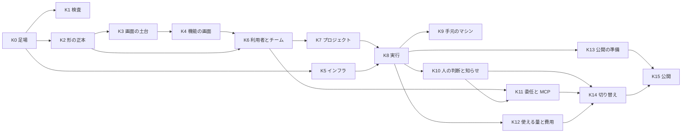

# 子の切り方: 画面先行の順で、子の課題が全体の設計だけを読んで詳細設計へ進める（#24）

[頭の文書](issue-24-design.md)の機能一覧（F1〜F23）と不変条件（I1〜I16）を、実装の単位の子の課題へ割り当て、順序と並列を決める。設計承認の後に、#24 の本文の開発計画と子の課題の本文をこの表に合わせて作り直す。

## 決まり

| 決まり | 中身 |
| --- | --- |
| 順序 | Value 2 のとおり、検査と形の正本 → 画面の土台 → 機能の画面（ダミーデータ）→ API の中身をつなぐ。インフラは土台の後ならいつでも並行してよい |
| 1 子の大きさ | 1 つの子は 1 つのスプリント（NDF の 1 版）で閉じる大きさにする。超えると分かったら、詳細設計で子を分けて本文を直す |
| 同時の数 | 1 スプリントの中の設計と実装は、どちらも同時に 3 本まで |
| 閉じる条件 | 子の受け入れ条件がすべて満たされ、受け持つ不変条件のテストが通り、受け持つ機能の画面・API・MCP の道具がそろっている（I14 の検査が通る） |
| 詳細設計 | 子ごとに `issues/issue-<番号>-design-detail.md` を書く。全体の設計で決めたモデル・境界・入出力・状態の置き場・権限は決め直さない。決め直す必要が出たら全体の設計を直す PR を先に出す |
| 追補 | 閉じた子への追加は、元の子を引く新しい課題にする。追補が 10 を超えたら全体の設計を見直す |
| 書かないもの | 課題・PR・コミットに、インフラの実際の値・運用する環境の名前・旧い側の名前と番号を書かない |

## 子の一覧

「既存の課題」は、設計承認の後に題と本文を書き直して使う課題である。`新規` は起票する。

| 子 | 範囲 | 機能 | 縛る不変条件 | 前に要る子 | 既存の課題 |
| --- | --- | --- | --- | --- | --- |
| K0 足場 | プロジェクト MVV・LICENSE・SECURITY.md・NDF の宣言（PR #25） | — | — | なし | #18・#14 の一部 |
| K1 検査 | 漏れ・参照・形の往復・横断の部品の外での直の利用・使える量の判定の外の比べ・操作の一覧と画面と MCP の対応・NDF の版の数字の比べ・CI の資格情報・NDF の契約の照合（定期）（[検査](issue-24-design-platform.md#検査)） | F23 | I8・I14 | K0 | #1（#23 を取り込む） |
| K2 形の正本と横断の部品 | 操作の表から型・JSON Schema・OpenAPI・MCP の道具・経路の登録・ダミーデータを作る生成、値の形（配列・UTC・通貨）、横断の部品（時計・ID・ログと伏せ字・外部の呼び出し・条件つきの書き込み・認可の判定・使える量の判定・操作の記録の書き手） | — | I2（判定の部品）・I9・I12・I15 | K0 | #2 |
| K3 画面の土台 | 画面の地図・ナビゲーション・共通の部品・デザインの規約・端末の幅・オフライン（PWA・暗号化した控え・そろえ方・確定待ち）・国際化 | — | I4（確定待ち） | K2 | #12 |
| K4 機能の画面 | F1〜F20 の画面を、形の正本から作るダミーデータで作り切る | F1〜F20 の画面 | I14（画面の側） | K3 | 新規 |
| K5 インフラ | 自前の VPC・Aurora（進行表の DB）・ECS のクラスタ・ECR・予算と知らせ・ECS のサービスを作らないことの照らし（NAT 0 件・タスクの受け入れ 0 件・PITR などのスタックのテスト）・実測（一時停止・カタログの分け方） | — | I10・I11 | K0 | #13 |
| K6 利用者とチーム | サインイン・ログインの組・利用者の設定・チームと席の API と画面のつなぎ | F1・F2・F3 | I15（利用者の設定）・I16 | K4・K2 | #4 |
| K7 プロジェクトとリポジトリ | GitHub App・プロジェクトの作成と割り当て・リポジトリの登録・割り当てを移す流れ | F4・F5・F6 | I1・I2・I3 | K6 | #5 |
| K8 実行 | スプリントを始める・読む・取り消す、ホステッドのランナー、NDF との契約、進捗の事象、実行の場所と推論の手段 | F7・F8・F9・F10・F17 | I5・I6・I7・I10・I11・I13 | K7・K5 | #6 |
| K9 手元のマシン | 登録・心拍・nd ランタイム・レーンの受け取り | F18 | I7 | K8 | #7 |
| K10 人の判断と知らせ | 承認の依頼と承認資料・承認の確定・問いと答え・知らせ・通知先（Web Push・Slack） | F11〜F15 | I4・I5 | K8 | #8 |
| K11 委任と MCP | 委任の発行と取り消し・MCP の受け口・操作の記録の読み出し | F16・F20 | I2（MCP と記録の経路）・I3・I9 | K6・K10 | #11 |
| K12 使える量と費用 | 料金プランの値・使える量の判定・月の上限額・費用の記録と画面 | F19 | I8・I15（金額） | K8 | 新規 |
| K13 公開の準備 | 自分で設置する手順の文書・商標の確かめ・貢献の受け方。確定仕様化で `docs/design/rebuild/` を外し `AGENTS.md` の行を直すのは #24 の確定仕様化が行う | F21 | — | K8 | #14 |
| K14 運用する環境の切り替え | 運用する環境の利用者を新しい側へ案内する段取りと戻し方（[付録](issue-24-design-legacy.md)） | — | — | K10・K11・K12 | #15 |
| K15 社内のテストとサービスの公開 | 社内のテストを経て、運用する環境のサービスを公開する | F22 | — | K13・K14 | #16 |

後に回す子（最初の版の外。付録に入れる条件がある）:

| 子 | 範囲 | 既存の課題 |
| --- | --- | --- |
| L1 開発ループ | 課題を続けて選び、スプリントを周回させる | #9 |
| L2 AI のオーガナイザーとの会話 | プロジェクトに 1 つ動く AI と会話で指示する | #10 |

閉じる課題:

| 課題 | 理由 |
| --- | --- |
| #3（対応表の試走） | 旧い側との同等をそろえることを目的にしない。子を閉じる条件は受け入れ条件とテストにした（[決定 6](issue-24-design-decisions.md#決定-6-子を閉じる条件を受け入れ条件とテストにするため対応表の試走をやめる)） |
| #22（旧い設計への移し） | 移す先の `docs/design/rebuild/` を外す。中身（GitHub の token の失効と進行表の DB の用意の順）は K5・K7・K8 の詳細設計が受ける |

## 順序

| 段 | 子 | 同時に動く本数 |
| --- | --- | --- |
| 1 | K0 | 1 |
| 2 | K1・K2・K5 | 3 |
| 3 | K3（K5 が残っていれば並行） | 1〜2 |
| 4 | K4 | 1 |
| 5 | K6 | 1 |
| 6 | K7 | 1 |
| 7 | K8 | 1 |
| 8 | K9・K10・K12 | 3 |
| 9 | K11・K13 | 2 |
| 10 | K14 | 1 |
| 11 | K15 | 1 |

後の段の子の設計は、前の段の子の設計の収束を待てば始めてよい（実装のマージは待たない）。

## 子ごとの詳細設計で書くこと

| 子 | 全体の設計に無く、詳細設計で決めること |
| --- | --- |
| K1 | 漏れの値の受け方（CI の秘密）・検査ごとの落とし方と出力の形 |
| K2 | 操作の表の形・生成物の置き場・横断の部品の関数の形・ダミーデータの作り方 |
| K3 | 部品の一覧と状態・控えの期間と量の上限・そろえ方の食い違いの解き方の細部・翻訳のキーの名付け |
| K4 | 画面ごとの項目の並び・空と誤りの見せ方の文言のキー |
| K5 | VPC の CIDR の既定・Aurora の最大 ACU の既定・ECS のタスクの大きさの既定・予算の既定・実測の手順 |
| K6 | ログインの組の結び付け・招きの期限・席の役割の変え方 |
| K7 | GitHub App の権限の一覧・割り当てを移す受け入れの期限・閉じたプロジェクトの中身の保存期間 |
| K8 | ランナーのイメージの中身・承認の待ちの猶予の既定・NDF のファイルを読む時機・進行表の DB の用意の手順の細部 |
| K9 | nd ランタイムの配り方・心拍の間隔・同時に受けるレーンの数の既定 |
| K10 | 承認資料の項目と要約値の作り方・知らせの束ね方・Slack の本文の形 |
| K11 | 委任の範囲の値の集合・MCP の認可の流れの細部・操作の記録の保存期間 |
| K12 | 料金プランの値の集合と量・費用の数え方の細部 |
