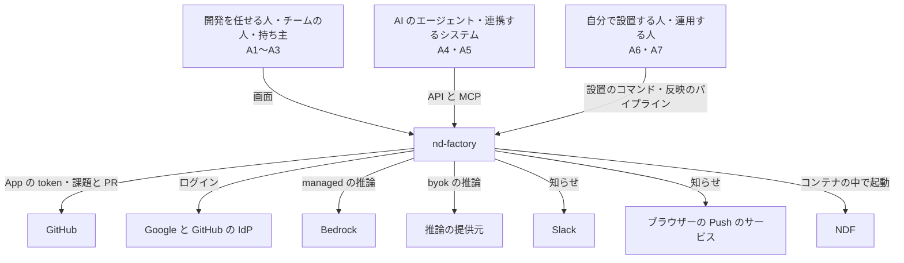
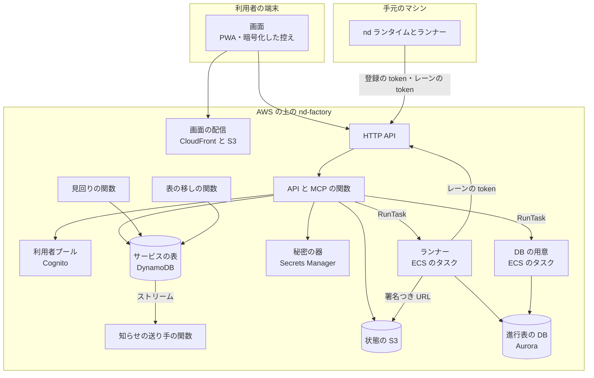
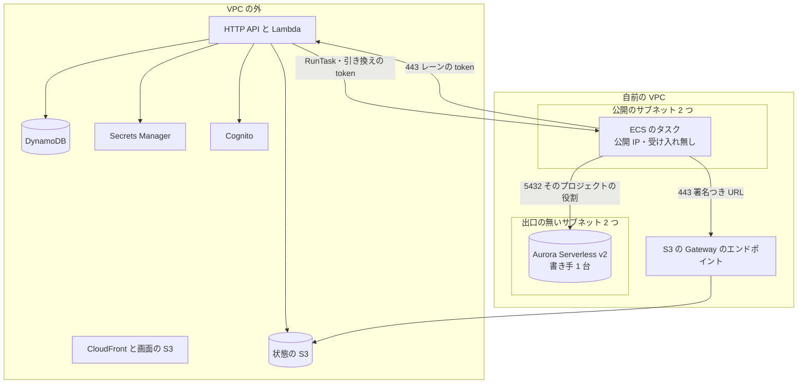
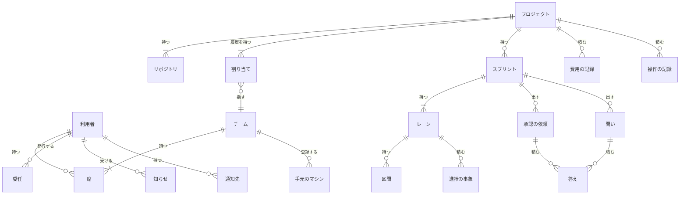

# 土台: 誰でも自分の AWS へ安く設置でき、承認した差分だけが反映され、値の漏れを検査で止められる（#24）

[頭の文書](issue-24-design.md)の「MVV と設計の節の対応」のうち、Value 6（インフラ・費用）・Value 7（検査）・Value 8 と P1（反映と設置）を受け、頭の文書のドメインモデル（集約・不変条件 I1〜I15）を置き場とインフラへ下ろす。
アーキテクチャは arc42（STD1）の 12 章と C4（STD2）の図で書く。画面・API・実行の振る舞いは [画面](issue-24-design-screens.md)・[API と MCP](issue-24-design-api.md)・[実行](issue-24-design-execution.md) にあり、この文書はそれらが動く土台だけを扱う。
値はすべて作り物（AWS のアカウント `123456789012`・リージョン `us-west-2`・接頭辞 `acme`・環境 `test`）か設計の既定値である。

## アーキテクチャ

### arc42 の章との対応

| 章 | arc42 の章 | この設計で受ける所 |
| --- | --- | --- |
| 1 | 導入と目標 | 頭の文書の [目的](issue-24-design.md#目的)・[MVV と設計の節の対応](issue-24-design.md#mvv-と設計の節の対応) |
| 2 | 制約 | 下の [制約](#制約) |
| 3 | 文脈と範囲 | 下の [文脈の図](#文脈の図) |
| 4 | 解決の方針 | 下の [解決の方針](#解決の方針) |
| 5 | 構成要素の見方 | 下の [コンテナの図](#コンテナの図)・[構成要素](#構成要素)。Component と Code の階層は子の詳細設計（[詳細設計](issue-24-design-detail.md)） |
| 6 | 実行時の見方 | [実行](issue-24-design-execution.md) のスプリントを始める流れ・承認と問いの流れ |
| 7 | 配置の見方 | 下の [配置の図](#配置の図)・[インフラ](#インフラ) |
| 8 | 横断の概念 | [状態の置き場](#状態の置き場)・[横断の部品と定数の置き場](#横断の部品と定数の置き場)・[認可](issue-24-design-api.md#認可) |
| 9 | 設計の決定 | 下の [決定の記録](#決定の記録)（決定 80〜94）と [決定の置き場](issue-24-design-decisions.md#決定の置き場) |
| 10 | 品質の要求 | 下の [非機能の実現方式](#非機能の実現方式) |
| 11 | リスクと技術的負債 | 下の [未確認のまま残ること](#未確認のまま残ること)・頭の文書の [未確認のまま残ること](issue-24-design.md#未確認のまま残ること) |
| 12 | 用語集 | 頭の文書の [用語](issue-24-design.md#用語)・`docs/glossary/glossary.json` |

### 制約

| 制約 | 出所 |
| --- | --- |
| このリポジトリのスタックだけで立つ。他の資源に相乗りしない。特定の環境にしか無い資源を前提にしない | Value 6 |
| NAT を置かない。Lambda は VPC の外、Fargate は公開のサブネット | Value 6 |
| 実際のインフラの値・秘密をリポジトリ・合成の出力・CI の記録に置かない。AWS のアカウントとリージョンは profile、ほかは設定のファイル、秘密は秘密の器から受ける | Value 7、[settings.md](../docs/operations/settings.md) |
| 反映は反映のパイプラインか設置のコマンドだけ。CI は AWS の資格情報を持たない | Value 8、P1、[setup.md](../docs/operations/setup.md)・[pipeline-approval.md](../docs/operations/pipeline-approval.md) |
| NDF は外部の系で変えない。やり取りは NDF の契約だけ。NDF の版の数字で振る舞いを変えない | 頭の文書の [適用範囲](issue-24-design.md#適用範囲)、[NDF との契約](issue-24-design-execution.md#ndf-との契約) |
| 旧い側のデータを移さない | 利用者の指示（2026-11-16） |

### 解決の方針

| 方針 | 中身 | 決定 |
| --- | --- | --- |
| 使わない間は止まる部品で組む | 画面は静的な配信、API は Lambda、レーンは動く間だけの Fargate のタスク、進行表の DB は 0 ACU で一時停止する Aurora | 決定 80・83・85 |
| サービスの状態はサーバーの側の 1 つの置き場 | サービスの状態は DynamoDB、大きい本文は S3、NDF の状態は進行表の DB。どれもプロジェクトかチームの ID で区切り、認可の判定（I2）と同じ単位にそろえる | 決定 81・82・84 |
| 反映の経路は骨組みのものをそのまま使う | 設置のコマンド（`diff` → `deploy --confirm`）と反映のパイプライン（push → 準備 → 人の承認 → 反映）。足す資源は縦の切れ端のスタックへ入れ、確認の値で縛る | 決定 89・87 |
| 値の漏れと規約の破れは検査で止める | 漏れ・参照・形の往復・境界・I8・I14 の検査を CI に置き、スタックのテストがインフラの決まりを照らす | 決定 92 |

### 文脈の図

C4 の System context（STD2）。nd-factory を 1 つの箱にし、こちらが変えられない外部の系だけを描く。

| 外部の系 | 流れるもの | nd-factory から変えられるか |
| --- | --- | --- |
| GitHub | App の導入・1 つのリポジトリに絞った token・課題と PR の読み書き | 変えられない |
| Google と GitHub の IdP | ログイン（OAuth と OIDC） | 変えられない |
| Bedrock・推論の提供元 | レーンの claude の推論（`managed` は API が渡す 1 時間の一時の資格情報、`byok` は持ち込みのキー） | 変えられない |
| Slack・ブラウザーの Push のサービス | 人を待つものの知らせ | 変えられない |
| NDF | 契約ファイル・コンテナの中で動く工程 | 変えられない（読むだけ） |

### コンテナの図

C4 の Container（STD2）。ここの「コンテナ」は C4 の語で、動く単位の箱を指す。

形の正本・設置のコマンド・反映のパイプライン・検査は、組み立てと反映の時に働く要素で、この図に描かない（下の [構成要素](#構成要素)）。

### 構成要素

| 要素 | 責務 | 動く所 | 受け持つ子 |
| --- | --- | --- | --- |
| 画面 | 画面の地図・部品・オフラインの控え・国際化。操作はすべて API を通す | 端末（CloudFront から配る） | K3・K4 |
| API | 認証・認可の判定（I2）・使える量の判定（I8）・各コンテキストのモジュール・操作の記録（I9）。操作の表から経路を作る | Lambda（VPC の外） | K2・K6〜K12 |
| MCP | 操作の表から作った道具の一覧と呼び出し。API と同じ関数・同じ認可を通る（I14） | API と同じ Lambda | K11 |
| ランナー | レーンの中で NDF を区間ごとに起動し、NDF の結果の行・承認ゲート・問いを進捗の事象・承認の依頼・問いへ翻訳する（腐敗防止層）。AWS の権限を持たない（I11） | ECS のタスクか手元のマシン | K8 |
| nd ランタイム | 手元のマシンの登録・心拍・レーンの受け取り・コンテナでのランナーの起動 | 手元のマシン | K9 |
| DB の用意 | プロジェクトの進行表のデータベースと役割を作る・役割のパスワードを差し替える | ECS のタスク（nd-factory のイメージ。claude と NDF を含まない） | K5・K8 |
| 見回り | 定期に起き、心拍の切れたレーンと手元のマシン・猶予を過ぎた答えの送達・やり直しの残る失効（GitHub の token・DB の資格情報）を見つけて、持ち主のモジュールの操作を呼ぶ | Lambda（スケジュールで起動） | K8・K7 |
| 知らせの送り手 | 知らせの表に足された行を通知先（Web Push・Slack）へ送り、通知先ごとの送達の状態を書く | Lambda（知らせの表のストリームで起動） | K10 |
| 表の移し | サービスの表の古い形の版の項目を新しい版へ書き換える（[形の版と移し方](#形の版と移し方)） | Lambda（反映の後に 1 回） | K2 |
| 形の正本 | 設定のファイル・操作の表・事象・値の形・終了コードを zod で持ち、型・JSON Schema・OpenAPI・MCP の道具・ダミーデータ・文書の表を作る | 組み立ての時（`packages/contracts/`） | K2 |
| 設置のコマンド | 確かめ・合成・差分・確認の値・反映（`npm run nd-setup`） | 設置する人の端末 | 骨組み（ある）・K5 |
| 反映のパイプライン | 起点のブランチへの push → 準備 → 人の承認 → 反映 | CodePipeline と CodeBuild | 骨組み（ある） |
| 検査 | 漏れ・参照・形の往復・境界・I8・I14・CI の資格情報・NDF の契約の照合 | GitHub の workflow | K1 |

### 配置の図

C4 の Deployment（STD2）。VPC の中と外で何が動き、境界を何が流れるかを示す。

| 境界をまたぐ線 | 流れるもの | 保護の条件 |
| --- | --- | --- |
| API → タスク | `RunTask` の環境の上書きで渡す、10 分・1 回だけの引き換えの token | タスクの記述から読めても 1 回で失効する（[実行](issue-24-design-execution.md)） |
| タスク → API | レーンの token・進捗の事象・指示の問い合わせ | TLS。レーンの token はレーンが動く間だけ有効（I11） |
| タスク → Aurora | そのプロジェクトの役割のパスワードを含む URL での接続 | Aurora の SG はタスクの SG からの 5432 だけを受ける。役割はそのデータベースだけに権限を持つ（I10） |
| タスク → 状態の S3 | NDF のファイル | API が出す、そのレーンの頭だけの署名つき URL |

## 状態の置き場

### 置き場の分け方

状態は 3 つの置き場に分ける。どの置き場も、区切りの頭にプロジェクトかチーム（利用者だけに属するものは利用者）の ID を置き、認可の判定（I2）が同じ ID で絞れる形にする。

| 置き場 | 何を置くか | 書き手 | 読み手 |
| --- | --- | --- | --- |
| サービスの表（DynamoDB） | 頭の文書の集約のすべて（利用者・チーム・委任・プロジェクト・割り当て・スプリント・手元のマシン・進捗の事象・承認の依頼・問い・知らせ・通知先・費用の記録・操作の記録）と冪等の鍵 | API の各モジュール（集約の持ち主だけ）・見回り・知らせの送り手（送達の状態だけ）・表の移し | API |
| 状態の S3 | 承認資料の本文・NDF のファイルのうち進行表の DB に乗らないもの | API（承認資料）・ランナー（署名つき URL で NDF のファイル） | API・ランナー（署名つき URL） |
| 進行表の DB（Aurora PostgreSQL） | NDF の進行表と耐久の記録 | コンテナの中の NDF だけ | コンテナの中の NDF だけ。サービスは読まない |

サービスが NDF の状態を知る経路は、ランナーが送る進捗の事象だけにする。Lambda は VPC の外に置き、出口の無いサブネットの進行表の DB へ届かないためである（決定 83）。

### サービスの表

#### ER 図

主な集約と関連だけを描く。属性は下のテーブル定義にある。

多重度の決まり: 割り当ては履歴の行を積み、今の割り当ては 1 つだけ（I3）。リポジトリのうち主はちょうど 1 つ（I1）。レーンを動かすコンテナは同時に 1 つ（I7）。

#### 表と鍵

表はコンテキスト（集約の持ち主のモジュール）ごとに分ける（決定 81）。1 つの処理が書き換える集約は 1 つで、表をまたぐ反映はドメインイベントで後から行う。表の名前は `<prefix>-<environment>-db-<用途>` にする。

| 表（用途） | 区切りの鍵 / 並びの鍵 | 持つ集約 | 時系列の扱い |
| --- | --- | --- | --- |
| `db-users` | `USER#<利用者>` / `USER`・`LOGIN#<IdP>#<主体>`・`DELEGATION#<委任>` | 利用者・ログインの組・委任 | 上書き。変更の履歴は操作の記録が持つ |
| `db-teams` | `TEAM#<チーム>` / `TEAM`・`SEAT#<利用者>`・`MACHINE#<マシン>`・`USAGE#<UTC の年月>` | チーム・席・手元のマシン・月の使った量 | 上書き。席と役割の変更は操作の記録、使った量の元は費用の記録 |
| `db-projects` | `PROJECT#<プロジェクト>` / `PROJECT`・`REPO#<リポジトリ>`・`ASSIGN#<時刻>#<ID>`・`GHTOKEN#<期限>#<レーン>#<連番>` | プロジェクト・リポジトリ・割り当て・渡した GitHub の token の記録 | 割り当ては履歴保持型（変更ごとに行を足し、プロジェクトの行が今の割り当てを指す）。token の記録は期限で TTL |
| `db-sprints` | `PROJECT#<プロジェクト>` / `SPRINT#<スプリント>`・`SPRINT#<スプリント>#LANE#<レーン>`・`…#SEG#<連番>` | スプリント・レーン・区間 | 状態は上書き。状態の移りは進捗の事象が持つ |
| `db-events` | `PROJECT#<プロジェクト>#LANE#<レーン>` / `SEQ#<連番>` | 進捗の事象 | 事象の記録（追記だけ、I13） |
| `db-decisions` | `PROJECT#<プロジェクト>` / `APPROVAL#<依頼>`・`QUESTION#<問い>`・`…#ANSWER#<答え>` | 承認の依頼・問い・答え | 答えは追記だけ。確定した答えを上書きしない |
| `db-notices` | `USER#<利用者>` / `NOTICE#<時刻>#<ID>`・`DEST#<通知先>` | 知らせ・通知先 | 知らせは既読と送達の状態だけを上書き |
| `db-usage` | `PROJECT#<プロジェクト>` / `COST#<時刻>#<ID>` | 費用の記録 | 事象の記録（追記だけ） |
| `db-audit` | `PROJECT#<プロジェクト>`・`TEAM#<チーム>`・`USER#<利用者>` / `<時刻>#<ID>` | 操作の記録 | 事象の記録（追記だけ、I9） |
| `db-idempotency` | `<主体>#<鍵>` / なし | 冪等の鍵 | 24 時間で TTL |

| 決まり | 中身 |
| --- | --- |
| 区切りの外の ID | プロジェクトに属する行は、区切りの鍵の外でも `project_id` を持つ。利用者で区切る行（知らせ）も `project_id` を持ち、一覧は認可の判定で絞ってから返す・数える（I2） |
| 索引 | 利用者の席の一覧（`USER#<利用者>` からチームへ）・チームのプロジェクトの一覧（今の割り当てのチームから）・人を待つものの一覧（待っている依頼と問いだけを持つ疎な索引）の 3 つを置く。列の細部は K2 の詳細設計 |
| 条件つきの書き込み | 今の割り当ての差し替え（I3）・主リポジトリの数（I1）・レーンのコンテナの割り当て（I7）・同じ連番の事象（I13）・答えの確定（I4・I5）・使える量の加算（I8）は、条件式（LIB81）で 1 行を照らして書く。外れたら 409 か前の 1 件を返す |
| 日時と金額 | 日時は UTC の ISO 8601（末尾 `Z`）、金額は最小単位の整数と ISO 4217 の通貨の組で持つ（I15）。形の正本の検証が外れた値を拒む |
| 形の版 | どの項目も `schema_version`（整数）を持つ（[形の版と移し方](#形の版と移し方)） |
| 課金と守り | 表は要求の数の課金（LIB81）。どの表もポイントインタイムの戻し（PITR）を有効にし、スタックから消しても表を残す（決定 93） |

#### テーブル定義

主な集約だけを書く。ほかの列は K2 と各子の詳細設計が書く。

プロジェクト（`db-projects` の `PROJECT` の行）:

| 列 | 型 | 空を許すか | 意味 |
| --- | --- | --- | --- |
| `project_id` | 文字列 | 許さない | プロジェクトの ID（無作為） |
| `name` | 文字列 | 許さない | 名前 |
| `current_team_id` | 文字列 | 許す | 今の割り当てのチーム。空は「閉じた」で、どのチームからも見えない |
| `current_assign_id` | 文字列 | 許す | 今の割り当ての行の ID。空の意味は上と同じ |
| `transfer` | 地図 | 許す | 割り当てを移す途中の状態（移す先・止め終えたか・失効が終わったか）。空は「移していない」 |
| `progress_db_state` | 文字列 | 許さない | 進行表の DB の状態（`無い`・`作成中`・`有る`） |
| `progress_db_secret` | 文字列 | 許す | そのプロジェクトの URL を入れた秘密の器の名前。空は「まだ作っていない」 |
| `gh_token_max_expiry` | 日時 | 許す | 渡した GitHub の token の期限の最大値。空は「期限の前の token が無い」 |
| `gh_token_generation` | 整数 | 許さない | token の記録の世代番号。記録を足すたびに 1 上げる |
| `created_at` | 日時 | 許さない | 作った時刻（UTC） |
| `schema_version` | 整数 | 許さない | 形の版 |

割り当て（`ASSIGN#…` の行。追記だけ）:

| 列 | 型 | 空を許すか | 意味 |
| --- | --- | --- | --- |
| `assign_id` | 文字列 | 許さない | 割り当ての行の ID |
| `team_id` | 文字列 | 許す | 割り当てたチーム。空は「閉じた」行 |
| `confirmed_by` | 文字列 | 許さない | 確定した人の利用者の ID（人だけ、I3） |
| `accepted_by` | 文字列 | 許す | 移す先の持ち主の受け入れ。空は「作成と同時の割り当て」か「閉じた」 |
| `confirmed_at` | 日時 | 許さない | 確定の時刻（UTC） |

レーン（`db-sprints` の `…#LANE#…` の行）:

| 列 | 型 | 空を許すか | 意味 |
| --- | --- | --- | --- |
| `lane_id` | 文字列 | 許さない | レーンの ID |
| `repo_id` | 文字列 | 許さない | 回すリポジトリ |
| `after` | 文字列の配列 | 許さない | 先に終わるべきレーン。空の配列は「待たない」 |
| `place` | 文字列 | 許さない | 実行の場所（`hosted`・`machine`） |
| `inference` | 文字列 | 許さない | 推論の手段（`managed`・`byok`） |
| `runner_id` | 文字列 | 許す | 今動かしているコンテナ（タスクかマシン）。空は「どこにも割り当てていない」（I7 は空のときだけ書ける条件で守る） |
| `state` | 文字列 | 許さない | レーンの状態（値の集合は [実行](issue-24-design-execution.md)） |
| `last_seq` | 整数 | 許さない | 受けた進捗の事象の最後の連番 |

承認の依頼（`db-decisions` の `APPROVAL#…` の行）:

| 列 | 型 | 空を許すか | 意味 |
| --- | --- | --- | --- |
| `approval_id` | 文字列 | 許さない | 依頼の ID |
| `sprint_id`・`lane_id` | 文字列 | 許さない | 出したスプリントとレーン |
| `gate` | 文字列 | 許さない | 承認ゲートの種類（設計・リリース・レッドライン） |
| `material_digest` | 文字列 | 許さない | 承認資料の要約値（sha256）。状態の S3 の本文の名前でもある |
| `state` | 文字列 | 許さない | 待っている・答えた・取り下げた |
| `answer_id` | 文字列 | 許す | 確定した答え。空は「待っている」か「取り下げた」 |
| `delivery` | 文字列 | 許す | 答えの NDF への送達の状態（I5）。空は「答えていない」 |
| `waiting_since` | 日時 | 許す | 疎な索引の鍵。空は「人を待っていない」 |

操作の記録（`db-audit` の行。追記だけ）:

| 列 | 型 | 空を許すか | 意味 |
| --- | --- | --- | --- |
| `at` | 日時 | 許さない | 時刻（UTC） |
| `actor` | 地図 | 許さない | 主体（人・委任・ランナー・手元のマシン・見回り）と、委任なら委任した人とクライアントの名前 |
| `channel` | 文字列 | 許さない | 経路（画面・API・MCP・ランナー・見回り） |
| `operation` | 文字列 | 許さない | 操作の表の名前 |
| `target_ids` | 文字列の配列 | 許さない | 対象の ID。空の配列は「対象を持たない操作」（サインインなど） |
| `result` | 文字列 | 許さない | 結果（成功・拒否・失敗と状態の番号） |

秘密と個人情報の値は記録に書かない（I9）。記録を書けなければ、その操作を 503 で失敗させる。

### 状態の S3

バケットは 1 つで、公開を止め、暗号化し、TLS だけを受ける。オブジェクトの名前の頭に形の版を置く。

| 中身 | 名前 | いつ書くか | 消し方 |
| --- | --- | --- | --- |
| 承認資料の本文 | `v1/projects/<プロジェクト>/materials/<要約値>.json` | 承認の依頼を受けたとき（API） | プロジェクトを閉じた後に、K7 が決める保存期間で消す。人の判断の材料のため、スプリントの終わりでは消さない |
| NDF のファイル | `v1/projects/<プロジェクト>/lanes/<レーン>/…` | 承認の待ちでタスクを止めるとき・区間の終わり・SIGTERM（ランナー） | レーンの終わりから 14 日（ライフサイクルの規則） |

署名つき URL は、そのレーンの頭だけに、15 分の期限で出す。名前の頭がプロジェクトの ID のため、割り当てを移した後に古いレーンの URL が残っても、新しいレーンの頭とは重ならない。

### 進行表の DB

**1 つの Aurora Serverless v2（PostgreSQL、最小 0 ACU）のクラスタの中に、プロジェクトごとに別のデータベースとログインの役割を作る（I10、決定 83・84）。** サービスは中身を読み書きしない。接続するのはホステッドのランナーと DB の用意のタスクだけである。手元のマシンのレーンへは URL を渡さない（出口の無いサブネットへ届かないため。手元のマシンの NDF は手元の置き場を使う。[実行](issue-24-design-execution.md)）。

| 項目 | 決まり |
| --- | --- |
| 単位 | プロジェクトごとに 1 つのデータベースと、そのデータベースだけに権限を持つ役割。名前はプロジェクト・チーム・リポジトリの名前や ID から作らない無作為の値にし、対応はサービスの表にだけ置く |
| 作る時 | そのプロジェクトの最初のホステッドのレーンを始めるとき。`progress_db_state` を `作成中` にし、DB の用意のタスクが終わりを知らせたら `有る` にする。失敗か時間切れなら `無い` へ戻し、次の開始で作り直す |
| 認証 | 役割のパスワードを含む URL を、プロジェクトごとの秘密の器に置く。IAM 認証は使わない（token が 15 分で、NDF の DB の URL は token を取り直す口を持たない。LIB80） |
| 渡し方 | API が引き換えのときに、そのプロジェクトの URL だけをランナーへ返す。ランナーはメモリだけに置き、ファイルとログに書かない |
| 一時停止 | 利用者の接続が 0 本になってから既定の 300 秒で一時停止する。再開は通常 約 15 秒、24 時間を超えた停止の後は 30 秒以上（LIB80）。タスクの起動の手順は、最初の接続を再試行で待つ |

#### 用意の手順

DB の用意のタスクは、API から引き換えの token で管理の接続とプロジェクトの役割の値を受け、次の順で行う。秘密の器を作り値を入れるのは API で、タスクは秘密の器に触れない。

| 順 | 行うこと | 理由 |
| --- | --- | --- |
| 1 | `postgres`・`template1` の `CONNECT`・`TEMPORARY` を `PUBLIC` から外す（何度打っても同じ結果） | 別のデータベースへ接続し直して、カタログと統計から他のプロジェクトの名前を読ませない |
| 2 | データベースを `ALLOW_CONNECTIONS false` で作る（作り直しで既にあれば作らない） | 権限を整えるまで誰も接続できない |
| 3 | そのデータベースの `CONNECT`・`TEMPORARY` を `PUBLIC` から外し、`ALLOW_CONNECTIONS true` にする | この時点で接続できるのは持ち主の管理の役割だけ |
| 4 | 管理の役割でそのデータベースへ接続し、カタログと統計のビューの読み取りを `PUBLIC` から外す。読み取りの既定の役割（`pg_read_all_stats` など）へ入れない | 他のプロジェクトのデータベースと役割の名前と数を読ませない（I2） |
| 5 | 管理の接続とプロジェクトの役割の接続のほかを切る | 作り直しのとき、権限を整える前から残る接続を断つ |
| 6 | 役割を作り、その役割を持ち主とする専用のスキーマと `search_path` を置き、最後にその役割にだけ `CONNECT`・`TEMPORARY` を与える | NDF と DBOS の表を作る場所。DBOS が一時表を使うため `TEMPORARY` が要る |

4 で外せるかと、プロジェクト A の役割から B のデータベース・`postgres`・`template1` へ接続できないことは、K5 が骨組みの環境で実測する（[未確認のまま残ること](#未確認のまま残ること)）。外せないときは、2 つ目のチームのプロジェクトでホステッドのレーンを動かす前に、分け方を設計へ戻す。

#### 割り当てを移すときの差し替え

割り当てを移す確定（[割り当てを変える流れ](issue-24-design.md#割り当てを変える流れ)）は、レーンを止めた後に、そのプロジェクトの役割のパスワードを差し替える。渡し済みの URL を別のレーンから使わせないためである。

| `progress_db_state` | 扱い |
| --- | --- |
| `無い` | 渡し済みの URL が無いため差し替えない。割り当ての行に「差し替え不要」と書く |
| `作成中` | 作り終えるまで確定を 409 で拒む |
| `有る` | API が新しいパスワードを秘密の器へ保留の版で入れ、DB の用意のタスクを差し替えの種類で起こす。タスクはパスワードを差し替えて役割の接続をすべて切り、差し替えの ID を添えて終わりを知らせる。API は ID が合う知らせだけを受け、保留の版を今の版へ移す |

移す先の受け入れは、差し替えの終わりと `gh_token_max_expiry` が空か過去であることを、割り当ての行の差し替えと同じ条件つきの書き込みで照らす。GitHub の token の失効の順は [実行](issue-24-design-execution.md) と K7 の詳細設計が持つ。

### 形の版と移し方

旧い側のデータは移さないため、移しの仕組みはこの後の形の変更のためだけに置く。

| 置き場 | 形を変えるとき |
| --- | --- |
| サービスの表 | 2 段で出す（決定 82）。1 段目の反映で、読み手が今と次の版の両方を読めるようにする。2 段目の反映で、書き手を次の版へ上げる。残った古い版の項目は表の移しの関数が書き換える（冪等。時間切れの前に続きの位置を残して自分を起こし直す）。読み手が受ける版は今と 1 つ前だけ |
| 状態の S3 | 次の版の頭（`v2/`）へ書き、読み手は両方を読む。古い版は消し方の期限で消える |
| 進行表の DB | NDF が持つ。nd-factory は形を変えない。NDF の固定の値（`ndf-pin.json`）を変える PR で、契約の照合と試験を通してから上げる |
| 端末の控え | 画面の控えは形の版を持ち、合わない版の控えは捨ててサーバーから読み直す（[オフライン](issue-24-design-screens.md#オフライン)） |

### CRUD 図

行は機能（F1〜F20）と、機能でない書き手（ランナー・見回り・知らせの送り手）。C は作る、R は読む、U は更新、D は消す。操作の記録はどの機能でも C（読み取りを含む、I9）のため、列を置かずにここで述べる。F21〜F23 はサービスのデータを触らない。

| 機能 | 利用者・委任 | チーム・席・マシン | プロジェクト・リポジトリ | 割り当て | スプリント・レーン | 進捗の事象 | 承認の依頼・問い・答え | 承認資料（S3） | 知らせ・通知先 | 費用の記録・使った量 | 進行表の DB |
| --- | --- | --- | --- | --- | --- | --- | --- | --- | --- | --- | --- |
| F1 サインイン | CR | R | — | — | — | — | — | — | — | — | — |
| F2 言語と時刻帯 | RU | — | — | — | — | — | — | — | — | — | — |
| F3 チームと席 | R | CRUD | — | R | — | — | — | — | — | — | — |
| F4 プロジェクトを作る | R | R | C | C | — | — | — | — | — | — | — |
| F5 リポジトリの登録 | — | R | CRUD | R | — | — | — | — | — | — | — |
| F6 割り当てを移す | — | R | U | CRU | U | — | U | — | C | — | U |
| F7 ホーム | — | R | R | R | R | R | R | — | R | — | — |
| F8 スプリントを始める | — | R | R | R | C | — | — | — | — | R | C |
| F9 スプリントを読む | — | — | R | R | R | R | R | — | — | R | — |
| F10 取り消す | — | — | R | R | U | — | U | — | C | — | — |
| F11 承認の依頼を読む | — | — | R | R | R | — | R | R | — | — | — |
| F12 承認する | — | — | R | R | U | — | CU | R | U | — | — |
| F13 問いに答える | — | — | R | R | U | — | CU | — | U | — | — |
| F14 知らせを読む | — | — | — | R | — | — | — | — | RU | — | — |
| F15 通知先 | — | — | — | — | — | — | — | — | CRUD | — | — |
| F16 委任 | CRUD | R | R | R | — | — | — | — | — | — | — |
| F17 実行の場所 | — | RU | — | — | — | — | — | — | — | — | — |
| F18 手元のマシン | — | CRUD | — | — | — | — | — | — | — | — | — |
| F19 使える量と上限額 | — | RU | — | — | — | — | — | — | — | R | — |
| F20 操作の記録 | — | R | R | R | — | — | — | — | — | — | — |
| ランナー | — | — | R | — | U | C | C | C | — | C | RU |
| 見回り | — | R | U | R | U | — | U | — | C | — | — |
| 知らせの送り手 | — | — | — | — | — | — | — | — | U | — | — |

F6 は 6 つのデータを更新する。割り当てを移す流れは、止める（スプリント）・断つ（token・DB の資格情報）・差し替える（割り当て）を 1 つの確定に束ねるためで、各データの更新は持ち主のモジュールの操作を順に呼ぶ（ドメインイベント E17）。1 つの書き込みで複数の集約を書かない。

## インフラ

### 資源ごとの形

| 資源 | 形 | 理由（MVV） |
| --- | --- | --- |
| VPC | 自前で作る。2 つの AZ に公開のサブネットと出口の無いサブネットを 1 つずつ。AZ は `Fn::GetAZs` で反映の時に選び、合成で lookup を使わない | Value 6（相乗りしない）。合成を資格情報なしで通す（Value 8） |
| NAT ゲートウェイ | 置かない。スタックのテストが 0 件を照らす | Value 6。1 つで時間あたり 0.045 ドル掛かる（[費用](#費用) の単価の出典） |
| Gateway のエンドポイント | S3 だけ置く（無料）。DynamoDB の分は置かない。Interface 型は置かない | タスクは DynamoDB に触れない（権限を持たない）。Interface 型は時間で費用が掛かる |
| API・MCP・見回り・知らせの送り手・表の移しの Lambda | VPC の外。Node 24・ARM64。束ねは esbuild（骨組みと同じ） | Value 6。DynamoDB・S3・Secrets Manager・Cognito・ECS の API は VPC の外から届く |
| ECS のタスク（ランナー・DB の用意） | Fargate。公開のサブネットで公開 IP を付ける。ECS のサービスを作らず `RunTask` で起こす（決定 86）。x86_64 | 公開 IP で ECR・CloudWatch Logs・API・推論の端点へ出る。動く間だけ費用が掛かる |
| タスクの役割 | AWS の権限を持たない（I11）。ECR からの取得とログの書き込みはタスクの実行の役割だけが持つ | 必要なものはすべて API から引き換えで受ける |
| タスクの SG | 受け入れを空にする。行きは 443（任意の宛先）と 5432（Aurora の SG だけ） | 公開のサブネットに置くため、外から入る経路を持たない |
| Aurora Serverless v2 | PostgreSQL（自動の一時停止を持つ版、LIB80）。出口の無いサブネット。書き手 1 台・読み手なし。最小 0 ACU。最大 ACU の既定は K5 | Value 6（使わない間は計算の費用が 0） |
| Aurora の SG | タスクの SG からの 5432 だけを受ける | DB に触れるのはタスクだけ |
| Cognito | 利用者プール。自分の登録を止め、Google（と GitHub）の IdP からだけ入る（骨組みと同じ） | Value 9（だれが入れるかをサーバーの側で決める） |
| CloudFront と画面の S3 | 置き場は公開せず、配信は OAC で読む（LIB83）。価格の区分は 100（骨組みと同じ） | Value 3（HTTPS の配信で Service Worker が動く）・Value 6 |
| 状態の S3 | 公開を止め、暗号化し、TLS だけ。NDF のファイルは 14 日で消す規則 | Value 7・Value 6 |
| ECR | ランナーと DB の用意のイメージ。ライフサイクルの規則で古い版を消す（残す数は K5、LIB85） | Value 6（保管の費用を抑える） |
| Secrets Manager | 器は CDK が作り、値は人か API が入れる。名前は `<prefix>/<environment>/<用途>`（決定 90） | Value 7 |
| HTTP API | 利用者の JWT（利用者プール）と、委任・レーン・マシンの token を受ける。認可の方式は [API と MCP](issue-24-design-api.md#認可)。CORS は配信の元だけ | Value 4・Value 9 |
| 予算 | AWS Budgets の月の予算と知らせ（[費用](#費用)） | Value 6 |

### ECS.2 と公開 IP

Security Hub の ECS.2 は ECS のサービス（`AWS::ECS::Service`）で公開 IP の自動の割り当てが有効なときに失敗し、ECS.16 は同じことをタスクセット（`AWS::ECS::TaskSet`）で見る（STD81）。nd-factory は `RunTask` だけでタスクを起こし、どちらの資源も作らないため、2 つのコントロールの対象を持たない。

| 扱い | 中身 |
| --- | --- |
| 作らない資源 | `AWS::ECS::Service` と `AWS::ECS::TaskSet`。スタックのテストが 0 件を照らす |
| 抑止のルール | 作らない（決定 86）。設定のファイルに抑止のキーを置かない |
| サービスを足す日 | 足す PR が、公開 IP を外せるか（NAT を置かずに出る経路）と、Security Hub の自動化ルール（STD82）で理由つきに抑止するかを決め、[費用が増える構成を足すとき](#費用が増える構成を足すとき) の形で理由と代案を書く |
| ほかの ECS のコントロール | 非 root の利用者で動かす（ECS.20）。秘密を環境の値に書かない（ECS.8。引き換えの token は 1 回で失効し、タスクの定義には書かない）。ルートのファイルシステムを読むだけにできるか（ECS.5）は、NDF の作業場所の書き込みと合わせて K8 が確かめる |

### 環境の値の受け方

骨組みの決まり（[settings.md](../docs/operations/settings.md)）をそのまま使う。

| 値 | 受ける所 | リポジトリに置くもの |
| --- | --- | --- |
| AWS のアカウントとリージョン | 設置のコマンドへ渡す profile | 置かない。CI の合成は作り物の値 |
| 接頭辞・環境・ログインの IdP・反映のパイプラインの起点・この設計で足すキー（予算・最大 ACU・推論の手段の可否など） | 設定のファイル（リポジトリの外。運用する環境では SSM のパラメーターが正本） | 形の正本の zod の定義・JSON Schema・作り物の値の見本 |
| 秘密の値 | 秘密の器 | 器の名前の付け方だけ |

設定のファイルのキーは、それを読む構成要素と同じ変更で足す（読み手の無いキーを先に足さない）。この設計で足すキーの名前と形は、読む子（K5・K8・K10・K12）の詳細設計が決める。

### 資源の名前

資源の名前は `<prefix>-<environment>-<用途>`、秘密の器と SSM のパラメーターは `<prefix>/<environment>/<用途>` にする（`infra/lib/naming.ts`）。すべての資源にタグ `app-prefix` と `app-env` を付け、費用をこのタグで分けて読む。S3 のバケットは名前を付けず（全リージョンで一意のため）、タグで見分ける。

| 用途 | 例（作り物） | 状態 |
| --- | --- | --- |
| スタック | `acme-test-app`・`acme-test-pipeline` | ある |
| 利用者プール・ドメイン・クライアント | `acme-test-users`・`acme-test-login`・`acme-test-web` | ある |
| HTTP API・JWT の認可 | `acme-test-api`・`acme-test-jwt` | ある |
| サービスの表 | `acme-test-db-users`・`acme-test-db-projects` など（[表と鍵](#表と鍵)） | 足す。骨組みの利用者の表 `acme-test-accounts` は `db-users` へ移す（「アカウント」を AWS のアカウントの意味だけで使うため） |
| Lambda | `acme-test-api-fn`・`acme-test-patrol`・`acme-test-notifier`・`acme-test-migrate` | 足す。骨組みの `acme-test-users-api` は `api-fn` へまとめる |
| VPC・SG | `acme-test-vpc`・`acme-test-task-sg`・`acme-test-db-sg` | 足す |
| ECS のクラスタ・タスクの定義 | `acme-test-runner`・`acme-test-runner`（族）・`acme-test-db-prep`（族） | 足す |
| Aurora のクラスタ | `acme-test-progress-db` | 足す |
| 予算 | `acme-test-budget` | 足す |
| 秘密の器 | `acme/test/google-oauth`（ある）・`acme/test/github-oauth`・`acme/test/github-app`・`acme/test/web-push`・`acme/test/progress-db-admin`・`acme/test/progress-db/<無作為>`・`acme/test/notify/<通知先>` | 足す |

## 費用

### 予算と知らせ

| 項目 | 決まり |
| --- | --- |
| 月の予算 | AWS Budgets で、タグ `app-prefix`・`app-env` の資源の月の費用に予算を置く。予算の監視と知らせは無料（LIB84） |
| 知らせ | 実績が 80%・100%、見込みが 100% に達したとき。宛先は設定のファイル（反映のパイプラインと同じく運用の宛先）。宛先が空なら予算だけ作る |
| 既定の額 | K5 が下の見込みから決める。設定のファイルで変えられる |
| 利用者の上限額との違い | 月の予算は AWS の請求全体の見張り（運用する人向け）。チームの月の上限額（F19）は使える量の判定（I8）が開始の前に止める線で、別に持つ |

### 使わない間に止まる資源

| 資源 | 使わない間 | 止まる仕組み |
| --- | --- | --- |
| Lambda・HTTP API | 0 | 呼ばれた分だけ |
| Fargate のタスクと公開 IP | 0 | レーンが動く間だけ。承認の待ちが猶予（既定 5 分）を超えたらタスクを止める（[実行](issue-24-design-execution.md)） |
| Aurora の計算 | 0 | 接続 0 本で 300 秒の後に一時停止（LIB80）。保守のために起きることがある（起きた後 20 分以上は止まらない） |
| DynamoDB | 保存の量だけ | 要求の数の課金（LIB81） |
| Cognito | 0 | 月の利用者 10,000 までは無料（下の単価の出典） |
| CloudFront | ほぼ 0 | 量の課金 |
| 掛かり続けるもの | 秘密の器の数・Aurora のストレージ・ECR の保管・ログの保管・S3 の保管 | 量に比例する。秘密の器が最も大きい（1 つ月 0.40 ドル） |

### 見込み

作り物の前提で、使い方ごとの月の額を出す。単価はバージニア北部（`us-east-1`）の公開の単価で、ほかのリージョンは違う。ACU の平均は実測していないため 1 ACU と置いた。

| 前提 | 使わない月 | 1 人のチーム | 5 人のチーム |
| --- | --- | --- | --- |
| プロジェクト・Slack の通知先 | 0・0 | 1・0 | 3・1 |
| スプリント × レーン | 0 | 10 × 1 | 40 × 2（2 本ずつ並行） |
| タスクの動く時間（区間・猶予・起こし直しの合計） | 0 時間 | 10 時間 | 80 時間 |
| Aurora の起きている時間（並行は重ねて数え、一時停止の前の 5 分を足す） | 0 時間 | 13 時間 | 50 時間 |

| 費用の項目 | 単価 | 使わない月 | 1 人のチーム | 5 人のチーム |
| --- | --- | --- | --- | --- |
| Fargate（1 vCPU・2 GB、x86） | 0.0405 ドル/vCPU 時・0.00445 ドル/GB 時 | 0 | 0.49 | 3.95 |
| 公開 IP | 0.005 ドル/時 | 0 | 0.05 | 0.40 |
| Aurora の計算 | 0.12 ドル/ACU 時 | 0 | 1.56 | 6.00 |
| Aurora のストレージ（1〜3 GB） | 0.10 ドル/GB 月 | 0.10 | 0.10 | 0.30 |
| 秘密の器（サービスの 5 つ ＋ プロジェクト ＋ 通知先） | 0.40 ドル/月 | 2.00 | 2.40 | 3.60 |
| ECR の保管（2 GB） | 0.10 ドル/GB 月 | 0.20 | 0.20 | 0.20 |
| HTTP API（0・5 万・50 万回） | 1.00 ドル/百万回 | 0 | 0.05 | 0.50 |
| DynamoDB（書き 0・10 万・100 万、読み 0・50 万・500 万） | 書き 0.625・読み 0.125 ドル/百万 | 0 | 0.13 | 1.25 |
| ログ（0・1・8 GB。月 5 GB まで無料） | 0.50 ドル/GB | 0 | 0 | 1.50 |
| Lambda・Cognito・CloudFront・S3・予算 | 無料の枠の中 | 0 | 0 | 0 |
| **合計（約）** | | **2.3 ドル** | **5.0 ドル** | **17.7 ドル** |

読み方: 使わない月は秘密の器が大半で、使う月は Aurora の起きている時間が最も効く。Aurora の起きている時間はタスクの動く時間に比例し、承認の待ちの間はタスクも接続も持たないため増えない。ACU の平均・保守で起きる時間・ログの量は実測で確かめる（[未確認のまま残ること](#未確認のまま残ること)）。

単価の出典（取得日 2026-11-17）: [Fargate](https://aws.amazon.com/fargate/pricing/)・[Aurora](https://aws.amazon.com/rds/aurora/pricing/)・[VPC（公開 IP・NAT・Gateway のエンドポイント）](https://aws.amazon.com/vpc/pricing/)・[DynamoDB](https://aws.amazon.com/dynamodb/pricing/on-demand/)・[Secrets Manager](https://aws.amazon.com/secrets-manager/pricing/)・[ECR](https://aws.amazon.com/ecr/pricing/)・[API Gateway](https://aws.amazon.com/api-gateway/pricing/)・[Lambda](https://aws.amazon.com/lambda/pricing/)・[Cognito](https://aws.amazon.com/cognito/pricing/)・[CloudWatch](https://aws.amazon.com/cloudwatch/pricing/)・[CloudFront](https://aws.amazon.com/cloudfront/pricing/)。頁の多くは単価の表が取得の結果に出ず、例の計算の中の単価を読んだ（[確かめられなかったこと](#確かめられなかったこと)）。

### 費用が増える構成を足すとき

Value 6 のとおり、運用の費用が増える構成や依存を足す PR は、設計文書か PR の本文に次の表を置く。スタックのテストの「時間で費用が掛かる資源を作らない」（骨組みにある）に当たる資源を足すときは、同じ PR でテストの許しの一覧へ理由つきで足す。

| 欄 | 書くこと | 例 |
| --- | --- | --- |
| 足すもの | 資源か依存 | Interface 型の ECR のエンドポイント |
| 増える額 | 単価と見込みの使い方での月の額（出典つき） | 2 つの AZ で時間の課金 × 730 時間 |
| 理由 | どの MVV の項目のどの要求に要るか | なぜ公開 IP で足りないか |
| 代案 | 費用の増えない作り方と、採らない理由 | 公開 IP で取る（今の形） |
| 使わない間 | 止まるか。止まらないなら月の固定の額 | 止まらない |

## 反映と設置

### 2 つの経路

骨組みの設置のコマンドと反映のパイプラインをそのまま使う。この設計で足す資源（VPC・Aurora・ECS・ECR・表・予算）は、縦の切れ端のスタック（`app`）へ入れ、同じ確認の値と要約値で縛る（決定 89）。手順の正本は [setup.md](../docs/operations/setup.md)・[pipeline-approval.md](../docs/operations/pipeline-approval.md)・[settings.md](../docs/operations/settings.md) で、この節はそれを変えない。

| 環境 | 経路 | 人の承認 |
| --- | --- | --- |
| 自分で設置する人（A6） | `npm run nd-setup -- diff --profile <profile> --settings <設定のファイル> --out <置き場>` で差分と確認の値を見て、`npm run nd-setup -- deploy --profile <profile> --assembly <置き場> --confirm <確認の値>` で反映する | 設置する人が差分を読んで確認の値を渡す |
| 運用する環境の縦の切れ端（A7） | 起点のブランチへの push → 準備（合成・差分・要約値）→ 人の承認 → 反映（要約値を数え直して同じときだけ） | 承認のアクションで人が差分を承認する。AI の主体は承認を拒む方針で送れない |
| 運用する環境のパイプラインのスタック | 設置のコマンドに `--stack pipeline` を渡す | `diff` の差分をリリース承認ゲートで承認した後にだけ `deploy` を打つ |

`cdk deploy` を設置のコマンドの外で直に打たない。CI は検査だけを行い、AWS の資格情報を持たない（`tools/test/ci-definition.test.ts`）。

### 設置の段ごとの振る舞い

| 段 | 何が起きるか | 止まるとき | P1 |
| --- | --- | --- | --- |
| 引数・設定のファイル | 形の正本で照らし、足りない・誤ったキーを 1 件 1 行で示す（終了コード 2・3） | 足すキー（予算の宛先など）が形に合わない | — |
| profile | アカウントは主体から、リージョンは profile から読む（4） | 資格情報やリージョンが無い | — |
| 合成 | 画面のビルド・Lambda の束ね・ランナーのイメージの資産の用意（6）。lookup を使わない | Aurora の自動の一時停止を持つ版が選べないなど、合成で分かる不足 | — |
| bootstrap | 既定の qualifier の版を読み、足りなければ求める版と今の版と打つコマンドを示して止まる（5）。コマンドは bootstrap を打たない | 版が足りない | 当たる。運用する環境では bootstrap を打つ・上げるのはリリース承認ゲートの後だけ。自分で設置する人は自分の AWS のアカウントで打つ |
| 差分と確認の値 | スタックごとの足し・変え・消し、作る資源の名前、戻り先の URL、確認の値を出す | — | — |
| 反映 | 保存した合成の結果だけを、確認の値が同じときだけ反映する（7・8）。イメージの資産はこのときに作って ECR へ置く | 合成の結果が書き換わった・アカウントかリージョンが違う | 外で打つ反映は当たる。このコマンドと反映のパイプラインの中なら当たらない |
| 秘密の待ち | 器だけができる。値が入るまで、画面は「ログインの設定を待っています」、リポジトリの登録は App の作り方、通知先の Web Push は「設定の待ち」を示す | — | — |
| 足りない設定の一覧 | `diff` の出力に、値の入っていない器と、無いと止まる機能（GitHub の App が無ければリポジトリを登録できない、Bedrock を使えないリージョンなら `managed` を切る、など）を並べる（F21） | — | — |
| 初めの反映の後 | 運用する環境では、接続を有効にし、承認を拒む方針を AI の主体へ付けて確かめるまで push しない（[pipeline-approval.md](../docs/operations/pipeline-approval.md)） | — | — |

### 骨組みに足すもの

| 足すもの | 中身 | 受け持つ子 |
| --- | --- | --- |
| ランナーのイメージの前提 | 合成の結果がイメージの資産を含むため、`deploy` と反映のアクションに Docker が要る。前提の表（setup.md）と反映のアクションの環境（特権の CodeBuild）を同じ PR で直す | K5・K8 |
| 足りない設定の一覧 | `diff` の出力の 1 欄。終了コードは足さない（足りない設定があっても反映はできる） | K5 |
| 設定のファイルのキー | 予算・最大 ACU・推論の手段の可否・Web Push の公開鍵など。読む子が足す | K5・K8・K10・K12 |

## 検査

検査は GitHub の workflow で走らせ、AWS の資格情報を持たない。照合の語と実際の値はリポジトリに置かず、CI の秘密から受ける。

### 今ある検査

| 検査 | 置き場 | 落とすもの |
| --- | --- | --- |
| lint・型検査・生成物の差・単体テスト | `npm run check`（CI の `check`） | 形の正本から作り直していない生成物（`generate:check`）・型の誤り |
| 作り物の値での合成 | CI の `synth` | 資格情報が要る合成（lookup） |
| 画面の e2e | CI の `e2e` | 画面の振る舞いの壊れ |
| 参照の検査 | `tools/ref-check`（CI の `ref-check`） | 照合の語（CI の秘密 `REF_CHECK_TERMS`）の当たり・NDF の固定の値が `ndf-pin.json` の 1 か所でない・NDF の版を読む式と大小の比べが同じ行にある |
| CI の定義のテスト | `tools/test/ci-definition.test.ts` | ジョブの集合と NDF の宣言の必須のチェックの食い違い・AWS の資格情報の語 |
| スタックのテスト | `infra/test/` | 接頭辞の無い名前・タグの欠け・時間で費用が掛かる資源・合成の出力の秘密の値 |

### 足す検査

| 検査 | 落とすもの | 縛る MVV と不変条件 | 受け持つ子 |
| --- | --- | --- | --- |
| 漏れの検査 | 作り物の値（`123456789012`・`us-west-2`・`acme`・`example.com`）でない AWS のアカウント ID の形の 12 桁・ARN・資源の ID・端点の形と、CI の秘密から受ける実際の値（アカウント・profile・環境の名前）の当たり。秘密の形（私有鍵の頭・token の頭）も同じ検査で探す | Value 7 | K1 |
| 形の往復 | 形の正本 → JSON Schema・OpenAPI・MCP の道具 → 見本の値の検証が往復で同じ結果にならない | Value 2・Value 4 | K1・K2 |
| 境界の検査（横断の部品の外での直の利用） | 下の [横断の部品の置き場の基準](#横断の部品の置き場の基準) の「置き場の外で直に使わないもの」 | Value 1・Value 7 | K1 |
| 使える量の判定の外の比べ | 判定の外で上限の値と比べるコード・料金プランの名前で分ける画面 | I8 | K1 |
| 操作の一覧と画面と MCP の対応 | 形の正本の操作の表に、画面の操作か MCP の道具の無い行がある・表に無い画面の操作がある（F1〜F20） | I14・Value 4 | K1 |
| NDF の契約の照合（定期） | 固定の NDF の契約の見本と、ランナーの翻訳の食い違い（F23）。週に 1 回と `ndf-pin.json` を変える PR で走らせる | 頭の文書の F23 | K1 |
| スタックのテストに足す行 | NAT が 1 件以上・タスクの SG に受け入れの規則・Lambda が VPC の中・`AWS::ECS::Service` か `TaskSet` が 1 件以上・タスクの役割に許可の文・Aurora の最小が 0 でない・表とバケットが消せる設定・PITR が無い | Value 6・I11 | K5 |

NDF の版の数字の比べ（参照の検査）と CI の資格情報（CI の定義のテスト）は今ある検査のまま使う。足す検査は CI の必須のチェック（`.ndf/project.json` の宣言）へ同じ PR で足し、CI の定義のテストが食い違いを落とす。

## 横断の部品と定数の置き場

### 横断の部品の置き場の基準

横断の部品は 1 つのパッケージ（置き場の名前とファイルの粒度は [詳細設計](issue-24-design-detail.md)）にだけ置く。置き場の外での直の利用は境界の検査が落とす（決定 91）。

| 部品 | 引き受けること | 置き場の外で直に使わないもの |
| --- | --- | --- |
| 時計 | 今の時刻（UTC）と、テストでの差し替え | `Date.now`・引数なしの `new Date()` |
| ID と冪等の鍵 | ID の生成（無作為）・冪等の鍵の記録と照合 | 乱数からの直の生成 |
| ログと伏せ字 | 構造化したログ。秘密の形の値（登録の token・委任の token・レーンの token・引き換えの token・DB の URL・推論の一時の資格情報・OAuth と App の秘密）をどの鍵の下でも伏せる | `console.log` |
| 外部の呼び出し | HTTP と AWS SDK の呼び出し・時間切れ・失敗の分類 | `fetch`・AWS SDK のクライアントの直の生成 |
| 再試行 | 回数と待ちの方針（データで持つ） | 自前の再試行のループ |
| 条件つきの書き込み | DynamoDB の条件式と競合の扱い（409 か前の 1 件を返す） | 条件式を直に組む書き込み |
| 認可の判定 | 主体とプロジェクトの見える範囲（I2）・人だけが確定できる操作（I4） | 経路ごとの独自の判定 |
| 使える量の判定 | 料金プランの値と使った量から、開始してよいかと理由を返す（I8） | 上限の値との直の比べ |
| 操作の記録の書き手 | 1 操作 1 件の追記（I9）。書けなければ操作を失敗させる | 表への直の書き込み |

### 定数とデータの置き場の基準

| 種類 | 置き場 | 例 |
| --- | --- | --- |
| 事実と方針（変わりうる値と表） | 形の正本の下の JSON のデータのファイルと、その形 | 料金プランの値・再試行の方針・終了コード（`packages/contracts/data/exit-codes.json`） |
| 閉じた語の集まり | 形の正本の値の集合（zod の列挙。TypeScript の enum は使わない） | 承認ゲートの種類・実行の場所・推論の手段・経路の種類 |
| 外部の仕様の値 | 出所を添えた定数 | NDF の環境変数の名前・GitHub の Webhook の種類・AWS の上限 |
| 環境ごとに違う値 | 設定のファイル（リポジトリの外）と profile | 接頭辞・環境・予算の宛先・最大 ACU |
| 秘密 | 秘密の器（値は人か API が入れる） | OAuth の client secret・App の私有鍵・DB の URL・Web Push の私有鍵 |
| 画面の文言 | 言語ごとの翻訳のファイル | 知らせの文言のキー（[国際化](issue-24-design-screens.md#国際化)） |

## 非機能の実現方式

要求の条件は MVV と頭の文書の不変条件から写す。

| 大項目 | 要求の条件 | 実現方式 | 確かめ方 |
| --- | --- | --- | --- |
| 可用性 | 承認と問いに、どこからでも答えられる（Vision） | 画面・API・表は 1 つのリージョンのマネージドサービスで組み、サーバーを持たない。API は進行表の DB に依らず、Aurora が止まってもホームと承認は読める（決定 93） | Aurora を止めた環境でホームと承認の依頼を読む |
| 可用性 | 書いた判断と記録を失わない（I5・I9） | サービスの表は PITR、Aurora は自動の保存、表とバケットとクラスタはスタックを消しても残す | スタックのテストが PITR と残す設定を照らす。K5 が戻しの予行を 1 回行う |
| 性能 | 初めの表示がスマートフォンで速い（Value 1・3） | 画面の初めの表示（LCP）を、スマートフォンの 75 パーセンタイルで 2.5 秒以内にする（STD80）。2 回目からは Service Worker の控えから 1 秒以内に最後の内容を出す | e2e で端末の幅と回線を絞って測る。K3 が控えからの表示を測る |
| 性能 | 操作の応答が速い（Value 1） | 操作への画面の応答（INP）を 200 ミリ秒以内（STD80）。API の応答は温まった Lambda で 95 パーセンタイル 1 秒以内。一覧は区切って返す | e2e と API の負荷の試験で測る |
| 性能 | 承認の後にレーンが早く続く（Value 1） | 猶予の間の答えは同じタスクで続ける。猶予の後はタスクの起動と Aurora の再開（約 15 秒、LIB80）を足した時間で続く | K8 が答えから次の区間の開始までを測る |
| 運用・保守 | 障害と費用を運用する人が知る（A7） | ログは CloudWatch Logs に 30 日。予算の知らせ・パイプラインの失敗の知らせ（ある）・見回りが見つけた止まったレーンの数を運用の宛先へ送る | 予算の知らせを低い額で試す |
| 運用・保守 | 子の担当が全体の設計だけで詳細設計へ進める（#24 の非機能） | 置き場・鍵・名前・権限・検査をこの文書で決め、子が決めることを [子の切り方](issue-24-design-children.md#子ごとの詳細設計で書くこと) に限る | 子の詳細設計のレビュー |
| 移行 | 形を変えても読めなくならない | 項目ごとの形の版と 2 段の反映（[形の版と移し方](#形の版と移し方)）。旧い側のデータは移さない | 1 つ前の版の項目を読む単体テスト |
| セキュリティ | 割り当ての外から存在が見えない（Value 9・I2） | 区切りの頭のプロジェクトとチームの ID・認可の判定 1 か所・進行表の DB のプロジェクトごとの役割・S3 の頭ごとの署名つき URL | 頭の文書の I2 の 7 経路の試験と、役割の接続の実測 |
| セキュリティ | 秘密を置かない・渡し先を絞る（Value 7・C1） | 秘密は器だけ。合成の出力には動的な参照だけ。タスクの役割は権限なし。通信は TLS、保存は既定の暗号化 | スタックのテストと漏れの検査 |
| システム環境 | 誰でも自分の AWS へ設置できる（Value 6・Vision） | Node 24・AWS CDK（TypeScript）・Docker（ランナーのイメージ）。Aurora の自動の一時停止と Bedrock の使えるリージョンに依る機能は、合成か足りない設定の一覧で示す | 作り物の値での合成（CI）と、別のリージョンでの設置の予行（K13） |

## 外部の調査

| 種類 | 調べるか | 理由 |
| --- | --- | --- |
| 標準・仕様 | 調べる | 画面の性能の目標と、Security Hub のコントロールに一次の定めがある。arc42 と C4 は頭の文書の STD1・STD2 を引く |
| 主要な製品 | 調べない | 置き場とインフラの選び方は MVV の Value 6（自前・NAT なし・Lambda は VPC の外・Fargate は公開のサブネット）と AWS のサービスの性質で決まり、他の製品の構成で変わらない |
| ライブラリとサービス | 調べる | 進行表の DB・サービスの表・タスクの網・配信・予算・イメージの置き場に AWS のサービスを使い、その性質と費用が設計を決める |

### 標準・仕様

| # | 標準・仕様 | 何を定めているか | 設計への反映 | 出典 |
| --- | --- | --- | --- | --- |
| STD80 | Core Web Vitals | 良い体験の目安を LCP 2.5 秒以内・INP 200 ミリ秒以内・CLS 0.1 以内とし、スマートフォンと PC に分けた 75 パーセンタイルで測る | 画面の性能の目標に採る（決定 94） | https://web.dev/articles/vitals （2026-11-17） |
| STD81 | Security Hub の ECS のコントロール | ECS.2 は `AWS::ECS::Service` の `AssignPublicIP` が `ENABLED` で失敗（重要度 High）。ECS.16 は `AWS::ECS::TaskSet` で同じ。ECS.8 は環境の値の AWS の鍵、ECS.20 は root の利用者を見る | ECS のサービスとタスクセットを作らず、対象を持たない（決定 86） | https://docs.aws.amazon.com/securityhub/latest/userguide/ecs-controls.html （2026-11-17） |
| STD82 | Security Hub の自動化ルール | 条件に合う検出結果の workflow の状態（`SUPPRESSED` など）と注記を自動で変える。作れるのは Security Hub の管理者のアカウントだけで、作ったリージョンにだけ効く | 今は作らない。ECS のサービスを足す日に比べる（決定 86） | https://docs.aws.amazon.com/securityhub/latest/userguide/automation-rules.html （2026-11-17） |

### ライブラリとサービス

| # | 候補 | 版 | ライセンス | 最後のリリースの日付 | 終了のアナウンス | 要件を満たすか | 出典 |
| --- | --- | --- | --- | --- | --- | --- | --- |
| LIB80 | Aurora Serverless v2 の自動の一時停止（PostgreSQL） | PostgreSQL 16.3・15.7・14.12・13.15 以上 | AWS のサービス | — | 無し | 満たす。最小 0 ACU で、利用者の接続が無い状態が既定 300 秒（300〜86,400 秒）続くと止まり、止まる間の計算の費用は 0。再開は通常 約 15 秒、24 時間を超えた後は 30 秒以上。利用者の接続が 1 本でも開いていると止まらない。RDS Proxy を付けると止まらない。保守で起き、起きた後 20 分以上は止まらない | https://docs.aws.amazon.com/AmazonRDS/latest/AuroraUserGuide/aurora-serverless-v2-auto-pause.html （2026-11-17） |
| LIB81 | DynamoDB（要求の数の課金・TTL・条件式・ストリーム） | — | AWS のサービス | — | 無し | 満たす。要求の数の課金は使った分だけ。TTL は期限の後に数日のうちに書き込みの量を使わずに消す。条件式は鍵で指した 1 行を照らして外れたら書かない。ストリームを Lambda が 1 秒に 4 回読み、失敗は記録が切れるまでやり直す（1 つのストリームに 2 つの関数まで） | https://docs.aws.amazon.com/amazondynamodb/latest/developerguide/capacity-mode.html ・ 同 TTL.html ・ 同 Expressions.ConditionExpressions.html ・ 同 Streams.Lambda.html （2026-11-17） |
| LIB82 | ECS Fargate のタスクの網 | プラットフォームの版 1.4.0 | AWS のサービス | — | 無し | 満たす。イメージを取るには外への経路が要り、公開のサブネットで公開 IP を付けるか、NAT か、ECR の Interface 型のエンドポイント。1.4.0 からは ECR・ログ・秘密の取得もタスクの網を通る | https://docs.aws.amazon.com/AmazonECS/latest/developerguide/fargate-task-networking.html （2026-11-17） |
| LIB83 | CloudFront の OAC | — | AWS のサービス | — | 無し | 満たす。OAI より OAC を推す（全リージョンの S3・SSE-KMS）。定額の Free プランは配信ごとに月 100 万回・100 GB | https://docs.aws.amazon.com/AmazonCloudFront/latest/DeveloperGuide/private-content-restricting-access-to-s3.html ・ https://aws.amazon.com/cloudfront/pricing/ （2026-11-17） |
| LIB84 | AWS Budgets | — | AWS のサービス | — | 無し | 満たす。予算の監視と知らせは無料。動作つきの予算は 2 つまで無料 | https://aws.amazon.com/aws-cost-management/aws-budgets/pricing/ （2026-11-17） |
| LIB85 | ECR のライフサイクルの規則 | — | AWS のサービス | — | 無し | 満たす。押した数（`imageCountMoreThan`）か日数で古いイメージを 24 時間のうちに消す | https://docs.aws.amazon.com/AmazonECR/latest/userguide/LifecyclePolicies.html （2026-11-17） |

### 確かめられなかったこと

| 対象 | 試した手段 | 結果と理由 |
| --- | --- | --- |
| Fargate・Aurora の `us-west-2` の単価 | https://aws.amazon.com/fargate/pricing/ ・ https://aws.amazon.com/rds/aurora/pricing/ | 取得の結果に `us-east-1` の例の単価しか出なかった。単価の表が取得の結果に出ない |
| CloudWatch Logs の単価の表 | https://aws.amazon.com/cloudwatch/pricing/ | 単価の表が取得の結果に出ず、例の計算の単価（取り込み 0.50 ドル/GB）だけを読んだ |
| Lambda の ARM64 の GB 秒の単価 | https://aws.amazon.com/lambda/pricing/ | 頁の取得の結果に無かった。見込みは無料の枠の中と置いた |
| GitHub を Cognito の OIDC の IdP として直に受けられるか | 試していない | K6 が GitHub の文書と Cognito の文書で確かめる |
| EventBridge のスケジュール・DynamoDB の PITR・ストリームの単価 | 試していない | 上限の前に、見込みの額への効きが小さいと置いて取得しなかった。K5 が確かめる |

調べた量: 候補 9 件・取得の試み 24 回。

## 決定の記録

### 決定 80: 使わない間の費用を 0 に近づけるため、常駐する計算を持たない構成にする

結論: 画面は CloudFront と S3 の静的な配信、API と MCP と見回りと知らせの送り手は Lambda、レーンは `RunTask` の Fargate のタスク、進行表の DB は 0 ACU で止まる Aurora にする。API と MCP は 1 つの関数にまとめ、同じ操作の表と認可の判定を通す。見回り・知らせの送り手・表の移しは起動の仕方が違うため別の関数にする。

理由: Value 6 は誰でも安く運用できることを求める。どの部品も使った分だけの課金で、使わない月は秘密の器とストレージだけになる（[見込み](#見込み)）。API と MCP を 1 つの関数にすると、Value 4 の「画面と API と MCP が同じ操作と認可を通る」を配置の単位でも崩さない。

採らなかった案: 常駐の ECS のサービスや EC2 に API を置く形は、使わない間も時間の費用が掛かる。経路ごとに関数を分ける形は、認可の判定と操作の記録の書き手を関数の数だけ束ね、食い違う余地が増える。

- 作り方: ライブラリやサービスを使う
- 比べた候補: LIB80 / LIB81 / LIB82 / LIB83

根拠: Value 6 / Value 4（MVV 版 1）

### 決定 81: 存在をチームの外へ見せないため、サービスの表を持ち主のモジュールごとに分け、区切りの鍵の頭にプロジェクトかチームの ID を置く

結論: 表はコンテキストごとに 10 に分ける（[表と鍵](#表と鍵)）。プロジェクトに属する行は区切りの鍵の頭に `PROJECT#<ID>` を置き、区切りの外でも `project_id` を持つ。表はすべて要求の数の課金にする。

理由: Value 9 と I2 は、認可の判定が同じ ID で絞れることを求める。区切りの鍵の頭をプロジェクトの ID にすると、読み出しが 1 つのプロジェクトの範囲から出ず、割り当ての外の行を読んでから捨てる経路ができない。表を持ち主ごとに分けると、関数の IAM の方針とテストが表の単位で持ち主を照らせる。要求の数の課金は表を増やしても使わない間の費用が増えない（LIB81）。

採らなかった案: 1 つの表にすべてを入れる形は、索引と IAM の方針が全集約で共有になり、持ち主の外からの書き込みを表の単位で止められない。チームの ID を頭に置く形は、割り当てを移すたびに行の鍵を書き換えることになる。

- 作り方: ライブラリやサービスを使う
- 比べた候補: LIB81

根拠: Value 9 / Value 6（MVV 版 1）

### 決定 82: 判断と記録を後から確かめられるよう、割り当て・答え・進捗の事象・費用・操作の記録を追記だけにし、形の版を 2 段で上げる

結論: 割り当ては履歴保持型、答え・進捗の事象・費用の記録・操作の記録は事象の記録（追記だけ）にする。状態の行（スプリント・レーン・プロジェクト）は上書きし、状態の移りは進捗の事象と操作の記録から辿る。形を変えるときは読み手を先に、書き手を後に上げる。

理由: Value 4 は読み取りを含むすべての操作を追記だけの記録に残すことを、Value 8 と頭の文書の P2 は人の確定の跡を求める。状態の行を上書きしても、過去は事象と記録から再構成できる。形の 2 段の上げ方は、反映の途中で読み手と書き手の版が食い違う時間を作らない。

採らなかった案: 状態の行も二重時間軸で持つ形は、書き込みが倍になり、事象の記録と同じ過去を 2 か所で持つ。反映のときに全件を書き換える形は、反映の途中に読めない項目ができる。

根拠: Value 4 / Value 3（MVV 版 1）

### 決定 83: 使わない間の費用を止めつつ NDF の進行表を動かすため、進行表の DB を Aurora Serverless v2 の 0 ACU にし、触れるのを ECS のタスクだけにする

結論: 1 つのクラスタ・書き手 1 台・最小 0 ACU を出口の無いサブネットに置く。接続はホステッドのランナーと DB の用意のタスクだけで、RDS Proxy と Data API を使わない。Lambda は VPC の外に置き、DB に接続しない。

理由: 利用者の接続が 0 本なら一時停止し、計算の費用が 0 になる（LIB80）。承認の待ちでタスクを止めると接続も 0 本になり、待ちの時間が費用にならない。Proxy は接続を開き続けて一時停止を妨げる（LIB80）。サービスが NDF の表を読まないと、NDF の形が変わっても API が壊れない。

採らなかった案: 読み手を足す形は、使わない間も止まらない読み手の費用か再開の待ちが増え、1 チームの規模で要らない。Lambda を VPC に入れて DB を読む形は、NAT か Interface 型のエンドポイントの時間の費用が要る。

- 作り方: ライブラリやサービスを使う
- 比べた候補: LIB80

根拠: Value 6（MVV 版 1）

### 決定 84: 他のプロジェクトの NDF の状態を読ませないため、進行表の DB をプロジェクトごとのデータベースと役割に分け、名前を無作為にする

結論: プロジェクトごとにデータベースと、そのデータベースだけに権限を持つ役割を作る（I10）。名前は無作為にし、カタログと統計の読み取りと他のデータベースへの接続の権限を外す（[用意の手順](#用意の手順)）。割り当てを移すときは役割のパスワードを差し替える。

理由: Value 9 は割り当ての外から中身も存在も見せないことを求める。分ける単位を見せる範囲の単位（プロジェクト）にそろえると、割り当てを移した後に古いチームのレーンから読めない。データベースはクラスタの中に作るため、プロジェクトの数だけ固定の費用は増えない（増えるのは秘密の器の 1 つ）。

採らなかった案: チームごとに分ける形は、同じチームの別のプロジェクトを移したときに、移した先から元のプロジェクトの状態が読める。プロジェクトごとにクラスタを作る形は、ストレージと保守の起き上がりがプロジェクトの数だけ増える。

根拠: Value 9 / Value 6（MVV 版 1）

### 決定 85: NAT を置かずにタスクを外へ出すため、Fargate を公開のサブネットで公開 IP を付けて動かし、受け入れを空にする

結論: タスクは公開のサブネットで公開 IP を持ち、SG の受け入れは空、行きは 443 と Aurora への 5432 だけにする。Gateway のエンドポイントは S3 だけ置き、Interface 型は置かない。

理由: Fargate がイメージを取るには、公開 IP・NAT・ECR の Interface 型のエンドポイントのどれかが要る（LIB82）。公開 IP は動く間だけ時間あたり 0.005 ドルで、NAT（時間あたり 0.045 ドル、止まらない）より安い。受け入れを空にすると、公開 IP があっても外から入る経路を持たない。

採らなかった案: NAT か Interface 型のエンドポイントを置く形は、使わない間も時間の費用が掛かり、Value 6 の決まり（NAT を立てない）に合わない。

- 作り方: ライブラリやサービスを使う
- 比べた候補: LIB82

根拠: Value 6（MVV 版 1）

### 決定 86: 検出結果に例外を作らずに公開 IP を使うため、ECS のサービスとタスクセットを作らず、ECS.2 の抑止のルールも作らない

結論: タスクは `RunTask` だけで起こす。ECS.2・ECS.16 の対象の資源を持たないため、抑止の自動化ルールと設定のキーを置かない。スタックのテストが `AWS::ECS::Service` と `AWS::ECS::TaskSet` の 0 件を照らす。

理由: ECS.2 は ECS のサービス、ECS.16 はタスクセットだけを見る（STD81）。対象が無ければ失敗の検出結果は出ない。自動化ルールは Security Hub の管理者のアカウントでしか作れず（STD82）、自分で設置する人の環境では作れないことがあり、読み手の無い設定のキーが増える。

採らなかった案: 後のために抑止のルールを先に定義する形は、使わない資源と設定を先回りで足す。ECS のサービスを足す日に、その PR が理由と代案とともに決める。

- 作り方: ライブラリやサービスを使う
- 比べた候補: STD81 / STD82

根拠: Value 6 / Value 7（MVV 版 1）

### 決定 87: 人が承認したものだけを反映するため、ランナーのイメージを CDK の資産として合成の結果に含め、確認の値で縛る

結論: ランナーと DB の用意のイメージは、Dockerfile とその入力を CDK の資産にし、合成の結果の要約値（確認の値）に含める。ベースのイメージは要約値で固定し、NDF は `ndf-pin.json` の固定の値で取る。イメージは反映のときに作って自前の ECR へ置く。CPU の種類は x86_64 にする。

理由: Value 8 は差分を見て承認した範囲だけを反映することを求める。イメージの入力が合成の結果に入ると、承認した要約値と違う中身は反映されない。x86_64 にすると、反映のアクション（x86 の CodeBuild）と多くの設置する人の端末で、まねをせずにイメージを作れる。ARM との差は 5 人のチームの見込みで月 1 ドルに満たない（[見込み](#見込み)）。

採らなかった案: 公開のレジストリのイメージをタグで引く形は、タグの指す中身が承認の後に変わりうり、外部のレジストリへの依存が増える。ARM64 にする形は、x86 の環境でのまねのビルドが遅く、設置の手順が増える。

根拠: Value 8 / Value 6（MVV 版 1）

### 決定 88: 知らせを操作の応答を待たせずに確実に送るため、知らせの表を送り出しの控えにし、表のストリームで送り手を起こす

結論: 人へ知らせを求める事象（E12）は、知らせのモジュールが知らせの行を書くことで受ける。送り手の関数は知らせの表のストリームで起き、通知先ごとに送って送達の状態を書く。失敗はストリームの記録が切れるまでやり直し、切れた分は見回りが拾う。

理由: Value 1 は待ち時間を減らすことを求める。API の関数の中で送ると、Push と Slack の遅れが承認の応答を待たせる。行を書くことと送ることを分けても、行が送り出しの控えになるため、書いたのに送られない知らせは見回りが見つけられる。ストリームは時間の費用を持たない部品で足りる（LIB81）。

採らなかった案: 待ち行列（SQS）を挟む形は、知らせの行と待ち行列の 2 か所へ書き、食い違いの扱いが増える。API の関数の中で送る形は、応答が遅れ、失敗のやり直しの置き場が無い。

- 作り方: ライブラリやサービスを使う
- 比べた候補: LIB81

根拠: Value 1 / Vision（MVV 版 1）

### 決定 89: 骨組みの反映の経路と確認の値を変えずに使うため、足す資源を縦の切れ端のスタックへ入れる

結論: VPC・Aurora・ECS・ECR・サービスの表・状態の S3・予算は `app` のスタックに入れ、スタックの種類（`app`・`pipeline`）を増やさない。状態を持つ資源（表・バケット・クラスタ）は、スタックから消しても残る設定にする。

理由: Value 8 の反映の経路は、反映のパイプラインが `app` だけを反映し、パイプライン自身は設置のコマンドで反映する形で骨組みにある（[pipeline-approval.md](../docs/operations/pipeline-approval.md)）。スタックを増やすと、確認の値・反映のアクション・承認の資料の作りを変えることになる。消しても残す設定で、1 つのスタックに状態を持つ資源を置いても、差分の誤りで消えない。

採らなかった案: 網と状態を別のスタックに分ける形は、パイプラインが複数のスタックの順序と差分を扱うように変わり、承認する人が読む差分が分かれる。

根拠: Value 8（MVV 版 1）

### 決定 90: 秘密を受け取れる主体を絞るため、秘密の器を用途ごとに分け、API の関数だけが自分の環境の頭の器を読む

結論: 秘密の器は `<prefix>/<environment>/<用途>` で、サービスの秘密（OAuth・App・Web Push・DB の管理）と、プロジェクトごとの進行表の DB の URL、通知先ごとの宛先の値（Slack）を別の器にする。読めるのは API の関数（`<prefix>/<environment>/` の頭だけ）で、タスクの役割は読めない。値はログ・応答・合成の出力に出さない。

理由: Value 7 は秘密を秘密の器から受けることを、頭の文書の I10・I11 は渡し先を絞ることを求める。器を分けると、割り当てを移したときの差し替え・通知先を外したときの削除が 1 つの器で閉じる。1 つ月 0.40 ドルで、3 プロジェクトと 1 つの通知先で月 1.60 ドルの増えに留まる（[見込み](#見込み)）。

採らなかった案: すべてを 1 つの器の JSON にまとめる形は、1 つの値を変えるたびに全体を書き換え、プロジェクトの間の値を同じ器で持つ。表に暗号化して置く形は、鍵の管理（KMS の鍵）の費用と部品が増える。

根拠: Value 7 / Value 9（MVV 版 1）

### 決定 91: 同じ役割の処理を重ねないため、横断の部品を 1 か所に置き、外での直の利用を境界の検査で落とす

結論: 時計・ID と冪等の鍵・ログと伏せ字・外部の呼び出し・再試行・条件つきの書き込み・認可の判定・使える量の判定・操作の記録の書き手を 1 つのパッケージに置く。置き場の外での直の利用は境界の検査（K1）が落とす。

理由: Value 7 の伏せ字と Value 9 の認可の判定は、1 か所でも抜けると漏れになる。規約の文書だけでは守られないため、検査に載せる。

採らなかった案: 経路ごとに判定と伏せ字を持つ形は、経路を足すたびに抜けが生じうる。

根拠: Value 7 / Value 9（MVV 版 1）

### 決定 92: 実際の値の混入を CI で止めるため、漏れの検査を形と照合の語の 2 つで行う

結論: 漏れの検査は、作り物の値でない AWS のアカウント ID の形・ARN・資源の ID・端点・秘密の形を形で探すことと、CI の秘密から受ける実際の値（アカウント・profile・環境の名前）を照合することの 2 つで行う。照合の語はリポジトリに置かず、出力に語そのものを出さない（参照の検査と同じ扱い）。

理由: Value 7 はリポジトリが公開されている前提で、混入を検査で機械的に止めることを求める。形だけでは profile と環境の名前を見つけられず、照合だけでは知らない値を見つけられない。

採らなかった案: レビューで探す形は、見落としが公開の後に分かる。

根拠: Value 7（MVV 版 1）

### 決定 93: 承認と判断を DB の停止に左右させず失わないため、1 リージョンのマネージドサービスで組み、PITR と残す設定で守る

結論: 冗長は 1 リージョンの中のマネージドサービスに任せ、Aurora は書き手 1 台にする。サービスの表は PITR を有効にし、表・バケット・クラスタはスタックから消しても残す。API は進行表の DB に依らないため、Aurora が止まってもホーム・承認・問いは読め、答えはレーンが戻ったときに渡る。

理由: Vision は、どこでも何が待つかが分かることを求め、Value 6 は安く運用できることを求める。人の判断の読み書きを Aurora から切り離したため、Aurora の冗長に費用を掛けなくても承認は止まらない。PITR は誤った反映と書き込みからの戻しを持つ。

採らなかった案: Aurora に読み手を足して切り替えを速くする形は、使わない間の費用が増え、止まるのはホステッドのレーンだけで人の判断は止まらない。

根拠: Vision / Value 6（MVV 版 1）

### 決定 94: スマートフォンでも速く迷わず操作できるよう、画面の性能の目標を Core Web Vitals に合わせる

結論: 初めの表示（LCP）2.5 秒以内・操作の応答（INP）200 ミリ秒以内を、スマートフォンの 75 パーセンタイルで目標にする。API は温まった Lambda で 95 パーセンタイル 1 秒以内にする。

理由: Value 1 は速く迷わない操作を、Value 3 はスマートフォンで使えることを求める。業界の一次の目安（STD80）に合わせると、測り方と合否の線を新たに決めずに済む。

採らなかった案: 独自の目標の値を置く形は、測り方と根拠を別に持つことになる。

- 作り方: 標準に倣う
- 比べた候補: STD80

根拠: Value 1 / Value 3（MVV 版 1）

## 未確認のまま残ること

| 項目 | 内容 | いつ・何で分かるか |
| --- | --- | --- |
| Aurora の一時停止と再開 | タスクの無い間に接続が 0 本になって一時停止に入ること・再開の待ちがタスクの起動に収まること・保守で起きる回数 | K5 が骨組みの環境で数日の実測（`ServerlessDatabaseCapacity` の 0 の時間） |
| カタログの分け方 | Aurora の管理の役割でカタログと統計の読み取りを外せること・A の役割から B と `postgres`・`template1` へ接続できないこと | K5 が骨組みの環境で実測 |
| DBOS と Aurora の版 | NDF の固定の版の DBOS が、一時停止を持つ PostgreSQL の版で進行表を作れること・長い待ちの後も接続が保たれること | K5・K8 が固定の版の NDF で実測 |
| ACU の平均 | 見込みは起きている間の平均を 1 ACU と置いた | K5 の実測と、骨組みを反映した後の請求 |
| 1 か月の費用 | [見込み](#見込み) の額 | 反映した後の請求（タグ `app-prefix`・`app-env` で分けて読む） |
| ルートのファイルシステムを読むだけにできるか（ECS.5） | NDF の作業場所の書き込みをボリュームへ寄せられるか | K8 がランナーのイメージで確かめる |
| GitHub の IdP | GitHub のログインを Cognito の IdP として直に受けられるか（外部の調査で試していない） | K6 が GitHub と Cognito の文書で確かめる |
| `us-west-2` などの単価 | 見込みは `us-east-1` の単価で出した | 設置する人がリージョンの単価の頁で読む。K13 の手順に読み方を書く |
