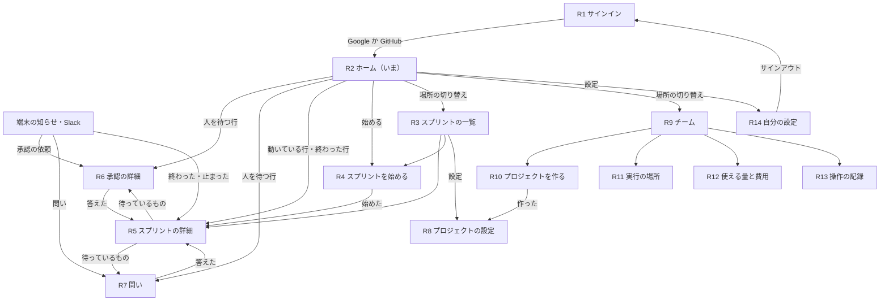
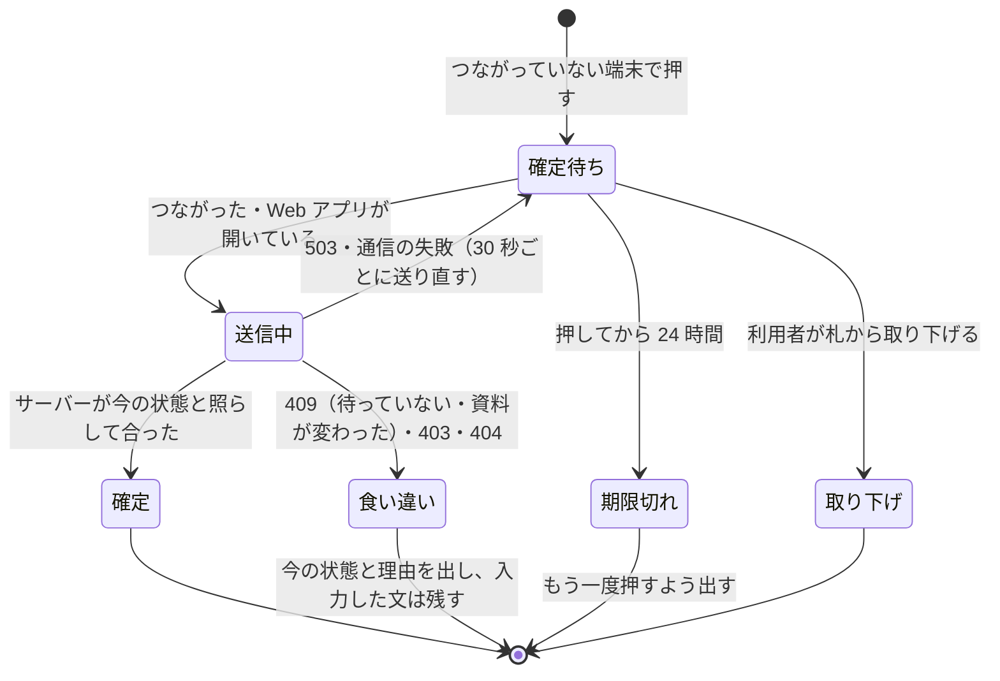

# 画面: どの端末でも、つながらなくても、人を待つものを少ない手数で片づけられる

画面は、[全体の設計](issue-24-design.md) の「利用の場面」（S1〜S6・S12）と「機能一覧」（F1〜F20）を受ける。
MVV の Value 2 の順に、UX の土台（手数の目標・画面の地図・共通の部品・端末の幅・オフライン・国際化）を先に決め、その上に機能の画面を置く。
語・番号・不変条件（I1〜I16）は全体の設計に従う。API の操作は [API の操作の一覧](issue-24-design-api.md#操作の一覧) の名前（`sprints.create` など）で指す。

## この文書で決めること

| 段 | 節 | 決めること | 決定 |
| --- | --- | --- | --- |
| 土台 | [手数の目標](#手数の目標) | 場面ごとの手数とページの数の上限を数で置き、e2e で数える | 20 |
| 土台 | [画面の地図](#画面の地図) | HTTP の経路を 14 本にし、プロジェクトとチームを経路の頭に持つ。経路は URL の path で持つ | 21・38 |
| 土台 | [画面の地図](#画面の地図) | ホーム（いま）はプロジェクトをまたいで並べ、知らせの画面を別に持たない。ナビゲーションは 4 つの行き先 | 22・24 |
| 土台 | [共通の部品とデザインの規約](#共通の部品とデザインの規約) | 「承認する」に確かめのダイアログを置かない。押せる要素は 44 px 以上。ショートカットとコマンドパレットを入れない | 23・25・27 |
| 土台 | [端末の幅](#端末の幅) | 区切りの幅を 640 px と 1024 px の 2 つにする | 26 |
| 土台 | [オフライン](#オフライン) | 控える範囲と期間・暗号化の鍵・ログインの控え・操作の 3 つの区分・サーバーを正にするそろえ方 | 28〜33 |
| 土台 | [国際化](#国際化) | 翻訳のファイルの形・誤りは理由のコードだけ・日時の出し方・右から左は作らない | 34〜37 |
| 機能の画面 | [画面一覧](#画面一覧)・[画面ごとの項目](#画面ごとの項目) | 14 本の経路ごとの機能・API の操作・オフライン・人だけの操作と、画面ごとの項目 | — |
| 機能の画面 | [ダミーデータで作り切る段](#ダミーデータで作り切る段) | ダミーデータを形の正本の見本から作り、API をつなぐ前に画面を作り切る | 39 |

## 手数の目標

利用者がいちばん多く行う場面ごとに、手数（押す・選ぶの回数。文字の入力と IdP の画面の中の操作は数えない）と、通るページの数の上限を置く。
e2e で手数とページの数を数え、上限を超えたら落とす（決定 20）。

| 場面 | 始まり | 終わり | 手数の上限 | ページの数の上限 | 目標の待ち時間 |
| --- | --- | --- | --- | --- | --- |
| S1 始める（課題 1 つ） | ホーム（いま） | 「始めました」の表示 | 3（始めるを開く → 課題を選ぶ → 始める） | 1（スプリントを始める） | 確定から表示まで 2 秒以内 |
| S1 始める（課題 n 個） | ホーム（いま） | 同じ | 2 + n | 1 | 同じ |
| S2 いま | Web アプリを開く（サインイン済み） | 人を待つものと動いているスプリントが読める | 0 | 1（ホーム（いま）） | 端末の控えから 1 秒以内に描き、つながっていれば 3 秒以内に最新へ差し替える |
| S3 承認 | ホーム（いま） | 承認の確定 | 2（承認の行 → 承認する） | 1（承認の詳細） | 確定から結果の表示まで 2 秒以内 |
| S3 差し戻し | ホーム（いま） | 差し戻しの確定 | 3（承認の行 → 差し戻す → 確かめで確定）＋理由の入力 | 1 | 同じ |
| S4 問い | ホーム（いま）か知らせ | 答えの確定 | 3（問いの行 → 選択肢 → 答える） | 1（問い） | 同じ |
| S5 知らせから承認 | 端末の知らせ（Web Push）か Slack | 承認の確定 | 2（知らせ → 承認する） | 1（承認の詳細。ホームを通らない） | 知らせを押してから承認資料が読めるまで 2 秒以内 |
| S6 移動中に読む | オフラインで Web アプリを開く | 最後に受け取ったスプリントと承認資料が読める | S2・S3 と同じ | 同じ | 端末の控えから 1 秒以内 |
| サインインから | サインインの画面 | ホーム（いま） | 1（Google か GitHub）＋ IdP の画面 | 1 | — |

- 手数の上限は「1 つの画面で用が済む」ことを前提にする。承認資料・問いの選択肢・課題の候補を、別のページや GitHub へ移らずに読める。承認資料のうち、コードと差分そのものだけは GitHub へのリンクで代えてよい
- 待ち時間はモバイルの回線（4G 相当）の上で測る。測り方は e2e の回線の絞りで決める

## 画面の地図

### HTTP の経路の一覧

HTTP の経路は 14 本にする。機能ごとの一覧の画面・タブの HTTP の経路・転送の HTTP の経路を持たない（決定 21）。
プロジェクトに属する画面は HTTP の経路の頭に `/p/:projectId` を、チームに属する画面は `/t/:teamId` を持つ。HTTP の経路の ID が割り当ての外のプロジェクトを指すときは、存在しないときと同じ「見つからない」を出す（I2）。

| # | HTTP の経路 | 画面 | 群 |
| --- | --- | --- | --- |
| R1 | `/signin` | サインイン | サインインの前 |
| R2 | `/` | ホーム（いま） | 主 |
| R3 | `/p/:projectId` | スプリントの一覧 | プロジェクト |
| R4 | `/p/:projectId/start` | スプリントを始める | プロジェクト |
| R5 | `/p/:projectId/sprints/:sprintId` | スプリントの詳細 | プロジェクト |
| R6 | `/p/:projectId/approvals/:approvalId` | 承認の詳細 | プロジェクト |
| R7 | `/p/:projectId/questions/:questionId` | 問い | プロジェクト |
| R8 | `/p/:projectId/settings` | プロジェクトの設定 | プロジェクト |
| R9 | `/t/:teamId` | チーム | チーム |
| R10 | `/t/:teamId/projects/new` | プロジェクトを作る | チーム |
| R11 | `/t/:teamId/execution` | 実行の場所 | チーム |
| R12 | `/t/:teamId/usage` | 使える量と費用 | チーム |
| R13 | `/t/:teamId/audit` | 操作の記録 | チーム |
| R14 | `/me` | 自分の設定 | 自分 |

- サインインの戻り（認可コードと `state` の検索の値）は `/` で受け、受けたら履歴から検索の値を消す
- GitHub App を入れた後の戻りは R10 で受ける（検索の値を保ったまま、登録の候補を読み直す）
- 地図に無い HTTP の経路は `/` へ履歴を置き換えて移る。転送の表は持たない
- チームを作る・委任を発行する・手元のマシンを登録するは、それぞれ R9・R14・R11 の中のダイアログにし、HTTP の経路を足さない

### 遷移

### ナビゲーション

ナビゲーションの行き先は 4 つに絞り、どの幅でも同じ 4 つを同じ順で並べる（決定 24）。

| 幅 | 置き場 |
| --- | --- |
| スマートフォン | 画面の下の帯 |
| タブレット | 左の細い帯（アイコンと短い名前） |
| PC | 左の帯（アイコンと名前・場所の切り替え） |

| 順 | 行き先 | HTTP の経路 | 添えるもの |
| --- | --- | --- | --- |
| 1 | いま | R2 | 人を待つものの数（承認の依頼と問いの和。0 は出さない。99 を超えたら `99+`）。数は名前に含めず説明として読み上げる |
| 2 | スプリント | 今のプロジェクトの R3（プロジェクトを選んでいなければ場所の切り替えを開く） | — |
| 3 | 始める | 今のプロジェクトの R4（同じ） | — |
| 4 | 設定 | R14。PC の帯では、席の役割が持ち主のときチームの行き先（R9・R11・R12・R13）を区切りの下に足す | — |

- Web アプリのアイコンの数（Badging）にも、同じ「人を待つものの数」を出す（PRD20・STD28）。知らせの許可が無い端末では出さない
- 帯の各項目は 44 px 以上で、今の行き先に `aria-current="page"` を付ける

### チームとプロジェクトの切り替え

今いる場所（チーム › プロジェクト）を、スマートフォンでは画面の上の帯の題に、タブレットと PC では帯の上端に出す。押すと場所の一覧を開く。

| 項目 | 決まり |
| --- | --- |
| 一覧の中身 | 席を持つチームを名前の順に、その下に各チームのプロジェクトを名前の順に並べる。末尾に「チームを作る」 |
| 選ぶと | プロジェクトなら R3、チームなら R9 へ移る |
| 今の場所の控え | 最後に開いたプロジェクトの ID を端末の控え（暗号化）に置き、ナビゲーションの「スプリント」「始める」の行き先にする。控えのプロジェクトが一覧に無くなったら控えを消す |
| ホーム（いま） | プロジェクトを選ばず、見られるすべてのプロジェクトをまたいで並べる（決定 22）。上の絞り込みでプロジェクトを 1 つに絞れる（絞りは控えない） |
| 個人で使う人 | 1 人のチームとして同じ一覧に出す。チームが 1 つ・プロジェクトが 1 つなら、一覧を開かずに題だけを出す |
| 一覧に出すもの | 自分の席の分だけ。割り当ての外のプロジェクトは名前も数も出さない（I2） |

## 共通の部品とデザインの規約

### 共通の部品

画面は次の部品だけで組む。部品は `apps/web/src/ui/` に 1 つのファイルで 1 つ置き、部品の一覧と置き場の一致をテストで照らす。

| 部品 | 何をするか | 決まり |
| --- | --- | --- |
| 枠 | サインインの後の画面を包む。ナビゲーション・場所の切り替え・オフラインの帯を持つ | 幅ごとの形は「端末の幅」の表 |
| 上の帯 | 画面の題（`h1`）・説明の 1 行・主の操作（0 か 1 つ） | スマートフォンでは主の操作を画面の下の固定の帯へ移す |
| 一覧 | 同じ形の行を並べる。行を押すと詳細へ移る | 行は 44 px 以上。スマートフォンでは 1 行を 1 枚のカードに積み、タブレットより広い幅では列の表にする |
| 詳細 | 1 件の名前と値の組 | スマートフォンでは名前と値を縦に積む |
| 畳む節 | 見出しを押すと開閉する節（`aria-expanded`） | 開閉の状態は端末の控えに置く |
| 状態の札 | 状態を色と文言の組で出す | 色だけで状態を示さない（WCAG 1.4.1）。頭に調子ごとに形の違うアイコンを置く |
| 空の状態 | 0 件・見つからない | 何が無いか・次にすること（行き先へのリンク）の 2 段 |
| 読み込み中 | 初めての読み込み | 端末の控えがあれば出さず、控えを出したまま裏で読む。動きを減らす設定では回らない |
| 誤りの表示 | 読めない・送れない | 理由の文（理由のコードを翻訳した文）と、やり直せるなら「もう一度」。画面を白くしない |
| 確かめのダイアログ | 取り消せない操作の確かめ（決定 23 の行だけ） | `role="dialog"`・`aria-modal`。開いた間フォーカスを中に留め、Esc で閉じる。確定のボタンに操作の名前を書く（「OK」にしない） |
| オフラインの帯 | つながっていないこと・最後に受け取った時刻・確定待ちの数 | 枠の上端に 1 本。`role="status"` で読み上げる |
| 確定待ちの札 | 確定待ちの操作がある行と画面に付ける | 「つながってから確定」と期限の時刻。押すと控えを取り下げられる |
| 操作の結果 | 操作が通った・通らなかったの 1 文 | 通ったときは `role="status"`、通らなかったときは `role="alert"` |
| 時刻 | 日時を相対か絶対で出す | 「国際化」の日時の表。`<time datetime>` に UTC の値を置く |
| 金額 | 通貨つきの金額を出す | 通貨の無い金額を受けない（I15） |
| 資料の本文 | 承認資料・問いの本文を出す | Markdown を安全な部分だけで描く（HTML を通さない）。表とコードは横に送れる箱に入れ、本文の幅をはみ出さない |
| ボタン・入力欄・選択の欄 | 操作と入力 | ラベルは欄の上。入力欄の文字は 16 px 以上（スマートフォンの拡大を起こさない） |

### 状態の札の調子

| 調子 | 使う状態 | 色の役割 |
| --- | --- | --- |
| 人を待つ | 承認の依頼が待っている・問いが待っている | 承認（緑） |
| 動いている | スプリント・レーンが動いている | 情報（青） |
| 終わった | 終わった・承認された・答えた | 完了（紫） |
| 止まった | 上限で止まった・予定外に止まった | 注意（黄） |
| 失敗 | 失敗した・差し戻された・送達できなかった | 危険（赤） |
| 中立 | 待っている（始まっていない）・取り消した | 中立（灰） |
| 確定待ち | つながってから確定する操作がある | 中立の地に点線の枠（色だけに頼らず形で分ける） |

### デザインの規約

| 項目 | 決まり |
| --- | --- |
| 値の置き場 | 色・文字・余白・角・動きの値は Design Tokens Format の JSON（`apps/web/src/ui/tokens.json`、ダークは `tokens.dark.json`）に置き、ビルドで CSS の変数へ写す。部品と画面のコードに色の値を直に書かない |
| 色の役割 | 地・面・本文・補足・区切り・主の操作・フォーカス、と上の 7 つの調子（文字と地の組）。主の操作は藍、承認ゲートの「承認する」だけを緑の地にする |
| テーマ | OS の設定（`prefers-color-scheme`）に従う。画面に切り替えを置かない |
| 文字の大きさ | 本文 16 px・補足 14 px・節の見出し 18 px・画面の題 22 px。すべて `rem` で書き、利用者の文字の大きさの設定に従う（200% まで崩れない。WCAG 1.4.4） |
| 書体 | 端末の書体（`system-ui` と日本語の書体の並び）。外部から書体を読まない。識別子・SHA・ブランチの名前は等幅で訳さない |
| 触れる大きさ | 押せる要素はすべての幅で幅と高さとも 44 px 以上（決定 25）。文中のリンクは除く |
| 余白 | 4 の倍数（4・8・12・16・24・32 px）だけを使う |
| キーボード | すべての操作を Tab・Shift+Tab・Enter・Space・Esc・矢印で行える。本文へ飛ぶリンクを先頭に置く。1 文字のショートカットとコマンドパレットは持たない（決定 27） |
| フォーカス | `:focus-visible` で 2 px の輪。固定の帯（下の帯・主の操作の帯）がフォーカスした要素を隠さない（WCAG 2.4.11） |
| アクセシビリティの水準 | WCAG 2.2 の AA（STD23）。加えて触れる大きさは 2.5.5（44 px）に合わせる。320 CSS px の幅で横にはみ出さない（1.4.10） |
| 動き | 色の移り変わり 120 ms・ダイアログ 180 ms。動きを減らす設定では動かさない |
| 文言 | 画面のコードに文言を書かない。翻訳のファイルのキーで引く（「国際化」） |
| 状態を省かない | どの画面も、読み込み中・空・誤り・見つからない（権限なしも同じ）・オフラインの 5 つを持つ。画面ごとの表は「画面ごとの項目」 |

## 端末の幅

区切りの幅は 640 px と 1024 px の 2 つにする（決定 26）。部品は CSS だけで形を変え、画面のコードは幅を知らない。

| 区分 | 幅 | 代表の幅 | ナビゲーション | 場所の切り替え | 本文 | 一覧と詳細 | 主の操作 |
| --- | --- | --- | --- | --- | --- | --- | --- |
| スマートフォン | 640 px 未満 | 360・390 px | 画面の下の帯（4 つ、セーフエリアの内側） | 上の帯の題を押して開く | 1 段。左右 16 px の余白 | 一覧と詳細は別のページ。一覧の行はカード | 下の帯の上に固定の帯 |
| タブレット | 640 px 以上 1024 px 未満 | 768・834 px | 左の細い帯（幅 80 px、アイコンと短い名前） | 帯の上端のボタン | 1 段。左右 24 px | 一覧は列の表。詳細は別のページ | 上の帯の右端 |
| PC | 1024 px 以上 | 1280・1440 px | 左の帯（幅 240 px、アイコンと名前） | 帯の上端に名前を出す | 幅の上限 1200 px。左右 32 px | ホーム（いま）とスプリントの一覧は、行を選ぶと右に詳細を開く 2 段（選んだ行は HTTP の経路に出す） | 上の帯の右端 |

- 3 つの区分のどれでも、横にはみ出さない。e2e は 360・768・1280 px の 3 つの幅ですべての HTTP の経路を開いて確かめる
- 端末を横にしたスマートフォン（高さが 500 px 未満）は、下の固定の帯を 1 つにまとめ、本文の高さを残す
- PC の 2 段で開いた詳細は、同じ HTTP の経路（R5・R6・R7）を右に描いたもので、HTTP の経路と中身を別に持たない

## オフライン

### 端末に控えるもの

端末に控えるのは、サーバーから受け取った中身の写しと、まだ送れていない操作（控えと確定待ち）だけである。サーバーが常に正で、控えの写しは読み出し専用の写しとして扱う（決定 28・29）。

| 控えるもの | 範囲 | 期間 |
| --- | --- | --- |
| 画面の殻（HTML・JS・CSS・アイコン・翻訳のファイル） | 今の版の 1 揃い | 新しい版が入るまで |
| 画面の設定の値（`/config.json`） | 1 件 | 次につながって読めるまで |
| ホーム（いま）の中身 | 見られるプロジェクトの人を待つもの・動いているスプリント・終わったもの（7 日分） | 受け取ってから 14 日 |
| スプリントの一覧 | プロジェクトごとに新しい順の 50 件 | 同じ |
| スプリントの詳細 | 動いているスプリントと、開いたスプリント | 同じ |
| 承認の依頼と承認資料・問い | 待っているもの全部と、開いたもの | 同じ |
| 知らせ | 新しい順の 100 件と既読の位置 | 同じ |
| 自分の設定（言語・時刻帯・呼び名）・場所の一覧（チームとプロジェクトの名前） | 全部 | 同じ |
| ログインの控え | 1 件 | refresh token の期限（30 日。[API の文書の token の寿命](issue-24-design-api.md#token-の寿命)）まで（決定 31） |
| 控えて送る操作・確定待ちの操作 | 全部 | 確定待ちは押してから 24 時間（決定 32） |

控えないもの: 操作の記録・チームのメンバーの一覧・使える量と費用・実行の場所・委任の一覧と token・通知先の宛先の値・課題の候補。これらはつながっているときだけ読む画面で、つながっていないときは「つながると読めます」を出す。

- 14 日を過ぎた写しは、Web アプリを開いたときに消す。消したものは「控えが古いので消しました」を出さず、空の状態として出す
- Web アプリを開いたとき、ストレージを消されにくくする許し（`navigator.storage.persist()`）を求める。断られても動く（PRD21）
- ブラウザのタブで使う Safari では、使わない日が 7 日続くと控えが消されうる。ホーム画面に加えた Web アプリはこの数え方が別である（PRD21）。画面は控えが消えていても空の状態として動き、ホーム画面に加えることを自分の設定の通知先の節で勧める
- 端末に入れる Web アプリとして、Web App Manifest（名前・`start_url: "/"`・`display: "standalone"`・`scope: "/"`・アイコン・`lang`）と Service Worker を持つ（STD20・STD21）。画面の設定の値はつながっていれば毎回読み、読めなければ Service Worker の控えを使う（決定 28）

### 暗号化

| 項目 | 決まり |
| --- | --- |
| 置き場 | IndexedDB の 1 つのデータベース（名前は利用者ごとに分けない。中身に利用者の ID を持つ） |
| 鍵 | Web Crypto で作る AES-GCM 256 ビットの鍵。`extractable` を偽にして作り、`CryptoKey` のまま IndexedDB に置く。鍵の生の値は JS からも取り出せない（STD24・決定 30） |
| 暗号化の単位 | 1 件ごと（1 つのスプリント・1 つの承認の依頼など）に、毎回新しい 12 バイトの初期値で暗号化する。索引に使う値（種類・プロジェクトの ID・受け取った時刻）だけを平文で持つ |
| 読めないとき | 鍵が無い・復号に失敗したら、写しをすべて消し、オンラインなら読み直す。オフラインなら空の状態を出す |
| Service Worker の控え | 画面の殻と画面の設定の値だけを Cache Storage に置く。API の応答は Cache Storage に置かない（暗号化されない置き場に中身を残さない） |

### サインアウトで消す

サインアウト（自分の設定の「サインアウト」）は、次をこの順で行い、終わってからサインインの画面へ移る。

1. この端末の Web Push の購読を外し、サーバーの通知先からこの端末を外す。つながっていないときは外す操作を確定待ちに残さない。サーバーが次に送ろうとして購読の失効を受けたときに外す
2. 確定待ちと控えて送る操作を捨てる（捨てる数を確かめのダイアログで出す）
3. IndexedDB のデータベースと鍵を消す
4. ログインの控えを消し、IdP のサインアウトへ移る

別の利用者がサインインしたときも、前の利用者の写しと鍵を消してから始める。

### 操作の 3 つの区分

画面の操作を、つながっていないときの扱いで 3 つに分ける（決定 32）。

| 区分 | つながっていないとき | つながったとき | 当たる操作 |
| --- | --- | --- | --- |
| 控えて送る | 押せる。画面の写しに先に映し、控えに積む | 積んだ順に送る。通らなければ写しを読み直して元に戻し、理由を出す | 知らせを既読にする・呼び名・言語・時刻帯を変える・畳む節の開閉（端末だけ） |
| 確定待ち | 押せる。押すと確定せず、確定待ちの札を出す。押した時点の版（承認資料の要約値・依頼の状態）を一緒に控える | Web アプリが開いている間に送る。サーバーが今の状態と控えた版を照らし、合えば確定、合わなければ食い違いを出す | 承認する・差し戻す・問いに答える・スプリントを取り消す・割り当てを移す・受け入れる・取り下げる・閉じる |
| つながってから押す | 押せない。ボタンの下に「つながると使えます」 | 押せる | スプリントを始める（課題の候補と使える量をその場で読む）・委任の発行と取り消し（token を一度だけ返す）・通知先を足す・試す・外す・リポジトリの登録と外す・チームの人を招く・役割を変える・外す・手元のマシンの登録と外す・持ち込みのキーを足す・外す・実行の場所と上限額を変える・プロジェクトを作る・チームとプロジェクトの名前を変える・サインインの手段をつなぐ・外す |

- 確定待ちの送信は、押したときに画面が作った答えの ID を冪等の鍵にする（I5）。同じ操作を 2 回送っても 1 回として扱われる
- 同じ対象（同じ承認の依頼など）への確定待ちは 1 つだけ持ち、後から押した方で置き換える
- Web アプリが閉じている間は送らない。裏で送る仕組み（Background Sync）は W3C の標準の道に無く（STD27）、iOS で頼れないので使わない。開いたとき・つながったとき・画面が見えるようになったときに送る
- 確定待ちがあるときは、オフラインの帯と、ナビゲーションの「いま」に数を出す。サインアウトでは捨てる前に数を確かめる

### つながったときのそろえ方

| 段 | 決まり |
| --- | --- |
| 1. 確定待ちと控えを送る | 上の表のとおり。先に送り、送り終えてから読み直す（自分の操作が読み直しで消えて見えないように） |
| 2. 見ている画面を読み直す | 開いている画面の中身を読み直し、写しを丸ごと置き換える（サーバーが正）。写しの中で書き換えた値は無いので、写しどうしを混ぜる処理を持たない |
| 3. ホーム（いま）を読み直す | 人を待つものの数とアイコンの数を合わせる |
| 4. 消えたものを消す | 読み直しで返らなかった（終わった・見えなくなった）行を写しから消す。見る権限を失ったプロジェクト（割り当ての変更）の写しは、そのプロジェクトの分を丸ごと消す |

- つながっている間の新しさは 2 つで保つ。画面が見えている間の 30 秒ごとの読み直しと、Web Push を受けた Service Worker から画面への知らせ（届いた依頼の ID）である。画面が隠れている間は読み直さない
- 読み直しに失敗しても前の表示を残し、上に「読み直せませんでした（時刻）」を出す
- 食い違いは「サーバーの今の状態」と「自分が押したもの」を並べて出す。例: 「この承認の依頼は、承認資料が変わりました。新しい資料を読んでから、もう一度答えてください」

## 国際化

| 項目 | 決まり |
| --- | --- |
| 翻訳のファイルの置き場 | `apps/web/src/i18n/<言語のタグ>.json`（例: `ja.json`・`en.json`）。言語のタグは BCP 47 |
| 形 | i18next の JSON v4 の形に倣う（LIB20）。キーは入れ子のオブジェクト、差し込みは `{{name}}`、複数の形は `_one`・`_other` などの接尾辞で、`Intl.PluralRules` が選ぶ。引き当ては自前の小さな関数で行う（決定 34） |
| キーの決まり | `<画面か部品>.<節>.<意味>`。小文字の lowerCamelCase を `.` でつなぐ（例: `home.waiting.title`・`approval.actions.approve`）。誤りの文だけは `errors.reason.<理由のコード>` で、理由のコードの字をそのまま使う（例: `errors.reason.not_found`）。文言そのものをキーにしない |
| 原文の言語 | 日本語（`ja.json`）。キーの型は `ja.json` から作り、無いキーは型検査で落ちる |
| 最初の言語 | 日本語と英語。2 つのファイルのキーの集合が同じことを検査で照らし、欠けを落とす |
| 言語を足す | 翻訳のファイルを 1 つ足し、言語の一覧（`apps/web/src/i18n/locales.ts`）に 1 行足す。画面のコードは変えない |
| 言語の決め方 | 自分の設定の言語 → ブラウザの言語（`navigator.languages` の最初に当たるもの）→ 日本語。決まった言語を `<html lang>` に入れる |
| 誤りの文 | API は理由のコード（`not_found`・`state_mismatch` など。[API の文書の誤りの形](issue-24-design-api.md#誤りの形)）だけを返し、画面が `errors.reason.<コード>` の文に替える。表に無いコードは汎用の文を出し、コードの文字列をそのまま出さない（決定 35） |
| 画面の外の文言 | Web Push と Slack の文面は、受ける利用者の言語で送り手が作る（[実行の文書](issue-24-design-execution.md)が受ける）。画面と同じキーの決まりの翻訳のファイルを使う |

### 日時・数・金額

| 値 | 受け取る形 | 出し方 |
| --- | --- | --- |
| 日時 | API から UTC の ISO 8601（末尾 `Z`） | `Intl.DateTimeFormat` に利用者の言語と時刻帯（自分の設定 → ブラウザの時刻帯）を渡して出す（STD26） |
| 相対の時刻 | 同じ | 24 時間より前でなければ `Intl.RelativeTimeFormat` で「3 分前」の形。それより前は日付と時刻。一覧は相対、詳細は絶対で出し、どちらも `<time datetime>` に UTC の値を置く。相対の時刻は画面が見えている間 1 分ごとに描き直す |
| 待ち時間 | 待ち始めた時刻 | 「待って 12 分」の形（相対の時刻と同じ関数） |
| 数 | 数 | `Intl.NumberFormat`。件数の複数の形は `Intl.PluralRules` |
| 金額 | 金額と ISO 4217 の通貨の組（形は [API の文書の値の形](issue-24-design-api.md#値の形)） | `Intl.NumberFormat` の `style: "currency"`。通貨を画面で換算しない。通貨の無い金額は描かずに誤りの表示を出す（I15） |
| 時刻帯の一覧 | — | `Intl.supportedValuesOf("timeZone")` の IANA の名前から選ぶ |

### 右から左の言語

右から左に書く言語（アラビア語・ヘブライ語など）のための向きの切り替え・アイコンの左右の反転・その検査は作らない。CSS の余白と配置は論理の向き（`margin-inline-start` など）で書く。後で向きを足すときに CSS を書き換えずに済む形だけを残す（決定 37）。

## 画面一覧

「機能」は全体の設計の機能一覧の番号である。「読む・書く API の操作」は [API の操作の一覧](issue-24-design-api.md#操作の一覧) の名前である。どの操作も配列で受け渡す（I12）。
「オフライン」は、つながっていないときに最後に受け取った中身を読めるか。「人だけの操作」は、API の操作の一覧で「人だけ」の印を持ち、委任からは確定できず、画面でだけ人が確定する操作である（I4・I3。MCP では対になる読み出しの道具だけを持つ）。

| HTTP の経路 | 画面 | 機能 | 読む・書く API の操作 | オフライン | 人だけの操作 |
| --- | --- | --- | --- | --- | --- |
| R1 `/signin` | サインイン | F1 | （IdP へ移る）・`sessions.create`（IdP から `/` へ戻った後） | 開ける（つながると使えます） | `sessions.create` |
| R2 `/` | ホーム（いま） | F7・F9・F14 | `approvals.list`・`questions.list`（人を待つもの）・`sprints.list`（動いている・終わった）・`waiting_counts.get`（待ちの数）・`notices.list`・`notices.mark_read`・`teams.list`・`projects.list`（場所の一覧） | 読める | — |
| R3 `/p/:projectId` | スプリントの一覧 | F9 | `projects.get`・`sprints.list` | 読める | — |
| R4 `/p/:projectId/start` | スプリントを始める | F8・F17・F19 | `issue_candidates.list`・`usage.get`・`execution_settings.get`・`sprints.create` | 読めない | — |
| R5 `/p/:projectId/sprints/:sprintId` | スプリントの詳細 | F9・F10・F11・F13 | `sprints.get`・`lanes.list`・`progress_events.list`・`usage_records.list`（費用）・`approvals.list`・`questions.list`（このスプリントの待ち）・`sprints.cancel` | 読める | — |
| R6 `/p/:projectId/approvals/:approvalId` | 承認の詳細 | F11・F12・F14 | `approvals.get`・`approvals.answer`・`notices.mark_read` | 読める（確定は確定待ち） | `approvals.answer`（I4） |
| R7 `/p/:projectId/questions/:questionId` | 問い | F13・F14 | `questions.get`・`questions.answer`・`notices.mark_read` | 読める（答えは確定待ち） | レッドラインに当たる問いへの `questions.answer`（I4） |
| R8 `/p/:projectId/settings` | プロジェクトの設定 | F4・F5・F6 | `projects.get`・`projects.update`（名前）・`repositories.list`・`repositories.add`・`repositories.remove`・`github_installations.list`・`project_transfers.list`・`project_transfers.create`・`project_transfers.delete`・`projects.close` | 読めない | `project_transfers.create`・`project_transfers.delete`・`projects.close`（I3・P2） |
| R9 `/t/:teamId` | チーム | F3・F4・F6 | `teams.get`・`teams.update`（名前）・`teams.create`・`seats.list`・`seats.update`・`seats.delete`・`invitations.list`・`invitations.create`・`invitations.delete`・`invitations.accept`（招かれた人が招待のリンクから開いたとき）・`projects.list`・`project_transfers.list`・`project_transfers.accept` | 読めない | `teams.create`・`seats.update`・`seats.delete`・`invitations.create`・`invitations.delete`・`invitations.accept`・`project_transfers.accept`（I3・P2） |
| R10 `/t/:teamId/projects/new` | プロジェクトを作る | F4・F5 | `github_installations.list`（導入の状態とリポジトリの候補）・`github_installations.link`（GitHub から戻ったとき）・`projects.create`（割り当てとリポジトリの登録を同じ操作で） | 読めない | `github_installations.link`・`projects.create`（I3・P2） |
| R11 `/t/:teamId/execution` | 実行の場所 | F17・F18 | `execution_settings.get`・`execution_settings.update`・`model_keys.list`・`model_keys.create`・`model_keys.delete`・`machines.list`・`machines.create`・`machines.delete` | 読めない | `execution_settings.update`・`model_keys.create`・`machines.create` |
| R12 `/t/:teamId/usage` | 使える量と費用 | F19 | `usage.get`・`usage_records.list`・`spend_caps.update` | 読めない | `spend_caps.update` |
| R13 `/t/:teamId/audit` | 操作の記録 | F20 | `audit_records.list`（チームとそのプロジェクト、絞り込み: プロジェクト・主体・入口・期間） | 読めない | — |
| R14 `/me` | 自分の設定 | F1・F2・F15・F16 | `users.get`・`users.update`・`logins.create`・`logins.delete`・`notification_targets.list`・`notification_targets.create`・`notification_targets.test`・`notification_targets.delete`・`delegations.list`・`delegations.create`・`delegations.revoke`・`sessions.delete`（サインアウト） | 読める（自分の設定だけ） | `logins.create`・`logins.delete`・`notification_targets.create`・`delegations.create`・`delegations.revoke`・`sessions.delete` |

F1〜F20 はどれも 1 回以上この表に現れる。画面にしか無い操作は無く、どの操作も API の操作の一覧と MCP の道具にある（I14）。画面の操作と形の正本の操作の一覧の対応を検査で照らす。

## 画面ごとの項目

どの画面も次の共通の状態を持つ。画面ごとの表には、共通と違うところだけを書く。

| 状態 | 共通の出し方 |
| --- | --- |
| 読み込み中 | 写しがあれば写しを出したまま裏で読む。写しが無ければ読み込み中 |
| 空 | 空の状態（何が無いか・次にすること） |
| 誤り（5xx・通信の失敗） | 誤りの表示と「もう一度」。写しがあれば写しを残し、上に「読み直せませんでした（時刻）」 |
| 見つからない（404。割り当ての外も同じ） | 「見つからないか、見る権限がありません」。存在するかを区別しない（I2）。そのプロジェクトの写しを消す |
| 401 | ログインの控えで token を取り直し、取り直せなければサインインへ |
| オフライン | オフラインの帯を出し、写しを出す。控えない画面は「つながると読めます」 |

### ホーム（いま）

サインインの後に最初に開く画面。人を待つもの（承認の依頼・問い）を先頭に、動いているスプリントを続けて、終わったものを畳んで並べる（決定 22）。

| 節 | 並ぶもの | 並べ方 | 1 行の項目 |
| --- | --- | --- | --- |
| 人を待つもの | 待っている承認の依頼と問い | 待ち始めた古い順（長く待たせているものが上） | 種類の札（設計承認・リリース承認・レッドライン・問い）・プロジェクトの名前・リポジトリ・課題・題・待ち時間・未読の点・確定待ちの札 |
| 動いているスプリント | 動いている・止まったスプリント | 最後の動きの新しい順。止まったもの（上限・失敗）を動いているものより上 | プロジェクトの名前・スプリントの題（課題の数）・状態の札・レーンの進み（終わったレーンの数 / レーンの数）・今の工程・最後の動きの時刻・費用 |
| 終わったもの（畳む） | 7 日以内に終わった・取り消した・失敗したスプリント | 終わった新しい順 | プロジェクトの名前・題・状態の札・終わった時刻・未読の点 |

| 操作 | 結果 |
| --- | --- |
| 行を押す | 承認の詳細・問い・スプリントの詳細へ（PC は右の段に開く）。押した行の知らせを既読にする（`notices.mark_read`） |
| プロジェクトで絞る | 上の絞り込みの帯でプロジェクトを 1 つ選ぶ。全部へ戻せる |
| すべて既読にする | 終わったものの節の見出しの操作（`notices.mark_read`）。控えて送る |
| 始める（主の操作） | 今のプロジェクトの R4。プロジェクトが無いときはチームの R9 の「プロジェクトを作る」へ |

| 状態 | 出し方 |
| --- | --- |
| 人を待つものが 0 | 節の中に「人を待つものはありません」の 1 行（空の状態の大きな表示にしない） |
| すべての節が 0 | 空の状態「動いているスプリントはありません」と「スプリントを始める」 |
| プロジェクトが 0 | 空の状態「プロジェクトがありません」と、持ち主には「プロジェクトを作る」、メンバーには「チームの持ち主にプロジェクトを作ってもらってください」 |
| 一部のプロジェクトを読めない | 読めた分を出し、読めなかった数だけを上に出す（名前は出さない） |

### スプリントを始める

| 項目 | 型 | 必須 | 上限 | 満たさないときの表示 |
| --- | --- | --- | --- | --- |
| 課題 | 課題の候補からの複数の選択（リポジトリごとに見出し。NDF の棚卸しの順位があれば順位の順、無ければ GitHub の更新の新しい順） | 必須 | 1 回 20 件 | 「課題を 1 つ以上選んでください」・「1 回に選べるのは 20 件までです」 |
| 絞り込み | 文字列（題と番号） | — | 100 字 | — |
| 課題の番号で足す | `<リポジトリ>#<番号>` | — | — | 「このプロジェクトのリポジトリの課題ではありません」 |

| 表示 | 中身 |
| --- | --- |
| レーンの計画 | 選んだ課題をリポジトリごとのレーンにまとめて出す。レーンの順（`after`）は既定で空（並列）で、始める人がレーンの間に順を付けられる。輪になる順は付けられない。計画の作り方は[実行の文書のスプリントを始める流れ](issue-24-design-execution.md#スプリントを始める流れ)が決める |
| 実行の場所と推論の手段 | チームの既定を読むだけで出す（変えるのは R11） |
| 使える量 | 今月の使った額と上限額（通貨つき）。上限に当たっていれば、判定が返した理由を出して「始める」を押せなくする（I8。画面はプランの名前で分岐しない） |

| 操作 | 結果 | 失敗の見せ方 |
| --- | --- | --- |
| 始める（主の操作。`sprints.create`） | 確定すると R5 へ移り「始めました」 | 上限（E16）: 理由と R12 へのリンク。GitHub App が課題を読めない: 「リポジトリを読めません」と R8 へのリンク。同じ冪等の鍵の 2 回目: 前に始めたスプリントへ移る |

課題の候補が 0 件なら「このプロジェクトに開いている課題がありません」と GitHub の課題へのリンクを出す。オフラインでは開けるが、候補を出さず「つながると使えます」を出す。

### スプリントの詳細

| 節 | 項目 |
| --- | --- |
| 見出し | 題・状態の札・プロジェクト・始めた人と時刻・実行の場所・推論の手段・費用（通貨つき） |
| 人を待つもの | このスプリントで待っている承認の依頼と問い（ホームと同じ行） |
| レーン | リポジトリごとに 1 行: 状態の札・今の工程・`after` の待ち・課題ごとの状態・PR へのリンク・CI の結果 |
| 進捗の事象 | 新しい順の 50 件（下で古い分を読み足す）。種類・レーン・時刻・1 行の要約 |
| 止まった理由 | 止まった・失敗したときだけ、理由と次にすること |

| 操作 | 結果 | 失敗の見せ方 |
| --- | --- | --- |
| 取り消す（`sprints.cancel`） | 確かめのダイアログ（止まるレーンの数と、取り消せないこと）→ 確定。オフラインでは確定待ち | 409（もう終わっている）: 今の状態を出して読み直す |

### 承認の詳細

1 つの画面で、承認資料を読み、承認するか差し戻すかを確定する。承認資料は GitHub を開かずに全文を読める（コードと差分そのものだけはリンク）。

| 節 | 項目 |
| --- | --- |
| 見出し | 種類の札（設計承認ゲート・リリース承認ゲート・レッドライン）・プロジェクト・リポジトリ・課題・PR へのリンク・待ち始めた時刻と待ち時間・スプリントの詳細へのリンク |
| 承認資料 | 題・目的・差分の要約・決めたこと・検査の結果・リンク。資料の本文の部品で描く。末尾に要約値の先頭 8 文字 |
| 答える | 「承認する」（緑の地）・「差し戻す」。承認ゲートの結果の `routes` にあるときだけ、残りの答え（承認しない・打ち直す・終える。[実行の文書の差し戻し](issue-24-design-execution.md#差し戻し)）を「ほかの答え」の下に出す。スマートフォンでは画面の下の固定の帯 |

| 項目 | 型 | 必須 | 上限 | 満たさないときの表示 |
| --- | --- | --- | --- | --- |
| 差し戻す理由 | 複数行の文字列 | 差し戻しでは必須 | 10,000 字 | 「差し戻す理由を書いてください」 |

| 操作 | 結果 |
| --- | --- |
| 承認する（`approvals.answer`、答えの語 `approved`） | 確かめのダイアログを出さずに確定する（決定 23）。読んでいる資料の要約値を一緒に送り、サーバーが今の要約値と照らす |
| 差し戻す（`approvals.answer`、答えの語 `revise`） | 理由の欄を開き、「差し戻しを確定する」で確定する |
| ほかの答え（`approvals.answer`、`rejected`・`retry`・`finish`・`cancel` のうち `routes` にあるもの） | 確かめのダイアログ（レーンが止まるかどうか）で確定する |

| 状態 | 出し方 |
| --- | --- |
| 待っている | 答えるボタン |
| 答え済み | ボタンの代わりに、答え・答えた人・時刻 |
| 待っていない（取り消した・別の端末や入口から答えた） | 「この依頼はもう答えを待っていません」と今の状態 |
| 資料が変わった（409） | 「承認資料が変わりました」と新しい資料を出し、もう一度押させる |
| 答えを NDF へ渡せていない | 「答えは受け付けました。実行へ渡しています」（送達の状態を読み直す） |
| 確定待ち | 確定待ちの札・期限・取り下げ |

### 問い

| 節 | 項目 |
| --- | --- |
| 見出し | 区分の札・人だけの札（レッドラインに当たる問い）・プロジェクト・スプリント・レーン・待ち時間 |
| 問い | 問いの本文（資料の本文の部品）・背景 |
| 選択肢 | 選択肢を 1 つずつ（説明つき）。推しの案に「推し」の札を付ける。前もって選んでおかない |

| 項目 | 型 | 必須 | 上限 | 満たさないときの表示 |
| --- | --- | --- | --- | --- |
| 選択肢 | 1 つの選択 | 選択肢がある問いでは必須 | — | 「選択肢を選んでください」 |
| 添える文 | 複数行の文字列 | 選択肢が無い問いでは必須 | 10,000 字 | 「答えを書いてください」 |

答えるは `questions.answer` で確定する。状態と失敗の見せ方は承認の詳細と同じ（答え済み・待っていない・409・確定待ち）。

### 設定の各画面

| 画面 | 主な項目 | 主な操作 | 失敗と状態の見せ方 |
| --- | --- | --- | --- |
| 自分の設定（R14） | 呼び名（0〜32 字）・言語（選択）・時刻帯（選択）・サインインの手段（Google・GitHub）・通知先（この端末の Web Push・Slack）・委任の一覧（クライアントの名前・範囲・期限・最後に使った時刻・状態）・サインアウト | 設定を変える（`users.update`。控えて送る）・サインインの手段をつなぐ・外す（`logins.create`・`logins.delete`。つなぐは IdP へ移って戻る。最後の 1 つは外せない）・この端末へ知らせを受ける（`notification_targets.create`。押したときだけ許可を求める）・試す（`notification_targets.test`）・外す（`notification_targets.delete`）・委任を発行する（`delegations.create`。ダイアログ。token は 1 度だけ出し、写す操作を置く）・取り消す（`delegations.revoke`。確かめのダイアログ）・サインアウト（`sessions.delete`） | Web Push の許可を断られた: 端末の設定から許す案内。iOS でホーム画面に加えていない: 「ホーム画面に加えると知らせを受けられます」と手順（PRD20）。Slack の宛先の値は保存の後に出さず、末尾 4 字だけ |
| チーム（R9） | チームの名前・席の一覧（呼び名・役割・加えた時刻）・招待の一覧・プロジェクトの一覧・受け入れ待ちの割り当て | 名前を変える（`teams.update`）・人を招く（`invitations.create`）・招待を取り下げる（`invitations.delete`）・役割を変える（`seats.update`）・外す（`seats.delete`。確かめ）・チームを作る（`teams.create`。ダイアログ）・プロジェクトを作る（R10 へ）・割り当てを受け入れる（`project_transfers.accept`。人だけ・確かめ）。招かれた人が招待のリンクから開いたときは、招待を受ける（`invitations.accept`）だけを出す | メンバーには操作を出さず読むだけ。最後の持ち主を外す・メンバーにする: 409 の理由を出す |
| プロジェクトを作る（R10） | 名前（1〜100 字）・割り当てるチーム（今のチーム）・GitHub App の導入の状態・リポジトリの候補（主を 1 つ、サブを 0 以上選ぶ） | GitHub App を入れる（GitHub へ移り R10 へ戻る。戻りで `github_installations.link`）・作る（`projects.create`） | 主が 0 か 2 つ: 「主のリポジトリを 1 つ選んでください」（I1） |
| プロジェクトの設定（R8） | 名前・リポジトリ（主・サブ）・割り当てたチーム・移す先と状態 | 名前を変える（`projects.update`）・リポジトリを足す（`repositories.add`）・外す（`repositories.remove`。主は外せない）・割り当てを移す（`project_transfers.create`。移す先のチームを選び、確かめ）・取り下げる（`project_transfers.delete`）・閉じる（`projects.close`。確かめ。閉じた後は見えなくなる） | 移す・閉じるは止まるスプリントの数を確かめのダイアログに出す。409（スプリントが止まりきっていない）: 理由を出す |
| 実行の場所（R11） | 既定の実行の場所（ホステッド・手元のマシン）・推論の手段（`managed`・`byok`）・持ち込みのキーの一覧・手元のマシンの一覧（名前・状態の札・最後の心拍・同時のレーンの数） | 変える（`execution_settings.update`）・持ち込みのキーを足す（`model_keys.create`）・外す（`model_keys.delete`）・手元のマシンを登録する（`machines.create`。ダイアログ。登録の token は 1 度だけ出す）・外す（`machines.delete`。確かめ） | メンバーには読むだけ。`byok` の鍵の値は出さない |
| 使える量と費用（R12） | 料金プランの名前・今月の使った額と上限額・使える量（判定が返す残り）・費用の記録（スプリントごと、新しい順） | 月の上限額を変える（`spend_caps.update`。通貨はチームの通貨で固定） | 上限額が使った額より小さい: 「今月はこの後スプリントを始められなくなります」を確かめのダイアログで出す |
| 操作の記録（R13） | 時刻・主体（人か、だれの委任のどのクライアントか）・入口（画面・API・MCP・ランナー・手元のマシン・GitHub・見回り・DB の用意）・操作・対象・結果 | 絞り込み（`audit_records.list`。プロジェクト・主体・入口・期間）・古い分を読み足す | 秘密と個人情報の値は記録に無いので、画面も出さない（I9） |

## ダミーデータで作り切る段

Value 2 の順で、機能の画面を API の中身より先に、ダミーデータですべての HTTP の経路が動くまで作る（決定 39）。

| 決まり | 中身 |
| --- | --- |
| 見本の元 | 形の正本（`packages/contracts/`）の zod の型から、操作ごとの見本（正常・空・境目の値）を `npm run generate` で作る。画面が別に見本を手で書かない |
| 差し替えの口 | 画面は API のクライアントの型（操作の表から作る）だけを通して読む。ダミーのクライアントは同じ型を見本で満たす。差し替えは起動の組み立ての 1 か所だけ |
| 本番に入れない | ダミーは `vite` の mode `dummy` のときだけ読み込む。本番の成果物にダミーの印が無いことをビルドの検査で確かめる |
| 場面を選ぶ | 検索の値 `scenario`（`normal`・`empty`・`error`・`slow`・`notFound`）と `connection`（`online`・`offline`・`pending`）で状態を切り替える。すべての HTTP の経路が、すべての値で描ける |
| 作る順 | 枠とナビゲーションと場所の切り替え → ホーム（いま）→ 承認の詳細・問い → スプリントの詳細・一覧 → スプリントを始める → 自分の設定 → チームとプロジェクトの画面 |
| 終わりの条件 | 14 本の HTTP の経路が 3 つの幅とすべての `scenario`・`connection` で e2e を通り、手数の目標の e2e が通り、WCAG 2.2 AA の機械の検査で当たりが 0 件 |
| API をつなぐ | 終わりの条件を満たした後に、ダミーのクライアントを本物へ替える。画面のコードは替えない |
| 見本の値 | 作り物だけ（チーム `acme`・メール `ops@example.com`・ID は [API の文書の値の形](issue-24-design-api.md#値の形) の `<種類の頭>_<UUIDv7>` で、例 `spr_00000000-0000-7000-8000-000000000001`）。秘密の形の値を置かない |

## 外部の調査

| 種類 | 調べるか | 理由 |
| --- | --- | --- |
| 標準・仕様 | 調べる | 端末に入れる Web アプリ・オフライン・知らせ・暗号化・アクセシビリティ・国際化のどれにも W3C と Ecma の仕様がある |
| 主要な製品 | 調べる | iOS の Safari の制約（Web Push・ストレージ）が設計を縛る。スマートフォンでの承認とナビゲーションの区切りを主要な製品で比べる |
| ライブラリとサービス | 調べる | 翻訳の引き当て・IndexedDB の包み・Service Worker の包みを自前で作るかを決める |

### 標準・仕様

| # | 標準・仕様 | 何を定めているか | 設計への反映 | 出典 |
| --- | --- | --- | --- | --- |
| STD20 | Web Application Manifest（W3C Working Draft、2026-11-16） | 端末に入れる Web アプリの `name`・`short_name`・`start_url`・`display`・`scope`・`icons`・`lang`・`dir`・`shortcuts` | Manifest の項目（オフラインの「端末に控えるもの」） | https://www.w3.org/TR/appmanifest/ （2026-11-17） |
| STD21 | Service Workers（W3C Candidate Recommendation Draft、2026-11-17） | `fetch` の事象と Cache の置き場でオフラインを作る。安全な文脈だけ。登録の範囲。待つ版から有効な版へ移る順 | 画面の殻だけを控える（決定 28） | https://www.w3.org/TR/service-workers/ （2026-11-17） |
| STD22 | Push API（W3C Working Draft、2026-11-16） | `PushManager.subscribe`・`userVisibleOnly`・`applicationServerKey`（VAPID の P-256 公開鍵）・`push` の事象・購読の失効と `pushsubscriptionchange` | 自分の設定の通知先・サインアウトで購読を外す | https://www.w3.org/TR/push-api/ （2026-11-17） |
| STD23 | WCAG 2.2（W3C 勧告、2024-12-12） | 1.4.3 文字のコントラスト 4.5:1・1.4.11 文字でないもの 3:1・1.4.10 320 CSS px で崩れない・2.4.11 フォーカスを隠さない（AA）・2.5.8 触れる大きさ 24 px（AA）・2.5.5 44 px（拡張） | 水準を AA にし、触れる大きさは 44 px（決定 25） | https://www.w3.org/TR/WCAG22/ ・ https://www.w3.org/WAI/WCAG22/Understanding/target-size-minimum.html （2026-11-17） |
| STD24 | Web Cryptography API（W3C First Public Working Draft、2025-04-22） | `extractable` が偽の鍵は生の値を取り出せない。`CryptoKey` は直列化でき、IndexedDB に置ける。AES-GCM | 端末の控えの鍵（決定 30） | https://www.w3.org/TR/WebCryptoAPI/ （2026-11-17） |
| STD25 | Indexed Database API 3.0（W3C Working Draft、2026-10-30） | 値を構造化の写しで保存する。トランザクションは途中で止めると変更をすべて戻す | 写しと確定待ちの置き場（決定 29・32） | https://www.w3.org/TR/IndexedDB/ （2026-11-17） |
| STD26 | ECMA-402（ECMAScript 2027 Internationalization API、草案 2026-11-16） | `Intl.DateTimeFormat` の `timeZone`（IANA）・`RelativeTimeFormat`・`NumberFormat` の通貨（ISO 4217）・`PluralRules`・`Locale` | 日時・数・金額・複数の形の出し方（決定 34・36） | https://tc39.es/ecma402/ （2026-11-17） |
| STD27 | Web Background Synchronization（WICG の Draft Community Group Report、2021-11-10） | 裏で送る予約。W3C の標準の道に無いと文書が書く | 確定待ちは Web アプリが開いている間だけ送る（決定 32） | https://wicg.github.io/background-sync/spec/ （2026-11-17） |
| STD28 | Badging API（W3C Working Draft、2026-04-27） | `setAppBadge` で入れた Web アプリのアイコンに数を出す。知らせの許可が要ることがある | ナビゲーションの「いま」と同じ数をアイコンに出す | https://www.w3.org/TR/badging/ （2026-11-17） |

### 主要な製品

| # | 製品 | どう解いているか | 設計への反映 | 出典 |
| --- | --- | --- | --- | --- |
| PRD20 | Safari（iOS・iPadOS 16.4 の Web Push） | Web Push はホーム画面に加えた Web アプリでだけ届く。許可を求めるのは利用者が押した操作の中だけ。ホーム画面の Web アプリはアイコンの数（Badging）を出せる（2023-02-16） | 通知先を足すボタンで許可を求める。加えていない iOS では手順を出す | https://webkit.org/blog/13878/web-push-for-web-apps-on-ios-and-ipados/ （2026-11-17） |
| PRD21 | Safari のストレージの扱い | ブラウザで使わない日が 7 日続くとスクリプトが書いた控え（IndexedDB・Service Worker の控えを含む）を消す。ホーム画面の Web アプリは日数を別に数える（2020-03-24）。ホーム画面の Web アプリもブラウザと同じ容量。`persist()` を求められ、ホーム画面の Web アプリかどうかで許しを決める（2023） | 控えが消えても空の状態で動く。`persist()` を求める。ホーム画面に加えるのを勧める（決定 29） | https://webkit.org/blog/10218/full-third-party-cookie-blocking-and-more/ ・ https://webkit.org/blog/14403/updates-to-storage-policy/ （2026-11-17） |
| PRD22 | GitHub Mobile | 知らせをスマートフォンで仕分け、PR と課題を読み、レビューし、言及で Push を受ける | 知らせから直に詳細を開き、1 画面で読んで答える（手数の目標の S5） | https://docs.github.com/en/get-started/using-github/github-mobile （2026-11-17） |
| PRD23 | Primer（GitHub のデザインの体系） | 区切りの幅を 320・544・768・1012・1280・1400 px に置く | 区切りを 2 つに絞り、640 px と 1024 px に置く（決定 26） | https://primer.style/foundations/layout （2026-11-17） |

### ライブラリとサービス

| # | 候補 | 版 | ライセンス | 最後のリリースの日付 | 終了のアナウンス | 要件を満たすか | 出典 |
| --- | --- | --- | --- | --- | --- | --- | --- |
| LIB20 | i18next | 27.1.5 | MIT | 2026-11-17 | 無し | 満たす。ただし最新の版が取得の当日に出たばかりで、引き当てと差し込みと複数の形だけを使う画面には機能が多い。JSON v4 の形（入れ子・`{{}}`・`_one`/`_other` と `Intl.PluralRules`）には倣う | `npm view i18next`（2026-11-17）・ https://www.i18next.com/misc/json-format （2026-11-17） |
| LIB21 | idb（IndexedDB を Promise で包む） | 8.0.4 | ISC | 2026-10-06 | 無し | 満たす。小さく、依存が無い | `npm view idb`（2026-11-17） |
| LIB22 | workbox-window（Service Worker の登録と版の切り替えを包む） | 7.4.1 | MIT | 2026-05-04 | 無し | 満たすが、控えるのは画面の殻と設定の値だけで、控えの戦略の切り替えは要らない | `npm view workbox-window`（2026-11-17） |

### 確かめられなかったこと

| 対象 | 試した手段 | 結果と理由 |
| --- | --- | --- |
| GitHub Mobile での PR の承認の変更の記録 | https://github.blog/changelog/2024-03-28-approve-pull-requests-on-github-mobile/ | HTTP 404 |
| Linear のオフラインの扱い | https://linear.app/docs/offline-mode | HTTP 404 |
| WCAG 2.2 の 2.5.5 の水準（AAA であること） | https://www.w3.org/WAI/WCAG22/Understanding/target-size-minimum.html | 取得した範囲に水準の記載が無かった |
| 主なブラウザでの Badging・Background Sync の実装の状況 | 試していない | 未確認。実機で確かめる |

調べた量: 候補 15 件・取得の試み 21 回。

## 決定の記録

### 決定 20: 手数を増やす変更を見逃さないよう、場面ごとの手数とページの数の上限を数で置き、e2e で数える

Value 1 は「操作の手数と待ち時間を減らす変更を選ぶ」と書く。数が無いと、画面を足す変更で手数が増えても気づけない。主な場面（S1〜S6）ごとに上限を置き、e2e が押した回数と移ったページの数を数えて上限を超えたら落とす。

場面を文で書くだけの形は、増えた手数を検査で止められないので採らなかった。

根拠: Value 1（MVV 版 1）

### 決定 21: 画面を渡り歩かずに済むよう、HTTP の経路を 14 本にし、プロジェクトとチームを HTTP の経路の頭に持つ

機能ごとに一覧の画面とタブの HTTP の経路を持つ形では、承認を待つものを 1 か所で読めず、HTTP の経路が機能の数だけ増える。人を待つものはホーム（いま）に集め、知らせ・承認待ちの一覧・タブの HTTP の経路・転送の HTTP の経路を持たない。プロジェクトに属する画面は `/p/:projectId` を持つ。URL だけでどのプロジェクトの何かが決まるので、Web Push と Slack から直に開ける。

今のチームを HTTP の経路に持ち、プロジェクトを画面の中で選ぶ形は採らなかった。知らせの URL に選んだ状態を載せられず、認可の単位（プロジェクト）と HTTP の経路の単位がずれる。

根拠: Value 1 / Value 9（MVV 版 1）

### 決定 22: 人を待つものを 1 か所で読めるよう、ホーム（いま）はプロジェクトをまたいで並べ、知らせの画面を別に持たない

人を待つものは、どのプロジェクトのものでも同じく急ぐ。プロジェクトごとのホームでは、プロジェクトの数だけ開かないと全部が読めない。知らせは、人を待つもの・終わったスプリントの行の未読の点として同じ画面に出し、行を開くと既読にする。

知らせの一覧の画面を別に持つ形は、同じものを 2 か所に並べ、ナビゲーションの行き先を増やすので採らなかった。

根拠: Vision / Value 1（MVV 版 1）

### 決定 23: 知らせから承認の確定までを 2 手に保つため、「承認する」に確かめのダイアログを置かず、差し戻しは理由の欄を開く手で確かめを兼ね、取り消し・割り当てにはダイアログを置く

承認の詳細は承認資料を同じ画面に出し、「承認する」は読んでいる資料の要約値を送り、サーバーが今の要約値と照らす（I4）。読んだものと違うものを承認することは無い。毎回の確かめのダイアログは手数を 1 つ増やし、押し慣れて読まずに押す癖を作る。差し戻しは理由の入力が要るので、入力の欄を開く 1 手が確かめを兼ねる。スプリントの取り消しと割り当ての操作は、止まるレーンの数のように画面に出ていない影響があるので、それを出す確かめを置く。

すべての取り消せない操作に一律に確かめを置く形は、いちばん多い操作（承認）の手数を増やすので採らなかった。

根拠: Value 1 / Value 3（MVV 版 1）

### 決定 24: どの幅でも行き先を探さずに済むよう、ナビゲーションを 4 つの行き先に絞り、スマートフォンは下の帯・タブレットは細い帯・PC は横の帯に同じ順で並べる

スマートフォンは親指の届く下端に行き先を置くと 1 手で移れる。行き先を 4 つ（いま・スプリント・始める・設定）に絞ると、メニューを開く手が要らない。チームの画面は持ち主が PC で使う頻度の低い画面なので、PC の帯と設定から辿る。

メニューのボタンで開く形は、どの行き先にも 2 手かかるので採らなかった。

- 作り方: 自前で作る・標準に倣う
- 比べた候補: PRD22 / PRD23

根拠: Value 1 / Value 3（MVV 版 1）

### 決定 25: 指でもマウスでも押し損じないよう、押せる要素をすべての幅で 44 px 以上にする

WCAG 2.2 の AA の下限は 24 px（2.5.8）で、44 px は拡張の基準（2.5.5）である。指で使うのはスマートフォンだけでなく、タブレットとタッチの PC もある。幅と入力の種類で寸法を 2 通りに切り替える形は、境目の端末で小さい寸法が出る。44 px を 1 通りに置けば、切り替えのメディアクエリも検査の場合分けも要らない。PC では行の密度が下がるが、1 画面に並べるものを絞った（決定 21・22）ので一覧の長さは収まる。

入力の種類で PC だけ 32 px にする形は、寸法が 2 通りになり検査の組が増えるので採らなかった。

- 作り方: 標準に倣う
- 比べた候補: STD23

根拠: Value 1 / Value 3（MVV 版 1）

### 決定 26: 配置の組を増やさないよう、区切りの幅を 640 px と 1024 px の 2 つにする

ナビゲーションの形が変わる所だけに区切りを置く。640 px 未満は縦に持ったスマートフォン（下の帯）、1024 px 以上は 2 段を置ける幅（横の帯と右の詳細）、その間はタブレット（細い帯）である。横に持ったスマートフォンもタブレットの形になり、下の帯で本文の高さを削らない。

Primer の 5 つの区切りに合わせる形は、e2e で確かめる幅の組が増え、4 つの行き先の画面には区切りが余るので採らなかった。

- 作り方: 自前で作る
- 比べた候補: PRD23

根拠: Value 3（MVV 版 1）

### 決定 27: 操作を覚えずに使えるよう、1 文字のショートカットとコマンドパレットを最初の版に入れない

行き先が 4 つで、どの操作もボタンとして画面にある。ショートカットとパレットは、覚えた人の手数だけを減らし、入り切りの設定（WCAG 2.1.4）と、行き先と操作の候補の表を別に持つ必要が出る。キーボードだけで使えることは、Tab と Enter と Esc で全操作を行えることで満たす。

パレットとショートカットを入れる形は、行き先が 4 つの画面では得る手数が少ないので採らなかった。

根拠: Value 1（MVV 版 1）

### 決定 28: 暗号化されない置き場に中身を残さないよう、Service Worker は画面の殻と設定の値だけを控え、API の応答は画面が暗号化して IndexedDB へ置く

Service Worker の Cache Storage は応答をそのまま置き、暗号化の層を持たない（STD21）。API の応答をそこへ置くと、Value 3 の「端末に残すデータは暗号化して保存する」を満たせない。画面の殻（HTML・JS・CSS・翻訳）と画面の設定の値（公開の値だけ）は、プロジェクトの中身を含まない。この 2 つは Cache Storage に置き、オフラインで開けるようにする。Service Worker の登録と版の切り替えは自前の数十行で足り、包みのライブラリは足さない。

API の応答を Service Worker の控えの戦略で置く形は、暗号化されず、サインアウトで消し忘れる置き場が 2 つになるので採らなかった。

- 作り方: 自前で作る・標準に倣う
- 比べた候補: STD21 / LIB22

根拠: Value 3 / Value 6（MVV 版 1）

### 決定 29: 移動中に読めて端末に古いものを残し続けないよう、控える範囲を人を待つものと動いているスプリントに絞り、期間を受け取ってから 14 日にする

S6 で読みたいのは、ホーム（いま）・スプリントの一覧と詳細・承認資料・問いである。操作の記録・メンバー・費用・課題の候補は移動中の判断に要らず、控えると端末に残る中身だけが増える。14 日は、2 週の出張でも最後に受け取った分を読め、それより古い写しは判断の材料として古すぎる長さである。Safari のタブでは 7 日で消されうる（PRD21）ので、消えても空の状態で動く作りにする。

期間を決めずに残す形は、サインアウトしない端末に中身が残り続けるので採らなかった。

- 作り方: 自前で作る
- 比べた候補: STD25 / PRD21

根拠: Value 3 / Value 9（MVV 版 1）

### 決定 30: 端末の控えを他の手段で読み出されないよう、取り出せない AES-GCM の鍵を Web Crypto で作り、IndexedDB に置いて 1 件ごとに暗号化する

`extractable` を偽にした鍵は、画面の JS からも生の値を取り出せず（STD24）、同じ起点の外からは IndexedDB ごと読めない。鍵を利用者の入力（合言葉）から作る形は、オフラインで開くたびに入力が要り、S6 の手数を増やす。IndexedDB を包むのは小さな依存（LIB21）を使う。

暗号化を省いて IndexedDB に平文で置く形は Value 3 に反し、合言葉から鍵を作る形は手数を増やすので採らなかった。

- 作り方: 標準に倣う・ライブラリやサービスを使う
- 比べた候補: STD24 / STD25 / LIB21

根拠: Value 3（MVV 版 1）

### 決定 31: 知らせから開いてもサインインを挟まないよう、ログインの控え（refresh token）を暗号化した IndexedDB に置き、タブを閉じても残す

token をタブの `sessionStorage` に置くと、ホーム画面の Web アプリを知らせから開くたびに IdP へ移り、S5 の 2 手が成り立たない。refresh token を決定 30 の鍵で暗号化して置き、開いたときに access token を取り直す。サインアウトとほかの利用者のサインインで消す。access token はメモリだけに置く。この判断は秘密の置き場を決めるので、[全体の設計](issue-24-design.md) の「人へ残す判断」（C1）の対象である。

| 採らなかった形 | 理由 |
| --- | --- |
| `sessionStorage` に置く | 知らせから開くたびにサインインを挟む |
| `localStorage` に平文で置く | 暗号化の決まりに反する |

- 作り方: 標準に倣う
- 比べた候補: STD24 / STD25

根拠: Value 1 / Value 3（MVV 版 1）

### 決定 32: 取り消せない操作をオフラインで確定させないよう、操作を「控えて送る」「確定待ち」「つながってから押す」の 3 つに分ける

取り消せる操作（既読・自分の設定）は、先に写しに映して後で送っても、通らなければ戻せる。取り消せない操作（承認・差し戻し・答え・取り消し・割り当て）は、押した時点の版を控えて確定待ちにする。つながった時にサーバーが今の状態と照らして確定する（I4）。外部とその場でやり取りする操作と、秘密を 1 度だけ返す操作は、控えても意味を持たないので押せなくする。確定待ちは IndexedDB に暗号化して置き、Web アプリを閉じても消えない。期限は押してから 24 時間で、移動の 1 日を越え、それより古い判断を自動で送らない。裏で送る仕組み（STD27）は標準の道に無く iOS で頼れないので、開いている間だけ送る。

| 採らなかった形 | 理由 |
| --- | --- |
| オフラインでは承認を押せなくする | 移動中に読んで判断した人が、つながるまで覚えておく手間を作る |
| メモリだけに控える | Web アプリを閉じると判断が消える |

- 作り方: 自前で作る
- 比べた候補: STD25 / STD27

根拠: Value 3 / Value 4（MVV 版 1）

### 決定 33: 写しとサーバーが食い違わないよう、サーバーを正にし、写しは読み直しで丸ごと置き換える

写しを画面で書き換えるのは「控えて送る」の操作だけで、その値も送った後の読み直しで置き換わる。写しどうしを混ぜる処理（版の比べ・項目ごとの合わせ）を持たなければ、食い違いの解き方は「確定待ちが 409 を受けたら今の状態を出す」の 1 つで済む。見る権限を失ったプロジェクトの写しは丸ごと消す（Value 9）。

端末とサーバーの両方で書き換えて項目ごとに合わせる形は採らなかった。承認の依頼と問いのように片方（NDF）が決める中身には要らず、合わせ方の誤りが食い違いになる。

根拠: Value 3 / Value 9（MVV 版 1）

### 決定 34: 言語を足すときに画面のコードを変えないよう、翻訳のファイルは i18next の JSON v4 の形に倣い、引き当ては自前の小さな関数で行う

画面が要るのは、キーの引き当て・`{{}}` の差し込み・複数の形の 3 つで、複数の形は `Intl.PluralRules`（STD26）が選ぶ。この 3 つは数十行で書け、依存を足さずに済む。形は広く使われる JSON v4 に倣うので、翻訳の道具と人がそのまま読め、後でライブラリへ替えるときもファイルを変えない。キーの型は `ja.json` から作り、`en.json` とのキーの集合の一致を検査で照らす。

i18next を使う形は、要らない機能（名前空間の読み込み・検出・後ろの口）が多く、最新の版が出たばかりなので採らなかった。

- 作り方: 自前で作る・標準に倣う
- 比べた候補: LIB20 / STD26

根拠: Value 5 / Value 6（MVV 版 1）

### 決定 35: 誤りの文を言語ごとに出せるよう、API は理由のコードだけを返し、文は画面の翻訳のファイルが持つ

API が文を返すと、言語を足すたびに API の文面も訳すことになり、MCP と連携するシステムは文を読んで判定しなければならない。理由のコードなら機械は判定に使え、人が読む文は画面が利用者の言語で出す。表に無いコードは汎用の文にし、コードの文字列を画面に出さない。

API が利用者の言語で文を返す形は、言語の判定と文面が API と画面の 2 か所に分かれるので採らなかった。

根拠: Value 4 / Value 5（MVV 版 1）

### 決定 36: 時刻帯と地域で読み違えないよう、日時は UTC で受けて利用者の時刻帯で出し、24 時間以内は相対の時刻にする

人を待つものは「どれだけ待たせているか」が判断に効くので、一覧では「12 分前」の相対の形が早く読める。詳細では絶対の日時を出し、どちらも `<time datetime>` に UTC を置く。時刻帯は自分の設定を先にし、無ければブラウザの時刻帯にする。金額は通貨とともに `Intl.NumberFormat` で出し、画面で換算しない。

端末の時刻帯だけで出す形は、旅先や共用の端末で利用者の時刻帯とずれるので採らなかった。

- 作り方: 標準に倣う
- 比べた候補: STD26

根拠: Value 5（MVV 版 1）

### 決定 37: まだ出ていない言語のために作り込まないよう、右から左の向きは作らず、CSS を論理の向きで書くことだけを決まりにする

右から左の言語の利用者はまだいない。向きの切り替え・アイコンの反転・その検査を今作ると、使われない分の保守が残る。論理の向きのプロパティは左右のプロパティと同じ手間で書け、後で向きを足すときに CSS の書き直しが要らない。

向きの切り替えまで今作る形は、Value 5 の「先回りして作らない」に反するので採らなかった。

根拠: Value 5（MVV 版 1）

### 決定 38: 知らせと Slack から直に画面を開けるよう、HTTP の経路を URL の path で持ち、地図の HTTP の経路には CDN が `index.html` を返す

Web Push の知らせと Slack の文面は URL だけを運ぶ。path の HTTP の経路なら、`/p/:projectId/approvals/:approvalId` を開くだけで承認の詳細が出る。オフラインでは Service Worker が控えた画面の殻を返す。CDN が地図の HTTP の経路へ `index.html` を返す設定は[土台の文書](issue-24-design-platform.md)が受ける。

`#` の後ろに HTTP の経路を置く形は採らなかった。得るのは CDN の設定が 1 つ減ることだけである。知らせと Slack に載せる URL が読みにくくなり、サインインの戻りの検索の値と並べて扱う所が増える。

根拠: Value 1 / Value 3（MVV 版 1）

### 決定 39: 画面を API の中身より先に作り切れるよう、ダミーデータを形の正本の見本から作り、すべての HTTP の経路を `scenario` と `connection` で動かす

Value 2 は、機能の画面をダミーデータで作り切ってから API をつなぐ順を決めている。画面が見本を手で書くと、形の正本と食い違い、つないだときに直す所が出る。形の正本の zod の型から見本を生成すれば、型が変わったときに見本も変わる。すべての HTTP の経路をすべての状態で描けることを e2e で確かめた後に、ダミーのクライアントを本物へ替える。

画面の中に手書きのダミーデータを置く形は、形の正本と 2 つの正本になるので採らなかった。

根拠: Value 2（MVV 版 1）

## 未確認のまま残ること

| 項目 | 内容 | いつ・何で分かるか |
| --- | --- | --- |
| 手数の目標の待ち時間 | 2 秒・3 秒の目標がモバイルの回線で成り立つか | ダミーで e2e の回線の絞りを掛けて測り、API をつないだ後に動く環境で測り直す |
| ログインの控えの期限 | refresh token の 30 日（API の文書の token の寿命）で、知らせから開いたときにサインインを挟まずに済むか | 実機で、30 日に近い控えから知らせを開いて確かめる |
| ブラウザのタブで使う Safari の控え | 7 日使わないと消えうる控えで、移動中に読めない人がどれだけ出るか | 実機で、ホーム画面に加えた場合と加えない場合を確かめる |
| 鍵の置き場の強さ | 取り出せない鍵でも、端末とブラウザのプロファイルを丸ごと持ち出されたときに読めるか | 全体の設計の「未確認のまま残ること」と同じ。実機で確かめる |
| 承認資料の大きさ | 承認資料の本文を端末に控えたときの容量 | 承認資料の形が決まったとき |
