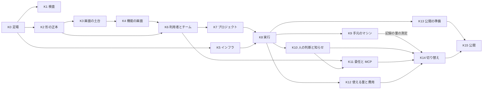

# 子の切り方: 画面先行の順で、子の課題が全体の設計だけを読んで詳細設計へ進める

[全体の設計](../issue-24-design.md)の機能一覧（F1〜F23）と不変条件（I1〜I16）を、実装の単位の子の課題へ割り当て、順序と並列を決める。設計承認の後に、#24 の本文の開発計画と子の課題の本文をこの表に合わせて作り直す。

この文書は、全体の設計の「MVV と設計の節の対応」の Value 2（画面先行）の行を、子の順序で受ける。Value 1 の行は、旧い側の機能の採否（[legacy.md](legacy.md)）が受ける。全体の設計を作った経緯と作り方は [README.md](README.md) から辿る。

## 子の一覧

「既存の課題」の列は、設計承認の後に題と本文を書き直して使う課題である。`新規` は起票する。順序は次の節、子に共通の決まりはその次の節にある。

| 子 | 範囲 | 機能 | 縛る不変条件 | 前に要る子 | 既存の課題 |
| --- | --- | --- | --- | --- | --- |
| K0 足場 | プロジェクト MVV・LICENSE・SECURITY.md・NDF の宣言（PR #25） | — | — | なし | #18・#14 の一部 |
| K1 検査 | 漏れ・参照・形の往復・横断の部品の外での直の利用・使える量の判定の外の比べ・操作の一覧と画面と MCP の対応・NDF の版の数字の比べ・CI の資格情報・NDF の契約の照合（定期）（[検査](../issue-24-design-platform.md#検査)） | F23 | I8・I14 | K0 | #1（#23 を取り込む） |
| K2 形の正本と横断の部品 | 操作の表から型・JSON Schema・OpenAPI・MCP の道具・HTTP の経路の登録・ダミーデータを作る生成、値の形（配列・UTC・通貨）、横断の部品（時計・ID・ログと伏せ字・外部の呼び出し・条件つきの書き込み・認可の判定・使える量の判定・操作の記録の書き手） | — | I2（判定の部品）・I9・I12・I15 | K0 | #2 |
| K3 画面の土台 | 画面の地図・ナビゲーション・共通の部品・デザインの規約・端末の幅・オフライン（PWA・暗号化した控え・そろえ方・確定待ち）・国際化 | — | I4（確定待ち） | K2 | #12 |
| K4 機能の画面 | F1〜F20 の画面を、形の正本から作るダミーデータで作り切る | F1〜F20 の画面 | I14（画面の側） | K3 | 新規 |
| K5 インフラ | 自前の VPC・Aurora（進行表の DB）・ECS のクラスタ・ECR・予算と知らせ・ECS のサービスを作らないことの照らし（NAT 0 件・タスクの受け入れ 0 件・PITR などのスタックのテスト）・実測（一時停止・カタログの分け方） | — | I10・I11 | K0 | #13 |
| K6 利用者とチーム | サインイン・ログインの組・利用者の設定・チームと席の API と画面のつなぎ | F1・F2・F3 | I15（利用者の設定）・I16 | K4・K2 | #4 |
| K7 プロジェクトとリポジトリ | GitHub App・プロジェクトの作成と割り当て・リポジトリの登録・割り当てを移す流れ | F4・F5・F6 | I1・I2・I3 | K6 | #5 |
| K8 実行 | スプリントを始める・読む・取り消す、ホステッドのランナー、NDF との契約、進捗の事象、実行の場所と推論の手段 | F7・F8・F9・F10・F17 | I5・I6・I7・I10・I11・I13 | K7・K5 | #6 |
| K9 手元のマシン | 登録・心拍・nd ランタイム・レーンの受け取り | F18 | I7 | K8 | #7 |
| K10 人の判断と知らせ | 承認の依頼と承認資料・承認の確定・問いと答え・知らせ・通知先（Web Push・Slack） | F11〜F15 | I4・I5 | K8 | #8 |
| K11 委任と MCP | 委任の発行と取り消し・MCP の受け口・操作の記録の読み出し | F16・F20 | I2（MCP と記録の出口）・I3・I9 | K6・K10 | #11 |
| K12 使える量と費用 | 料金プランの値・使える量の判定・月の上限額・費用の記録と画面 | F19 | I8・I15（金額） | K8 | 新規 |
| K13 公開の準備 | 自分で設置する手順の文書・商標の確かめ・貢献の受け方。確定仕様化で `docs/design/rebuild/` を外し `AGENTS.md` の行を直すのは #24 の確定仕様化が行う | F21 | — | K8 | #14 |
| K14 運用する環境の切り替え | 運用する環境の利用者を新しい側へ案内する段取りと戻し方（[付録](legacy.md)）。始める条件は、前に要る子に加えて、操作の記録の量と費用の測定（[確かめる子](#確かめる子)）の結果が全体の設計の費用の見込みへ返っていること | — | — | K9・K10・K11・K12 | #15 |
| K15 社内のテストとサービスの公開 | 社内のテストを経て、運用する環境のサービスを公開する | F22 | — | K13・K14 | #16 |

### 後に回す子

最初の版の外に置く子である。入れる条件は付録にある。

| 子 | 範囲 | 既存の課題 |
| --- | --- | --- |
| L1 開発ループ | 課題を続けて選び、スプリントを周回させる | #9 |
| L2 AI のオーガナイザーとの会話 | プロジェクトに 1 つ動く AI と会話で指示する | #10 |

### 閉じる課題

| 課題 | 理由 |
| --- | --- |
| #3（対応表の試走） | 旧い側との同等をそろえることを目的にしない。子を閉じる条件は受け入れ条件とテストにした（[決定 6](how-designed.md#決定-6-子を閉じる条件を受け入れ条件とテストにするため対応表の試走をやめる)） |
| #22（旧い設計への移し） | 移す先の `docs/design/rebuild/` を外す。中身（GitHub の token の失効と進行表の DB の用意の順）は K5・K7・K8 の詳細設計が受ける |

## 順序

| 段 | 子 | 同時に動く本数 |
| --- | --- | --- |
| 1 | K0 | 1 |
| 2 | K1・K2・K5 | 3 |
| 3 | K3（K5 が残っていれば並行） | 1〜2 |
| 4 | K4 | 1 |
| 5 | K6 | 1 |
| 6 | K7 | 1 |
| 7 | K8 | 1 |
| 8 | K9・K10・K12 | 3 |
| 9 | K11・K13 | 2 |
| 10 | K14 | 1 |
| 11 | K15 | 1 |

後の段の子の設計は、前の段の子の設計の収束を待てば始めてよい（実装のマージは待たない）。

### 決定 9: 画面先行を子の順序で守るため、検査と形の正本 → 画面の土台 → 機能の画面 → API の順に子を並べる

結論: 上の順序（K0 → K1・K2・K5 → K3 → K4 → K6 → …）にする。

理由: Value 2 は UX の土台を先に固め、機能の画面をダミーデータで作り切ってから API をつなぐ順を求める。画面が先に揃うと、API の形が 1 つの画面に寄らず機能から起こせる。

採らなかった案: 機能ごとに画面と API を同時に作る順（旧い設計の順）。画面の土台が機能の子ごとに少しずつ決まり、部品と見せ方がそろわない。

根拠: Value 2（MVV 版 1）

## 設計承認の後にすること

| すること | 中身 |
| --- | --- |
| 子の課題を作り直す | 子の課題の題と本文を [子の一覧](#子の一覧) に合わせて作り直す（K0〜K15・L1・L2）。#3・#22 は閉じる（[閉じる課題](#閉じる課題)） |
| 不変条件をテストへ移す | 不変条件 I1〜I16 は、受け持つ子の課題がテストへ移す（子の一覧の「縛る不変条件」の列） |
| 後に回す機能 | 入れる条件は [legacy.md](legacy.md) の採否の表の理由の列にある |
| 請求の仕組み | 利用者から支払いを受ける請求の仕組みは、サービスの公開（K15）の前に別の課題で決める |

## 決まり

| 決まり | 中身 |
| --- | --- |
| 順序 | Value 2 のとおり、検査と形の正本 → 画面の土台 → 機能の画面（ダミーデータ）→ API の中身をつなぐ。インフラは土台の後ならいつでも並行してよい |
| 1 子の大きさ | 1 つの子は 1 つのスプリント（NDF の 1 版）で閉じる大きさにする。超えると分かったら、詳細設計で子を分けて本文を直す |
| 同時の数 | 1 スプリントの中の設計と実装は、どちらも同時に 3 本まで |
| 閉じる条件 | 子の受け入れ条件がすべて満たされ、受け持つ不変条件のテストが通り、受け持つ機能の画面・API・MCP の道具がそろっている（I14 の検査が通る） |
| 詳細設計 | 子ごとに `issues/issue-<番号>-design-detail.md` を書く。全体の設計で決めたモデル・境界・入出力・状態の置き場・権限は決め直さない。決め直す必要が出たら全体の設計を直す PR を先に出す |
| 追補 | 閉じた子への追加は、元の子を引く新しい課題にする。追補が 10 を超えたら全体の設計を見直す |
| 書かないもの | 課題・PR・コミットに、インフラの実際の値・運用する環境の名前・旧い側の名前と番号を書かない |

## 子ごとの詳細設計で書くこと

| 子 | 全体の設計に無く、詳細設計で決めること |
| --- | --- |
| K1 | 漏れの値の受け方（CI の秘密）・検査ごとの落とし方と出力の形 |
| K2 | 操作の表の形・生成物の置き場・横断の部品の関数の形・ダミーデータの作り方 |
| K3 | 部品の一覧と状態・控えの量の上限・そろえ方の食い違いの解き方の細部（控えの期間 14 日とキーの決まりは [画面の文書](../issue-24-design-screens.md) が決めた） |
| K4 | 画面ごとの項目の並び・空と誤りの見せ方の文言のキー |
| K5 | VPC の CIDR の既定・Aurora の最大 ACU の既定・ECS のタスクの大きさの既定・予算の既定・実測の手順 |
| K6 | ログインの組の結び付け・招きの期限・席の役割の変え方 |
| K7 | GitHub App の権限の一覧・割り当てを移す受け入れの期限・閉じたプロジェクトの中身の保存期間 |
| K8 | ランナーのイメージの中身・進行表の DB の用意の手順の細部（承認の待ちの猶予 5 分と、NDF のファイルを読む 30 秒の間隔は [実行の文書の設定の値](../issue-24-design-execution.md#設定の値) が決めた） |
| K9 | nd ランタイムの配り方・同時に受けるレーンの数の既定（1〜16 の中。心拍の間隔 60 秒は実行の文書が決めた） |
| K10 | 承認資料の要約値の項目の並べ方の細部・知らせの束ね方・Slack と Web Push の文面（載せる項目は [実行の文書の通知先](../issue-24-design-execution.md#通知先) が決めた） |
| K11 | 貼る token を MCP のクライアントが受けるかの確かめと設定の手順・道具の説明の文（委任の範囲 `read`・`run`・`manage` と操作の記録の保存期間 1 年は [API の文書](../issue-24-design-api.md) が決めた） |
| K12 | 料金プランの値の集合と量・費用の数え方の細部 |

## 設計の要素ごとの受け持ち

設計文書の要素を、どの子が作り・詳細設計で決めるかである。設計文書からは「受け持つ子」の列と「K の詳細設計が決める」の言及を外し、ここへまとめた。

### 構成要素

[土台の文書の構成要素](../issue-24-design-platform.md#アーキテクチャ) ごとの受け持ちである。

| 要素 | 受け持つ子 |
| --- | --- |
| 画面 | K3・K4 |
| API | K2・K6〜K12 |
| MCP | K11 |
| ランナー | K8 |
| nd ランタイム | K9 |
| DB の用意 | K5・K8 |
| 見回り | K8・K7 |
| 知らせの送り手 | K10 |
| 表の移し | K2 |
| 形の正本 | K2 |
| 設置のコマンド | 骨組みにある。足りない設定の一覧などは K5 |
| 反映のパイプライン | 骨組みにある |
| 検査 | K1 |

### モジュールの置き場

[詳細設計の置き場](../issue-24-design-detail.md) ごとに、最上位の関数の中身を決める子である。全体の設計にない各コンテキストのモジュール（利用者とチーム・プロジェクト・実行の制御ほか）の関数は K6〜K12 が、横断の部品の形の細部（ファイルの単位・型の項目の並び）は K2 が、それぞれの詳細設計で決める。ファイルの単位の配置も、K2 ほかの子の詳細設計が持つ。

| 置き場 | 詳細設計で決める子 |
| --- | --- |
| `packages/contracts/` | K2（生成のスクリプトの関数） |
| `apps/api/src/entries/` | K2・K8・K10 |
| `apps/api/src/modules/` | K6〜K12 |
| `apps/web/` | K3・K4（[画面の文書](../issue-24-design-screens.md) に沿う） |
| `apps/runner/` | K8 |
| `apps/nd-runtime/` | K9 |
| `apps/db-prep/` | K5・K8 |
| `infra/` | 資源を足すのは K5 ほか |
| `tools/checks/` | K1 |

| 値・データ | 決める子 |
| --- | --- |
| 秘密の形のデータ | 漏れの検査（K1）も同じデータを読む |
| 再試行の方針の値の調整 | K2 |
| 料金プランの値の集合 | K12 |

### 状態の置き場とインフラ

| 項目 | 受け持つ子と中身 |
| --- | --- |
| 表と鍵の索引・列の細部 | K2 の詳細設計。ほかの列は K2 と各子の詳細設計が書く |
| 状態の S3 の承認資料の本文 | K7 が決める保存期間で消す |
| 割り当てを移すときの差し替え | GitHub の token の失効の順は [実行の文書](../issue-24-design-execution.md) と K7 の詳細設計が持つ |
| Aurora Serverless v2 の最大 ACU の既定 | K5 |
| ECR の残す数 | K5（LIB85） |
| ECS.5（ルートのファイルシステムを読むだけ） | NDF の作業場所の書き込みと合わせて K8 が確かめる |
| 設定のファイルに足すキー（予算・最大 ACU・推論の手段の可否・Web Push の公開鍵など） | キーの名前と形は、読む子（K5・K8・K10・K12）の詳細設計が決める |
| 予算の既定の額 | K5 が [土台の文書の費用](../issue-24-design-platform.md#費用) の見込みから決める |

### 検査

[土台の文書の検査](../issue-24-design-platform.md#検査) のうち、設計の決まりを縛る検査の受け持ちである。足す検査は CI の必須のチェック（`.ndf/project.json` の宣言）へ同じ PR で足す。

| 検査 | 受け持つ子 |
| --- | --- |
| 漏れの検査 | K1 |
| 形の往復 | K1・K2 |
| 境界の検査 | K1 |
| 使える量の判定の外の比べ | K1 |
| 操作の一覧と画面と MCP の対応 | K1 |
| NDF の契約の照合（定期。[実行の文書](../issue-24-design-execution.md)） | K1 |
| スタックのテストに足す行 | K5 |

### 非機能と運用・保守

| 項目 | 受け持つ子と中身 |
| --- | --- |
| 可用性 | K5 が戻しの予行を 1 回行う |
| 性能（控えからの表示） | K3 が測る |
| 性能（答えから次の区間の開始まで） | K8 が測る |
| システム環境 | 別のリージョンでの設置の予行は K13 |
| 運用・保守 | 子の担当が全体の設計だけで詳細設計へ進める（#24 の非機能）。置き場・鍵・名前・権限・検査を土台の文書で決め、子が決めることを [子ごとの詳細設計で書くこと](#子ごとの詳細設計で書くこと) に限る。子の詳細設計のレビューで確かめる |
| 手数の目標 | K3 が e2e で手数とページの数を数え、上限を超えたら落とす（画面の決定 20）。待ち時間の測り方は K3 が e2e の回線の絞りで決める |
| 共通の部品 | 部品の一覧と置き場の一致を K3 がテストで照らす |
| 画面一覧 | 画面の操作と形の正本の操作の一覧の対応を K3 が検査で照らす |

## 確かめる子

設計文書の「未確認のまま残ること」と外部の調査の「確かめられなかったこと」には、何が未確認でどう確かめるかだけを残した。どの子が確かめるかをここに置く。子の呼び方は元の書き方で、括弧に当たる子を書く。

| 文書 | 項目 | 確かめる子 | 確かめ方 |
| --- | --- | --- | --- |
| 全体の設計 | iOS の Safari での Web Push | 画面の土台の子（K3） | 実機 |
| 全体の設計 | 端末のデータの暗号化の鍵の置き場 | 画面の土台の子（K3） | 実機 |
| 全体の設計 | MCP の認可の仕様の版 | API と MCP の子（K11） | 作る時点の版 |
| 全体の設計 | Aurora の一時停止と進行表の DB | インフラの子（K5） | 実測 |
| 全体の設計 | 1 か月の費用 | — | 骨組みを反映した後の請求 |
| 画面 | 主なブラウザでの Badging・Background Sync | 画面の土台の子（K3） | 実機 |
| 画面 | 手数の目標の待ち時間 | 画面の土台の子（K3） | ダミーで e2e の回線の絞りを掛けて測り、API をつないだ後に骨組みの環境で測り直す |
| 画面 | ログインの控えの期限 | 画面の土台の子（K3） | 実機で、30 日に近い控えから知らせを開く |
| 画面 | ブラウザのタブで使う Safari の控え | 画面の土台の子（K3） | 実機で、ホーム画面に加えた場合と加えない場合 |
| 画面 | 鍵の置き場の強さ | 画面の土台の子（K3） | 実機 |
| 画面 | 承認資料の大きさ | 実行の子（K8） | 承認資料の形を決めたとき |
| API | MCP の認可で使えるクライアント | 子（STD40 の範囲外） | 実機 |
| API | MCP のクライアントが貼る token を受けるか | API と MCP の子（K11） | 使う予定のクライアントが `Authorization` の頭書きを設定できるかを実機で |
| API | MCP の仕様の改訂 | API と MCP の子（K11） | 2026-07-28 版で外れたセッションなどが次の版で変わるかを、作る時点の版で |
| API | 操作の記録の量と費用 | 手元のマシンの子（K9）。K9 の反映の後、K14 の前 | 骨組みには操作の記録の書き手（K2）も、画面の読み直しの読む操作（K6 以降）も、心拍（K9）も無いため、骨組みでは測らない。三つがそろう K9 の反映の後に、反映した環境で画面の読み直しと心拍を 1 件ずつ記録させ、`db-audit` の書き込みの数を 1 日測って 1 か月へ延ばし、単価を掛ける。結果を全体の設計の費用の見込みへ返す。K14 はこの結果が返るまで始めない（[子の一覧](#子の一覧) の K14 の行と順序の図の K9 → K14） |
| API | Cognito の access token を 15 分にしたときの画面の取り直し | 画面の土台の子（K3） | 取り直しが画面の操作の速さを落とさないかを実機で |
| 実行 | Web Push の本文の暗号化の方式（RFC 8291）の細部 | 画面の土台の子（K3） | 使う部品の側で |
| 実行 | Claude Code の `-p` の結果の出力が推論の量（token の数）を持つ項目の名前 | 費用の記録の子（K12） | 固定の版の claude |
| 実行 | 問いと承認ゲートの ID の得方・防ぐ守りの下での承認ゲート・答えの置き場が進行表の DB か・答えの事象の項目・休止の後の続き | ランナーの子（K8） | 固定の版の NDF で承認ゲートを 1 回通す |
| 実行 | 1 時間を超える区間での GitHub の token | ランナーの子（K8） | 固定の版で長い区間を通す |
| 実行 | `awsCredentialExport` の読み直し | ランナーの子（K8） | 固定の版の claude で 1 時間を超える区間を通す |
| 実行 | 推論の量の項目 | 費用の記録の子（K12） | 固定の版の claude |
| 土台 | Aurora の一時停止と再開 | K5 | 骨組みの環境で数日の実測 |
| 土台 | カタログの分け方・用意の手順の本文（4 で外せるか・接続できないこと） | K5 | 骨組みの環境で実測 |
| 土台 | DBOS と Aurora の版 | K5・K8 | 固定の版の NDF で実測 |
| 土台 | ACU の平均 | K5 | 実測と、骨組みを反映した後の請求 |
| 土台 | ルートのファイルシステムを読むだけにできるか（ECS.5） | K8 | ランナーのイメージ |
| 土台 | GitHub を Cognito の OIDC の IdP として直に受けられるか | K6 | GitHub の文書と Cognito の文書 |
| 土台 | EventBridge のスケジュール・DynamoDB の PITR・ストリームの単価 | K5 | 単価の頁 |
| 土台 | `us-west-2` などの単価 | K13 | 手順に読み方を書く |

## 骨組みからの移り方

main の骨組みを、まとまりの単位でどう扱うか（そのまま使う・直す・捨てる）は [legacy.md の骨組みからの移り方](legacy.md#骨組みからの移り方) にある。骨組みの状態は [history.md の骨組みの状態](history.md#骨組みの状態) にある。ここには、子が骨組みに足すものと、横断の部品が骨組みのコードから引き継ぐものを置く。

### 骨組みに足すもの

| 足すもの | 中身 | 受け持つ子 |
| --- | --- | --- |
| ランナーのイメージの前提 | [土台の設置と反映の前提](../issue-24-design-platform.md#設置と反映の前提) のとおり。作業は 2 つに分ける: 1 つ目の PR で前提の表（setup.md）と、パイプラインのスタック（`infra/lib/pipeline-stack.ts`。反映のアクションの CodeBuild の特権と、引き受けられる役割への `image-publishing` の足し）を直し、マージの後にリリース承認ゲートの承認を経て設置のコマンド（`--stack pipeline`）で反映する。2 つ目の PR でイメージの資産を縦の切れ端へ入れ、起点のブランチへ push する | K5・K8 |
| 足りない設定の一覧 | `diff` の出力の 1 欄。終了コードは足さない（足りない設定があっても反映はできる） | K5 |
| 設定のファイルのキー | 予算・最大 ACU・推論の手段の可否・Web Push の公開鍵など。読む子が足す | K5・K8・K10・K12 |
| 縦の切れ端のスタックの資源 | VPC・Aurora・ECS・ECR・表・予算を縦の切れ端のスタック（`app`）へ入れ、同じ確認の値と要約値で縛る（土台の決定 89） | K5 ほか |

### 骨組みから置き換えるもの

骨組みの経路・資源で、新しい設計の名前と形に置き換えるものである。置き換えた PR で古い側を残さない。

| 置き換えるもの | 置き換え先と作業 | 受け持つ子 |
| --- | --- | --- |
| HTTP の経路 `PUT /v1/users`（`packages/contracts/src/users-api.ts`・`apps/api/src/users-handler.ts`・`infra/lib/app-stack.ts` の経路）と、それを呼ぶ画面の `apps/web/src/users-client.ts` | `sessions.create`（`POST /v1/sessions/create`）へ移す。直す 4 つ（経路・`{"ok": true, "item"}`・要素の 400 `item_invalid`・上限 100）は [history.md の API の合わない所](history.md#api-の合わない所)。同じ PR で `PUT /v1/users` を形の正本・HTTP API・画面の呼び手から消す。操作の表に無い経路を残すと I14 の照らしに反する | K6（振り分けは K2） |
| 画面の 1 枚の利用者の表示（`apps/web/src/`） | [history.md の画面の合わない所](history.md#画面の合わない所) の 7 行を、画面の土台の上へ置き直す。ログインの控えの `sessionStorage` は、暗号化した IndexedDB の控えへ移す PR で消す | K3・K6 |
| 利用者の表 `<prefix>-<env>-accounts`（`infra/lib/naming.ts` の `usersTable`） | `db-users` へ名前を変える。名前を変えると CloudFormation は新しい表を作り、今の行は新しい表に移らない。移し方は「作り直して捨てる」にする: 今の行は IdP の利用者の識別子（`sub`）と作った時刻（`created_at`）だけで（`apps/api/src/user-store.ts`）、次のサインインの `sessions.create` が新しい表に作り直す。作り直した行の作った時刻は、作り直した時刻になる。古い表は消さずにスタックの管理の中に残す: 置き換えの PR は `db-users` を別の論理 ID で足し、古い表の定義（同じ論理 ID・同じ名前・既定の残す設定）をスタックに残して、関数からの参照と権限だけを外す。同じ論理 ID のまま名前だけを変えると CloudFormation が古い表を管理の外へ外し、後で消すのにパイプラインの外の直の操作（P1）が要るため、その形を採らない。既にログインしている利用者も行を持たないまま進めない: 置き換えの PR の画面は、その PR より前の版の画面が残したログインの控え（骨組みの `sessionStorage` の控えと、置き換えの前に作った IndexedDB の控え。控えに形の版を持たせて見分ける）を読まずに消し、IdP のサインインへ戻す。IdP から戻ったときの `sessions.create` が新しい表に行を作ってから、保護された画面の操作へ進む。これは利用者のデータを変える操作（C3）のため、置き換えの PR の本文に「利用者の行は次のサインインで作り直す」と書き、差分の表の足しを、反映のパイプラインの人の承認と、リリース承認ゲートで人が見る。残した古い表を消すのはデータの削除（C4）で、子の作業では消さず、運用する環境の切り替え（K14）で既存の反映の経路だけを使って消す: 1 つ目の変更で古い表の定義の残す設定を消す設定（`RemovalPolicy.DESTROY`）へ変えて反映し、2 つ目の変更で定義をスタックから外して反映する（CloudFormation は外した資源を前の版の消す設定に従って扱うため、2 回に分ける）。どちらも反映のパイプラインの差分（2 つ目は表の消し）として人が承認し、リリース承認ゲートで人が見る | K6 |
| 関数 `users-api`（`infra/lib/naming.ts` の `usersFunction`） | `api-fn` へまとめる。関数は状態を持たないため、作り直しで足りる | K6 |

### 横断の部品が引き継ぐもの

横断の部品（K2）が骨組みのコードから引き継ぐ形である。部品ごとの確かめた結果は [history.md の既存の部品の再利用](history.md#既存の部品の再利用) にある。

| 部品 | 引き継ぐもの |
| --- | --- |
| `createClock` | `users-handler.ts` の依存の注入 `now: () => new Date()` |
| `claimIdempotency`・`putIfAbsent` | `user-store.ts` の `ensureUser`（`attribute_not_exists(pk)` と強い整合の読み直し）を移す |
| `createLogger` | `users-handler.ts` の `LogFields` と 1 行の JSON・要求の ID・`level` の形を `core` へ移す |
| `classifyFailure` | `user-store.ts` の `isConditionFailure` を広げる |
| `awsClient` | `users-handler.ts` の `DynamoDBDocumentClient.from(new DynamoDBClient({}))` の使い回し。`infra/setup/aws-reader.ts` はそのまま使う |
| `authorize` | `users-handler.ts` の `answerItems`（見えないものを無いものと同じに返す） |
| `readHttpCall` | `parseUsersRequest` と `decodeBody` の検査の順と読み方。要素の上限を 10 から 100 へ上げ、重なりの検査を足す |
| `dispatch` | `users-handler.ts` の `createHandler`（依存の注入・401・400・503 の扱い） |
| `writeHttpResponse` | `users-handler.ts` の `json`。problem の形と `no-store` を足す |
| `authenticate` | `infra/lib/app-stack.ts` の `HttpJwtAuthorizer` は使わない（委任の token を読めないため）。`createHash` は `infra/lib/assembly-digest.ts` が既に使う |
