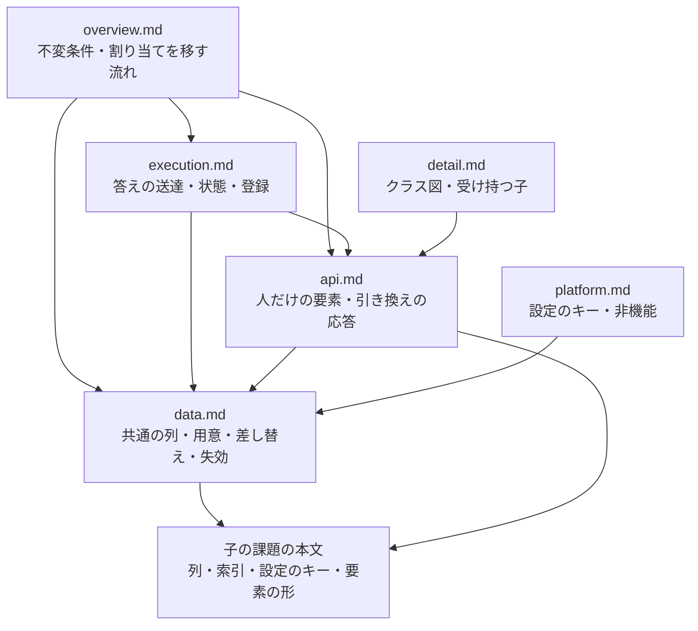
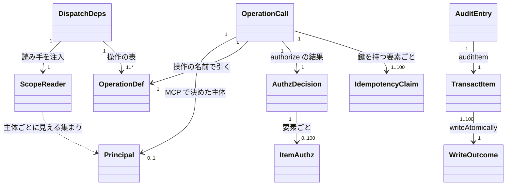
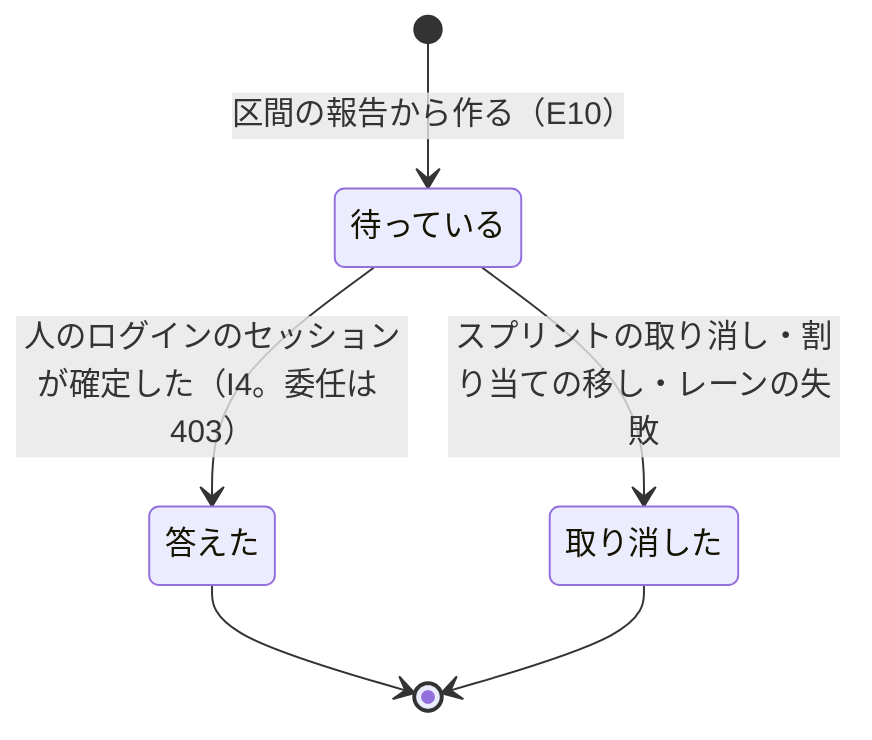
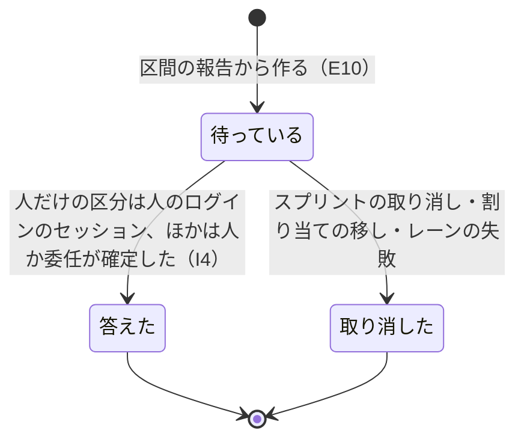
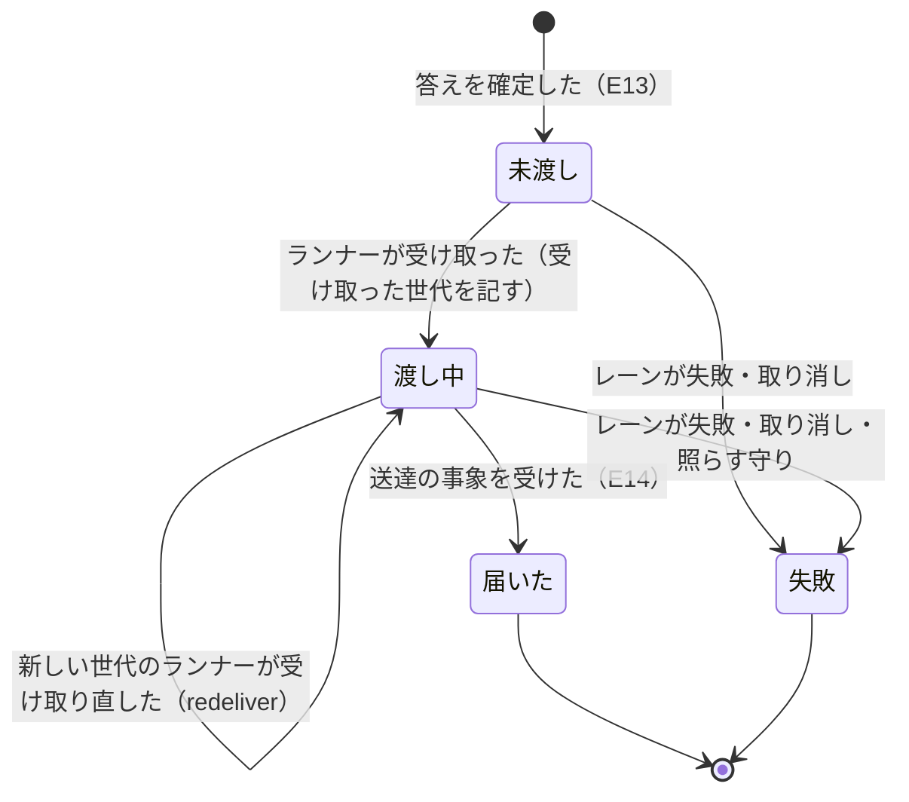
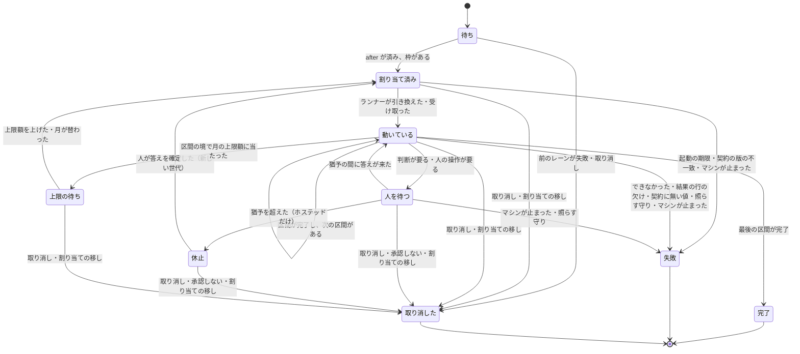
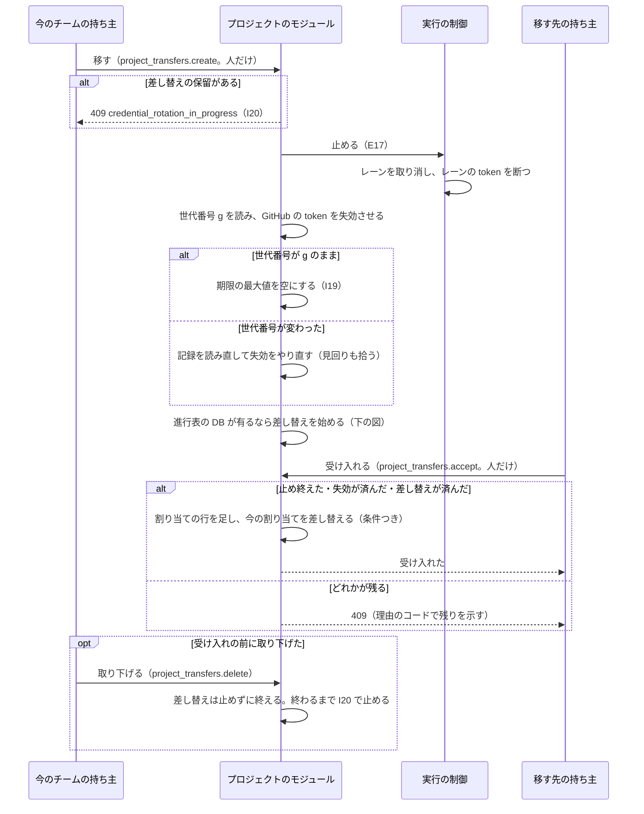
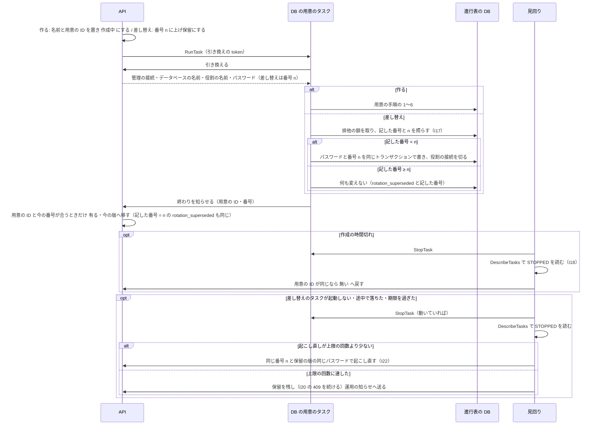
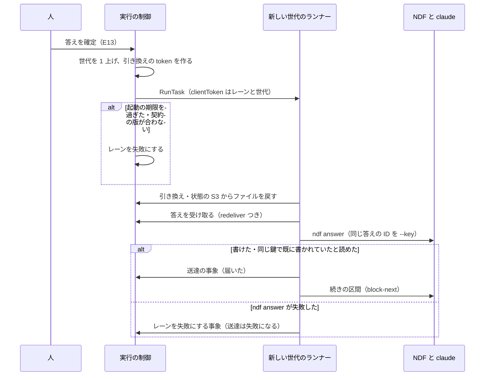
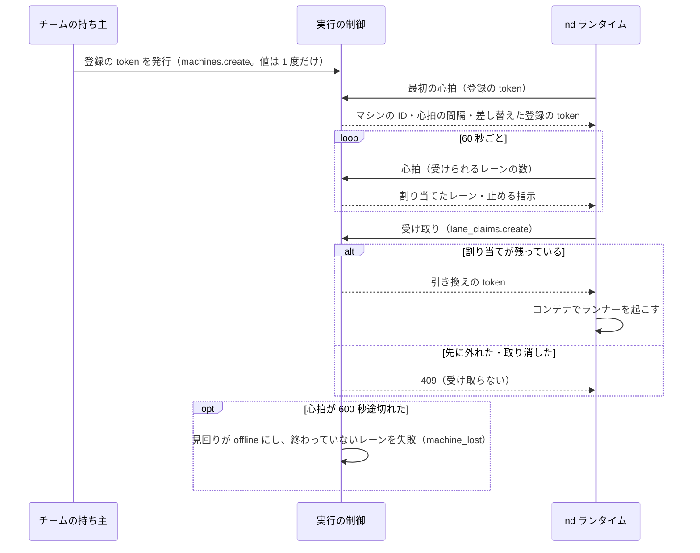

# 全体の設計: 子の課題が認可・起こし直し・公開範囲・DB の用意を 1 か所から 1 つの答えで読める（#32）

## 目的

- **今どうなっているか**: 承認済みの全体の設計（`docs/design/` の 7 本）は、問いに人だけが答える範囲・答えの送達の起こし直し・起票の宛先の公開範囲・進行表の DB の用意と差し替えについて、文書ごとに違う答えを持つか、答えを持たない。「詳細設計が持つ」と回した中身の行き先も無い
- **誰に効くか**: 全体の設計を引いて詳細設計を書く子の課題（#1・#2・#4〜#8・#11・#13・#14・#28・#29。下の「子の課題へ渡す欠け」の渡す先と同じ集まり）の担当者と、設計承認ゲートで承認する人
- **変えると何が成り立つか**: 指摘 11 件と R1〜R15 のどれについても、全体の設計の 1 か所（または渡した子の課題の本文）から 1 つの答えを読める

## 適用範囲

- **働く範囲**: このリポジトリの全体の設計（`docs/design/`）・用語集（`docs/glossary/`）と、子の課題の本文。コード・形の正本・インフラの定義は変えない
- **プロジェクトごとに違うもの**: 無し（設計の文書の改訂で、設定も引数も受けない）
- **当たるモード**: `standard`

## あるべき姿の根拠

| 根拠 | 種類 | 何を示すか |
| --- | --- | --- |
| NDF の `ndf answer` の引数のスキーマ（STD1） | 外部の一次情報 | `--reason` は必須、`--drop` は整数の配列、`--key` は「同じ鍵の答え直しは書かない」。指摘 1 と 4 の答えの出所 |
| PostgreSQL の advisory lock（STD2） | 外部の一次情報 | トランザクションの間だけ持つ排他の鎖を DB の側で取れる。指摘 9 の排他の出所 |
| DynamoDB の `TransactWriteItems`（LIB1） | 外部の一次情報 | 100 件までの書き込みと、書かない行の条件（`ConditionCheck`）を 1 つのトランザクションで照らせる。R8・指摘 10・11 の出所 |

要求と受け入れ条件は #32 の本文にある（コピーは [issue-32-requirements.md](issue-32-requirements.md) ）。この文書は「どう直すか」だけを扱う。直した後の文の正本は `docs/design/` で、この文書は直す中身と理由を持つ。この文書の「タスク」は ECS のタスク（DB の用意のタスク・ランナーのタスク）を指す。

## ドメインモデル

### コンテキスト

| コンテキスト（用語集の `id`） | 何の語が 1 つの意味に決まるか |
| --- | --- |
| 人の判断（`judgment`） | 承認の依頼・問い・答え・答えの送達・人だけの区分 |
| 実行（`execution`） | レーン・区間・手元のマシンの登録・起こし直し |
| プロジェクト（`project`） | 割り当てを移す流れ・GitHub の token の失効 |
| 利用者とチーム（`identity`） | ログインの組から利用者を引く行 |
| 土台（`platform`） | 進行表の DB の用意・資格情報の差し替え・サービスの表の共通の列 |

コンテキストマップの関係は、全体の設計の表を引き継ぐ。変えるのは次の 2 行である。

| 上流 | 下流 | 関係 | この変更で決めること |
| --- | --- | --- | --- |
| 実行 | 人の判断 | 公開された言語（「パートナーシップ」から替える） | 形の正本の事象の形でやり取りする。全体の設計が使う「パートナーシップ」は 5 つの関係の語に無い（R15）。答えの送達の状態と承認の依頼の取り消しは、実行が出す事象を人の判断が受けて書く（下の「集約を書き換える経路」） |
| プロジェクト | 実行・人の判断・知らせ・操作の記録の読み出し・土台（DB の用意） | 顧客 / 供給者（下流に土台を足す） | 進行表の DB の列と GitHub の token の世代番号はプロジェクトの集約にあり、DB の用意の引き換え・見回り・token の取り直しは、プロジェクトのモジュールの関数を呼んで書く（直に表へ書かない） |

### 集約

| 集約 | 持ち主（書き換えてよいもの） | 根 | エンティティ | 値オブジェクト |
| --- | --- | --- | --- | --- |
| 承認の依頼 | 人の判断のモジュール | 承認の依頼 | 答え | 状態（待っている・答えた・取り消した）・答えの送達の状態・対象の課題の番号の並び・起票の結果（起票の依頼だけ。作った・作らなかった） |
| 問い | 人の判断のモジュール | 問い | 答え | 状態（同上）・人だけか（区分から決める）・答えの送達の状態 |
| 手元のマシン | 実行の制御 | 手元のマシン | — | 状態（登録待ち・`online`・`offline`）・登録の token の指紋 |
| プロジェクト | プロジェクトのモジュール | プロジェクト | リポジトリ | 進行表の DB の名前と役割の名前・用意の ID と用意のタスク・差し替えの番号・GitHub の token の世代番号・版 |
| 利用者 | 利用者とチームのモジュール | 利用者 | ログインの組 | IdP の主体から利用者を引く行 |

進行表の DB の中の差し替えの番号の表は、DB の用意のタスクだけが書く（サービスは読まない）。

#### 集約を書き換える経路

持ち主の外で起きた出来事は、持ち主のモジュールへ事象か関数の呼び出しで頼み、持ち主だけが書く。

| 書き換える値 | 起こすもの | 頼み方 | 書くもの |
| --- | --- | --- | --- |
| 答えの送達の状態（渡し中） | ランナーの受け取り（`/v1/runner/answers/list`） | 実行の制御が人の判断のモジュールの受け取りの関数を呼ぶ | 人の判断のモジュール |
| 答えの送達の状態（届いた） | ランナー | 送達の事象（E14） | 人の判断のモジュール |
| 答えの送達の状態（失敗）・承認の依頼と問いの取り消し | 実行の制御（レーンの失敗・取り消し。割り当ての移しは E17 を受けた実行の制御がレーンを取り消す） | レーンの終わりの事象（失敗・取り消し） | 人の判断のモジュール |
| 起票の結果 | 実行の制御（起こす段。I21） | 起票の結果の事象（作った・作らなかった。作らなかったときは理由 `visibility_widened`） | 人の判断のモジュール |
| 進行表の DB の列（名前・用意の ID・用意のタスク・差し替えの番号と保留） | API の開始と移し・DB の用意の引き換えと完了の報告・見回り | プロジェクトのモジュールの関数を呼ぶ（`version` の条件つきの書き込み） | プロジェクトのモジュール |
| GitHub の token の世代番号 | 実行の制御（心拍の token の取り直し）・プロジェクトのモジュール（失効） | 実行の制御はプロジェクトのモジュールの取り直しの関数を呼ぶ | プロジェクトのモジュール |

### 不変条件

全体の設計の不変条件のうち 3 つの文を変え、6 つを足す。足す番号は I17 から振り、[全体の設計の不変条件](../docs/design/overview.md#不変条件) の表と、その下のテスト設計の表へ同じ番号で載せる。

| # | 集約 | 条件 | 破れたときの扱い |
| --- | --- | --- | --- |
| I4（意味の変更） | 承認の依頼・問い | 承認の依頼すべてと、人だけの区分の問いの答えを確定できるのは、人のログインのセッションからの要求だけ。つながっていない端末では確定しない。確定の時点でサーバーの今の状態（待っている・承認資料の要約値が同じ）と照らす | 合わなければ 409。委任からの確定は 403 `human_only` |
| I5（意味の変更） | 承認の依頼・問い | 1 つの答えは NDF へ 1 回だけ書かれる（冪等の鍵は答えの ID）。結果が分からないまま起動し直したランナーは同じ答えの ID で打ち直し、違う答えの ID を作らない | 同じ鍵の 2 回目は NDF が書かない。控えに無い答えが現れたらレーンを止めて知らせる |
| I16（守り方の変更） | 利用者 | 1 つの IdP のアカウントは、ちょうど 1 人の利用者に結ぶ。IdP の主体ごとに一意の行を持ち、ログインの組の行と同じトランザクションで書く | 一意の行が既にあれば 409 |
| I17 | プロジェクト | 進行表の DB の資格情報の差し替えは、プロジェクトの差し替えの番号を DB の側の排他の鎖の下で照らし、DB に記した番号より大きいときだけ適用する | 小さいか同じなら何も変えずに、記した番号を添えて `rotation_superseded` で終える。API は記した番号が今の番号と同じなら、適用と同じく保留を下ろす（DB には今の番号のパスワードが既にある） |
| I18 | プロジェクト | 進行表の DB の状態を `作成中` から `無い` へ戻すのは、その用意の ID のタスクが止まったことを読んだ後だけ | 止まったと読めなければ `作成中` のまま次の見回りでやり直す |
| I19 | プロジェクト | GitHub の token の失効の完了は、失効を始めたときの世代番号と今の世代番号が同じときだけ記録する | 違えば完了を記録せず、記録を読み直して失効をやり直す |
| I20 | プロジェクト | 進行表の DB の資格情報の差し替えが終わるまで、そのプロジェクトのスプリントの開始と割り当ての移しの作成を受けない | 409 `credential_rotation_in_progress` |
| I21 | 承認の依頼 | 起票の依頼から課題を作るのは、作成の要求の直前に読んだ宛先の公開範囲が、レーンのリポジトリの公開範囲より広くないときだけ | 作らずに、起票の結果を「作らなかった」（理由 `visibility_widened`）にして事象に残し、始めた人へ知らせる。承認の依頼は人が答えたため「答えた」のまま閉じる |
| I22 | プロジェクト | 差し替えの保留は、差し替えの期限（作成の時間切れと同じ設定の値）を過ぎても完了の報告が無ければ、見回りがそのタスクを止めて `STOPPED` を読んだ後に、同じ番号 n と保留の版の同じパスワードでタスクを起こし直す。保留を下ろすのは、番号の合う完了の報告（適用か、記した番号 = n の `rotation_superseded`）だけ | 起こし直しが上限の回数（設定の値、既定 3）を超えたら、保留を残したまま（I20 の 409 を続ける）運用の知らせへ送り、人が直す |

公開範囲の広さは `private` ＜ `internal` ＜ `public` の順で比べる（LIB2 のリポジトリの `visibility`）。

### ドメインイベント

要求の E1〜E5（設計の文書の改訂の流れ）を引き継ぐ。製品のドメインイベント（全体の設計の E5〜E17）は番号を変えない。

| # | イベント | 発生元 | 受け手 |
| --- | --- | --- | --- |
| E1 | 指摘ごとに、設計の中で正しい状態を決めた | この設計文書（設計の工程） | 実装の段（`docs/design/` の改訂） |
| E2 | 正しい状態に合わせて設計の文書を直した | 実装の段 | 設計の文書の読み手（子の課題の担当者） |
| E3 | 直さないと決めた指摘を、決定の記録に理由とともに書いた | この設計文書 | 決定の記録の読み手。11 件をすべて直すため、この変更では起きない（下の「指摘 11 件の扱い」） |
| E4 | 子の課題へ渡す欠けを、渡す先の子の課題の本文へ追記した | 実装の段 | 渡す先の子の課題の担当者 |
| E5 | 設計 PR が設計承認ゲートを通った | 承認する人 | 実装の段 |

全体の設計の「番号は E5 から振る（E1〜E4 は使わない）」の文は、E1〜E4 が #24 の要求の文書の改訂の流れのイベントで、製品のイベントと番号を分けたことを書く文へ直す（R15）。

### 用語

| 用語 | 意味 | 用語集への反映 |
| --- | --- | --- |
| 答えの送達 | 人が確定した答えを、ランナーが NDF へ `ndf answer` で渡し終えるまでの流れ。状態は未渡し・渡し中・届いた・失敗 | 追加（`judgment`） |
| 資格情報の差し替え | 進行表の DB の役割のパスワードを新しい値へ替え、古い値での接続を断つこと。プロジェクトの差し替えの番号で順を決める | 追加（`platform`） |

## 外部の調査

| 種類 | 調べるか | 理由 |
| --- | --- | --- |
| 標準・仕様 | 調べる | `ndf answer` の引数は NDF の契約が決め、DB の側の排他は PostgreSQL の機能で決まる |
| 主要な製品 | 調べない | 直す中身は自分の設計の文書の間の食い違いで、他の製品の作りで答えが変わらない |
| ライブラリとサービス | 調べる | 一意の行・条件つきの書き込み・リポジトリの公開範囲・タスクの停止は、使うサービスの一次情報で決まる |

### 標準・仕様

| # | 標準・仕様 | 何を定めているか | 設計への反映 | 出典 |
| --- | --- | --- | --- | --- |
| STD1 | NDF の契約の `ndf answer` の引数（`C/schemas/io/answer.args.schema.json`、固定の点） | 必須は `table_id`・`--gate`・`--result`・`--reason`・`--by`・`--key`。`--drop` は整数の配列で「設計承認ゲートで外す課題の番号」。`--key` は「同じ鍵の答え直しは書かない」 | 確定から NDF への図に `--reason` と `--drop` を足す（指摘 1）。起こし直しの打ち直しを `--key` に任せる（指摘 4） | `gh api repos/devbasex/ai-plugins/contents/plugins/ndf-next/contracts/schemas/io/answer.args.schema.json`（`ref` は `ndf-pin.json` の固定の値）（2026-11-18） |
| STD2 | PostgreSQL 16 の advisory lock | `pg_advisory_xact_lock` はトランザクションの単位の排他の鎖を取り、要れば待つ。トランザクションの終わりで外れる | 差し替えの番号を照らして書く間、同じ役割の差し替えを DB の側で 1 つにする（指摘 9） | https://www.postgresql.org/docs/16/functions-admin.html （2026-11-18） |

### ライブラリとサービス

| # | 候補 | 版 | ライセンス | 最後のリリースの日付 | 終了のアナウンス | 要件を満たすか | 出典 |
| --- | --- | --- | --- | --- | --- | --- | --- |
| LIB1 | DynamoDB の `TransactWriteItems` | —（サービス） | —（AWS のサービス） | — | 無し | 満たす。100 件までの書き込みを、表をまたいで 1 つにまとめる。同じ行を 2 回指せない。書かない行の条件は `ConditionCheck` で照らす | https://docs.aws.amazon.com/amazondynamodb/latest/APIReference/API_TransactWriteItems.html （2026-11-18） |
| LIB2 | GitHub の REST のリポジトリの取得 | —（サービス） | —（サービス） | — | 無し | 満たす。応答にリポジトリの `visibility`（`public` など）を持つ | https://docs.github.com/en/rest/repos/repos （2026-11-18） |
| LIB3 | ECS の `StopTask`・`DescribeTasks` | —（サービス） | —（AWS のサービス） | — | 無し | 満たす。`StopTask` は SIGTERM を送り、既定 30 秒の後に SIGKILL で止める。`DescribeTasks` はタスクの `lastStatus` を返す | https://docs.aws.amazon.com/AmazonECS/latest/APIReference/API_StopTask.html ・ https://docs.aws.amazon.com/AmazonECS/latest/APIReference/API_DescribeTasks.html （2026-11-18） |
| LIB4 | Amazon SNS | —（サービス） | —（AWS のサービス） | — | 無し | 満たす。月 100 万回の要求とメールの 1,000 通までは無料の枠。時間の課金を持たない | https://aws.amazon.com/sns/pricing/ （2026-11-18） |

### 確かめられなかったこと

| 対象 | 試した手段 | 結果と理由 |
| --- | --- | --- |
| `ALTER ROLE … PASSWORD` を advisory lock と同じトランザクションの中で打てること | 試していない | PostgreSQL の `ALTER ROLE` の頁を取得していない。未確認のまま残すこと（下）へ移した |
| AWS のクォータ（Lambda の同時実行・Fargate の vCPU）の既定の値 | 試していない | 値はアカウントとリージョンで違い、設置する人が Service Quotas で読む。未確認のまま残すことへ移した |
| 同じ鍵で `ndf answer` を 2 回打ったときの終了コードと出力（STD1） | 試していない。読んだのはスキーマの説明（「同じ鍵の答え直しは書かない」）だけ | 打つと NDF の進行表へ答えが書かれるため、設計の工程では打っていない。#6 の詳細設計で、試しの進行表に対して実測する（扱いは「ホステッドの起こし直し」の図の下と、未確認のまま残すこと） |

調べた量: 候補 6 件・取得の試み 7 回。

## 機能一覧

この変更が答えを決め直す機能を、全体の設計の番号で並べる。

| # | 機能 | 誰が使うか |
| --- | --- | --- |
| F1 | Google か GitHub でサインインし、ログインを同じ利用者へつなぐ（R8） | A1・A2・A3 |
| F6 | プロジェクトの割り当てを移す・受け入れる・取り下げる（指摘 9〜11・R9） | A3 |
| F8 | スプリントを始める（指摘 10） | A1・A2・A4 |
| F12 | 承認ゲートと起票の依頼を承認する・差し戻す（指摘 1・3・5・R2） | A1・A2 |
| F13 | 問いに答える（指摘 2・4・R2） | A1・A2・A4 |
| F18 | 手元のマシンを登録する（R5・R9） | A3 |
| F3・F4・F17・F19・F20 | メンバーへの操作の見せ方（R12） | A2 |

## 構成要素

直す文書と、それぞれが正本として持つ答え。正本の文書だけに答えを書き、ほかの文書はリンクで指す（決定 1）。

| 要素 | 責務（この変更で正本として持つもの） |
| --- | --- |
| [overview.md](../docs/design/overview.md) | 機能一覧の人による確定の経路（指摘 3）・割り当てを変える流れと順序図（指摘 10・R9）・不変条件 I17〜I22 とテスト設計・#24 の受け入れ条件のテスト設計（R7）・承認する人が読む欄と人へ残す判断と関係の語（R15）・文書の地図 |
| [execution.md](../docs/design/execution.md) | 確定から NDF への図（指摘 1）・答えの送達と起こし直し（指摘 4）・起票の直前の公開範囲（指摘 5）・承認の依頼と問いの状態（R2）・レーンの状態（R4）・手元のマシンの登録（R5）・ホステッドの起こし直しと手元のマシンの受け取りの順序図（R9） |
| [api.md](../docs/design/api.md) | `questions.answer` の要素ごとの人だけ（指摘 2）・DB の用意の引き換えの応答（指摘 7）・要素の形と理由のコードの置き場（R6）・外部の調査の候補の上限（R15） |
| `data.md`（新設。土台の文書の「状態の置き場」を移す） | 共通の列と版（R3）・IdP の主体の一意の行（R8）・テーブル定義の行き先（R1）・承認資料の保存期間（R1）・用意の手順の順序図（R9）・作成の時間切れ（指摘 8）・資格情報の差し替え（指摘 9）・GitHub の token の失効の完了（指摘 11） |
| [platform.md](../docs/design/platform.md) | 設定のファイルのキーの行き先（R1）・非機能の実現方式と運用の知らせと切り戻しと上限（R13）・依存の向きの検査の行（R15） |
| [detail.md](../docs/design/detail.md) | 境界の検査の対象（指摘 6）・横断の部品の型のクラス図（R10）・受け持つ子の課題（R14） |
| [screens.md](../docs/design/screens.md) | メンバーへの見せ方（R12）・手元のマシンの「登録待ち」の状態の札（R5）・外部の調査の候補の上限（R15） |
| [decisions.md](../docs/design/decisions.md) | 決定の置き場の番号の表・決定 3 の比べた候補（R15）・文書の分け方の決定 |
| 用語集（`docs/glossary/glossary.json`・`docs/glossary.md`） | 「答えの送達」「資格情報の差し替え」の 2 語 |
| 子の課題の本文（#1・#2・#4〜#8・#11・#13・#14・#28・#29） | 渡した欠けの中身と、引く全体の設計の節へのリンク（下の「子の課題へ渡す欠け」） |



辺は「リンクで指す」向きである。screens.md・decisions.md・用語集は答えを引くだけで指す先を増やさないため、図に描かない。

## 指摘 11 件の扱い

11 件とも直す（決定記録に「直さない」とする件は無い）。

| # | 正しい状態 | 直す文書と節 | 決定 |
| --- | --- | --- | --- |
| 1 | 確定から NDF への図の `ndf answer` の行に `--reason 理由` と、設計承認ゲートで外す課題があるときだけ `--drop 課題の番号…` を足す。理由は答えの理由の欄（任意、2,000 字まで）。空なら、ランナーが答えの語と答えの ID から作る定型の文を渡す。外す課題は `approvals.answer` の要素 `drop_issues`（整数の配列）で受け、設計承認ゲートの依頼の対象の課題の番号に限る。ほかの承認ゲートの依頼に付けたら要素の 400 `item_invalid`。承認資料に対象の課題の番号の並びを足す | execution.md「確定から NDF まで」「承認資料」・api.md「操作の一覧」の `approvals.answer` の注記 | 決定 15 |
| 2 | `questions.answer` は、問いの「人だけか」が真の要素を 403 `human_only` にする。「人だけか」は問いを作るときに実行の文書の区分の表で決め、API の文書は区分を写さずにその表を指す | api.md「スプリント・承認・問い・知らせ」の表・「人だけにした理由」・「人だけの操作の扱い」、overview.md の S4・F13 | 決定 4 |
| 3 | 機能一覧の「人だけ」の行は、人のログインのセッション（画面か、人が同じ API を直に呼ぶ）だけが確定でき、委任の token からは API・MCP とも 403 `human_only`。MCP は対になる読み出しの道具だけを持つ（I3・I14 と同じ文） | overview.md「機能一覧」の前文 | — |
| 4 | 答えの送達を状態遷移図（下の「答えの送達」）で持つ。ランナーは受け取った答えのうち、渡し中のまま前の世代が受け取った答えを、同じ答えの ID を `--key` にして打ち直す。照らす守りの控えは、ランナーの手元でなく API の送達の行から組み直す | execution.md「確定から NDF まで」の「NDF へ 1 回だけ」の行・「守り」の「照らす」の行・新しい「答えの送達」の小節 | 決定 5 |
| 5 | 起票の依頼の「起こす」段で、作成の要求の直前に宛先とレーンのリポジトリの公開範囲を読み直し、宛先の方が広ければ作らない（I21） | execution.md「起票の依頼」の「起こす」の行 | 決定 12 |
| 6 | 境界の検査の対象は `apps/` の 5 つの置き場のコードだけ。`packages/core` は部品の置き場そのもので、`infra/`・`tools/` は組み立てと反映の時だけ動くため外す | detail.md「クラスと関数の構造」の `tools/checks/` の行 | — |
| 7 | 引き換えの応答の「用意するプロジェクトの役割の値」に、作る種類・差し替えの種類のどちらもデータベースの名前と役割の名前を持たせる。名前は API が `作成中` にするときに作ってプロジェクトの行に置き、作り直しでも同じ名前を使う | api.md「ランナー・手元のマシン・DB の用意のタスクの HTTP の経路」の `db_prep/exchanges` の行・data.md のプロジェクトの表 | — |
| 8 | 作成の時間切れでは、見回りが用意のタスクを `StopTask` で止め、`DescribeTasks` で `STOPPED` を読んでから、用意の ID が同じことを条件に `無い` へ戻す（I18） | data.md「進行表の DB」の「作る時」の行・用意の手順の順序図 | 決定 9 |
| 9 | 差し替えのたびに API がプロジェクトの差し替えの番号を 1 上げ、タスクは DB の側で排他の鎖を取って番号を照らしてから、パスワードと番号を同じトランザクションで書く（I17）。完了の報告は今の番号と同じときだけ受ける。タスクが起動しない・落ちる・期限を過ぎたときは、同じ番号とパスワードで起こし直す（I22） | data.md「割り当てを移すときの差し替え」の `有る` の行・用意の手順の順序図 | 決定 8 |
| 10 | 取り下げた後も差し替えは止めずに終える。差し替えの番号の保留が残る間、そのプロジェクトの `sprints.create` と `project_transfers.create` を要素の 409 `credential_rotation_in_progress` にする（I20） | overview.md「割り当てを変える流れ」の「取り下げる」の行・api.md の理由のコードの出所の文 | 決定 11 |
| 11 | 失効を始めるときに GitHub の token の世代番号を読み、記録の行を失効させ、世代番号が読んだ値と同じことを条件に期限の最大値を空へ書く（I19）。違えば記録を読み直してやり直す | data.md「割り当てを移すときの差し替え」の下に「GitHub の token の失効」の表を足す | 決定 10 |

指摘 11 の失効の API が失効させる token の値を要るか（値の置き場）は 11 件の外の欠けで、#33 へ分けた。

## R1〜R15 の扱い

| # | 扱い | 直す文書と節 / 渡す先 | 決定 |
| --- | --- | --- | --- |
| R1 | 一部を全体で決め、残りを子へ渡す | 全体: data.md「表と鍵」に共通の列を置き、テーブル定義の無い表と索引の列の行き先を #2 と書く。承認資料の保存期間を決める（決定 17）。platform.md「環境の値の受け方」の「キーの名前と形は詳細設計」を、キーごとの受け持つ子の表へ替える。渡す: #2（列と索引）・#6・#8・#13・#29（設定のキー） | 決定 3・17 |
| R2 | 全体で直す | execution.md「承認と問いの流れ」に「承認の依頼と問いの状態」の小節（状態遷移図 2 枚）を正本として置く。data.md の承認の依頼の表の `state` の列はその小節を指す（「取り下げた」を「取り消した」に替える） | 決定 6 |
| R3 | 全体で直す | data.md「表と鍵」の決まりに「上書きの行は `version` を持つ・追記だけの行は持たない」を足し、プロジェクト・レーン・承認の依頼の表に `version` の列を足す | — |
| R4 | 全体で直す | execution.md「レーンの状態」の図を下の「レーンの状態」の図に替え、本文の遷移をすべて図に載せる | — |
| R5 | 全体で直す | execution.md「手元のマシン」の「登録」の行を「最初の心拍が登録を兼ねる」に替え、api.md の `machine/heartbeats` の行に最初の心拍の応答を書く。マシンの状態に足す「登録待ち」を screens.md「状態の札の調子」の中立の行へ足す | 決定 7 |
| R6 | 決まりを全体に置き、中身を子へ渡す | api.md「操作の一覧」の前文に「要素の項目・型・必須か・理由のコードは形の正本の操作の定義だけに置く」と受け持つ子の表を足す。渡す: #4・#5・#6・#7・#8・#11・#13・#29 | 決定 3 |
| R7 | 全体で直す | overview.md「テスト設計」に「#24 の受け入れ条件」の表（14 行）を足す | — |
| R8 | 全体で直す | data.md「表と鍵」の `db-users` に IdP の主体の一意の行（`LOGIN#<IdP>#<主体>` を区切りの鍵にした行）を足し、overview.md の I16 の守り方を直す | 決定 13 |
| R9 | 全体で直す | 順序図 4 枚（下の「処理の流れ」）を overview.md「割り当てを変える流れ」・execution.md「ホステッド」「手元のマシン」・data.md「用意の手順」へ置く。どの図も失敗の分かれ（`alt`）を持つ | — |
| R10 | 全体で直す | detail.md「クラスと関数の構造」の「描き直さない」の文を、下の「構造」のクラス図に替える | — |
| R11 | 子へ渡す | #28（設定の各画面と手元のマシンの登録の項目の型・上限・外れたときの文言のキー） | — |
| R12 | 全体で直す | screens.md「設定の各画面」の前文に「メンバーに許されない操作は出さない」の決まりを置き、R8・R10・R12・R13 の「失敗と状態の見せ方」の列にメンバーの見せ方を足す | 決定 14 |
| R13 | 決まりを全体に置き、コード・インフラ・CI の変更を子へ渡す | platform.md「非機能の実現方式」に #24 の非機能の条件の 2 行・運用の知らせの行・増えたときの上限の行を足し、data.md「形の版と移し方」に 2 段目の切り戻しの行を足す。渡す: #1（漏れの検査を docs/ へ）・#2・#14（切り戻し）・#13（SNS のトピックと設定のキー）・#29（同時のレーンの数の判定） | 決定 18 |
| R14 | 全体で直す | detail.md の冒頭に「受け持つ子の課題」の表（下の「詳細設計の受け持ち」）を置く | — |
| R15 | 全体で直す（依存の向きの検査だけ子へ渡す） | overview.md: H1 に `（#24）`、目的に「今どうなっているか」、適用範囲に「当たるモード」、人へ残す判断に「なぜ当たるか」の列、コンテキストに `id` の列、関係の語、E1〜E4 の文。decisions.md: 決定 3 に `比べた候補: STD62`。api.md: LIB45 を LIB40 の行へ畳む。screens.md: 標準・仕様の 9 行を 6 行へ畳む。platform.md「設計の決まりを縛る検査」に依存の向きの行を足す。渡す: #1（依存の向きの検査） | — |

15 行のうち、全体の設計だけで直すのは 10 行（R2〜R5・R7〜R10・R12・R14）、子へ渡すのは R11 の 1 行、全体で決まりを置いて残りを子へ渡すのは 4 行（R1・R6・R13・R15）である。

### 外部の調査の候補の上限（R15）

| 文書 | 種類 | 今の行 | 畳み方 |
| --- | --- | --- | --- |
| api.md | ライブラリとサービス | 7 行（LIB40〜LIB46） | LIB45（v1 の系列）を LIB40 の「要件を満たすか」へ「v1 の系列 `@modelcontextprotocol/sdk` 1.32.2 は LIB40 が置き換える」として畳む。決定 51 の比べた候補と detail.md の再利用の表の LIB45 を LIB40 へ替える |
| screens.md | 標準・仕様 | 9 行（STD20〜STD28） | STD21 を STD20 へ（端末に入れる Web アプリとオフライン）、STD25 を STD24 へ（暗号化した端末の控え）、STD28 を STD27 へ（使わないと決めた Web アプリの機能）畳み、本文の STD21・STD25・STD28 を畳んだ先の番号へ替える |

## 構造

横断の部品の型の関係と多重度（R10）。detail.md の「内部のデータと定数」の型だけを描き、項目の並びは描かない。



型の名前は識別子のまま載せる（コードの型の名前と照らすため）。

## データ構造

### 共通の列（R3）

| 列 | 持つ行 | 意味 |
| --- | --- | --- |
| `pk`・`sk` | すべて | 区切りの鍵と並びの鍵（表と鍵の表） |
| `schema_version` | すべて | 形の版 |
| `version` | 上書きの行（利用者・チーム・席・委任・手元のマシン・プロジェクト・リポジトリ・スプリント・レーン・承認の依頼・問い・知らせ・通知先・月の使った量） | エンティティの版。書くたびに 1 上げ、`updateIfVersion` で照らす |

追記だけの行（割り当て・答え・進捗の事象・費用の記録・操作の記録・冪等の鍵）は `version` を持たない。

### プロジェクトの行に足す列（指摘 7〜11）

| 列 | 型 | 空を許すか | 意味 |
| --- | --- | --- | --- |
| `version` | 整数 | 許さない | エンティティの版 |
| `progress_db_name`・`progress_db_role` | 文字列 | 許す | 進行表の DB のデータベースと役割の名前（無作為）。空は「まだ作っていない」 |
| `progress_db_prep_id` | 文字列 | 許す | 今の用意の ID。完了の報告の token はこの ID に結ぶ。空は「用意していない」 |
| `progress_db_prep_task` | 文字列 | 許す | 今の用意のタスクの ID。時間切れで止める先 |
| `progress_db_rotation_seq` | 整数 | 許さない | 差し替えの番号。差し替えを始めるたびに 1 上げる |
| `progress_db_rotation_pending` | 真偽 | 許さない | 差し替えの完了を待っているか。真の間は I20 で止める |
| `progress_db_rotation_attempts` | 整数 | 許さない | 今の番号の差し替えでタスクを起こした回数。番号を上げるときに 1 にし、起こし直すたびに 1 上げる（I22） |

### IdP の主体の一意の行（R8）

| 表 | 区切りの鍵 / 並びの鍵 | 持つ列 | 書き方 |
| --- | --- | --- | --- |
| `db-users` | `LOGIN#<IdP>#<主体>` / `LOGIN` | `user_id`・`schema_version` | ログインの組の行（`USER#<利用者>` / `LOGIN#<IdP>#<主体>`）と同じトランザクションで `putIfAbsent`。既にあれば 409（I16）。外すときは 2 行を同じトランザクションで消す |

サインインは IdP の主体からこの行を強い整合で読み、利用者を引く。

### 進行表の DB の中の差し替えの番号（指摘 9）

| 置き場 | 列 | 書き手 | 読み手 |
| --- | --- | --- | --- |
| 管理のデータベース（`postgres`）の、管理の役割だけが持つスキーマの表 | 役割の名前・差し替えの番号・書いた時刻 | DB の用意のタスク（管理の役割） | DB の用意のタスクだけ。プロジェクトの役割には権限を与えない |

### 承認資料の保存期間（R1）

承認資料の本文は、プロジェクトを閉じてから操作の記録と同じ保存期間（既定 1 年。設置する人が設定のファイルで延ばせる）で消す（決定 17）。

## 入出力の契約

| 操作・HTTP の経路 | 変える所 |
| --- | --- |
| `approvals.answer` | 要素に `reason`（文字列、0〜2,000 字、任意）と `drop_issues`（整数の配列、任意、設計承認ゲートの依頼だけ）を足す。外れたら要素の 400 `item_invalid` |
| `questions.answer` | 問いの「人だけか」が真の要素を 403 `human_only`。委任でない主体（人）の要素は受ける |
| `sprints.create`・`project_transfers.create` | 差し替えの保留の間は要素の 409 `credential_rotation_in_progress` |
| `/v1/runner/answers/list` | 応答の要素に `redeliver`（真偽）を足す。前の世代が受け取って渡し中のままの答えで真 |
| `/v1/machine/heartbeats/create` | 最初の心拍（マシンが登録待ち）の応答に、マシンの ID・心拍の間隔・差し替えた登録の token を持たせる |
| `/v1/db_prep/exchanges/create` | 応答の役割の値に、データベースの名前・役割の名前・差し替えの番号（差し替えの種類だけ）を足す |
| `/v1/db_prep/completions/create` | 要求に差し替えの番号を持たせ、今の番号と同じときだけ受ける。`rotation_superseded` の終わりも受ける |

要素の項目の型と理由のコードの一覧は、形の正本の操作の定義が正本である（決定 3）。上の表は全体の設計の文に書く変わり目だけを示す。

## 処理の流れ

### 承認の依頼と問いの状態（R2）

承認の依頼と問いは同じ 3 つの状態を持つ。差し戻しは答えの語（`request_changes`）で表し、状態にしない。確定できる主体が違うため、図を集約ごとに分ける。

承認の依頼:



問い:



| 遷移 | 決まり |
| --- | --- |
| 答えた（語が `request_changes`） | 前の依頼は「答えた」で閉じる。NDF がもう一度承認ゲートに着いたら、新しい依頼を作る |
| 答えた（起票の依頼） | 状態は「答えた」で閉じ、作ったかどうかは起票の結果（作った・作らなかった）で持つ。作成の直前の照らし（I21）で作らなかったときも「答えた」のまま |
| 取り消した | 答えを受けない（確定は 409 `state_mismatch`）。知らせの送っていない分を捨てる |

### 答えの送達（指摘 4）



| 段 | 決まり |
| --- | --- |
| 受け取る | ランナーは起動の後と指示の問い合わせのたびに答えを読む。渡し中のまま前の世代が受け取った答えは `redeliver` が真 |
| 打ち直す | `redeliver` が真の答えは、同じ答えの ID を `--key` にして `ndf answer` を打ち直す。NDF は同じ鍵の 2 回目を書かない（STD1）。新しい答えの ID を作らない |
| 控えを組み直す | 照らす守りの控えは、API が返すそのレーンの未渡し・渡し中・届いた答えの ID から組む。ランナーの手元の控えが起動し直しで消えても、渡した答えを控えに無いと読まない |

### レーンの状態（R4）



本文の遷移の表と図の辺を 1 対 1 にする。図に無い遷移は本文にも書かない。

### 割り当てを移す流れ（R9・指摘 9〜11）



### 進行表の DB の用意と差し替え（R9・指摘 7〜9）



| 失敗の場面 | 扱い |
| --- | --- |
| 番号 n のパスワードを書いた後、完了の報告の前に落ちた | 起こし直したタスクは、記した番号 = n を読んで何も変えず `rotation_superseded` を返す。DB のパスワードは保留の版と同じため、API は保留を下ろす |
| 書く前に落ちた・起動しなかった | 起こし直したタスクが番号 n で書く |
| 起こし直しが上限を超えた | 保留を残し、スプリントの開始と割り当ての移しを止めたまま、運用の知らせで人が直す（安全の側に倒す） |

### ホステッドの起こし直し（R9・指摘 4）



「同じ鍵で既に書かれていた」ときの `ndf answer` の終了コードと出力は実測していない（下の「確かめられなかったこと」）。#6 の詳細設計で実測し、2 回目が成功の終了コードを返すなら図のとおりにする。失敗の終了コードを返すなら、ランナーはその出力が同じ鍵の書き込み済みを示すときだけ「届いた」として扱う。どちらでもなく見分けられないなら、決定 5 を決め直して設計承認ゲートへ戻す。

### 手元のマシンの登録と受け取り（R9・R5）



## 非機能の実現方式

要求の非機能の条件を、この変更でどう満たすかを書く。

| 大項目 | 要求の条件 | 実現方式 | 確かめ方 |
| --- | --- | --- | --- |
| 運用・保守性 | 設計の文書の間で、同じ事柄を 2 か所に書かない | 事柄ごとに正本の文書を 1 つに決め（上の「構成要素」）、ほかはリンクで指す。行数を収めるため状態の置き場を data.md へ移す | 「指摘 11 件の扱い」と「R1〜R15 の扱い」の各行の正本の節を開き、ほかの文書に同じ表が無いことを読む |
| セキュリティ | 指摘 2・3・5・8・9・10・11 の答えが Value 9（割り当ての外へ見せない）と Value 4（承認の確定は人だけ）を弱めない | 人だけの問いは実行の文書の区分の表のとおり広い側（知らない区分を含む）にそろえる。起票は直前に公開範囲を照らす。差し替え・失効・作成の時間切れは条件つきの書き込みと DB の側の排他で、古いタスクや古い token を残さない | テスト設計の I4・I17〜I22 の行 |

### 全体の設計の非機能に足す行（R13）

| 大項目 | 要求の条件 | 実現方式 | コード・インフラ・CI の変更を受け持つ子 |
| --- | --- | --- | --- |
| 運用・保守性 | 子の課題の担当が、全体の設計だけを読んで新たに決めずに詳細設計へ進める（#24） | 「詳細設計が持つ」の行き先を、受け持つ子の課題か detail.md の節に限る。受け持つ子の表を detail.md に置く | —（文書だけ） |
| セキュリティ | 設計文書を含む差分が漏れの検査に当たらない（#24） | 漏れの検査（設計の決まりを縛る検査）を docs/ にも掛ける | #1（検査の CI） |
| 運用・保守 | 運用の知らせを 1 つの宛先へ集める | 運用の知らせの資源を 1 つの SNS のトピック（`<prefix>-<environment>-ops`）にし、予算の知らせ・パイプラインの失敗・見回りの止まったレーンの数・差し替えの起こし直しの上限（I22）をここへ送る。宛先のメールは設定のファイルで受け、空なら購読を作らない（LIB4。時間の課金を持たない） | #13（トピックの資源と宛先のキー） |
| 移行 | 2 段目の反映を戻せる | 2 段目（書き手を次の版へ上げる）を戻すときは、書き手だけを前の版へ戻す反映を出す。読み手は両方の版を読むため、表の移しが書き換えた項目は次の版のまま残してよい。1 段目（読み手を上げる）を戻すのは、次の版の項目が 0 件のときだけ | #2（読み手が両方の版を読む表の移し）・#14（切り戻しの手順を設置の手順に書く） |
| 性能 | 増えたときに AWS の上限より先に止まる | 設置全体の同時に動くレーンの数の上限を設定の値で持ち、使える量の判定が料金プランの同時の数と合わせて照らす（`concurrency_full` で待たせる）。Lambda・Fargate のクォータの値は設置する人が Service Quotas で読み、足りない設定の一覧に並べる | #29（使える量の判定）・#13（上限の設定のキー） |

## 詳細設計の受け持ち（R14）

detail.md の冒頭に置く表である。detail.md 自身が持つのは横断の部品（`packages/core/`）だけで、ほかはこの表の子の課題が詳細設計を書く。

| 置き場 | 中身 | 受け持つ子の課題 |
| --- | --- | --- |
| `packages/core/`・`packages/contracts/` | 横断の部品・操作の表の枠・サービスの表の列と索引・表の移し | detail.md（この文書）と #2 |
| `apps/runner/` | ランナー | #6 |
| `apps/nd-runtime/` | nd ランタイム | #7 |
| `apps/db-prep/` | DB の用意 | #13 |
| `apps/api/src/entries/` の見回り | 見回りの起点と予定。処理ごとの中身は持ち主の子（失効のやり直し #5・マシンの途切れ #7・送達のやり直し #8） | #6 |
| `apps/api/src/entries/` の知らせの送り手・`apps/api/src/modules/` の知らせ | 知らせ | #8 |

## 子の課題へ渡す欠け

実装の段で、各子の課題の本文の末尾へ `## #32 から渡された欠け` の節を足し、下の表の行の中身を追記する（決定 16）。リンクは `docs/design/` の節を指す。

渡す先は 12 件で、どれも既にある開いた課題である（新しく起票しない）。要求の前提 4 は渡す先を #2〜#16 から選ぶとするが、次の 3 件はその範囲の外の課題が受け持つ主題に当たるため、そちらへ渡す（「要求から変えたこと」に載せる）。

| 渡す先 | 課題の主題（`gh issue view` の題、2026-11-18 に OPEN を確かめた） | 範囲の外でもここへ渡す理由 |
| --- | --- | --- |
| #1 | 検査: 値の漏れと設計の決まりの破れと NDF の契約の食い違いを、PR ごとと定期の CI で止める | 依存の向きの検査と漏れの検査を docs/ に掛けることは、設計の決まりを縛る検査の CI の変更で、#2〜#16 に検査の CI を受け持つ子が無い。要求の「含まない」の NDF 11 の改名も #1 が受けるが、渡すのはそれと別の検査の行である |
| #28 | 機能の画面: F1〜F20 の画面を、ダミーデータで通しで操作できる | 設定の各画面の項目の型と文言のキーは画面の詳細で、#12（画面の土台）は個々の機能の画面を持たない |
| #29 | 使える量と費用: 月の上限額でスプリントを止め、使った額を通貨で読める | 使える量の操作と同時のレーンの数の判定は、使える量の判定 1 か所（I8）の中身で、#6（実行）は判定を問う側である |

| 渡す先 | 追記する中身 | 引く全体の設計の節 | 由来 |
| --- | --- | --- | --- |
| #1 | 依存の向きの検査（`packages/contracts` → `packages/core` → `apps/*` の一方向・`apps/*` どうしの import が無い・`infra` が `apps/*` を import しない）を、設計の決まりを縛る検査に足す。漏れの検査を `docs/` にも掛ける | detail.md「クラスと関数の構造」の依存の表・platform.md「設計の決まりを縛る検査」「非機能の実現方式」 | R15・R13 |
| #2 | テーブル定義の無い表（利用者・ログインの組・委任・チーム・席・招待・手元のマシン・月の使った量・リポジトリ・区間・スプリント・進捗の事象・問い・答え・知らせ・通知先・費用の記録・冪等の鍵・渡した GitHub の token の記録）の列と、3 つの索引の列を決める。共通の列（`pk`・`sk`・`schema_version`・上書きの行の `version`）は全体の設計が持つ。表の移しの読み手が両方の版を読み、2 段目だけを戻せる作り | data.md「表と鍵」「テーブル定義」「形の版と移し方」 | R1・R13 |
| #4 | F1〜F3 の操作（`sessions.*`・`users.*`・`logins.*`・`teams.*`・`seats.*`・`invitations.*`）の要素の項目・型・必須か・理由のコードを、形の正本の操作の定義に書く | api.md「操作の一覧」 | R6 |
| #5 | F4〜F6 の操作（`projects.*`・`github_installations.*`・`repositories.*`・`project_transfers.*`）の要素と理由のコード（`credential_rotation_in_progress` を含む） | api.md「操作の一覧」・overview.md「割り当てを変える流れ」 | R6 |
| #6 | F7〜F10・F17 の操作（`waiting_counts.get`・`issue_candidates.list`・`sprints.*`・`lanes.list`・`progress_events.list`・`execution_settings.*`・`model_keys.*`）の要素と理由のコード（`sprints.create` の `credential_rotation_in_progress` を含む）。ランナー向けの 5 つの HTTP の経路の要求と応答の項目（`redeliver` を含む）。実行の設定の値（猶予・寿命・間隔・期限・起票の上限）と推論の手段の可否の設定のファイルのキー | api.md「操作の一覧」「ランナー・手元のマシン・DB の用意のタスクの HTTP の経路」・execution.md「設定の値」・platform.md「環境の値の受け方」 | R1・R6 |
| #7 | F18 の操作（`machines.*`）と手元のマシン向けの 2 つの HTTP の経路の要求と応答の項目（最初の心拍の応答を含む） | api.md 同上・execution.md「手元のマシン」 | R6 |
| #8 | F11〜F15 の操作（`approvals.*`・`questions.*`・`notices.*`・`notification_targets.*`）の要素と理由のコード（`reason`・`drop_issues` を含む）。起票の依頼を取り消す理由 `visibility_widened` の事象の形。Web Push の公開鍵の設定のファイルのキー | api.md「操作の一覧」・execution.md「承認と問いの流れ」・platform.md「環境の値の受け方」 | R1・R6 |
| #11 | F16・F20 の操作（`delegations.*`・`audit_records.list`）の要素と理由のコード | api.md「操作の一覧」 | R6 |
| #13 | DB の用意のタスク向けの 2 つの HTTP の経路の要求と応答の項目（終わりの `rotation_superseded` と記した番号を含む）。差し替えの起こし直し（I22）の見回りと上限の回数。運用の知らせの SNS のトピックの資源。予算・最大 ACU・運用の知らせの宛先・設置全体の同時のレーンの数・差し替えの起こし直しの上限の設定のファイルのキー | api.md「ランナー・手元のマシン・DB の用意のタスクの HTTP の経路」・data.md「進行表の DB」・platform.md「環境の値の受け方」「非機能の実現方式」 | R1・R6・R13 |
| #14 | 2 段目の反映の切り戻しの手順（書き手だけを前の版へ戻す・1 段目は次の版の項目が 0 件のときだけ戻す）を設置の手順に書く | platform.md「非機能の実現方式」・data.md「形の版と移し方」 | R13 |
| #28 | 設定の各画面（R8〜R14）と手元のマシンの登録のダイアログの、項目の型・上限・外れたときの文言のキー。R4 と R8 で 409 `credential_rotation_in_progress` を受けたときの文言のキー | screens.md「設定の各画面」 | R11 |
| #29 | F19 の操作（`usage.get`・`usage_records.list`・`spend_caps.update`）の要素と理由のコード。料金プランの表の選びと単価の設定のファイルのキー。使える量の判定で、設置全体の同時に動くレーンの数の上限を料金プランの同時の数と合わせて照らし、`concurrency_full` で待たせる | api.md「操作の一覧」・execution.md「料金プランと月の上限額」・platform.md「非機能の実現方式」 | R1・R6・R13 |

## 決定の記録

決定は実装の段で `docs/design/` の決定の記録へも書く。書き先の番号は各決定の「書き先」にある。実行の文書（60〜79）と画面の文書（20〜39）の決定の番号は埋まっているため、100〜119 を実行の続き、120〜139 を画面の続きとして decisions.md の「決定の置き場」に足す。

書き先の番号が空いていることは、各文書の決定の見出しの番号を並べて確かめた（2026-11-18、このブランチの `docs/design/`）。

```bash
for f in decisions api screens platform execution; do
  grep -noE '^#{2,4} 決定 [0-9]+' docs/design/$f.md | awk -F'決定 ' '{print $2}' | sort -n | tr '\n' ' '
done
```

| 文書 | 決定の置き場の範囲 | 使っている番号 | この設計の書き先 | 判定 |
| --- | --- | --- | --- | --- |
| decisions.md | 1〜10 | 2・3・4・5・8・10 | 1・6・7・9 | 空いている |
| api.md | 40〜59 | 40〜55 | 56・57 | 空いている |
| screens.md | 20〜39 | 20〜39 | 120（続きの範囲） | 20〜39 は空きが無いため、続きの範囲に置く |
| platform.md | 80〜99 | 80〜94 | 95〜99 | 空いている |
| execution.md | 60〜79 | 60〜79 | 100〜103（続きの範囲）・78 の本文へ足す | 100 以上はどの文書の見出しにも無い |

本文で `決定 1`・`決定 6`・`決定 7`・`決定 9`・`決定 56`・`決定 57`・`決定 95`〜`決定 99`・`決定 100` 以上を引く箇所も、`docs/design/*.md` を `grep -rnoE '決定 (1|6|7|9|56|57|9[5-9]|1[0-9]{2})[^0-9]'` で探して 0 件だった。

### 決定 1: 子の課題が 1 つの答えを読めるよう、食い違う事柄ごとに正本の文書を 1 つ決め、ほかの文書はリンクで指す

同じ規則を 2 つの文書が文で持つと、片方だけを直したときに食い違いが戻る。指摘 2 は API の文書と実行の文書が人だけの範囲を別の文で持っていたことから起きた。正本を決めればレビューは 1 か所を見ればよい。

採らなかった案: 両方の文書に同じ文をコピーして照らす検査を置く形は、文の照らしが言い換えに弱く、検査を作る手間が答えを 1 か所に置く手間より大きい。

書き先: decisions.md 決定 1。

根拠: 根拠なし（MVV 版 1）

### 決定 2: どの文書も 1,000 行に収めるため、土台の文書の「状態の置き場」を data.md へ分ける

土台の文書は 903 行で、指摘 7〜9・11 と R1・R3・R8・R9・R13 の書き足しで 1,000 行を超える。「状態の置き場」（置き場の分け方・サービスの表・状態の S3・進行表の DB・形の版・CRUD 図）は、データの主題として独立して読める。土台の文書の決定（80〜99）は土台の文書に残し、data.md はそれをリンクで指す。arc42 の章との対応の表の 8 章の行を data.md へ向け直す。

採らなかった案: インフラ・費用・反映と設置を分ける形は、arc42 の配置の見方と費用の見込みが離れ、Value 6 の読み筋が 2 つの文書に割れる。

書き先: decisions.md 決定 6。

根拠: Value 6（MVV 版 1）

### 決定 3: 要素の形と理由のコードを 2 か所に持たないため、形の正本の操作の定義だけに置き、全体の設計には決まりと受け持つ子を書く

API の要素の項目・型・必須か・理由のコードは、形の正本の zod の操作の定義から型・JSON Schema・OpenAPI・MCP の道具が生成される（決定 55）。全体の設計に同じ表を写すと、正本と文書の 2 か所になる。全体の設計は、変わり目（指摘 1・2・7・10 の項目と理由のコード）だけを文に書き、残りは受け持つ子の課題が形の正本へ書く。テーブル定義の無い列と索引の列も、#2 の対象範囲（サービスの表と鍵の索引・列の細部）に入っているため #2 へ渡す。

採らなかった案: api.md に全操作の要素の表を書く形は、利用者向けの 66 の操作の要素の表で api.md が 1,000 行を超え、形の正本との食い違いの検査がもう 1 つ要る。

書き先: api.md 決定 56。

根拠: Value 2 / Value 4（MVV 版 1）

### 決定 4: 問いに人だけが答える範囲を 1 つにするため、問いを作るときに実行の文書の区分の表で「人だけか」を決め、API はその値で要素ごとに断る

実行の文書の区分の表（決定 72）は `ndf-ask:human-action` と知らない区分を人だけにし、API の文書は「レッドラインに当たる問い」だけを人だけにしていた。レッドラインの区分は承認の依頼になり問いにならないため、API の文書の文では人だけの問いが 0 件になる。区分の表を正本にすると、知らない区分も人だけ（強い側）になり Value 4 を弱めない。

採らなかった案: API の文書に区分の一覧を写す形は、決定 1 のとおり 2 か所になる。

書き先: api.md 決定 57。

根拠: Value 4（MVV 版 1）

### 決定 5: 結果が分からない送達を失わず 2 重にも書かないため、起動し直したランナーは同じ答えの ID で打ち直し、NDF の冪等の鍵に任せる

ランナーが `ndf answer` を打った後、送達の事象を送る前に止まると、NDF に書かれたかが分からない。打たないと答えが渡らず、新しい鍵で打つと違う鍵の答えになり照らす守りがレーンを止める。契約の `--key` は「同じ鍵の答え直しは書かない」と定めるため（STD1）、同じ鍵での打ち直しは書いていれば何も起こさず、書いていなければ書く。

採らなかった案: `ndf progress show` で答えの事象を探してから打つ形は、答えの事象が鍵を持たず（実行の文書の決定 70）、どの答えかを照らせない。

- 作り方: ライブラリやサービスを使う
- 比べた候補: STD1

書き先: execution.md 決定 100。

根拠: Value 4（MVV 版 1）

### 決定 6: 承認の依頼と問いの状態を文書の間で 1 つにするため、状態を「待っている・答えた・取り消した」の 3 つにし、差し戻しは答えの語で表す

土台の文書は「取り下げた」、実行の文書は「取り消した」「差し戻した」を使っていた。差し戻しは答えの語（`request_changes`）で、確定の後に状態が分かれる理由が無い。待ちが解ける理由はスプリントの取り消し・割り当ての移し・レーンの失敗で、どれも人が答えずに閉じるため 1 つの状態にまとめる。起票の直前の照らし（I21）は人が答えた後に起きるため、状態を「答えた」のまま閉じ、起票の結果（作った・作らなかった）で表す。確定できる主体は承認の依頼と問いで違うため（I4）、状態遷移図は集約ごとに分ける。

採らなかった案: 「差し戻した」を状態に持つ形は、答えの語と状態の 2 か所で同じことを表す。

書き先: execution.md 決定 101。

根拠: Value 4 / Value 1（MVV 版 1）

### 決定 7: 画面に見せた登録の token を使い捨てにするため、手元のマシンの登録を最初の心拍で兼ね、その応答で登録の token を差し替える

実行の文書は登録の段を持つが、API の文書に登録の経路が無かった。心拍の応答は既に「差し替えた登録の token」を持つため、最初の心拍で差し替えれば、画面に 1 度だけ出した値は 1 回使った時点で使えなくなる。経路を 1 本増やさずに済む。

採らなかった案: 登録の経路を別に足す形は、登録と心拍で同じ token の照らしと差し替えを 2 つの経路に持つ。

書き先: execution.md 決定 102。

根拠: Value 7 / Value 1（MVV 版 1）

### 決定 8: 古い差し替えが新しいパスワードを上書きしないため、差し替えの番号を API が上げ、DB の用意のタスクが DB の側の排他の鎖の下で番号を照らしてから書く

差し替えのタスクは移しのたびに起きる。保留の間は移しの作成を 409 で止めるため（I20・決定 11）、番号の違う 2 つの差し替えのタスクが同時に動くことは起きない。I17 が守るのは、同じ番号 n のタスクを起こし直す場面（I22）である。番号 n を書いた後、完了の報告の前に落ちたタスクの後で、起こし直したタスクが同じ書き込みを繰り返しても何も変えず、記した番号 = n を返せば API は保留を下ろせる。番号の照らしが完了の報告にだけ掛かると、この場面で起こし直しが書き終えたかを DB から読めない。DB の側で `pg_advisory_xact_lock` を取り（STD2）、記した番号より大きいときだけパスワードと番号を同じトランザクションで書く。`StopTask` の後に `STOPPED` を読み違えた・同じタスクが 2 回起動したといった、止めの守りが外れた場面でも、番号の小さいタスクは何も変えない（守りを 2 重にする）。

採らなかった案: サービスの表の条件つきの書き込みだけで排他する形は、タスクが DB へ書く時点を縛れない（LIB1 は DynamoDB の中だけを照らす）。

- 作り方: 標準に倣う・自前で作る
- 比べた候補: STD2 / LIB1

書き先: platform.md 決定 95。

根拠: Value 9（MVV 版 1）

### 決定 9: 2 つのタスクが同じデータベースと役割を変えないため、作成の時間切れでは前のタスクを止めて停止を読んでから「無い」へ戻す

時間切れの後に「無い」へ戻すと、次の開始が新しいタスクを起こし、前のタスクが動いたままなら同じデータベースと役割を 2 つのタスクが変える。`StopTask` は SIGTERM の後 既定 30 秒で SIGKILL を送り、`DescribeTasks` の `lastStatus` で止まったことを読める（LIB3）。完了の報告の token は用意の ID に結ぶため、戻した後に前のタスクが報告しても受けない。

採らなかった案: 時間切れの後に一定の時間を待つ形は、止まったことを確かめない。

- 作り方: ライブラリやサービスを使う
- 比べた候補: LIB3

書き先: platform.md 決定 96。

根拠: Value 9（MVV 版 1）

### 決定 10: 失効の後に渡した token を残したまま受け入れないため、失効の完了を GitHub の token の世代番号の条件つきの書き込みで記録する

失効の間に心拍の取り直しが新しい token を渡すと、記録の行と世代番号が増える。完了の記録が世代番号を照らさないと、新しい token が残ったまま期限の最大値が空になり、移す先の受け入れが通る。世代番号が失効を始めたときと同じことを条件に書けば（LIB1 の条件式）、間に渡した token があれば完了にならず、読み直してやり直す。

採らなかった案: 失効の間は token の取り直しを拒むだけの形は、拒みと失効の間の競り合いを残す。拒みは既にあり（割り当ての変更の後は取り直しを断る）、世代番号の照らしはその後ろの守りとして重ねる。

- 作り方: ライブラリやサービスを使う
- 比べた候補: LIB1

書き先: platform.md 決定 97。

根拠: Value 9（MVV 版 1）

### 決定 11: 差し替えの途中の資格情報をレーンへ渡さないため、差し替えが終わるまでスプリントの開始と割り当ての移しの作成を 409 で止める

取り下げの後も、止めたレーンへ渡した古いパスワードは差し替えで断つ必要があり、差し替えを途中で止めない。その間にスプリントを始めると、保留の版と今の版のどちらを渡すかが決まらない。移しの作成を受けると、差し替えの番号が重なる。止める単位は実行の場所によらずプロジェクトにし、規則を 1 つにする。差し替えは数分で終わり、待ちは短い。

採らなかった案: ホステッドのレーンの割り当てだけを止める形は、手元のマシンのレーンを待たせずに済むが、止める場所が実行の制御の割り当てと API の開始の 2 か所に分かれる。

書き先: overview.md（割り当てを変える流れ）の文と platform.md 決定 98。

根拠: Value 9 / Value 1（MVV 版 1）

### 決定 12: 人が承認した後に広がった宛先へ起こさないため、作成の要求の直前に宛先とレーンのリポジトリの公開範囲を読み直す

起票の依頼は「確かめる」段で公開範囲を照らすが、人の承認までに数日かかることがあり、その間に宛先が公開へ変わりうる。作成の直前に読み直せば、承認の時点の材料と違う公開範囲へ中身を出さない（C5・Value 9）。リポジトリの取得の応答が `visibility` を持つ（LIB2）。

採らなかった案: 承認資料に公開範囲を載せて人に見せるだけの形は、承認の後の変化を止めない。

- 作り方: ライブラリやサービスを使う
- 比べた候補: LIB2

書き先: execution.md 決定 78 の本文へ足す。

根拠: Value 9 / Value 4（MVV 版 1）

### 決定 13: 1 つの IdP のアカウントを 2 人へ結ばないため、IdP の主体ごとに一意の行を置き、ログインの組の行と同じトランザクションで書く

ログインの組の行は利用者の区切りの下にあり、IdP の主体から利用者を引けず、一意も照らせない。主体を区切りの鍵にした行を `putIfAbsent` で同じトランザクションに入れれば、2 人目へ結ぶ書き込みは条件で外れる（LIB1）。サインインもこの行を強い整合で読んで利用者を引ける。

採らなかった案: 主体を鍵にした索引を張る形は、索引が結果整合で一意を照らせない。

- 作り方: ライブラリやサービスを使う
- 比べた候補: LIB1

書き先: platform.md 決定 99。

根拠: Value 9（MVV 版 1）

### 決定 14: メンバーが押せない操作に迷わないため、メンバーに許されない操作は画面から出さず、読む項目は出す

チームの画面と実行の場所の画面は既に「メンバーには操作を出さず読むだけ」で、ほかの設定の画面も同じ決まりにそろえる。押せないボタンを残すと、押せない理由を読む手数が増える（Value 1）。読み出しはメンバーにも許されているため（席の役割ごとの操作）、項目は出す。操作の記録の画面は、メンバーには自分と自分の委任の記録だけを出し、主体の絞り込みを出さない。プロジェクトを作る画面は、メンバーには画面への導線を出さず、直に開いたら持ち主へ頼む案内を出す。

採らなかった案: 押せなくして理由を添える形は、画面ごとに理由の文言が要り、手数も減らない。

書き先: screens.md 決定 120。

根拠: Value 1（MVV 版 1）

### 決定 15: NDF の必須の引数を満たし、人が書かなかった理由を作り話にしないため、`--reason` には人の理由を渡し、空なら答えの語と ID からの定型の文を渡す

`--reason` は契約の必須の引数である（STD1）。承認する人は理由の欄を任意で書く（承認するに確かめのダイアログを置かない。画面の決定 23）。空のときに AI が理由の文を作ると、人の判断として記録される。定型の文（答えの語・答えの ID・nd-factory で確定したこと）なら、人が書いていないことが記録から読める。`--drop` は設計承認ゲートの依頼だけが受け、対象の課題の番号に限る。

採らなかった案: 理由の欄を必須にする形は、承認の手数を増やす（Value 1）。

書き先: execution.md 決定 103。

根拠: Value 4 / Value 1（MVV 版 1）

### 決定 16: 渡す欠けの中身を承認する人が設計承認ゲートで読めるよう、追記の文面をこの設計に置き、子の課題の本文への追記は実装の段で行う

要求は E5（設計承認ゲート）の前提を E2（`docs/design/` の改訂）・E3・E4（子の課題への追記）とし、追記を設計 PR のマージの前に行うとする。スプリントの工程では設計 PR は設計文書だけを載せ、`docs/design/` の改訂と子の課題への追記は実装の段で行う。この決定は要求の順序を変えるため、「要求から変えたこと」に載せる。渡す先と中身をこの設計の「子の課題へ渡す欠け」の表に置き、直す中身を「指摘 11 件の扱い」「R1〜R15 の扱い」に置けば、承認する人は改訂と追記と同じ中身を設計承認ゲートで読める。差し戻しで中身が変われば、表を直した後に改訂と追記を行う。

受け入れ条件は、次の PR で確かめるものとして読み替える。

| 受け入れ条件 | 確かめる PR | 何を確かめるか |
| --- | --- | --- |
| 11 件と R1〜R15 の扱いの表がある | 設計 PR | この設計文書の 2 つの表 |
| 直した設計の PR が設計承認ゲートを通る | 設計 PR | 直す中身（扱いの表と渡す欠けの表）の承認 |
| 11 件・R1〜R15 が食い違いなく直っている・行き先の無い参照 0 件・1,000 行以下・用語の検査・実際のインフラの値が無い | 実装の PR | `docs/design/` と用語集の改訂の差分 |
| 設計 PR の CI が通る | 設計 PR と実装の PR の両方 | 設計 PR は設計文書の `check` と `ref-check`。実装の PR は改訂した `docs/design/` の `check` と `ref-check` |
| 範囲外の変更が無い | 設計 PR と実装の PR の両方 | 設計 PR は `issues/` の設計文書だけ。実装の PR は各差分が 2 つの扱いの表の行に当たる |
| 渡した欠けごとに本文に中身とリンクがある | 実装の PR（追記は実装の段で行い、実装の PR の本文に追記した課題の番号を並べる） | `gh issue view` の本文の「#32 から渡された欠け」の節 |

採らなかった案: 設計の工程で子の課題の本文へ先に追記する形は、差し戻しのたびに 12 件の本文を直し戻す。

根拠: 根拠なし（MVV 版 1）

### 決定 17: 判断の材料と記録を同じ期間読めるよう、承認資料の本文をプロジェクトを閉じてから操作の記録と同じ保存期間で消す

承認資料は人の判断の材料で、操作の記録は判断の跡である。片方だけが先に消えると、記録から材料をたどれない。保存期間の値を 1 つにすれば、設置する人が延ばすときも 1 つの値で足りる。

採らなかった案: 別の保存期間の値を持つ形は、設定のキーが増え、2 つの値の食い違いを許す。

書き先: decisions.md 決定 7。

根拠: Value 4（MVV 版 1）

### 決定 18: 運用の知らせを費用を増やさずに 1 つの宛先へ集めるため、運用の知らせの資源を 1 つの SNS のトピックにする

予算・パイプラインの失敗・見回りが見つけた止まったレーンは、送り手が違う。トピック 1 つに集めれば、宛先の設定が 1 か所になる。SNS は時間の課金を持たず、要求とメールの無料の枠の中に収まる（LIB4）。

採らなかった案: 送り手ごとに宛先を設定する形は、設定のキーが送り手の数だけ増える。

- 作り方: ライブラリやサービスを使う
- 比べた候補: LIB4

書き先: decisions.md 決定 9。

根拠: Value 6（MVV 版 1）

## テスト設計

この変更は文書の改訂で、受け入れ条件は検索と検査で確かめる。不変条件 I4・I5・I16〜I22 は、全体の設計のテスト設計の表へ載せ、受け持つ子の課題の実装のテストが縛る。

| 受け入れ条件・不変条件 | どの振る舞いで縛るか | どう壊したら落ちるべきか |
| --- | --- | --- |
| 11 件が食い違いなく直っている | 「指摘 11 件の扱い」の各行の正本の節に、正しい状態の文がある。ほかの文書の同じ事柄はリンクだけ | 正本でない文書に別の答えの文が残ると、承認する人の読みで落ちる |
| 11 件の扱いの表がある | この文書の「指摘 11 件の扱い」 | 行が 11 でないと落ちる |
| R1〜R15 が直っているか子の本文にある | 「R1〜R15 の扱い」の各行の節か、渡す先の本文 | 渡す先の本文に追記が無いと落ちる |
| R1〜R15 の扱いの表が 15 行埋まっている | この文書の「R1〜R15 の扱い」 | 空の扱いの列があると落ちる |
| 渡した欠けごとに本文に中身とリンクがある | `gh issue view <番号>` の本文の「#32 から渡された欠け」の節 | リンクの無い行があると落ちる |
| 「詳細設計が持つ」の行き先が 0 件残らない | `grep -n '詳細設計' docs/design/*.md` の当たりが、受け持つ子の番号か detail.md の節を指す | 行き先の無い文が 1 件でもあると落ちる |
| どの文書も 1,000 行以下 | `wc -l docs/design/*.md` | 1,001 行以上の文書があると落ちる |
| 用語の検査の当たりが 0 件 | `glossary.py check --file` を直した文書と要求のコピーへ | 当たりが 1 件でもあると落ちる |
| 実際のインフラの値が無い | `grep -nE '(^\|[^0-9-])[0-9]{12}([^0-9-]\|$)\|arn:aws' docs/design/*.md` | `123456789012` 以外に当たると落ちる |
| CI が通る | 設計 PR と実装の PR の `check` と `ref-check`（決定 16 の読み替え） | どちらかの PR で落ちると落ちる |
| 11 件と R1〜R15 の外の中身の変更が無い | 設計 PR の差分が `issues/` の設計文書だけ。実装の PR の差分の各箇所が、2 つの扱いの表のどれかの行に当たる（決定 16 の読み替え） | 表に無い箇所の中身の変更があると落ちる |
| 設計承認ゲートを通る | この設計 PR の承認 | 差し戻しなら E1 へ戻る |
| I4 | 委任からの承認の確定と、人だけの区分（`ndf-ask:human-action`・知らない区分）の問いへの答え | 委任の確定が通ると落ちる |
| I5 | 渡し中の答えを持つレーンを新しい世代で起こし直す | 新しい答えの ID で打つ・打ち直さない・送達が 2 回届くと落ちる |
| I16 | 別の利用者に結ばれた IdP の主体をつなぐ | 一意の行が 2 つ書けると落ちる |
| I17 | 番号 n を書き終えて完了の報告の前に落ちたタスクの後に、同じ番号 n のタスクを起こし直す。止めの守りが外れた場面として、記した番号が n のときに番号 n−1 のタスクを着かせる | 起こし直しがパスワードを書き直す・`rotation_superseded` で保留が下りない・n−1 のタスクがパスワードを書くと落ちる |
| I18 | 作成の時間切れのとき、用意のタスクが止まっていない | `無い` へ戻ると落ちる |
| I19 | 失効の間に世代番号を 1 上げる | 期限の最大値が空になると落ちる |
| I20 | 差し替えの保留の間の `sprints.create` と `project_transfers.create` | 409 以外が返ると落ちる |
| I21 | 承認の後に宛先を `public` へ変えて作成へ進める | 課題が作られる・起票の結果が「作らなかった」にならない・承認の依頼が「答えた」以外になると落ちる |
| I22 | 差し替えのタスクを起動させない・書く前に落とす・期限を過ぎさせる。起こし直しを上限の回数だけ失敗させる | 保留が下りないまま起こし直しが起きない・別の番号やパスワードで起こし直す・上限の後に保留が下りる・運用の知らせが出ないと落ちる |

## 設計の結果

| 課題 | 扱い | 取り込み先 | 触るファイル |
| --- | --- | --- | --- |
| #32 | 実装する | — | `docs/design/overview.md`、`docs/design/execution.md`、`docs/design/api.md`、`docs/design/platform.md`、`docs/design/data.md`（新設）、`docs/design/detail.md`、`docs/design/screens.md`、`docs/design/decisions.md`、`docs/glossary/glossary.json`、`docs/glossary.md` |

子の課題の本文への追記（12 件）はファイルを触らない。

## 要求から変えたこと

レッドラインには当たらないが、要求の順序か範囲を変える判断である。設計承認ゲートで人が読む。

| 変えたこと | 要求の側 | 理由 |
| --- | --- | --- |
| `docs/design/` の改訂と子の課題への追記を設計承認ゲートの後の実装の段で行い、受け入れ条件を設計 PR と実装の PR に読み替える（決定 16） | E5 の前提を E2・E3・E4 とし、追記を設計 PR のマージの前に行う | 承認していない振り分けを子の課題へ渡さない。直す中身はこの設計の表に置くため、承認する人は同じ中身を設計承認ゲートで読める |
| 渡す先に #1・#28・#29 を選ぶ（「子の課題へ渡す欠け」） | 前提 4 は渡す先を #2〜#16 から選ぶ | 3 件の主題をその課題が受け持つ。どれも既にある開いた課題で、新しく起票しない |

## 人へ残す判断

| 判断 | 当たるレッドライン | なぜ当たるか |
| --- | --- | --- |
| 委任から答えられる問いを、実行の文書の区分の表にそろえる（`ndf-ask:human-action` と知らない区分の問いを委任から 403 にする。決定 4） | C2 | 委任の主体が `questions.answer` で通る要素の範囲、つまり認可が変わる |
| 起票の直前に宛先の公開範囲を読み直し、広がっていれば作らない（決定 12） | C5 | 他のリポジトリへ課題を公開する条件が変わる |
| 承認の依頼すべてと人だけの区分の問いを、人のログインのセッションだけが確定でき、委任の token からは API・MCP とも 403 `human_only` にする（I4・指摘 3） | C2 | 承認の確定の経路、つまりだれが確定できるかの認可が変わる |
| サインインで、IdP の主体ごとの一意の行から利用者を引き、1 つの IdP のアカウントを 2 人へ結ばない（I16・決定 13） | C2 | サインインの認証で、どの利用者として通すかの引き方が変わる |
| 画面に見せた登録の token を最初の心拍で使い捨てにし、手元のマシンの登録の経路を心拍に兼ねる（決定 7） | C2 | 手元のマシンを登録する認証の経路と、登録の token が使える回数が変わる |
| 承認資料の本文を、プロジェクトを閉じてから操作の記録と同じ保存期間（既定 1 年）で消す（決定 17） | C3 | 利用者のデータを消す時期を決める |

## 未確認のまま残ること

| 項目 | 内容 |
| --- | --- |
| `ALTER ROLE` と advisory lock の同じトランザクション | パスワードの変更と番号の書き込みを 1 つのトランザクションで確定できることを、反映した環境の Aurora で実測する（#13 の用意の手順の試験） |
| `StopTask` から `STOPPED` までの時間 | 見回りの 1 回の起動の中で停止を読めるか。読めなければ次の見回りで読む。反映した環境で測る（#13） |
| AWS のクォータの値 | Lambda の同時実行と Fargate の vCPU の既定の値は、アカウントとリージョンで違う。設置する人が Service Quotas で読む（#14 の設置の予行） |
| リポジトリの `visibility` の値の集まり | `private`・`internal`・`public` の 3 つで尽きるか。GitHub の REST の文書の応答の形で、#8 の実装の時に確かめる |
| 失効に token の値が要るか | 失効の API が失効させる token で認証するか。#33 で扱う |
| 同じ鍵の `ndf answer` の 2 回目の終了コード | 成功を返すか、見分けられる失敗を返すか。#6 の詳細設計で実測する。見分けられなければ決定 5 を決め直す |
