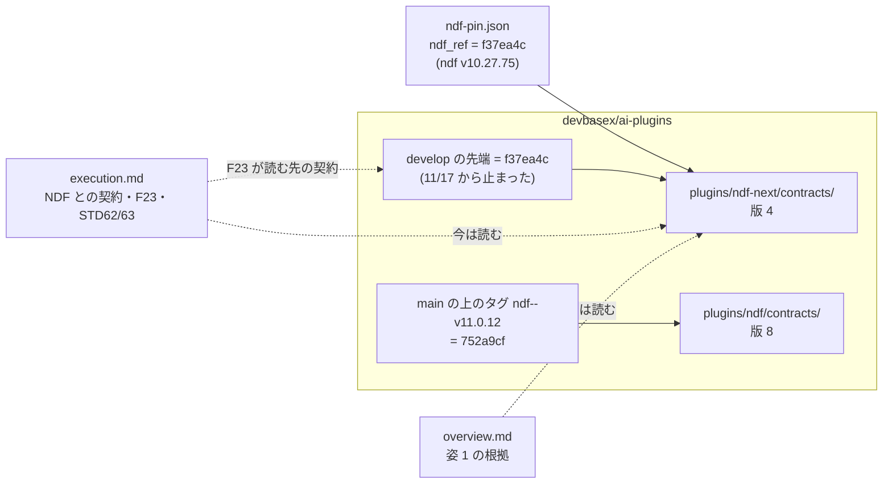
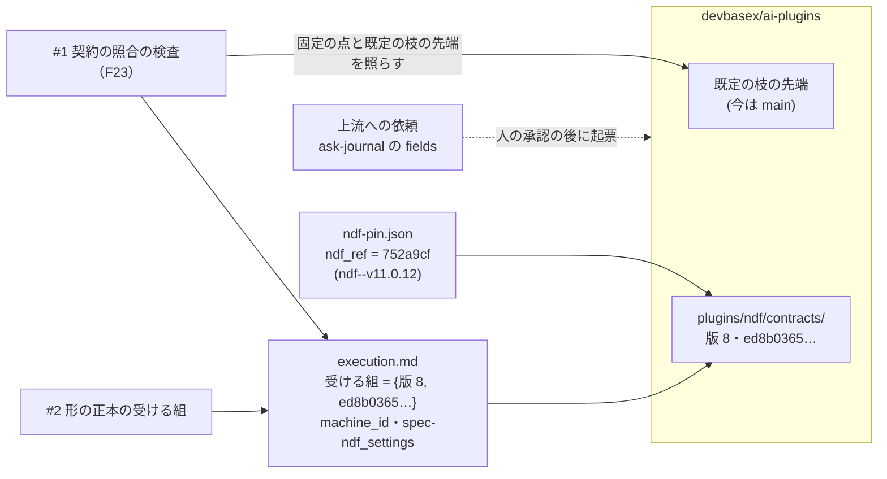

# NDF との契約: 全体の設計と固定の点が、配布された ndf v11.0.12 の契約を指す（#41）

全体の設計の「NDF との契約」と固定の点（`ndf-pin.json`）が NDF 11 の前の契約（版 4・`plugins/ndf-next/contracts/`）を指したままで、#1 と #2 の詳細設計が古い置き場と名前を読む。固定の点を ndf v11.0.12 の配布のコミットへ付け替え、受ける契約の組を `{版 8, ed8b0365…}` の 1 つにし、置き場・口・引数の名前を v11.0.12 の契約に合わせて全体の設計を直す。契約に無い問いの ID の取り出し元は上流へ契約への追加を依頼し、契約の照合の検査（F23）が読む先を止まった `develop` から NDF の既定の枝へ移す。比べた案は「決定の記録」に、契約の突き合わせは「外部の調査」にある。

## 今の姿

何が起きたか・目的・受け入れ条件は要求仕様（[issue-41-requirements.md](./issue-41-requirements.md)、正は #41 の本文）にある。この文書は「どう解くか」と「なぜその解き方か」だけを書く。

変える場所は、全体の設計の 2 本（`docs/design/execution.md`・`docs/design/overview.md`）と `ndf-pin.json` である。`execution.md` で古い契約を引く箇所は次のとおり。

| 節 | 古い契約を引く箇所 |
| --- | --- |
| NDF との契約 | 前文の `ndf-next` プラグインと `plugins/ndf-next/contracts/`。「NDF 11 の名前」の行の「今の点は旧い名前を持つ」。「契約の版の照らし」の行の版 4。「使わない口」の `spec-declarations` |
| 契約の照合の定期の検査 | 読む先の「NDF の develop の先端」と、落ちたときの「develop の先端だけが食い違う」 |
| ランナーの責務（照らす） | `ndf progress show <表の ID>` |
| 確定から NDF まで | 図の `ndf answer 表の ID` |
| 問いの答え | 「問いの ID と表の ID は、区間の報告と `ask.jsonl` の行から得る」 |
| 決定 79 | 見出しと本文の「develop の先端」 |
| 外部の調査 | STD62・STD63 の置き場・`table_id`・調べた日 |
| 未確認のまま残ること | 「問いと承認ゲートの ID の得方」の `table_id`。「答えの事象の項目」の「表の ID」 |

`overview.md` は「あるべき姿の根拠」の姿 1 の行が `plugins/ndf-next/contracts/` を引く。他の 6 本（`api.md`・`data.md`・`decisions.md`・`detail.md`・`platform.md`・`screens.md`）は `ndf-pin.json` の名前と「進行表の DB」を引くだけで、契約の置き場・版・口の名前を持たない（`git grep` で確かめた）。

## 文脈と制約

- nd-factory は NDF の契約のファイルに載るものだけでやり取りし、NDF の内部のスクリプトと状態のファイルに頼らない（[NDF との契約](../docs/design/execution.md#ndf-との契約)）
- NDF の版の数字を読んで比べない。機能の有無は契約の版と sha256 で判断する（参照の検査 `ref-check` が落とす）
- `ndf_ref` のキーは `ndf-pin.json` の 1 か所だけに置く（`AGENTS.md`・参照の検査）
- 受ける契約の組を形の正本のデータに置くのは #2、契約の照合の検査そのものは #1、ランナーの起動の組み立ては #6 である。この課題は全体の設計の記述と固定の値だけを変える
- 上流の契約の突き合わせの結果は「外部の調査」の STD62〜STD64 にある。全体の設計が引く行のうち、変わったのは要求仕様の「何を足すか・変えるか」の表の 7 行だけで、口の数（15）・見本の数（26）・サービスが入れる環境変数の名前（6）・`reader: service` の読むファイルの `fields`・`ndf answer` の他の引数と結果の形は変わっていない
- 実行計画の判断で 2 つの答えを利用者から受けている（付け替え先は v11.0.12・この課題で先に流す。要求仕様の「起票者の推定」）

## 解き方の全体像

- `ndf-pin.json` の `ndf_ref` は ndf v11.0.12 のタグのコミット `752a9cf48a6d36c00ffb3197c8668d1c898c32e2` を指し、全体の設計の受ける契約の組は `{版 8, sha256 ed8b036584bec284dfc93a2bb5b988e2385b4f8f297d659399f5d3cb91b520c4}` の 1 つになる
- 全体の設計の契約の置き場は `plugins/ndf/contracts/`（`C/` の略）で、口・引数の名前は v11.0.12 の名前（`spec-ndf_settings`・`machine_id`）になる。nd-factory の語「進行表」は残し、ID は「進行表の ID（`machine_id`）」と書く
- 契約の照合の検査（F23）は、固定の点の契約と、ai-plugins の既定の枝の先端の契約を照らす
- `ask-journal` の `fields` が無い件は、上流へ契約への追加を依頼する（起票は設計承認ゲートの承認の後）。足されるまで「未確認のまま残ること」の行に残る
- #1 と #2 は、全体の設計の「NDF との契約」から、置き場・受ける組・名前を 1 つの答えで読む

## 決定の記録

決定の番号は、全体の設計の「実行の続き」の帯（100〜119。[決定の置き場](../docs/design/decisions.md#決定の置き場)）の次の番号から振り、`execution.md` の「決定の記録」へ同じ番号で載せる。

### 決定 104: 古い契約の点を残さず、上流の最新の配布と同じ契約で作るため、固定の点を ndf v11.0.12 のタグのコミットにし、受ける契約の組を版 8 の 1 つにする

- **質問**: 固定の点をどの配布のコミットへ付け替え、受ける契約の組（版と sha256）をいくつ持つか
- **選んだ案**: `ndf_ref` を `ndf--v11.0.12` のタグのコミット（`752a9cf…`）にし、受ける組を `{版 8, ed8b0365…}` の 1 つにする。全体の設計の「契約の版の照らし」の行に、固定の点の版と sha256 を書く。形の正本のデータへ置くのは #2 である
- 採らなかった案: ndf v11.0.0 の配布のコミット（版 6）へ付け替える（今の全体の設計が書いた先だが、その後 v11.0.12 までに契約が 2 版進み、付け替えた直後に古い点になる）
- 採らなかった案: 受ける組に版 6〜8 の 3 つを持つ（動いているランナーがまだ無く、古い組を受ける理由が無い。組を増やすと照合の検査が見る形も増える）
- 採らなかった案: 既定の枝の先端のコミットを固定の点にする（配布していない変更を含み、利用者の手元の NDF と同じにならない）
- **代償**: NDF の配布が進むたびに、固定の点と受ける組を同じ Pull Request で直す手間が残る（今の全体の設計の決まりと同じ）
- 根拠: Value 8 / Value 4（MVV 版 1）。STD62

### 決定 105: nd-factory の語を変えずに契約の引数の名前に合わせるため、「進行表」の語を残し、ID を「進行表の ID（`machine_id`）」と書く

- **質問**: 契約が `table_id`（進行表の ID）を `machine_id`（ステートマシンの ID）へ改名したのに合わせ、全体の設計の語をどこまで変えるか
- **選んだ案**: 全体の設計で ID を指す 4 か所（照らす・確定から NDF までの図・問いの答え・未確認のまま残ること）と STD63 の引数の名前を `machine_id` にし、語は「進行表の ID（`machine_id`）」と書く。「進行表」「進行表の DB」の語は用語集のまま残す
- 採らなかった案: 全体の設計の「進行表」をすべて NDF 11 の語「ステートマシン」へ言い換える（7 本で 60 か所を超え、用語集の語「進行表の DB」と環境変数 `NDF_PROGRESS_DB` の読みも変わる。語の揃えは #34 の範囲）
- **代償**: nd-factory の語（進行表）と NDF の語（ステートマシン）が違うまま残り、読み手は括弧の識別子で対応を読む
- 根拠: Value 4（MVV 版 1）。STD63

### 決定 106: 契約に載るものだけで問いに答えるため、`ask-journal` の `fields` を上流の契約へ足すよう依頼し、足されるまで未確認として残す

- **質問**: ランナーが `ndf answer` に渡す問いの ID（`--gate`）と進行表の ID（`machine_id`）の取り出し元が、v11.0.12 の契約にも無い（`ask-journal` の行が `fields` を持たない）。契約に無いまま残すか、上流へ依頼するか
- **選んだ案**: devbasex/ai-plugins へ、`ndf-files.json` の `ask-journal` の行に `fields`（少なくとも問いの ID・進行表の ID・区分）を足す依頼を起票する。起票は他のリポジトリへの起票（C5）なので、設計承認ゲートで人が承認した後に行う（下の「人へ残す判断」）。足されるまで、全体の設計の「未確認のまま残ること」の行に依頼の課題を書いて残し、#6 の詳細設計はこの行を前提にしない
- 採らなかった案: 契約に無いまま残し、固定の版の NDF で承認ゲートを 1 回通して実測で確かめる（実測で得た形は契約に無く、NDF の内部の形に頼ることになり、「契約に載るものだけでやり取りする」に反する。食い違いを照合の検査（F23）で拾えない）
- 採らなかった案: NDF の実装（`ask.jsonl` を書くスクリプト）を読んで項目を決める（同じく契約の外の形に頼る）
- **代償**: 上流が契約を足すまで、ランナーの問いの答えの渡し方（#6）が決まらない。上流の返事を待つ時間が #6 の詳細設計の前に入りうる
- 根拠: Value 4 / Value 8（MVV 版 1）。STD62

### 決定 107: 次の配布の契約の食い違いを先に知るため、契約の照合の検査（F23）は固定の点と ai-plugins の既定の枝の先端を照らす

- **質問**: F23 が「固定の点を変える前の予告」として読む先の契約を、止まった `develop` の先端から何へ移すか
- **選んだ案**: ai-plugins の既定の枝（GitHub のリポジトリの `default_branch`。今は `main`）の先端の `plugins/ndf/contracts/` を読む。枝の名前を設計と検査に書き込まず、リポジトリの設定から引く。決定 79 の「develop の先端」を「既定の枝の先端」に読み替え、決定 79 の本文に移した理由を 1 行足す
- 採らなかった案: `develop` の先端のまま読む（2026-11-17 の `f37ea4c` から進まず、今は固定の点そのものと同じで、予告にならない）
- 採らなかった案: 最新の配布のタグ（`ndf--v*`）を読む（最新を選ぶにはタグの版の数字を比べるか日付で並べることになり、版の数字を比べない決まりと衝突する。リリースの一覧は他のプラグインのタグも混ざる）
- **代償**: 既定の枝の先端は配布の前の変更を含むため、要約に出る食い違いには配布されないまま変わるものも入る（落ちるのは固定の点で食い違ったときだけで、先端の食い違いは要約に出すだけという今の扱いは変えない）
- 根拠: Value 8（MVV 版 1）。STD64

## 影響と危険

- **働く範囲**: このリポジトリの全体の設計（`docs/design/execution.md`・`docs/design/overview.md`）と固定の値（`ndf-pin.json`）だけ。動くコードは無い。`ndf-pin.json` を読むのは参照の検査で、キーの数と置き場だけを見る
- **プロジェクトごとに違うもの**: 無い（設計の記述と固定の値で、設定も引数も受けない）
- **当たるモード**: `standard`
- **同じファイルを触る別の変更**: #33（GitHub の token の失効）・#34（用語）・#38（I21）も `execution.md` を直す課題で、今は動いていない。#33 と #38 は「NDF との契約」「契約の照合」「確定から NDF まで」「問いの答え」の節を触らない見込みで、重なっても行の衝突だけである。#34 は語の揃えで「進行表」を言い換える可能性があり、決定 105 はその余地を残す。K5-設計（#13）は `infra/` と詳細設計で重ならない
- **後に続く課題**: #1 と #2 は、決定 104〜107 と直した後の「NDF との契約」を読んで詳細設計を書く。#6 は決定 106 の上流の答えを待つ
- **壊れうる箇所**: `ndf-pin.json` を変える Pull Request は、F23 の検査ができた後は検査の対象になる。今は検査が無く（#1）、参照の検査だけが走る
- **用語集の描画**: ndf v11.0.12 の `ndf records glossary render` は用語集の文書を文脈ごとのファイルに分けて作り、今の `docs/glossary.md` と食い違う（`--check` が 9 件を返す。語は失われない）。この課題の範囲の外で、別の課題で扱う

### このリポジトリだけの事情

- 無し（設計の記述と固定の値の変更で、ブランチの運用やリリースの形に関わる値を足さない）

## テスト設計

| 受け入れ条件・決定 | どの振る舞いで縛るか | どう壊したら落ちるべきか |
| --- | --- | --- |
| 受け入れ条件 1（`ndf_ref` の付け替え） | 参照の検査（CI の `ref-check`）が、`ndf_ref` のキーが `ndf-pin.json` の 1 か所だけにあることを照らす。値は `gh api repos/devbasex/ai-plugins/git/ref/tags/ndf--v11.0.12` の `object.sha` と照らす（マージ前の手動確認） | `ndf_ref` を他の JSON にも書くと `ref-check` が落ちる。値が v11.0.12 のタグのコミットと違えば手動確認で見つかる |
| 受け入れ条件 2（古い名前が残らない） | `git grep -nE 'plugins/ndf-next/contracts\|spec-declarations\|table_id' -- docs/design` が 0 件（マージ前の手動確認と cross-review） | 直し漏れの 1 か所があれば 1 件以上になる |
| 受け入れ条件 3（版と sha256） | 全体の設計の「契約の版の照らし」の行の版と sha256 が、固定の点の `plugins/ndf/contracts/version.json` の `history` の最後の行と一致する（マージ前の手動確認） | 版 6・7 や sha256 の写し間違いで一致しない |
| 受け入れ条件 4（STD62・STD63） | STD62・STD63 の出典の列が `plugins/ndf/contracts/` と 2026-11-21 を持つ | 置き場か日付の片方だけを直すと読み手が見つける（cross-review） |
| 受け入れ条件 5・決定 106 | 「未確認のまま残ること」の「問いと承認ゲートの ID の得方」の行が、上流への依頼と、足されるまで #6 が前提にしないことを書く | 行が `table_id` のままか、扱いが無いと cross-review が落とす |
| 受け入れ条件 6・決定 107 | 「契約の照合の定期の検査」と決定 79 が「既定の枝の先端」を読む先として書く | `develop` の語が残ると `git grep -n develop -- docs/design/execution.md` が当たる |
| 受け入れ条件 7 | CI の `check`（`npm run check`）と `ref-check` が通る | 生成物の差・参照の検査の当たりで落ちる |
| 決定 105 | 「進行表の ID（`machine_id`）」の形が 4 か所でそろう | 「表の ID」「ステートマシンの ID」が混ざると cross-review が落とす |

## どこを変えるか

詳細設計はこのセクションに畳む。新設する関数 0・シグネチャを変える関数 0 のため（文書と固定の値だけの変更）。

| ファイル | 変える中身 | 決定 |
| --- | --- | --- |
| `ndf-pin.json` | `ndf_ref` を `752a9cf48a6d36c00ffb3197c8668d1c898c32e2` にする | 104 |
| `docs/design/execution.md` | 「NDF との契約」の前文: プラグインを `ndf`、置き場と `C/` を `plugins/ndf/contracts/` にする | 104 |
| `docs/design/execution.md` | 「NDF との契約」の「NDF 11 の名前」の行: 名前は固定の点（ndf v11.0.12）の契約の名前だと書き、「今の点は旧い名前を持つ」以降の付け替えの文を消す | 104 |
| `docs/design/execution.md` | 「NDF との契約」の「契約の版の照らし」の行: 置き場の列を「`C/version.json`（固定の点で版 8・sha256 `ed8b0365…`。受ける組はこの 1 つ）」にする | 104 |
| `docs/design/execution.md` | 「使う口」の「使わない口」: `spec-declarations` を `spec-ndf_settings` にする | 104 |
| `docs/design/execution.md` | 「契約の照合の定期の検査」: 読む先を「ai-plugins の既定の枝（`default_branch`）の先端の契約」、落ちたときの「develop の先端」を「既定の枝の先端」にする | 107 |
| `docs/design/execution.md` | 「ランナーの責務」の照らす・「確定から NDF まで」の図・「問いの答え」の本文: 「表の ID」を「進行表の ID（`machine_id`）」にする。「問いの答え」の未確認の文は決定 106 の依頼を指す | 105・106 |
| `docs/design/execution.md` | 「決定の記録」: 決定 79 の見出しと本文の「develop の先端」を「既定の枝の先端」にし、移した理由を 1 行足す。決定 104〜107 を足す | 104〜107 |
| `docs/design/execution.md` | 「外部の調査」: STD62・STD63 を `plugins/ndf/contracts/`・`machine_id`・2026-11-21 に直し、STD64（ai-plugins の枝とタグ）を足す | 104・107 |
| `docs/design/execution.md` | 「未確認のまま残ること」: 「問いと承認ゲートの ID の得方」の行を `machine_id` と上流への依頼（決定 106）に直す。「答えの事象の項目」の「表の ID」を「進行表の ID」にする | 105・106 |
| `docs/design/overview.md` | 「あるべき姿の根拠」の姿 1 の行: `plugins/ndf-next/contracts/` を `plugins/ndf/contracts/` にする | 104 |

## 設計の結果

| 課題 | 扱い | 統合先 | 触るファイル |
| --- | --- | --- | --- |
| #41 | 実装する | — | `ndf-pin.json`、`docs/design/execution.md`、`docs/design/overview.md` |

## 人へ残す判断

| 判断 | 当たるレッドライン | なぜ当たるか |
| --- | --- | --- |
| devbasex/ai-plugins へ、`ask-journal` の行に `fields` を足す依頼を起票する（決定 106） | C5 | このリポジトリの外のリポジトリへの起票である |

## 未確認のまま残ること

| 項目 | 内容 |
| --- | --- |
| 上流が `ask-journal` の `fields` を足すか | 依頼の課題への上流の答えで分かる。足されたら、その配布の点へ付け替える Pull Request で「未確認のまま残ること」の行を消す |
| 契約の `report-unattended` の出所のファイル | v11.0.12 の `entrypoints.json` の `report-unattended` の行は出所を `plugins/ndf/contracts/forms/unattended-report.json` とするが、v11.0.12 の契約のディレクトリに `forms/` は無い。全体の設計は結果の値の 3 つ（`args`）だけを読むため影響しない。#1 の照合の検査を作るときに出所の読み方を確かめる |

## 外部の調査

| 種類 | 調べるか | 理由 |
| --- | --- | --- |
| 標準・仕様 | 調べる | 上流の NDF の契約のファイルがこの変更の唯一の出所である |
| 主要な製品 | 調べない | 解き方を製品から選ぶ変更でなく、上流の契約に合わせる変更である |
| ライブラリとサービス | 調べない | 足すライブラリもサービスも無い |

### 標準・仕様

| # | 標準・仕様 | 何を定めているか | 設計への反映 | 出典 |
| --- | --- | --- | --- | --- |
| STD62 | NDF の契約のファイル（固定の点 `f37ea4c` の `plugins/ndf-next/contracts/` と、`ndf--v11.0.12` の `752a9cf` の `plugins/ndf/contracts/`） | 置き場の移動。`version.json` の最後の行は版 4・`e80d8578…` から版 8・`ed8b036584bec284dfc93a2bb5b988e2385b4f8f297d659399f5d3cb91b520c4` へ（v11.0.0 は版 6）。口は 15 行のまま、`file-ledgers` → `file-journals`・`spec-declarations` → `spec-ndf_settings`。見本は 26 件のまま、id の `ask-ledger` → `ask-journal`・`spec-declaration` → `spec-ndf_settings`。`set_by: service` の環境変数は 6 つのまま。答えの語は `revise` → `request_changes`。`reader: service` の読むファイルの `fields` は変わらず、`ask-journal` は `fields` を持たない | 決定 104・106、要求仕様の「何を足すか・変えるか」 | `git archive f37ea4c plugins/ndf-next/contracts` と `git archive 752a9cf plugins/ndf/contracts` を突き合わせた。`gh api 'repos/devbasex/ai-plugins/contents/plugins/ndf/contracts/version.json?ref=752a9cf48a6d36c00ffb3197c8668d1c898c32e2'`（2026-11-21） |
| STD63 | NDF の契約の `ndf answer` と `ndf progress` の引数（`C/schemas/io/answer.args.schema.json`・`answer.result.schema.json`・`progress.args.schema.json`） | `ndf answer` の必須は `machine_id`（位置引数。旧 `table_id`）・`--gate`・`--result`・`--reason`・`--by`・`--key`。`--drop`・`--notes`・`--head`・`--material-sha256` と、結果の `metrics.seqs`・`metrics.replayed` は変わらない。`ndf progress` の副命令の位置引数も `machine_id` | 決定 105 | 同上の 2 つの点の `schemas/io/` を `diff` で突き合わせた（2026-11-21） |
| STD64 | devbasex/ai-plugins の枝とタグ | 既定の枝は `main`。`develop` の先端は 2026-11-17 の `f37ea4c`（ndf v10.27.75 の配布）から進んでいない。`ndf--v11.0.12` のタグは `main` の上の `752a9cf`（2026-11-20） | 決定 104・107 | `gh api repos/devbasex/ai-plugins --jq .default_branch`、`gh api repos/devbasex/ai-plugins/git/ref/tags/ndf--v11.0.12`、`git log -1 origin/develop`（2026-11-21） |

調べた量: 候補 3 件・取得の試み 9 回。
