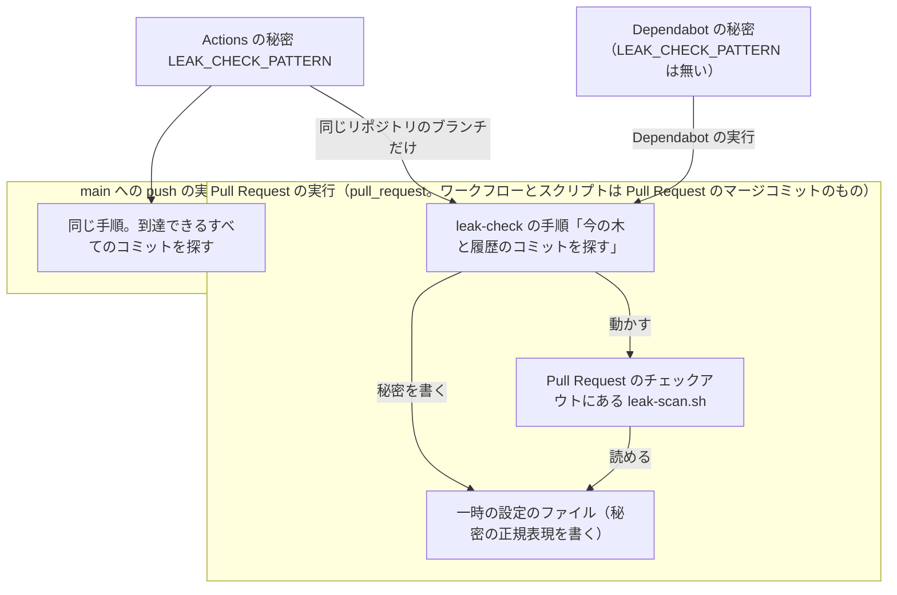
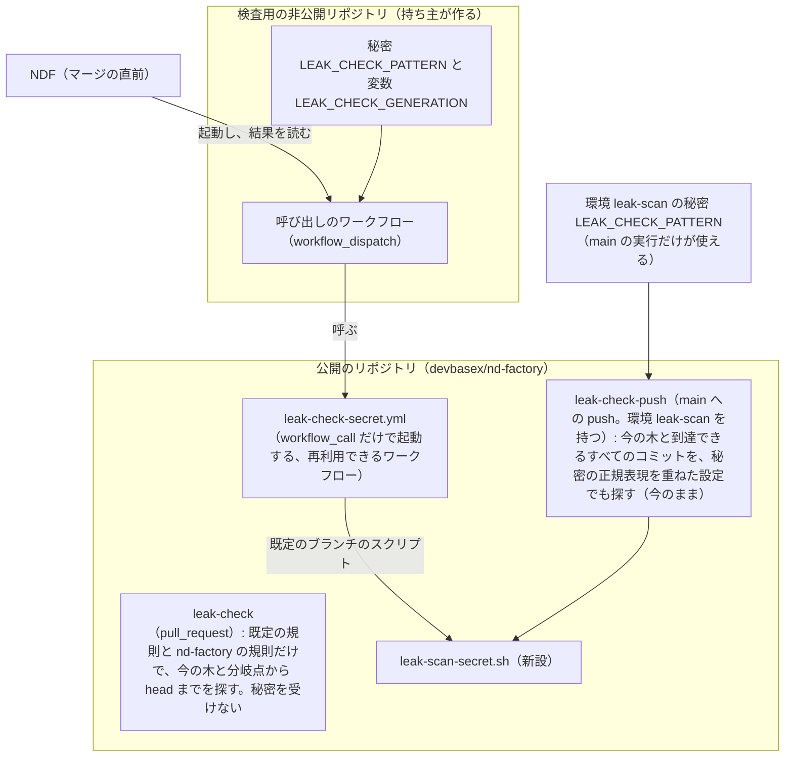
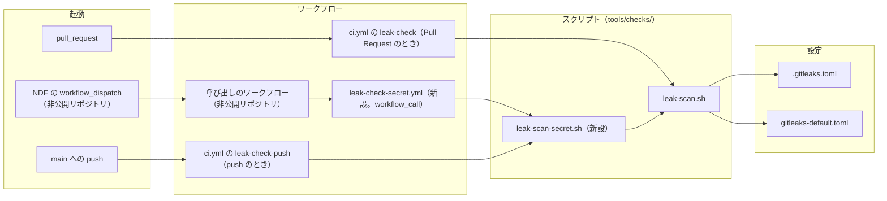
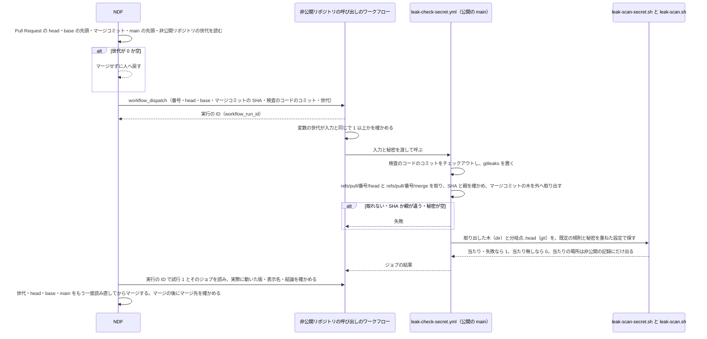

# 漏れの検査: 実際の値の規則での Pull Request の探しを非公開のリポジトリへ移し、NDF がマージの直前に起動して結果を確かめる（#96 #101）

漏れの検査（CI の `leak-check`）は実際の値の正規表現（CI の秘密 `LEAK_CHECK_PATTERN`）を Pull Request の側の実行で使うので、fork の Pull Request では探されず、Dependabot の Pull Request では落ち、同じリポジトリのブランチでは秘密を Pull Request のコードが読める。この設計では、Pull Request を実際の値の規則で探す処理を持ち主が用意する検査用の非公開リポジトリへ移し、NDF（このリポジトリの開発を進めるツール）がマージの直前に起動して、結果を非公開リポジトリに読み取りの権限を持つ人と NDF にだけ見せる。Pull Request の側の `leak-check` には秘密を渡さず、main への push の探しは main の実行だけが読める環境（GitHub Actions の environment）の秘密で今と同じく行う。公開のリポジトリで `pull_request_target` を使って探す形は、外部の作者が実際の値と思う語を Pull Request に入れ、成否から正規表現に当たるかを確かめられるので採らず、その理由とほかの採らなかった案は決定 1・8 にある。

## 今の姿

何が起きたか・目的・受け入れ条件は要求仕様（[issue-96-requirements.md](./issue-96-requirements.md)、正は #96 の本文。[issue-101-requirements.md](./issue-101-requirements.md)、正は #101 の本文）にある。この文書は「どう解くか」と「なぜその解き方か」だけを書く。

変更する位置は、`.github/workflows/ci.yml` の `leak-check` の手順「今の木と履歴のコミットを探す」（コミット fa6aa1b の 146〜184 行目）である。設計に要る今の構造は次のとおり。

| 実行 | 受ける秘密 | 秘密の正規表現での探し | 必須にする条件（変数 `LEAK_CHECK_REQUIRE_PATTERN` が `1` のとき） |
| --- | --- | --- | --- |
| 同じリポジトリのブランチからの Pull Request | Actions の秘密 | 分岐点から head までの全コミット。秘密を書いた設定のファイルを、Pull Request のチェックアウトのスクリプトが読む | 必須 |
| fork からの Pull Request | 無し | 探さない | 必須にしない |
| Dependabot が起動した Pull Request | Dependabot の秘密だけ | 秘密が空なので探せない | 必須（そのため毎回落ちる） |
| main への push | Actions の秘密 | 到達できるすべてのコミット | 必須 |

マージの方法は squash である（`.ndf/project.json` の `merge.commit` が `squash`）。squash では Pull Request の途中のコミットは main に入らないので、Pull Request の時に探さなかったコミットは main への push でも探されない。

**2 つの課題を 1 本にまとめたのは、原因が同じ 1 か所にあるためである。** 秘密を使う探しが Pull Request の側の実行（`pull_request`）の中にあり、秘密を受けられるかと、動くコードを信頼できるかが、Pull Request の出所（fork・Dependabot・同じリポジトリのブランチ）で変わる。#96 は fork で秘密を受けられないことと、同じリポジトリのブランチで秘密が Pull Request のコードに渡ることを、#101 は Dependabot で秘密を受けられないことを扱う。探しを出所に左右されない信頼できる場所へ移すと、両方が同じ変更で直る。#96 の要求も「Dependabot が起動した実行で秘密を使う探しがどう動くかは、この課題の仕組みを決めるときに #101 とそろえる」としている。

## 文脈と制約

括弧の中の STD・PRD・LIB の番号は、末尾の「外部の調査」の表の番号である。

- リポジトリは公開で、fork から誰でも Pull Request を出せる。実際の値の正規表現そのもの（運用する環境の名前などを含む）を、リポジトリ・CI の記録・Pull Request の作者が書いたコードに渡さない（MVV の Value 7）
- 公開のリポジトリの Actions の実行の記録と、Pull Request に付くチェックの結論は、誰でも見られる。実行の記録を見るには、そのリポジトリへの読み取りの権限が要る（STD10）。非公開のリポジトリの実行の記録は、そのリポジトリに読み取りの権限を持つ人にしか見えない
- CI は AWS の資格情報を持たない。ワークフローの `permissions` は最上位を `contents: read` だけにし、ジョブで広げない（`tools/test/ci-definition.test.ts` が落とす）
- 動作（`uses:`）はコミットの SHA で固定し、gitleaks はバージョンと要約値で固定して取る（#1 の決定 3・5）
- ワークフローの点検（zizmor v1.32.0）は `--offline --no-ignores --config .github/zizmor.yml` で打つ。`--no-ignores` を付けて打つと、行の中の `zizmor: ignore` も設定の `rules.<id>.ignore` も効かない（2026-11-24 に v1.32.0 を手元で打って確認した。外部の調査の LIB2）
- main にはブランチの保護もルールセットも無い。2026-11-24 に、`gh api repos/devbasex/nd-factory/branches/main/protection` は 404 を返し、`gh api repos/devbasex/nd-factory/rulesets` は空だった。GitHub の画面や API からのマージは、どのチェックが落ちていても止まらない。必須のチェックで止まるのは、NDF が行うマージだけである
- NDF は、マージの前に Pull Request の head のコミットに付いたチェックを名前だけで読み、必須のチェックの一覧と照らす。同じ名前のチェックが複数あれば、最も新しい 1 件だけを数える。チェックを出したワークフローのファイルと起動のイベントは見ない（devbasex/ai-plugins の `plugins/ndf/src/ndf/adapters/ci.py` の `read`・`latest` と、`plugins/ndf/src/ndf/domains/release/land.py` の `_runs`。2026-11-24 に main を読んで確認）。そのため、Pull Request の作者が同じ名前のジョブを足すと、名前だけの照合は迂回できる
- このリポジトリには Dependabot の設定のファイル（`.github/dependabot.yml`）が無く、Dependabot は Pull Request を作らない（2026-11-24 に確認）。Dependabot を有効にすること・秘密と変数の登録そのものは範囲の外である（両課題の「含まない」）

## 解き方の全体像

- Pull Request を実際の値の規則で探すのは、検査用の非公開リポジトリの実行である。NDF がマージの直前に、Pull Request の番号・head の SHA・base の SHA・Pull Request のマージコミットの SHA・検査のコードのコミット・設定の世代を渡して起動する。検査のコードのコミットは、探しに使うスクリプトと設定を取る公開のリポジトリの main の先頭のコミットで、探す対象の Pull Request のコミットではない。設定の世代は、持ち主が秘密か呼び出しのワークフローを変えるときに切り替える、非公開リポジトリの変数 `LEAK_CHECK_GENERATION` の値である（決定 7）。fork・同じリポジトリのブランチ・Dependabot のどの Pull Request でも、起動のされ方は同じである（決定 1・2）
- 非公開リポジトリの実行は、公開のリポジトリの既定のブランチにある再利用できるワークフロー `leak-check-secret.yml` を呼ぶ。そのワークフローは、既定のブランチのスクリプトと設定だけを動かし、Pull Request のコミットはデータとして取り込む。マージで base に入る木（GitHub が作る Pull Request のマージコミットの木）を、Git に保存された内容のまま作業ツリーの外に取り出して探し、分岐点から head までの各コミットの差分も探す（決定 4・5）
- 探しの成否・件数・当たりの場所は、非公開リポジトリの記録にだけ出る。NDF は結果を公開の Pull Request に書かない。外部の作者は、候補の語が正規表現に当たるかを公開の記録から確かめられない（決定 8）
- NDF は、自分が起動した 1 回の実行の結果だけを、渡した値と一致するかで確かめて受け入れる。前の実行の成功は使わない。マージの直前に条件を読み直し、マージの後にマージ先を確かめる。NDF にその機能を足す依頼は、承認を得てから devbasex/ai-plugins へ出す（決定 7）
- Pull Request の側の `leak-check` は秘密を一切受けない。秘密の正規表現を書いた設定のファイルを、Pull Request のコードが読む経路が無くなる（決定 3）
- Dependabot の秘密には、実際の値を登録しない。非公開リポジトリの実行は Dependabot が起動しないので、Dependabot の秘密は要らない（決定 2）
- 実際の値の正規表現は 2 か所に置く。Pull Request の探しのための非公開リポジトリの秘密と、main への push の探しのための公開のリポジトリの環境 `leak-scan` の秘密（使えるブランチは main だけ）である（決定 9）
- 持ち主の操作（非公開リポジトリの用意・秘密と変数の登録・NDF の権限の付与・秘密の切り替え）は、新設する運用の文書（`docs/operations/ci-checks.md`）と `AGENTS.md` に書く（決定 6）

## 構成要素

| 要素 | 責務 |
| --- | --- |
| 再利用できる漏れの検査のワークフロー（`.github/workflows/leak-check-secret.yml`、新設） | `workflow_call` だけで起動する。入力で Pull Request の番号・head の SHA・base の SHA・マージコミットの SHA・検査のコードのコミット・設定の世代を、秘密で `LEAK_CHECK_PATTERN` を受ける。入力の形（番号と世代は正の整数、head・base・マージコミット・検査のコードのコミットの 4 つの SHA は小文字の 16 進数 40 桁）を検査し、外れれば探す前に失敗する。公開のリポジトリを、入力の検査のコードのコミットで `persist-credentials: false` でチェックアウトする。Pull Request の head を `refs/pull/<番号>/head` から、マージコミットを `refs/pull/<番号>/merge` から git の参照として取り、入力の head の SHA・マージコミットの SHA と一致することを確かめる。マージコミットの親がちょうど 2 つで、最初の親が入力の base の SHA、2 つ目の親が入力の head の SHA であることも確かめる。マージコミットの木を、木の取り出しのスクリプトで作業ツリーの外のディレクトリへ取り出す。秘密を使う探しのスクリプトに、取り出した木（`dir`）と、分岐点から head までの範囲（`git --range`）を渡し、必須の指定は常に `1` にする。分岐点は入力の base の SHA と head の SHA から求める。ジョブの表示名に、入力の 6 つの値を入れる（決定 7）。取り出した木のファイルを動かさず、依存を入れない（`npm ci`・`setup-node` を持たない） |
| 呼び出しのワークフローの見本（`docs/operations/leak-check-caller.yml`、新設） | 持ち主が検査用の非公開リポジトリの `.github/workflows/` に置く呼び出しのワークフローの正本。`workflow_dispatch` だけで起動し、入力をそのまま `devbasex/nd-factory/.github/workflows/leak-check-secret.yml@main` に渡し、非公開リポジトリの秘密 `LEAK_CHECK_PATTERN` を名前で渡す。非公開リポジトリの変数 `LEAK_CHECK_GENERATION` が入力の世代と違うか、`0` か空なら、呼ぶ前に失敗する。公開のリポジトリの `.github/workflows/` の外に置くので、公開のリポジトリでは動かない |
| 秘密を使う探しのスクリプト（`tools/checks/leak-scan-secret.sh`、新設） | 探す対象（`dir` か `git`）を引数で、秘密の正規表現と必須の指定を環境変数で受ける。秘密があれば、一時の設定のファイルを、探す木の外に作る。その設定は `.gitleaks.toml` を `[extend] path` で読み、規則 `nd-real-value` を足す。秘密が空のとき、必須なら失敗する。必須でなければ、「秘密が空なので `.gitleaks.toml` だけで探す」行を記録に出して `.gitleaks.toml` だけで進む（main への push で、持ち主が変数を設定する前だけ起きる。決定 10 の手順 4 で、この行が出ていないことを確かめる）。続けて `leak-scan.sh` を、受けた対象で 2 回打つ。1 回目は既定の規則で、2 回目はその設定で探す。設定のファイルは、スクリプトと同じチェックアウトのものを絶対パスで渡す。`git` で範囲を受ければその範囲、受けなければ到達できるすべてのコミットを探す。`dir` では、探す木のディレクトリを引数で受けられる。秘密があれば、`nd-real-value` の当たりが 0 件でも、件数の行（`nd-real-value: <件数> 件`）を必ず出す。当たりの出し方は、件数だけにするか今の `leak-scan.sh` の形にするかを引数で受ける。今の `leak-scan.sh` は、`--paths` を渡さなければファイルの名前を `file-<番号>` で出す。手元で当たりのファイルを特定するときだけ `--details` を渡し、`leak-scan.sh` に `--paths` を渡して実際のファイルの名前を出す（決定 8）。正規表現を記録に出さない |
| 木の取り出しのスクリプト（`tools/checks/export-tree.sh`、新設） | コミットと、空の出力先のディレクトリを引数で受ける。`git ls-tree -r -z --full-tree` でコミットの木のすべての項目を読み、ファイルの項目ごとに `git cat-file blob` で Git に保存された内容をそのまま書き出す。`.gitattributes` を読まず、`git archive` の `export-ignore`・`export-subst` も、改行の変換などのフィルタも掛けない。シンボリックリンクの項目は、リンク先の文字列を中身とする普通のファイルとして書き、取り出した木の外を指すリンクを作らない。サブモジュールの項目は中身を持たないので書かない。パスが絶対パスか、`.`・`..`・`.git` の部分を含めば失敗する。書き終えた後に、書いたファイルの数が木のファイルの項目の数と同じで、各ファイルの `git hash-object --no-filters` の値が項目の値と同じことを確かめ、外れれば失敗する。失敗の知らせにパスを出さない（パスが実際の値を含み得るため。決定 8） |
| 今の木と履歴の探しのスクリプト（`tools/checks/leak-scan.sh`） | 変えない。gitleaks の 1 回の探しと、当たりを規則・ファイル・行・コミットだけで出す。探す木の根に `.gitleaksignore` があれば終了コード 2 で失敗する |
| CI の `leak-check` のジョブ（`.github/workflows/ci.yml`） | Pull Request の実行だけで動く（`if: github.event_name == 'pull_request'`）。必須のチェックの名前 `leak-check` は変えない。環境を持たず、秘密を受けない。`leak-scan.sh` を直に呼び、既定の規則と `.gitleaks.toml` だけで今の木（`dir`）と分岐点から head まで（`git --range`）を探す（今の既定の規則と nd-factory の規則の探しのまま） |
| CI の `leak-check-push` のジョブ（`.github/workflows/ci.yml`、`leak-check` から分けて新設） | main への push の実行だけで動く（`if: github.event_name == 'push'`）。`environment: leak-scan` を持ち、環境の秘密と変数を受け、秘密を使う探しのスクリプトを `dir` と `git`（範囲なし）で 1 回ずつ呼ぶ。今と同じく、今の木と到達できるすべてのコミットを、それぞれ 2 つの設定で探す。`nd-real-value` の当たりは件数だけを出す。Pull Request の実行では飛ばされ、必須のチェックにもしない |
| CI の定義のテスト（`tools/test/ci-definition.test.ts`） | 必須のチェックの宣言と、Pull Request で起動するジョブの集合の一致を見る。必須でなくてよいジョブの一覧には `leak-check-push` だけを入れる。ワークフローごとに許す起動のイベントの一覧を持ち、一覧の外のイベントがあれば落とす。再利用できる漏れの検査のワークフローと呼び出しのワークフローの見本の形（決定 4）と、秘密を受ける手順と必須の条件の分け方（決定 3）を、定義から読んで落とす |
| 漏れの検査の結合のテスト（`tools/test/leak-scan.integration.test.ts`） | 秘密を使う探しのスクリプトを、作り物の正規表現と、途中のコミットで足して後で消した作り物のリポジトリで動かす。木の取り出しのスクリプトを、`.gitattributes` でファイルを省いたり中身を替えたりする作り物のリポジトリで動かす |
| NDF のマージの前の非公開の検査（devbasex/ai-plugins、このリポジトリの外） | マージの直前に非公開リポジトリの呼び出しのワークフローを起動し、その 1 回の実行の結果を渡した値で確かめ、設定の世代と時間の上限を守ってマージし、マージの後にマージ先を確かめる機能。この変更では作らず、依頼を出す（決定 7） |
| NDF の設定（`.ndf/project.json`） | 導入の 2 本目の Pull Request で、NDF のマージの前の非公開の検査を有効にする項目を足す。項目の形は NDF の依頼で決める。非公開リポジトリの名前は公開のリポジトリに書かず、NDF の利用者の設定（リポジトリの外）に持つ。検査を必須にするかを NDF が決める読み取り元は、NDF の利用者の設定と、base のブランチの `.ndf/project.json` だけで、Pull Request の head の `.ndf/project.json` は読まない（決定 10 の手順 6）。1 本目（実装の Pull Request）では変えない（決定 10） |
| 運用の文書（`docs/operations/ci-checks.md`、新設）と指示書（`AGENTS.md`） | 持ち主が行う操作の手順（決定 6）と、秘密を使う探しがどこで動き、誰に結果が見えるか |
| プラットフォームの設計（`docs/design/platform.md` の「設計の決まりを縛る検査」） | 漏れの検査の行に、実際の値の規則での Pull Request の探しが、NDF のマージの直前に非公開リポジトリで動くことを足す |

図には CI の中で動くものだけを描き、テスト・宣言・文書の行は含めない。`leak-check-secret.yml` が使う設定とスクリプトは、`.gitleaks.toml`・`gitleaks-default.toml` と、`leak-scan-secret.sh`・`leak-scan.sh`・図に無い `export-tree.sh` の 3 本のスクリプトである。どれも、NDF が渡した検査のコードのコミット（公開のリポジトリの main のコミット）のチェックアウトにあるものである。Pull Request のコミットは git の参照として取り込まれ、マージコミットの木はチェックアウトの外のディレクトリへデータとして取り出される。

## 処理の流れ

NDF が受け入れるのは、自分がこのマージのために起動した 1 回の実行の結果だけである。その条件と、時間の上限・世代の扱いは決定 7 にある。

- 作者が新しいコミットを push しても、探し直しの起動は要らない。NDF はマージのたびに今の head で起動し直す
- マージ先（base のブランチ）を変えても、base の先頭が進んでも、NDF がマージの直前に今の base で起動するので、前の base の結果は使われない。探した base の先頭とマージの直前の base の先頭が違えば、NDF はマージしない（決定 7 の手順 5）
- 探しの設定とコードを変える Pull Request が、起動の後に main にマージされると、その前に起動した探しの結果は、マージの直前の比べ方で退けられる（決定 7 の手順 5）。次のマージでは、NDF は今の main の先頭を検査のコードのコミットとして渡す
- 持ち主が秘密を変えるときは、非公開リポジトリの変数 `LEAK_CHECK_GENERATION` を `0` にし、NDF の時間の上限が過ぎ、結果不明か照合の済んでいないマージが残っていないことを確かめてから変える（決定 7）

## 非機能の実現方式

| 大項目 | 要求の条件 | 実現方式 | 確かめ方 |
| --- | --- | --- | --- |
| セキュリティ | 秘密の正規表現と書き込みの権限が、Pull Request の作者が書いたコードに渡らない（#96 の受け入れ条件 3・4） | Pull Request の探しの秘密は非公開リポジトリの秘密に置き、呼び出しのワークフローから名前で渡す。探しのワークフローは公開のリポジトリの main のスクリプトと設定だけを動かし、Pull Request の head とマージコミットは git の参照として取り、木を Git に保存された内容のままデータとして取り出すだけにする。依存を入れない。入力の値は環境変数で渡し、形を検査してから使う。`permissions` は `contents: read` だけ。main への push の探しの秘密は、使えるブランチを main だけにした環境 `leak-scan` に置く（決定 9） | CI の定義のテスト（決定 3・4 の行）と、検証用のリポジトリでの確認（決定 10 の手順 1） |
| セキュリティ | 秘密を使う探しが失敗したときは通さない側に倒す（#96 の受け入れ条件 6） | 探しのワークフローのジョブと手順に `if:` と `continue-on-error` を置かない（条件で飛ばしたジョブは成功と報告されるため。STD4）。入力の検査・取り込み・SHA の一致・木の取り出し・範囲の読み取り・gitleaks のどこで失敗しても、終了コード 0 以外で終える。NDF は、成功の結論を確かめられない限りマージしない | CI の定義のテストと、結合のテストの失敗の経路の行 |
| セキュリティ | 実際の値の正規表現と、それに当たる語が正規表現に含まれるかどうかが、公開の記録・チェック・通知から分からない（Value 7。決定 8） | Pull Request の探しの成否・件数・当たりの場所は、非公開リポジトリの記録にだけ出る。NDF は結果を公開の Pull Request のコメントやチェックに書かない。公開の main への push の探しは、`nd-real-value` の当たりを件数だけで出す | 結合のテスト（出力に作り物の正規表現と当たった値が現れない）と、検証用のリポジトリでの確認（非公開の記録が外から見えない） |
| 運用・保守性 | 当たりの出力は今の `leak-scan.sh` の形（規則・ファイル・行・コミット）のままにし、持ち主が当たりの場所を引ける（#96） | Pull Request の探しは、非公開の記録に今の形で出す。ファイルの名前は `leak-scan.sh` が `file-<番号>` に替えるので、持ち主は記録のジョブの表示名にある SHA で同じ対象を手元に取り、秘密を渡して `leak-scan-secret.sh --details` を打ってファイルを特定する。main への push の探しの `nd-real-value` の当たりは件数だけを出し、持ち主が同じく手元で `--details` を打って場所を引く（決定 8） | 結合のテスト（`--details` を渡さないと、出力に実際のファイルの名前が出ない） |

## 決定の記録

決定の根拠に挙げる Value は、プロジェクト MVV（バージョン 3。本文は [.ndf/mvv.md](../.ndf/mvv.md)）の判断の基準である。この設計で使うものの要約と、この設計との関係を次に書く。

| 項目 | 要約 | この設計との関係 |
| --- | --- | --- |
| Value 7 | リポジトリは公開なので、運用する環境の名前などの実際の値と秘密の値を、リポジトリ・課題・PR・CI の記録に置かない。混入は検査で機械的に止める | 実際の値の正規表現と、それに当たる語の手がかりを、公開の記録と Pull Request のコードから隔て、全コミットをマージの前に探す |
| Value 8 | CI は GitHub のワークフローで検査だけを行い、AWS の資格情報を持たない | 新しいワークフローにも AWS の資格情報と書き込みの権限を持たせない |
| Value 13 | 同じ規則・処理は 1 か所に置き、ほかから参照する | 探しのワークフローとスクリプトを公開のリポジトリの 1 か所に置き、非公開リポジトリからはそれを呼ぶ |
| Value 14 | 変更のたびに自動のテストと静的解析を通す。依存を新しく保ち、脆弱性の知らせに早く応じる。設計の判断は理由と採らなかった案とともに残す | Dependabot の Pull Request を、ほかの Pull Request と同じ探しで通せるようにする |
| Value 17 | 目先の手間より、堅牢で長く保守しやすい形を選ぶ。今ある実装や設計を書き換える手間は、選ばない理由にしない | 持ち主の手順と NDF への依頼が増えても、結果を公開しない形を選ぶ |

### 決定 1: 実際の値の正規表現に当たる語を外部の作者に確かめさせないため、Pull Request の探しを検査用の非公開リポジトリで行い、NDF がマージの直前に起動する

- **質問**: fork・同じリポジトリのブランチ・Dependabot のどの Pull Request でも、途中のコミットを含む全コミットを実際の値の規則でマージの前に探し、その秘密と結果を Pull Request の作者に渡さないには、探しをどこで、何をきっかけに動かすか
- **選んだ案**: 持ち主が検査用の非公開リポジトリを作り、呼び出しのワークフローの見本（`docs/operations/leak-check-caller.yml`）を置く。NDF は、Pull Request をマージする直前に、ワークフローの起動の API（`POST /repos/{owner}/{repo}/actions/workflows/{workflow_id}/dispatches`）で呼び出しのワークフローを起動する。呼び出しのワークフローは、公開のリポジトリの `leak-check-secret.yml` を `workflow_call` で呼ぶ。公開のリポジトリの再利用できるワークフローは、どのリポジトリからも呼べ、その実行は呼んだ側のリポジトリのものになる（STD8）。そのため、実行の記録は非公開リポジトリにだけ残り、非公開リポジトリに読み取りの権限を持つ人と NDF にしか見えない（STD10）
- 採らなかった案: 公開のリポジトリで `pull_request_target` の新しいジョブを動かし、Pull Request のコミットを git のデータとして取る（成否と件数が公開の記録とチェックに出る。外部の作者は候補の語を 1 本ずつ Pull Request に入れて、当たるかを確かめられる。件数を伏せても成否から分かる。Pull Request を閉じても、出た結果は回収できない。Value 7 が記録に置かないと定めた運用する環境の名前などを、外部の作者が確かめられる）
- 採らなかった案: 公開のリポジトリで、必須のレビュアーを置いた環境を使い、人の承認の後にだけ `pull_request_target` の探しを動かす（承認の後の成否は公開の記録に出るので、承認した Pull Request からは同じく確かめられる。すべての Pull Request が人を待つ）
- 採らなかった案: `workflow_run` で Pull Request の CI の後に信頼できる側で探す（結果は公開の記録に出る。`workflow_run` のチェックは、Pull Request の必須のチェックとして数えられない（STD4）。zizmor の `dangerous-triggers` にも当たる）
- 採らなかった案: マージキュー（`merge_group`）で探す（マージキューの実行は Pull Request のコードを秘密つきで動かすので、#96 の受け入れ条件 3 に反する。squash のキューでは途中のコミットが残らない）
- 採らなかった案: GitHub の secret scanning の独自のパターンと push protection に正規表現を置く（fork への push は fork のリポジトリで受けるので、このリポジトリの push protection が掛からない。当たりは警告で、マージの前のチェックにならない。PRD1）
- 採らなかった案: マージの方法を rebase かマージのコミットに変え、途中のコミットを main への push で探す（マージの前に止めるという #96 の目的を満たさない。同じリポジトリのブランチで、秘密が Pull Request のコードに渡る経路も残る）
- **代償**: Pull Request の作者は、実際の値の規則の結果を見られない。当たったときは、持ち主が非公開の記録を見て、理由を伏せて直しを頼むか Pull Request を閉じる。探しは Pull Request ごとに自動では動かず、NDF のマージの直前か、持ち主が手で起動したときに動く。持ち主は非公開リポジトリを 1 つ持ち、呼び出しのワークフローを置き、NDF の認証に非公開リポジトリの権限を与える（決定 7）。NDF に機能が要り、入るまで実際の値の規則での探しはマージを止めない（決定 10）。外部の作者は、Pull Request がマージされないことからも推測できる。どの Pull Request をどう扱うかは持ち主の判断に残る
- 作り方: 標準に倣う・自前で作る
- 比べた候補: STD1 / STD2 / STD4 / STD8 / STD9 / STD10 / PRD1 / PRD2 / LIB1
- 根拠: Value 7 / Value 17（MVV バージョン 3）。実際の値と、その手がかりを公開の記録に置かない（Value 7）。手順と設計の書き換えが増えても、結果を公開しない堅牢な形を選ぶ（Value 17）

### 決定 2: Dependabot の Pull Request もほかと同じ探しを通すため、起動した人で分ける条件を置かず、Dependabot の秘密には実際の値を登録しない

- **質問**: Dependabot が作った Pull Request で、実際の値の規則をどう扱うか（Dependabot の秘密に登録して探すか、fork と同じく必須にしないか）
- **選んだ案**: Pull Request の探しは、NDF が非公開リポジトリで起動する。起動するのは Dependabot ではなく NDF なので、Pull Request を誰が作ったかによらず、非公開リポジトリの秘密が渡る。ワークフローとスクリプトは `github.actor` や `dependabot[bot]` で分ける条件を持たない。Dependabot の Pull Request の全コミットは、ほかの Pull Request と同じくマージの直前に探す。Dependabot の秘密には `LEAK_CHECK_PATTERN` を登録しない。Pull Request の側の `leak-check` は秘密を受けないので、Dependabot の Pull Request でも秘密の欠けで落ちない（決定 3）
- 採らなかった案: 実際の値を Dependabot の秘密に登録する（Dependabot の秘密は、Dependabot が起動した `pull_request` の実行で、Dependabot の Pull Request のコードと更新した依存から読める。秘密を信頼できるワークフローに限るという #96 の受け入れ条件 3 と両立しない）
- 採らなかった案: `github.actor == 'dependabot[bot]'` の実行を fork と同じく必須にしない（Dependabot の Pull Request の途中のコミットがマージの前に探されず、squash の後は main からも辿れない。起動した人での判定は、人が同じブランチへ push すると外れる）
- **代償**: 無い。今の `REF_CHECK_TERMS` は Dependabot の秘密にも登録したままで、この変更では変えない
- 根拠: Value 7 / Value 14（MVV バージョン 3）。Dependabot の Pull Request も実際の値の規則で探し、実際の値を Pull Request のコードに渡さない（Value 7）。依存の更新の Pull Request を止めない（Value 14）

### 決定 3: Pull Request のコードが秘密を読めないよう、Pull Request の側の `leak-check` には秘密を渡さず、必須にする条件は出所で分けない

- **質問**: 今の `leak-check` の、秘密を受ける手順と必須にする条件を、どう分けるか
- **選んだ案**: `ci.yml` の `leak-check` を、ジョブの単位で 2 つに分ける。環境（`environment:`）はジョブにしか付けられず、1 つのジョブを push と Pull Request で共有したまま環境を付けると、Pull Request の実行も環境の使えるブランチの条件を受けて `leak-check` が動かなくなるためである。
  - `leak-check`（`if: github.event_name == 'pull_request'`）: 必須のチェックの名前をそのまま保つ。環境を持たず、秘密を受けない。既定の規則と `.gitleaks.toml` で今の木と分岐点から head までを探す
  - `leak-check-push`（`if: github.event_name == 'push'`）: `environment: leak-scan` を持ち、秘密と必須の変数を受け、秘密を使う探しのスクリプトで今の木と到達できるすべてのコミットを探す。必須のチェックにはしない（main への push の結果で、Pull Request のマージは決まらない）

  ジョブの `if:` で飛ばしたジョブは成功と報告される（STD4）。`leak-check` が飛ばされるのは push の実行だけで、NDF が読む Pull Request の head の結果には当たらない。今の式の `github.event.pull_request.head.repo.full_name == github.repository` の条件は消す。`leak-check-secret.yml` は変数 `LEAK_CHECK_REQUIRE_PATTERN` を読まず、必須の指定を常に `1` にしてスクリプトに渡す。秘密が空なら、Pull Request の出所によらず終了コード 1 で落ちる。変数は main への push の `leak-check-push` だけが読む
- 採らなかった案: 同じリポジトリのブランチの Pull Request では、今の手順で秘密を受け続ける（Pull Request のチェックアウトのスクリプトが秘密の正規表現を読め、#96 の受け入れ条件 3 に反する）
- 採らなかった案: `leak-check-secret.yml` も変数で必須にするかを決め、変数が空なら `.gitleaks.toml` だけで成功させる（NDF の検査を有効にした後に変数が空だと、実際の値の規則が走らないまま成功と数えられ、#96 の受け入れ条件 1・2 を満たさない）
- **代償**: 同じリポジトリのブランチの Pull Request で秘密が空のとき、これまでは `leak-check` が落ちていた。これからは NDF の非公開の検査が落ちる。`ci.yml` のジョブが 1 つ増え、ジョブの `if:` で起動のイベントを分ける箇所が 2 つ増える。分けたジョブの `if:` は、CI の定義のテストが形を縛る
- 根拠: Value 7（MVV バージョン 3）。秘密を Pull Request のコードに渡さず、探しの欠けを成功と数えない

### 決定 4: 秘密を受けるワークフローが信頼できるコードだけを動かすよう、`leak-check-secret.yml` と呼び出しのワークフローの見本の形を CI の定義のテストで縛る

- **質問**: 再利用できるワークフローは、呼んだ側の秘密を受けて、Pull Request のコミットを扱う。どの形を許すか
- **選んだ案**: CI の定義のテストが、許す起動のイベントを一覧で持ち、次のどれかに当たれば落とす。禁止の起動を挙げるのではなく、許す起動を挙げるので、点検していない起動（`pull_request_target`・`workflow_run`・`issue_comment` など）を足すと落ちる。`workflow_call` は zizmor の `dangerous-triggers` の対象ではない（LIB2）ので、`.github/zizmor.yml` は変えない
  - `leak-check-secret.yml` の `on` に `workflow_call` のほかの起動がある
  - 呼び出しのワークフローの見本の `on` に `workflow_dispatch` のほかの起動がある。`uses:` が `devbasex/nd-factory/.github/workflows/leak-check-secret.yml@main` でない。秘密を `secrets: inherit` で渡す。世代を確かめる手順が無い
  - ほかのワークフローの `on` に、`push`・`pull_request`・`schedule`・`workflow_dispatch` のほかの起動がある（2026-11-24 の `ci.yml` と `ndf-contract.yml` が使う起動だけを許す）
  - `leak-check-secret.yml` が、次のどれかに当たる
    - `uses:` に、SHA で固定した `actions/checkout` のほかの動作がある
    - `run:` で、gitleaks を置く手順・`git`・チェックアウトの `tools/checks/export-tree.sh`・チェックアウトの `tools/checks/leak-scan-secret.sh` のほかを動かす。`git archive` か `tar` を使う。`--details` を渡す
    - `actions/checkout` の `repository` が `devbasex/nd-factory` でない。`ref` が入力の検査のコードのコミットでない。`allow-unsafe-pr-checkout` を渡す
    - `persist-credentials` が偽でない
    - `setup-node`・`npm`・`npx` を使う
    - `GITHUB_ENV`・`GITHUB_OUTPUT` に書く
    - gitleaks を置く手順を除いて、`GITHUB_PATH` に書く
    - `${{ inputs.* }}` を `run:` の中に直に書く
    - `if:` か `continue-on-error` がある
    - `permissions` が `contents: read` だけでない
    - 秘密を受ける手順が探しの手順のほかにある
    - ジョブの表示名に、入力の Pull Request の番号・head の SHA・base の SHA・マージコミットの SHA・検査のコードのコミット・世代が入っていない。分岐点を表示名と違う base の SHA から求める。マージコミットの親を確かめる手順が無い（決定 7）
- 採らなかった案: 呼び出しのワークフローを非公開リポジトリにだけ置き、公開のリポジトリに見本を置かない（形をテストで縛れず、持ち主の手元の写しが正本になる）
- 採らなかった案: 呼び出しのワークフローから `leak-check-secret.yml` を main のコミットの SHA で固定して呼ぶ。この案は、公開のリポジトリの main に書き込める人が非公開リポジトリの秘密に届く経路（決定 9 の代償）を塞ぐかで比べた。採らない理由は次の 3 つである
  - ワークフローだけを固定しても、経路は塞がらない。固定した版のワークフローも、入力の検査のコードのコミット（main の先頭）からスクリプトと設定をチェックアウトし、秘密つきで動かすためである
  - スクリプトと設定まで固定した版から動かすと、探しの規則かコードを main で変えるたびに、持ち主が非公開リポジトリの写しを直し、世代を切り替えることになる
  - 固定しても、値を読める人の範囲は狭まらない。同じ値は環境 `leak-scan` にもあり、main に書き込める人は main への push のワークフローを書き換えて読めるためである

  呼んだ版が想定どおりかは、NDF が実行のメタデータで実際に解決された SHA を確かめて扱う（決定 7 の手順 4）
- **代償**: 呼び出しのワークフローは、持ち主が見本から非公開リポジトリへ写す。見本を変えたときは、持ち主が写し直す。写しが見本と違っても、公開のリポジトリのテストでは見つからない。運用の文書に、見本を変えたら写し直す手順を書く
- 作り方: 標準に倣う・自前で作る
- 比べた候補: LIB2 / STD8
- 根拠: Value 8 / Value 13 / Value 14（MVV バージョン 3）。CI に AWS の資格情報を持たせない（Value 8）。呼び出しのワークフローの正本を 1 か所に置く（Value 13）。許す形を自動のテストで縛る（Value 14）

### 決定 5: 今の `dir` の探しと同じ保証を残すため、Pull Request のマージコミットの木を Git に保存された内容のまま作業ツリーの外へ取り出して探し、分岐点から head までの差分も探す

- **質問**: 秘密の正規表現を重ねた一時の設定を組む処理と必須の判定（今は `ci.yml` の手順の中のシェル）を、2 つのジョブでどう持つか。Pull Request の探しで、何を探すか
- **選んだ案**: `tools/checks/leak-scan-secret.sh` を新設し、今の手順の中のシェル（`'''` を含む正規表現を拒む・重ねた設定を組む・必須の判定・一時のファイルを消す）を移す。最初の引数で探す対象を受け、既定の規則と重ねた設定（秘密が無く必須でなければ `.gitleaks.toml`）の 2 回で探す。

  gitleaks の `git` の探しは、`git log -p` のパッチを探す（LIB1）。パッチには変えた行とその前後しか入らないので、マージで base に入る木の全体は探されない。今の `leak-check` は Pull Request のマージコミットの木を `dir` でも探している。同じ保証を残すため、Pull Request の探しでもマージコミットの木を探す。呼び分けは次のとおり。

  | 呼ぶ所 | 呼び方 | 探すもの |
  | --- | --- | --- |
  | main への push の `leak-check-push` | `leak-scan-secret.sh dir` の後に `leak-scan-secret.sh git` | 今の木と、到達できるすべてのコミット（今の `dir` 2 回・`git` 2 回と同じ） |
  | `leak-check-secret.yml` | `export-tree.sh <マージコミット> <空のディレクトリ>` で木を取り出し、`leak-scan-secret.sh dir <取り出した木>` の後に `leak-scan-secret.sh git --range <分岐点>..<head>` | マージコミットの木のすべてのファイルと、分岐点から head までの各コミットのパッチ |

  **取り出しは、Git に保存された内容を属性による加工なしで書き出す。** `git archive` は、対象のコミットの `.gitattributes` の `export-ignore` でファイルを省き、`export-subst` で中身を置き換える（[Git の属性の仕様](https://git-scm.com/docs/gitattributes.html)）。Pull Request の作者が `.gitattributes` を書けば、実際の値を含むファイルを探しから外せるので、`git archive` は使わない。木の取り出しのスクリプト `export-tree.sh` が、`git ls-tree` で読んだ項目ごとに `git cat-file blob` の内容を書き出し、書いたファイルの数と内容の値が木と一致することを確かめる（構成要素の表）。取り出したファイルは読むだけで、動かさない。設定のファイルは、検査のコードのコミットのチェックアウトにある `.gitleaks.toml` と `tools/checks/gitleaks-default.toml` を絶対パスで渡す。取り出した木に `.gitleaksignore` があれば、`leak-scan.sh` が終了コード 2 で落とす。Pull Request が `.gitleaks.toml` の許可を書き換えても、取り出した木の設定は読まれない。

  **head の木ではなくマージコミットの木を探すのは、base と head を別々に探しても、合わせた後の木を探したことにならないためである。** マージの後のファイルには base と head の両方の変更が入る。そのため、base の木でも head の木でも当たらなかった正規表現に、合わせた行が当たりうる。マージコミットは GitHub が作る Pull Request のマージの結果で、`refs/pull/<番号>/merge` から取れる。ワークフローは、マージコミットの親が入力の base の SHA と head の SHA であることを確かめてから探す。これで、探した木を、表示名に入る head と base に結び付ける。NDF は、マージの直前の base の先頭が探した base の SHA と同じときだけマージする（決定 7 の手順 5）。squash のマージでできるコミットの木は、同じ base の先頭と head から GitHub が作るマージコミットの木と同じになると見ている。これは検証用のリポジトリで確かめる（決定 10 の手順 1）
- 採らなかった案: 2 つのワークフローの手順に同じシェルをコピーする（同じ処理を 2 か所に持ち、片方だけを直す食い違いが起きる。Value 13）
- 採らなかった案: Pull Request の探しを、分岐点から head までのパッチだけにする（今の `dir` の探しが見るファイル全体のうち、範囲のコミットで変わらなかった行が探されない。パッチの前後の行で切れた値も見落としうる）
- 採らなかった案: `leak-check-secret.yml` では秘密の正規表現の規則だけで探す（Pull Request が `.gitleaks.toml` に足した許可で nd-factory の規則の当たりを外したとき、マージの前に既定のブランチの設定で探す実行が無くなる）
- 採らなかった案: `git archive` で木を取り出す（対象のコミットの `.gitattributes` に従ってファイルを省き、中身を置き換えるので、Pull Request の作者が探す対象を変えられる）
- 採らなかった案: head の木と base の木を別々に探す（合わせた後の木で初めて当たる値を見落とす。base の側を main への push の探しに任せると、合わせた値はマージの後まで見つからない）
- 採らなかった案: ワークフローの中で `git merge-tree` でマージの木を作る（対象のコミットの `.gitattributes` のマージの指定で結果が変わりうる。GitHub が実際に作るマージの結果ではない）
- **代償**: スクリプトが 2 本増え、結合のテストの対象が増える。Pull Request の探しは、gitleaks を 4 回打つ。base の先頭が探した後に進むと、マージせずに探し直すので、base がよく進むリポジトリではマージが遅れる
- 根拠: Value 13 / Value 7（MVV バージョン 3）。同じ処理を 1 か所に置く（Value 13）。今の探しと同じ範囲を、既定のブランチの設定で探す（Value 7）

### 決定 6: 持ち主の操作の手順を今の設定と一緒に読めるよう、運用の文書 `docs/operations/ci-checks.md` を新設し、`AGENTS.md` の行を直す

- **質問**: 秘密を登録して検査を必須にする持ち主の操作（#101 の受け入れ条件 6）を、どこに書くか
- **選んだ案**: `docs/operations/ci-checks.md` を新設し、次のことを書く。
  - 参照の検査と漏れの検査で、持ち主が GitHub の設定で行う操作。検査用の非公開リポジトリの作成と、呼び出しのワークフローの見本の写し・その秘密 `LEAK_CHECK_PATTERN`・変数 `LEAK_CHECK_GENERATION`。公開のリポジトリの環境 `leak-scan` とその秘密 `LEAK_CHECK_PATTERN`・変数 `LEAK_CHECK_REQUIRE_PATTERN`。今ある `REF_CHECK_TERMS` の 2 か所の登録
  - Dependabot の Pull Request で必要な操作は無く、Dependabot の秘密に `LEAK_CHECK_PATTERN` を登録しないこと（#101 の受け入れ条件 6。決定 2）
  - NDF の認証に与える非公開リポジトリの権限と、非公開リポジトリに読み取りの権限を持つ人を最小にすること（決定 7）
  - 秘密を変えるときに、世代を `0` にし、NDF の時間の上限を待ち、結果不明か照合の済んでいないマージが残っていないことを確かめてから変え、変えた後に世代を上げる手順（決定 7）
  - それぞれの検査が、どの実行で秘密を受け、誰に結果が見えるかと、残る経路（決定 9 の代償）。持ち主が見張る点として、公開のリポジトリの main への直の push と、`main` という名前のタグの作成
  - 1 本目の Pull Request をマージする前に、手元で秘密を渡して探す手順と、1 本目のマージから非公開の検査を手で起動できるようになるまで、NDF にほかの Pull Request をマージさせないこと（決定 10）
  - 環境 `leak-scan` と秘密を 1 本目のマージの前に用意し、1 本目のマージで起きた push の `leak-check-push` が実際の値の規則で探したことを確かめてから、変数 `LEAK_CHECK_REQUIRE_PATTERN` を `1` にする順序（決定 10）
  - NDF の非公開の検査を有効にする 2 本目の Pull Request へ進む条件と、それまでの間に、NDF のマージを起動する前に持ち主が非公開リポジトリで手で探しを起動して成功を確かめる手順（決定 10）
  - 当たりが出たときに、非公開リポジトリの実行の記録から探した対象の SHA と当たりの規則・`file-<番号>`・行・コミットを読み、手元で同じ対象に `leak-scan-secret.sh --details` を打ってファイルを特定する手順。main への push の当たりも同じく手元で引く。当たりの理由を公開の Pull Request に書かないこと（決定 8）
  - 呼び出しのワークフローの見本を変えたら、非公開リポジトリへ写し直すこと（決定 4）

  あわせて、`AGENTS.md` の「秘密とインフラの値を置かない」の行を、秘密を使う探しが NDF のマージの直前の非公開の検査と main への push で動くことに直し、運用の文書へリンクする
- 採らなかった案: #1 の設計（`docs/design-process/issue-1/design.md`）の「人へ残す判断」の行を直す（その文書は経緯の記録である。`docs/design-process/issue-1/README.md` は、検査を足した後はその文書を更新しない、と決めている）
- **代償**: `docs/operations/` の文書が 2 本増える（運用の文書と呼び出しのワークフローの見本）
- 根拠: Value 7 / Value 13（MVV バージョン 3）。秘密の置き場所と渡し方を持ち主が迷わず行える（Value 7）。手順を 1 か所に書く（Value 13）

### 決定 7: 前の実行の成功や、秘密の切り替え中の結果でマージさせないため、NDF はマージのたびに非公開の検査を起動し、その 1 回の結果だけを、渡した値と設定の世代で確かめて受け入れる

- **質問**: NDF は、どの実行の結果を、どういう条件で受け入れるか。持ち主が秘密を変えるとき、進行中のマージをどう扱うか。マージの直前に base が変わったときにどう扱うか
- **選んだ案**: NDF は、マージのたびに非公開リポジトリの探しを起動し、その起動で作られた実行の結果だけを使う。前の実行の成功は、同じ head に対するものでも使わない。そのため、同じ Pull Request の別の実行が未完了か失敗のときに、古い成功が選ばれることは起きない。実行の一覧を検索しないので、一覧の API の 1,000 件の上限にも当たらない。

  NDF の手順は次のとおり。NDF は、手順 1 で世代を読んだ時から時間の上限 T 以内に、手順 6 のマージの API の呼び出しを終える。T を過ぎたら、マージせずに人へ戻す。T は NDF の設定で持ち、既定の値は NDF の依頼で決める（例えば 30 分）。
  1. 非公開リポジトリの変数 `LEAK_CHECK_GENERATION` を、変数の取得の API（`GET /repos/{owner}/{repo}/actions/variables/LEAK_CHECK_GENERATION`。STD9）で読む。`0` か空か、読めなければ、マージせずに人へ戻す
  2. Pull Request の番号・head の SHA・base のブランチと先頭の SHA・Pull Request のマージコミットの SHA（`merge_commit_sha`）と、公開のリポジトリの main の先頭の SHA を読む。GitHub はマージコミットを後から作るので、`mergeable` が `null` の間は読み直して待つ。`mergeable` が偽か、T の中で真にならないか、マージコミットの SHA が無ければ、マージせずに人へ戻す
  3. 呼び出しのワークフローを、ワークフローの起動の API で、`ref` を非公開リポジトリの既定のブランチにして起動する。入力は、番号・head の SHA・base の先頭の SHA・マージコミットの SHA・main の先頭の SHA（検査のコードのコミット）・手順 1 の世代である。応答の `workflow_run_id`（STD9）を、この起動の実行として控える。応答に実行の ID が無ければ、マージせずに人へ戻す
  4. 控えた実行の初回の試行（試行 1）だけを読む。2 回目以降の試行は読まないので、誰かが再実行しても、試行 1 の結果は変わらない。実行の試行の取得の API（`GET /repos/{owner}/{repo}/actions/runs/{run_id}/attempts/1`）で、試行 1 の `status` が `completed` になるまで待つ。完了したら、試行を指定するジョブの一覧の API（`GET /repos/{owner}/{repo}/actions/runs/{run_id}/attempts/1/jobs`。STD7）で、試行 1 のジョブをすべてのページまで読む。次の条件をすべて満たすときだけ、探しが成功したと受け入れる
     - 試行 1 の `conclusion` が `success` である
     - 試行 1 の `referenced_workflows`（実行が呼んだ再利用できるワークフローの一覧）に、`path` が `devbasex/nd-factory/.github/workflows/leak-check-secret.yml@main` の項目がちょうど 1 つある。その `sha` が手順 3 で渡した検査のコードのコミットと同じである。`@main` は、同じ名前のタグがあればタグに解決される（STD8）。そのため、main の先頭を読んだだけでは、実際に動いた版を確かめたことにならない
     - ジョブの一覧に、表示名が手順 3 で渡した 6 つの値から組んだ名前で終わるジョブがちょうど 1 つあり、その `conclusion` が `success` である
     - ジョブの一覧のすべてのジョブの `conclusion` が `success` である

     条件を外れたら、マージせずに人へ戻す。

     **この検査で人へ戻すときの知らせは、非公開の場所にだけ出し、公開の場所には何も出さない。** 知らせを出すのは、NDF 自身の非公開の記録（非公開リポジトリの実行の記録とは別）と、非公開リポジトリに読み取りの権限を持つ持ち主への非公開の通知（NDF の利用者の設定で決めた宛先）の 2 か所だけである。公開のリポジトリの Pull Request・コメント・チェック・通知には、この検査について書かない。非公開リポジトリの実行の URL も書かない。URL には非公開リポジトリの名前が入る。また、結果を受け入れなかったときだけ公開の場所に何かを書くと、書いたかどうかから、外部の作者が結果を知れる。公開の場所から分かるのは、Pull Request がマージされたかどうかだけである。

     NDF は、外れ方を次の 4 つに分け、非公開の記録と持ち主への非公開の通知に書く。持ち主が直す所を選べるようにするためである。分類は次の順に当てはめ、最初に当たったものにする。

     | 順 | 分類 | 当てはまる実行 | 起きる理由の例 | 当たりの有無 |
     | --- | --- | --- | --- | --- |
     | 1 | 未完了 | T 以内に試行 1 が完了しない | 実行の待ちが長い | 分からない |
     | 2 | ジョブを作る前の失敗 | 試行 1 が完了し、ジョブの一覧が空 | 呼び出しのワークフローの誤り、再利用できるワークフローを呼べない設定 | 探していない |
     | 3 | 版の食い違い | 再利用できるワークフローの呼び出しに進んだ実行（ジョブの一覧に探しのジョブがある実行）で、`referenced_workflows` の条件を満たさない | `main` という名前のタグ、検査のコードのコミットと違う main | 信頼していない版で動いたので、結果を使わない |
     | 4 | 探しの失敗 | 上のどれにも当たらず、受け入れる条件を外れた | 呼び出しのワークフローでの世代の確認の失敗（探しのジョブが無い）、当たり、探しの誤り | 当たりがあったか、探しか世代の確認が失敗した |

     呼び出しのワークフローでの世代の確認に失敗した実行は、再利用できるワークフローを呼ばないので、探しのジョブも `referenced_workflows` の項目も無い。この実行は版の食い違いではなく、探しの失敗とする。持ち主が直すのは、ワークフローの版ではなく、世代の変数か呼び出しのワークフローである。

     分類のうち探しの失敗は、当たりがあったことを含む。そのため、分類も、外部の作者が候補の語の当たりを推測する手がかりになる。分類を公開の場所に書かないのは、このためである
  5. 世代・Pull Request・base・main を読み直し、次の条件をすべて確かめる。外れていれば、マージせずに人へ戻す
     - 世代が手順 1 と同じである
     - head の SHA が手順 2 と同じである
     - base のブランチと先頭の SHA が手順 2 と同じである。探したのは、手順 2 の base の先頭と head を合わせたマージコミットの木なので、base の先頭が進んでいれば、合わせた後の木は探していない
     - 検査のコードのコミットから今の main の先頭までの間に、探しの設定とコードが変わっていない。探しの設定とコードは、`.github/workflows/leak-check-secret.yml`・`tools/checks/export-tree.sh`・`tools/checks/leak-scan-secret.sh`・`tools/checks/leak-scan.sh`・`.gitleaks.toml`・`tools/checks/gitleaks-default.toml` の 6 つである。比較の API（`GET /repos/{owner}/{repo}/compare/{base}...{head}`）で `<検査のコードのコミット>...<main の先頭>` を比べ、`status` が `identical` か `ahead` で、`files` にこの 6 つのパスが無いことで確かめる。`files` は 300 件で切られる（compare API）ので、300 件あれば変わったとみなす
     - 手順 1 から T を過ぎていない
  6. **マージの API を呼んだ後は、手順 7〜9 の照合が済むまで、NDF の記録を閉じない。** マージが成り立っても照合の前に NDF が止まると、検査と違う base へのマージが誰にも知らされないためである。NDF は、Pull Request ごとの記録を NDF の記録に永続化し、次の 3 つの状態で扱う

     | 状態 | 意味 | 入る時 | 抜ける時 |
     | --- | --- | --- | --- |
     | 結果不明 | マージの API の結果がまだ分からない | マージの API を呼ぶ前 | 応答で成否が分かった時か、Pull Request を読んで成否が分かった時 |
     | 未検証 | マージは成り立ったが、手順 7〜9 の照合が済んでいない | マージの成立が分かった時 | 手順 7〜9 が済み、外れていればその知らせを出した時 |
     | 閉じた | 照合が済んだか、マージされていないことが確かめられた | 未検証を抜けた時か、不成立が分かった時 | ― |

     手順は次のとおり
     - マージの API を呼ぶ前に、Pull Request の番号・head の SHA・照合に使う base のブランチ・base の先頭の SHA・世代・呼ぶ時刻を、結果不明の記録として永続化する。base のブランチと先頭の SHA は、手順 5 で確かめた値である
     - 続けて、確かめた head の SHA を `sha` に渡してマージの API を呼ぶ。head が変わっていれば GitHub がマージを断る。API の呼び出しには、T の残りを超えない時間切れを掛ける
     - 応答でマージの不成立が分かったら、記録を閉じて人へ戻す
     - 応答でマージの成立が分かったら、記録を未検証に変えて永続化してから、手順 7 へ進む
     - 応答を受け取れなかったとき（時間切れ・接続の切断・NDF の停止）は、記録を結果不明のまま残す。クライアント側の時間切れでは、GitHub がマージを処理していないことを確定できないためである。結果不明の記録がある Pull Request には、マージの API を呼び直さず、探しも起動し直さない。NDF は Pull Request を読み続け、`merged` が真になれば記録を未検証に変えて手順 7 へ進む。Pull Request がマージされないまま残るか閉じられたときは、人へ戻す。この場合に記録を閉じるのは、マージされていないことを確かめた人である
     - **NDF が起動したときは、結果不明と未検証の記録をすべて読み、GitHub との照合を再開する。** マージの API の応答を受け取る前に NDF が止まると、記録は結果不明のまま残り、その間に GitHub がマージを成立させうるためである。結果不明の記録は、記録の番号で Pull Request を読み、上の「応答を受け取れなかったとき」と同じく扱う。`merged` が真なら未検証に変えて手順 7 へ進む。マージされないまま残るか閉じられていれば、人へ戻す。この場合も、マージの API を呼び直さず、探しも起動し直さない。未検証の記録は、記録の値で手順 7〜9 をやり直す。照合は読むだけなので、何度やり直しても結果は変わらない
  7. Pull Request を読み、マージ先のブランチが、未検証の記録の base のブランチと同じかを確かめる。マージでできたコミット（`merge_commit_sha`）の最初の親を読む。squash でも、このコミットの最初の親は、マージが成り立った時の base の先頭である。親が、記録の base の先頭の SHA と同じかを確かめる
  8. 世代をもう一度読み、記録の世代と同じかを確かめる
  9. 手順 7 か 8 で外れれば、人へ戻す。人へ戻す知らせには、マージ先のブランチ・マージでできたコミットとその最初の親か、世代が変わったことを書く。知らせを出した後か、外れなかったときに、記録を閉じる。知らせを出す前に NDF が止まったときは、起動したときのやり直しで知らせを出す

  ジョブの表示名は `leak-check-secret (#<番号> head <head の SHA> / base <base の SHA> / merge <マージコミットの SHA> / code <検査のコードのコミット> / gen <世代>)` の形で、`leak-check-secret.yml` が入力から組む。呼び出しのジョブを経るので、ジョブの一覧の API では呼び出しのジョブの名前が前に付く。ワークフローは、分岐点を同じ入力の base の SHA と head から求め、マージコミットの親が同じ入力の base の SHA と head の SHA であることを確かめる。そのため、表示名の base の SHA と、探した範囲と木は食い違わない。ワークフローは入力の head の SHA と取り込んだ `refs/pull/<番号>/head` が一致しなければ失敗するので、作者が起動の後に push すると、その実行は失敗し、NDF はマージしない

  **秘密を変えるときは、進行中のマージを終わらせるか止めてから変え、新しいマージは世代 `0` で締め出す。** 秘密の変更は GitHub の記録から見分けられないので、持ち主が非公開リポジトリの変数 `LEAK_CHECK_GENERATION` で表す。世代は持ち主が管理する整数で、秘密の値に由来しない。`0` は「切り替え中」を表す。持ち主は、非公開リポジトリの秘密 `LEAK_CHECK_PATTERN` の値か、呼び出しのワークフローを変えるときに、次の順で切り替える。
  1. 今の世代の値を控え、変数を `0` にする。この後に NDF の手順 1 か 5 か 8 を通る NDF は、マージしないか人へ戻す。呼び出しのワークフローも、入力の世代と変数が違うので、探す前に失敗する
  2. 変数を `0` にした時から、NDF の時間の上限 T が過ぎるのを待つ。`0` にする前に手順 1 を通った NDF は、T 以内にマージの API の呼び出しを終えるか、T を過ぎて止まる。待つ間に終わったマージは、変える前の秘密で探した結果によるもので、その時点で正しい。T が過ぎたら、NDF の記録に結果不明か未検証の記録が残っていないことを確かめる。残っていれば、手順 6〜9 のとおりに成否と照合の結果が分かり、記録が閉じるまで待つ。応答を失った要求は、T を過ぎた後に GitHub が処理しうるためである
  3. 秘密か呼び出しのワークフローを変える
  4. 変数を、控えた値に 1 を足した値にする。この後に手順 1 を通る NDF だけが、新しい世代で探す

  公開のリポジトリの環境 `leak-scan` の秘密（main への push の探しだけが使う）を変えるときは、この切り替えは要らない。main への push の探しは、push のたびに今の秘密で動き、マージを決めないためである。

  **NDF の認証は、非公開リポジトリに対して、実行の起動・実行とジョブの読み取り・変数の読み取りの権限を持つ必要がある。** ワークフローの起動の API と変数の取得の API は、そのリポジトリの協力者（collaborator）としての権限を求める。個人のアクセストークン（classic）なら `repo` の範囲が要る（STD9）。非公開リポジトリの実行の記録を読むにも、読み取りの権限が要る（STD10）。NDF がマージに使う今の認証で、これらの API が呼べることを、2 本目の Pull Request の前に確かめる（決定 10 の手順 5）。認証に権限を足すか、非公開リポジトリの協力者を足すのは、認証と認可の変更（「人へ残す判断」のレッドライン C2）なので、人の承認を受けてから行う

  **NDF のマージは、検査したマージ先と base の先頭をマージが成り立つ時まで固定できない。保証するのは、マージの直前の読み直しで条件を外れた結果ではマージしないことと、読み直しの後に base が変わってマージされたことをマージの後に必ず検出して人へ戻すことである。** GitHub のマージの API は、head の SHA の指定（`sha`）は受けるが、base のブランチや base の先頭の指定は受けない（STD6）。手順 5 と 6 の間に base のブランチを変えられるか、base の先頭が進むか書き換えられると、探していない木と範囲のままマージされうる。マージは取り消せないので、NDF にできるのは手順 7・9 での検出までである。

  検出した後は、持ち主が手元で、マージでできたコミットの木と、その最初の親と head から求めた分岐点から head までに `leak-scan-secret.sh --details` を打ち、当たりがあればマージを戻すかを判断する。base を変えられるのは、Pull Request の作者と書き込みの権限を持つ人である。マージ先が main でなければ、そのコミットが main に入るには、そのブランチから main への Pull Request を通るか、main への push を通る。前者はマージの前に NDF の非公開の検査が探し、後者は main に入った後に `leak-check-push` が探す。#96 の受け入れ条件 5 は前の head の結果でマージできないことだけを求めている。この設計は条件を base の変更にも広げる。ただし、マージの直前の読み直しからマージが成り立つまでの間の base の変更は防げない。そのため、保証の範囲を要求の変更として承認を受ける（人へ残す判断）
- 採らなかった案: Pull Request ごとに自動で探し、NDF は実行の一覧から最も新しい結果を選ぶ（同じ Pull Request の新しい実行がキューに入った直後や、ジョブを作る前に失敗した実行は、ジョブの名前から Pull Request と結び付けられず、古い成功が選ばれる。一覧の API は絞り込みの指定があると 1,000 件までしか返さず、長く開いている Pull Request の最新の実行を確かめられなくなる。STD7）
- 採らなかった案: 実行の一覧を検索し、入力に含めた相関の ID で実行を見分ける（起動の API が実行の ID を返す（STD9）ので、検索は要らない）
- 採らなかった案: `required_checks` に名前だけで足す（今の NDF の読み方では、Pull Request の作者が足した同じ名前のジョブの結果が、最も新しい 1 件として数えられる。文脈と制約の「NDF はチェックを名前だけで読む」の項）
- 採らなかった案: 世代を `0` にした直後に秘密を変える（`0` にする前に手順 5 を通った NDF は、その後のマージの API の呼び出しを止められず、変える前の秘密の結果でマージする。変えた後もその結果でマージが続きうる）
- 採らなかった案: 試行を指定しないジョブの一覧の API（`GET /repos/{owner}/{repo}/actions/runs/{run_id}/jobs`）で読む（既定では最新の試行のジョブを返し、応答に実行の試行の番号が無い。再実行の結果を初回の結果として受け入れうる）
- 採らなかった案: マージの API の時間切れを、マージが成り立たなかったとみなして呼び直すか止める（応答を失っても GitHub がマージを処理しうる。そのマージは手順 7〜9 の確認を経ず、秘密の切り替えの後に成り立つこともある）
- 採らなかった案: base の先頭が head と関わらないコミットで進んだだけなら、探した結果を受け入れる（探したのは前の base の先頭と合わせた木で、進んだ後の base と合わせた木ではない。合わせた後の行が当たりうる。決定 5）
- **代償**: マージのたびに非公開の検査を 1 回待つので、NDF のマージが探しの時間だけ遅れる。base の先頭が探した後に進むと、探し直すので、さらに遅れる。応答を失ったマージは、成否が分かるまで、その Pull Request のマージと秘密の切り替えが止まる。持ち主が秘密を変えるときは、T を待つ間、NDF のマージが止まる。世代の切り替えを忘れて秘密だけを変えると、変える前に起動した探しの結果で、変えた後にマージされうる。NDF のマージの経路では、マージの直前の読み直しから API の呼び出しまでの間の base のブランチと先頭の変更は止められず、マージの後に検出して人へ戻すことしかできない。NDF（devbasex/ai-plugins）に、この機能が要る。依頼の起票は他のリポジトリへの公開（「人へ残す判断」のレッドライン C5）なので、設計の承認の後に人の承認を得て出す。機能が入るまで、NDF の非公開の検査を有効にしない（決定 10）
- 作り方: 自前で作る（NDF の機能として）
- 根拠: Value 7（MVV バージョン 3）。検査を名前の偽装・古い結果・切り替え中の結果で迂回させない。外部の調査は STD5・STD6・STD7・STD9・STD10

### 決定 8: 実際の値の正規表現に当たる語を公開の記録から確かめさせないため、Pull Request の探しの結果は非公開の記録にだけ出し、公開の main への push の探しは件数だけを出す

- **質問**: 秘密の正規表現を使って探すとき、結果のどこまでを、誰に見える場所へ出すか
- **選んだ案**: 出す場所ごとに次のとおりにする。どちらも、実際の値の正規表現と当たった値は出さない
  - Pull Request の探し（非公開リポジトリの実行）: 当たりを今の `leak-scan.sh` の形（規則・ファイル・行・コミット）で出す。`leak-scan.sh` は変えないので、ファイルは名前の順の通し番号 `file-<番号>` で出し、gitleaks の生の診断（ファイルの名前が載る）も出さない。ファイルの名前も実際の値を含み得るので、非公開の記録にも名前を出さない。記録は非公開リポジトリに読み取りの権限を持つ人と NDF にしか見えない。NDF は、成否・件数・当たりの場所を、公開の Pull Request のコメント・チェック・通知に書かない

  **持ち主は、非公開の記録で探した対象を知り、手元で同じ対象を探し直してファイルを特定する。** 記録のジョブの表示名には、番号・head の SHA・base の SHA・マージコミットの SHA・検査のコードのコミットが入る。持ち主は次の順で特定する。
  1. 公開のリポジトリを検査のコードのコミットでチェックアウトし、`refs/pull/<番号>/head` と `refs/pull/<番号>/merge` を取る。取ったコミットが表示名の SHA と同じかを確かめる。マージコミットの参照が進んでいれば、表示名のマージコミットの SHA を直に取る
  2. 当たりのコミットの列が空の当たり（`dir` の探し）は、`export-tree.sh` でマージコミットの木を取り出し、秘密を渡して `leak-scan-secret.sh dir <取り出した木> --details` を打つ
  3. コミットの列がある当たり（`git` の探し）は、`leak-scan-secret.sh git --range <分岐点>..<head> --details` を打つ
  4. 出た実際のファイルの名前と行を、記録の当たりの規則と行と突き合わせる。`--details` の出力は手元の端末にだけ出し、記録・Issue・Pull Request に貼らない
  - main への push の探し（公開のリポジトリの `leak-check-push`）: `leak-scan-secret.sh` は `leak-scan.sh` の標準出力を記録に出さず、`--report` の JSON を探す木の外に受けて整形する。`nd-real-value` の当たりは件数だけを出し、ファイル・行・コミットを出さない。当たりが 0 件でも、`nd-real-value: 0 件` の行を必ず出す。持ち主が決定 10 の手順 4 で、実際の値の規則が走ったことを記録から確かめるためである。既定の規則と nd-factory の規則（中身は公開の `.gitleaks.toml` と `gitleaks-default.toml`）の当たりは、今の形で出す

  main への push の結果は公開されるが、main の中身はマージを経て入るので、外部の作者が候補の語を入れて試すことはできない。main の中身が当たるなら、その値は既に公開されている。当たった行の場所を出すと、公開の main のどの行が実際の値かが分かるので、件数だけにする
- 採らなかった案: 公開のリポジトリで Pull Request を探し、`nd-real-value` の当たりを件数だけで出す（件数を伏せても、成否から候補の語が当たるかが分かる。決定 1）
- 採らなかった案: main への push の探しでも、当たりを今の形（規則・ファイル・行・コミット）で出す（公開の main のどの行が実際の値の正規表現に当たるかが、誰にでも分かる）
- 採らなかった案: 当たりが 0 件のときは件数の行を出さない（当たりの無い main では、実際の値の規則が走ったことを記録から確かめられない）
- 採らなかった案: 非公開の記録には実際のファイルの名前を出す（`--details` を CI で渡すことになる。非公開リポジトリの記録でも、読み取りの権限を持つ人は秘密そのものを読めるとは限らない。名前に入った実際の値を、秘密より広い範囲へ出す）
- **代償**: Pull Request の作者は、実際の値の規則の当たりを見られない。持ち主が非公開の記録を見て対応する。Pull Request の探しの当たりのファイルも、持ち主が手元で打たないと特定できない。main への push の当たりの場所を CI で引けなくなり、持ち主が手元で打つ手間が増える。main への push の探しについて、#96 の前提 1 と非機能の条件（規則・ファイル・行・コミットで出す）から外れるので、要求の変更として承認を受ける
- 根拠: Value 7（MVV バージョン 3）。実際の値と、その手がかりを公開の記録に置かない

### 決定 9: 同じリポジトリに書き込める人のレビュー前の実行からも秘密を読ませないため、Pull Request の探しの秘密は非公開リポジトリに、main への push の探しの秘密は main の実行だけが使える環境に置く

- **質問**: 書き込みの権限を持つ人は、`pull_request` のワークフローを Pull Request の中で書き換えて、Actions の秘密を読む手順を足せる。この経路を塞ぐか。塞いだ後に、誰が秘密に届く経路が残るか
- **選んだ案**: 実際の値の正規表現を、次の 2 か所に置く。公開のリポジトリの Actions の秘密には置かない（2026-11-24 の時点で未登録。登録していれば消す）。Dependabot の秘密にも置かない（決定 2）
  - 検査用の非公開リポジトリの Actions の秘密 `LEAK_CHECK_PATTERN`: Pull Request の探しが使う。公開のリポジトリの実行には渡らない。ただし、秘密を受けて動くコード（`leak-check-secret.yml` と、それがチェックアウトするスクリプトと設定）は公開のリポジトリの main のものなので、main に書き込める人は、そのコードを書き換えて秘密を読める
  - 公開のリポジトリの環境 `leak-scan` の秘密 `LEAK_CHECK_PATTERN`: 持ち主が環境を作り、使えるブランチ（deployment branch policy）を `main` だけにする。main への push の `leak-check-push` だけが `environment: leak-scan` を持つ。Pull Request の側の実行は Pull Request のマージの参照（`refs/pull/<番号>/merge`）で動くので、ワークフローを書き換えて環境を指しても使えず、秘密を受けられない
- 採らなかった案: この経路を範囲の外にする（#96 の目的の「秘密の正規表現が Pull Request の側のコードに渡らない」と両立しない）
- 採らなかった案: main への push の探しも非公開リポジトリで行い、秘密を 1 か所にする（push のたびに非公開リポジトリを起動する仕組みには、公開のリポジトリに非公開リポジトリを起動できる資格情報が要る。今の main への push の探しの振る舞いも変わる）
- **代償**: 持ち主は同じ値を 2 か所に登録し、値を変えるときも 2 か所を直す。次の経路は残る。運用の文書に書く
  - main に直に push できる人は、main の上のワークフローを書き換えて環境の秘密を読める。main にはブランチの保護が無いので、書き込みの権限を持つ人が当たる（決定 11）
  - main に直に push できる人は、`leak-check-secret.yml` か、それが動かすスクリプトに、秘密を外へ送る手順を足せる。次に NDF がマージの直前に起動したとき、その手順が非公開リポジトリの秘密つきで動く。非公開リポジトリに読み取りの権限を持たない人でも、この経路で秘密に届く。公開のリポジトリに `main` という名前のタグを作れる人も、`@main` の解決をタグへ向けて同じことができる（同じ名前のタグはブランチより優先される。STD8）。NDF は実際に動いた版を確かめて結果を退ける（決定 7 の手順 4）が、秘密が渡ることは止められない。同じ値は環境 `leak-scan` にもあり、同じ人が main への push のワークフローの書き換えで読めるので、値を読める人の範囲は広がらない。呼び出しを SHA で固定する案を採らない理由は決定 4 にある。持ち主は、main への直の push と `main` という名前のタグの作成を見張る（運用の文書に書く）
  - 非公開リポジトリに書き込みの権限を持つ人は、呼び出しのワークフローを書き換えて秘密を読める。持ち主はその人数を最小にする
  - 環境の使えるブランチの条件が Pull Request の側の実行を通さないことは、文書を読んでの推定である。検証用のリポジトリで確かめる（決定 10）
- 根拠: Value 7（MVV バージョン 3）。秘密を Pull Request のコードから隔てる

### 決定 10: 実装の Pull Request を NDF でマージできるよう、導入を 2 本の Pull Request に分け、NDF の非公開の検査を有効にするのは確認の後にする

- **質問**: NDF の非公開の検査はまだ無く、新しいワークフローは 1 本目のマージまで main に無い。NDF の設定をいつ変え、今の `leak-check` からいつ切り替えるか
- **選んだ案**: 次の順に進める
  1. 持ち主が、作り物の値だけを使う検証用の公開リポジトリと検証用の非公開リポジトリで、この設計のワークフローを動かして確かめる。確かめる項目: 非公開リポジトリから公開のリポジトリの再利用できるワークフローを呼べ、秘密が名前で渡ること。非公開リポジトリの実行の記録が、権限の無い利用者から画面でも API でも見えないこと。起動の API が実行の ID を返すこと。fork の Pull Request の `refs/pull/<番号>/head` と `refs/pull/<番号>/merge` を、資格情報を残さないチェックアウトから取り込めること。マージコミットの木を取り出して `dir` で探し、`.gitleaksignore` を足した Pull Request と、`.gitattributes` の `export-ignore` で実際の値（作り物）のファイルを省こうとした Pull Request が落ちること。squash のマージでできたコミットの木が、同じ base の先頭と head のマージコミットの木と同じであること。試行 1 の取得の API が `referenced_workflows` に実際に解決された SHA を返すこと。決定 7 の手順で、ジョブを作る前の失敗・探しの失敗・版の食い違い・未完了・成功を区別し、起動の後の push・base の先頭の前進と書き換え・世代の切り替え・検査のコードの変更・マージ先の変更・再実行の結果を退けられること。呼び出しのワークフローが、世代が `0` か入力と違うときに探す前に失敗すること。環境 `leak-scan` の秘密を Pull Request の側の実行が受けられないこと（決定 9）
  2. 1 本目をマージする前に、持ち主が公開のリポジトリの環境 `leak-scan`（使えるブランチは main だけ）とその秘密 `LEAK_CHECK_PATTERN` を設定する。1 本目のマージで起きる main への push で、`leak-check-push` が最初から実際の値の規則で探せるようにするためである。この時点では環境を使うジョブがまだ無いので、環境の秘密を読む実行は無い。変数 `LEAK_CHECK_REQUIRE_PATTERN` は、この時点では `1` にしない。今の `leak-check` はリポジトリの Actions の秘密を読み、環境の秘密を読めないので、`1` にすると 1 本目の Pull Request 自身の `leak-check` が落ちる
  3. 実装の Pull Request（1 本目）で、ワークフロー・呼び出しのワークフローの見本・スクリプト・`ci.yml` の変更・テスト・文書を入れる。`.ndf/project.json` は変えない。Pull Request の側の `leak-check` は、このマージから秘密を受けなくなる。必須のチェックは今の 7 つのままなので、NDF でマージできる。1 本目の Pull Request 自身は、マージの前に持ち主が手元で探す。この時点の main には非公開の検査を動かすワークフローが無く、Pull Request の側の `leak-check` も、1 本目の Pull Request の変更で秘密を受けなくなるためである。

     **持ち主は、秘密を渡す前に、秘密を受けて動くスクリプトと設定の一式を読んで確かめ、そのコミットの SHA に固定する。探す対象のコミットは、データとして取り込むだけで、そのチェックアウトのコードは動かさない。** Pull Request の作者は、新しい 2 本のスクリプトのほかに、そこから呼ぶ `leak-scan.sh` と、探しの設定も変えられるためである。持ち主は次の順で探す
     1. 1 本目の Pull Request の head の SHA を控える。以後、この SHA を「確かめたコミット」と呼ぶ
     2. 確かめたコミットにある次の 5 つのファイルを、main との差分だけでなく全体を読む。`tools/checks/export-tree.sh`・`tools/checks/leak-scan-secret.sh`・`tools/checks/leak-scan.sh`・`.gitleaks.toml`・`tools/checks/gitleaks-default.toml`。秘密を外へ送る処理や、ほかのファイルを動かす処理が無いことを確かめる
     3. 確かめたコミットを、探す対象とは別のディレクトリにチェックアウトする。秘密を渡して動かすのは、このディレクトリのスクリプトと設定だけである。gitleaks は、今の `leak-check` と同じバージョンと要約値で確かめた物を使う
     4. 探す対象は、Pull Request の `refs/pull/<番号>/head` と `refs/pull/<番号>/merge` を取り込んだリポジトリにする。取り込んだ head が確かめたコミットと同じであることと、マージコミットの最初の親が今の main の先頭で、2 つ目の親が確かめたコミットであることを確かめる。違えば、この手元の探しの手順 1 からやり直す
     5. 手順 3 のスクリプトで、マージコミットの木を作業ツリーの外に取り出して `dir` で探し、分岐点から head まで（`git --range`）を探す。設定は、手順 3 のチェックアウトにある 2 つの設定を絶対パスで渡す
     6. 当たりか失敗があれば、マージしない。探した後に head か main の先頭が変われば、マージせずに、この手元の探しの手順 1 からやり直す
  4. 1 本目のマージで起きた main への push の `leak-check-push` を、持ち主が実行の記録で確かめる。確かめるのは、`dir` と `git` の両方の探しで `nd-real-value` の件数の行（当たりが無ければ `nd-real-value: 0 件`）が出ており、「秘密が空なので `.gitleaks.toml` だけで探す」行が出ていないことである。確かめられなければ、持ち主が手順 2 の設定を直し、手元で秘密を渡して `leak-scan-secret.sh git` を打ち、main の到達できるすべてのコミットを探す。確かめた後に、変数 `LEAK_CHECK_REQUIRE_PATTERN` を `1` にする
  5. 持ち主が検査用の非公開リポジトリを作り、呼び出しのワークフローの見本を写し、秘密 `LEAK_CHECK_PATTERN` と変数 `LEAK_CHECK_GENERATION`（値は `1`）を登録する。NDF がマージに使う今の認証で、非公開リポジトリの変数の取得・ワークフローの起動・ジョブの読み取りの API が呼べることを確かめる。呼べなければ、人の承認を受けてから権限を足す（C2）。開いている Pull Request の 1 本で、持ち主が手で探しを起動し、今の head を探して成功したことを非公開の記録で確かめる。1 本目のマージからこの確かめが済むまで、非公開の検査を手で起動できないので、持ち主は NDF にほかの Pull Request をマージさせない
  6. NDF に決定 7 の機能が入った後、2 本目の Pull Request で、`.ndf/project.json` に NDF の非公開の検査を有効にする項目を足す。2 本目の Pull Request 自身も、NDF のマージの直前に非公開の検査を通る。そのために、検査を必須にするかを NDF が決める読み取り元と、有効になる時点を次のように定める
     - NDF は、NDF の利用者の設定（リポジトリの外。非公開リポジトリの名前を持つ所）か、base のブランチの `.ndf/project.json` のどちらかで有効になっていれば、非公開の検査を必須にする。Pull Request の head の `.ndf/project.json` は読まない。Pull Request が項目を消しても足しても、その Pull Request の判定は変わらない
     - 持ち主は、2 本目の Pull Request を NDF にマージさせる前に、NDF の利用者の設定で非公開の検査を有効にする。この時点から、2 本目の Pull Request を含む、このリポジトリのすべての NDF のマージで検査が必須になる
     - base のブランチの `.ndf/project.json` で有効なのに、NDF の利用者の設定に非公開リポジトリが無ければ、NDF はマージせずに人へ戻す
     - 2 本目の Pull Request のマージの後も、利用者の設定は有効のまま残す。`.ndf/project.json` の項目は、このリポジトリをほかの NDF の利用者が扱うときにも検査を必須にするためのものである
- 2 本目へ進む条件: 手順 1・4・5 の確認が済み、手順 2 の設定があり、手順 4 の後に変数 `LEAK_CHECK_REQUIRE_PATTERN` が `1` で、NDF が決定 7 の手順で結果を受け入れられる。1 つでも欠ければ 2 本目を出さない。Dependabot の Pull Request での確認は、2 本目へ進む条件にしない。このリポジトリは今 Dependabot の Pull Request を作らず、有効にするのは範囲の外である。非公開の検査は Pull Request を誰が作ったかで振る舞いが変わらない（決定 2）ので、Dependabot を有効にした後に、最初の Dependabot の Pull Request で確かめる（リリース後の確認）
- 採らなかった案: 実装の Pull Request で `.ndf/project.json` も変える（NDF に機能が入る前に有効にすると、NDF のマージが止まる）
- 採らなかった案: 2 本目まで、Pull Request の側の `leak-check` で秘密を受け続ける（その間、同じリポジトリのブランチの Pull Request のコードが秘密の正規表現を読める。#96 が塞ぐ経路を残す）
- 採らなかった案: 最初の Dependabot の Pull Request での成功を 2 本目へ進む条件にする（Dependabot を有効にしない限り条件を満たせず、2 本目へ進めない）
- 採らなかった案: 検査を必須にするかを、2 本目の Pull Request がマージされた後の base のブランチの `.ndf/project.json` だけで決める（2 本目の Pull Request 自身は、新しい項目が base に無いまま判定され、非公開の検査を通らずにマージされる）
- **代償**: 1 本目のマージから 2 本目のマージまで、実際の値の規則での探しはマージを止めない。1 本目は、持ち主が手元で探してからマージする。1 本目のマージから手順 5 の確かめが済むまで、NDF はほかの Pull Request をマージしない。手順 5 の後は、持ち主が NDF のマージを起動する前に、非公開リポジトリで対象の Pull Request の今の head と今の base を入力にして探しを手で起動し、成功を確かめる。失敗か未完了なら、マージを保留する。main への push の `leak-check-push` は、到達できるすべてのコミットを今と同じく探す。この手順は運用の文書に書く
- 根拠: Value 7 / Value 14（MVV バージョン 3）。秘密を隔てることを先に行い（Value 7）、マージを止める検査は確かめてから入れる（Value 14）

### 決定 11: この変更が保証するのは NDF が行うマージだけにし、GitHub のブランチの保護とルールセットは作らない

- **質問**: #96 は、必須のチェックが変わるときは「`.ndf/project.json` の `required_checks` と GitHub のブランチの保護」を同じ変更で直すとしている。GitHub の画面や API からのマージも止めるか
- **選んだ案**: 止めるのは NDF が行うマージだけにする。このリポジトリのマージは NDF が行う（`.ndf/project.json` の `merge.actor` が `ndf`）。main にはブランチの保護もルールセットも無いので、#96 の「GitHub のブランチの保護」の側に直す設定は無く、この変更でも作らない。書き込みの権限を持つ人が GitHub の画面からマージすると、今のほかの必須のチェックと同じく、非公開の検査を通らずにマージできる
- 採らなかった案: ルールセットで main に必須のチェックを足す（Pull Request の探しの結果は公開のリポジトリのチェックにならないので、ルールセットからは参照できない。ほかの 7 つの必須のチェックも GitHub では必須でなく、この検査だけを足すのは、リポジトリ全体のマージの経路の決定になる）
- **代償**: GitHub の画面からのマージと、main への直の push は止まらない。どちらも書き込みの権限を持つ人だけが行え、今と同じである。#96 の要求の文と食い違うので、要求の変更として承認を受ける（人へ残す判断）
- 根拠: Value 7（MVV バージョン 3）。検査で止める範囲を、実際にマージを行う経路で定める

## 影響と危険

- **働く範囲**: このリポジトリの CI と、持ち主が用意する検査用の非公開リポジトリ。画面・API・設置のコマンド・利用者のプロジェクトのリポジトリは変わらない
- **プロジェクトごとに違うもの**: 実際の値の正規表現は非公開リポジトリの秘密と環境 `leak-scan` の秘密で、必須にするかは変数で、非公開リポジトリの名前は NDF の利用者の設定で受け、公開のリポジトリに置かない
- **当たるモード**: このリポジトリに出るすべての Pull Request（fork・同じリポジトリのブランチ・Dependabot）の NDF によるマージと、main への push

### 壊れうる箇所と扱い

| 箇所 | 起きること | 扱い |
| --- | --- | --- |
| 1 本目と 2 本目の Pull Request の間 | 実際の値の規則での探しがマージを止めない | 1 本目は、持ち主が手元で探してからマージする。1 本目のマージから非公開の検査を手で起動できるようになるまで、NDF にほかの Pull Request をマージさせない。その後は、持ち主が NDF のマージを起動する前に、非公開リポジトリで探しを手で起動して成功を確かめる。失敗か未完了なら、マージを保留する。main への push の `leak-check-push` は今と同じく探す（決定 10） |
| Pull Request の側に足した同じ名前のジョブ | 作者が `pull_request` のワークフローに `leak-check-secret` という名前のジョブを足すと、同じ名前のチェックが head に付く | NDF は自分が起動した非公開リポジトリの実行だけを読むので、公開のリポジトリのチェックは使わない（決定 7） |
| 起動の後の push・base の変更・base の先頭の前進と書き換え | 探した head や木や範囲が、マージの時のものと違う | ワークフローが head の SHA の不一致で失敗する。NDF がマージの直前に読み直し、head か base の先頭が違えば止める。読み直しとマージの API の呼び出しの間の変更は、マージの後に検出して人へ戻す（決定 7） |
| 検査のコードの変更 | 起動の後に、探しの設定とコードを変える Pull Request が main にマージされる | マージの直前の比べ方で退け、人へ戻す。次のマージでは今の main で探す（決定 7） |
| 秘密の切り替え | 確認を済ませた NDF が、切り替えの後に前の秘密の結果でマージする | 持ち主が世代を `0` にし、NDF の時間の上限 T を待ち、結果不明か未検証の記録が残っていないことを確かめてから秘密を変える。T を過ぎた NDF はマージせずに止まる（決定 7） |
| マージの API の応答が失われる | NDF が成否を知らないまま、GitHub がマージを処理する | 呼ぶ前に結果不明の記録を残し、成否が分かるまで呼び直さない。マージを見つけたら記録を未検証に変え、手順 7〜9 を行う。応答の前に NDF が止まっても、起動したときに結果不明の記録から Pull Request を読み直して照合を再開する（決定 7 の手順 6） |
| マージの成立の後、照合の前に NDF が止まる | 検査と違う base へのマージが、持ち主に知らされない | 未検証の記録を照合が済むまで閉じず、NDF が起動したときに記録の値で手順 7〜9 をやり直す（決定 7 の手順 6） |
| `.gitattributes` で探す対象を変える Pull Request | `export-ignore` か `export-subst` で、実際の値を含むファイルを省くか中身を替える | `git archive` を使わず、Git に保存された内容のまま取り出し、数と内容の値を確かめる（決定 5） |
| `main` という名前のタグ | `@main` の解決がタグに向き、別の版のワークフローが秘密つきで動く | NDF が試行 1 の `referenced_workflows` の SHA で退ける。秘密が渡ることは止められないので、持ち主が見張る（決定 7・9） |
| NDF の認証の権限 | NDF の認証が非公開リポジトリの変数・起動・ジョブを読めないと、どの Pull Request もマージできない | 通さない側に倒れるので漏れは起きない。2 本目の前に確かめ、権限を足すときは人の承認を受ける（決定 7・10） |
| 外部の作者が成否で正規表現を探る | 候補の語を入れた Pull Request を出し、当たるかを試す | Pull Request の探しの結果は非公開の記録にだけ出し、NDF も公開の場所に書かない。マージされないことからの推測は残り、持ち主の対応に任せる（決定 1・8） |
| 呼び出しのワークフローの写しのずれ | 持ち主が見本を写し直さないと、非公開リポジトリの呼び出しが古い形のまま動く | 呼ぶのは main の `leak-check-secret.yml` で、入力と世代の確認は見本の役目である。運用の文書に写し直す手順を書く（決定 4） |
| 同じリポジトリのブランチで `ci.yml` を書き換える Pull Request | 書き込みの権限を持つ人は、`pull_request` のワークフローを書き換えて秘密を読む手順を足せる | Pull Request の側の実行は、非公開リポジトリの秘密も、main だけが使える環境の秘密も読めない（決定 9）。main に直に push できる人の経路は残る（決定 9・11） |
| 既定の規則と nd-factory の規則の探し | `leak-check` と非公開の検査が同じ範囲を探すので、同じ当たりが 2 か所に出る | 二重に出ても通さない側なので残す（決定 5） |

### 受け入れ条件の読み方

どれも条件の文そのものは変えない。文を変える必要があるものは、下の「人へ残す判断」に要求の変更として挙げる。

- #96 の受け入れ条件 1・2・6 の「必須のチェックが落ちる」「必須のチェックは通らない」は、2 本目の Pull Request で NDF の非公開の検査を有効にした後に、「NDF の非公開の検査が失敗し、NDF がマージしない」で満たす（決定 10）。有効にした後は、秘密が空なら探しが必ず落ちるので、秘密なしで成功と数えられる期間は無い（決定 3）
- #96 の受け入れ条件 3 の「CI の定義のテストが確認する」は、公開のリポジトリの `leak-check-secret.yml` と呼び出しのワークフローの見本についての確認で満たす。非公開リポジトリに置いた写しは、検証用のリポジトリでの確認と運用の文書の手順で扱う（決定 4）
- #96 の「今の利用者への影響と互換」の「GitHub のブランチの保護」は、main に保護が無いので直す設定が無い。この変更でも作らない（決定 11）
- #101 の受け入れ条件 1 は、Pull Request の側の `leak-check` が秘密を受けないことで満たす
- #101 の受け入れ条件 2 の「今と同じく…落ちる」は、同じリポジトリのブランチの Pull Request では NDF の非公開の検査が落ちることで満たす（決定 3）。main への push では、`leak-check` から分けた `leak-check-push` が今と同じく落ちる
- #101 の受け入れ条件 3 の「fork からの Pull Request は、秘密が空でも実際の値の規則を必須にしない」は、Pull Request の側の `leak-check` についての条件として読む。`leak-check` はどの出所でも秘密を受けず、実際の値の規則を必須にしない。NDF の非公開の検査は fork の Pull Request でも秘密を受けるので、秘密が空なら落とす（#96 の受け入れ条件 6、決定 3）
- #101 の受け入れ条件 4 は「Dependabot の実行を見分ける条件を使う場合」の条件で、決定 2 はその条件を使わない。CI の定義のテストは、漏れの検査のワークフローに起動した人で処理を分ける条件があれば失敗する
- #101 の受け入れ条件 6 は、運用の文書に「Dependabot の Pull Request で必要な操作は無く、Dependabot の秘密に登録しない」と書くことで満たす（決定 2・6）
- #101 の検証手段とリリース後の確認の「最初の Dependabot の Pull Request で `leak-check` が通ることを見る」は、Dependabot を有効にした後に行う。あわせて、その Pull Request の NDF のマージで非公開の検査が成功したことを、非公開の記録で確かめる

## テスト設計

| 受け入れ条件・不変条件 | どの振る舞いで縛るか | どう壊したら落ちるべきか |
| --- | --- | --- |
| #96-1・#96-2: 途中のコミットで足して後で消した、秘密の正規表現にだけ当たる値がマージの前に落ちる | 結合のテストで、作り物の正規表現と、その値を足すコミットと消すコミットを持つ作り物のリポジトリを作り、秘密を使う探しのスクリプトに分岐点から head の範囲を渡すと、終了コード 1 で当たりが出る。CI の定義のテストで、`leak-check-secret.yml` が分岐点から head の範囲と取り出したマージコミットの木をそのスクリプトに渡し、出所で分ける条件を持たない。NDF がマージしないことは NDF の側のテストで縛る | 範囲をマージコミットの木だけにする・`-m`（`leak-scan.sh` が gitleaks に渡す、マージのコミットの差分も出す指定）を外す・fork の Pull Request を飛ばす条件を足すと落ちる |
| 決定 5: マージコミットの木のファイル全体を、Git に保存された内容のまま探す | 結合のテストで、分岐点より前のコミットから在るファイルの、範囲のコミットで変えていない行にだけ当たる値を置き、`dir` に取り出した木を渡すと終了コード 1 になる。取り出した木に `.gitleaksignore` があると終了コード 2 になる。木の取り出しのスクリプトの結合のテストで、`.gitattributes` に `* export-ignore`・`export-subst`・`text eol=crlf`・`ident` を書いたコミットを取り出すと、書いたファイルの数が `git ls-tree` のファイルの項目の数と同じで、各ファイルの内容が blob と同じバイト列になる。`export-ignore` を付けたファイルにだけ作り物の値を置くと、取り出した木の `dir` の探しが終了コード 1 になる。シンボリックリンクの項目が取り出した木の外を指すリンクにならない。`..` か `.git` の部分を持つ項目で失敗する。base の行と head の行を合わせた後の木でだけ作り物の正規表現に当たるマージコミットを作り、その木を取り出して探すと終了コード 1 になる（base の木と head の木を別々に探すと 0）。CI の定義のテストで、`leak-check-secret.yml` が `export-tree.sh` でマージコミットの木を取り出し、マージコミットの親を確かめ、`dir` と `git --range` の両方を呼び、`git archive` と `tar` を使わない | `dir` の呼び出しを外す・設定を取り出した木の `.gitleaks.toml` にする・取り出しを `git archive` に戻す・`git cat-file` に `--filters` を足す・数と内容の値の確かめを外す・取り出す木を head にすると落ちる |
| #96-3: 秘密を使う手順は既定のブランチのワークフロー・スクリプト・設定だけを動かす | CI の定義のテストで、決定 4 の形（`checkout` の `repository` と `ref`・`setup-node` と `npm` なし・入力を `run:` に直に書かない・起動は `workflow_call` だけ）と、`ci.yml` の `leak-check` のジョブが環境を持たず、`secrets.LEAK_CHECK_PATTERN` を受けないこと | `checkout` の `ref` を Pull Request の head にする・`npm ci` を足す・`leak-check` に秘密か `environment` を戻すと落ちる |
| #96-4: 秘密を使うジョブのトークンは書き込みの権限を持たない | CI の定義のテストの、最上位とジョブの `permissions` が `contents: read` だけの検査が、新しいワークフローと呼び出しのワークフローの見本にも掛かる | `pull-requests: write` を足すと落ちる |
| #96-5・決定 7: 今の head・今の範囲・今の設定で探していない結果ではマージしない | CI の定義のテストで、ジョブの表示名に入力の番号・head の SHA・base の SHA・マージコミットの SHA・検査のコードのコミット・世代が入ること。NDF の側のテストで、次の場合にマージしないこと。起動の API が実行の ID を返さない、ジョブの表示名が渡した値と違う、試行 1 が失敗で再実行の試行 2 が成功、試行 1 が完了してジョブが 1 つも無い、試行 1 の `referenced_workflows` に `leak-check-secret.yml@main` の項目が無いか 2 つ以上あるかその SHA が検査のコードのコミットと違う、結論が成功でない、未完了のまま T を過ぎた、Pull Request の `mergeable` が真でない、世代が `0` か空か読めない、手順 1 と手順 5 の世代が違う、head・base のブランチが変わった、base の先頭が head と関わらないコミットで進んだ、検査のコードのコミットの後に探しの設定とコードが main で変わった。同じ Pull Request の前の実行が成功でも、今回の実行が失敗ならマージしないこと。次の場合はマージの後に人へ戻すこと。読み直しの後にマージ先のブランチを変えた、マージでできたコミットの最初の親が探した base の先頭と違う、マージの後の世代が手順 1 と違う。マージの API の応答が時間切れのときは、結果不明の記録を残し、マージの API を呼び直さず、その後に `merged` が真になったのを見つけたら手順 7〜9 を行うこと。結果不明の記録を永続化した後、応答を受け取る前に NDF を止め、その間に GitHub でマージを成立させてから NDF を起動すると、マージの API を呼び直さずに記録を未検証に変えて手順 7〜9 を行い、外れていれば持ち主へ知らせること。同じく止めた後に Pull Request がマージされないまま残るか閉じられていれば、起動したときに人へ戻すこと。公開の場所に書く知らせに、外れ方の分け方が入らないこと。CI の定義のテストで、`leak-check-secret.yml` がマージコミットの親を入力の base の SHA と head の SHA と比べる手順を持つこと。検証用のリポジトリでも確かめる（決定 10 の手順 1） | 表示名から head の SHA・base の SHA・マージコミットの SHA・検査のコードのコミット・世代を外す・マージコミットの親の確かめを外すと落ちる |
| 決定 7: 秘密の切り替えの間にマージしない | NDF の側のテストで、手順 1 の後に T を過ぎたらマージの API を呼ばないこと。CI の定義のテストで、呼び出しのワークフローの見本が、変数の世代と入力の世代が違うか `0` か空なら呼ぶ前に失敗すること | 見本から世代の確認を外すと落ちる |
| 決定 10 の手順 6: 検査を必須にする読み取り元に、Pull Request の head の設定を使わない | NDF の側のテストで、利用者の設定で有効にし、base の `.ndf/project.json` に項目が無い Pull Request（2 本目の Pull Request の場合）で、非公開の検査が失敗か未完了ならマージしないこと。head の `.ndf/project.json` から項目を消した Pull Request でも、検査を必須にすること。base の `.ndf/project.json` で有効なのに、利用者の設定に非公開リポジトリが無ければマージしないこと | 判定に head の `.ndf/project.json` を読む・利用者の設定を読まないと落ちる |
| 決定 4: 秘密を受けるワークフローは決まった起動だけを持ち、信頼できるコードだけを動かす | CI の定義のテストで、ワークフローごとの起動の許可の一覧と、`leak-check-secret.yml` の `uses:`・`run:` の許可の一覧と、呼び出しのワークフローの見本の形に当たらないものが無いこと | `leak-check-secret.yml` に `pull_request_target` か `workflow_run` を足す・ほかのワークフローに `pull_request_target` を足す・`actions/setup-node` を足す・見本で `secrets: inherit` を使うと落ちる |
| 決定 8: 公開の main への push の探しは `nd-real-value` の当たりを件数だけで出し、0 件でも件数の行を出す | 結合のテストで、件数だけを出す指定で、作り物の正規表現に当たるリポジトリを探すと、出力に `nd-real-value` の件数が出て、当たりのファイル・行・コミットが出ない。当たらないリポジトリを探すと、`nd-real-value: 0 件` の行が出る。`--details` を渡したときだけ場所が出る。CI の定義のテストで、`leak-check-push` が件数だけを出す指定で呼び、どのワークフローも `--details` を渡さない | 整形を外して `leak-scan.sh` の出力をそのまま出す・0 件のときに件数の行を出さない・ワークフローに `--details` を足すと落ちる |
| 決定 9: main への push の探しの秘密は環境 `leak-scan` から受ける | CI の定義のテストで、公開のリポジトリで `secrets.LEAK_CHECK_PATTERN` を読むジョブが `environment: leak-scan` を持つ `leak-check-push` だけであること。`leak-check-secret.yml` は秘密を `workflow_call` の秘密としてだけ受けること。Pull Request の側の実行で環境の秘密が空になることは検証用のリポジトリで確かめる | `environment` を外す・`leak-check` で秘密を読む・`leak-check` に `environment` を付けると落ちる |
| #96-6: コミットを取れない・探しが途中で失敗すると通らない | 結合のテストで、読めない範囲・gitleaks の失敗で終了コードが 0 以外。CI の定義のテストで、ジョブと手順に `if:` と `continue-on-error` が無く、入力の形の検査と head の SHA の一致を確認する手順がある | `continue-on-error: true` を足す・範囲の読み取りの失敗を 0 で終えると落ちる |
| #96-7・#101 の非機能: 出力に秘密の正規表現と当たった値が出ない | 結合のテストで、秘密を使う探しのスクリプトの標準出力と標準エラーに、作り物の正規表現の文字列と当たった値が現れない。作り物の値を名前に含むファイルを置いた木を `--details` なしで探すと、当たりは `file-<番号>` で出て、その名前が出力に現れない。木の取り出しのスクリプトが失敗したときも、その名前が出力に現れない | 重ねた設定のファイルの中身を出す・`--paths` を渡す・取り出しの失敗の知らせにパスを出すと落ちる |
| #96-8: 既定の規則と nd-factory の規則で fork の Pull Request の全コミットを探す | CI の定義のテストで、`ci.yml` の `leak-check` のジョブが、出所の条件なしに分岐点から head の範囲を既定の規則と `.gitleaks.toml` で探す。今の結合のテストを残す | 範囲を外す・fork で飛ばす条件を足すと落ちる |
| #96-9: main への push は今の木と到達できるすべてのコミットを両方の規則で探す | CI の定義のテストで、`leak-check-push` のジョブが `if: github.event_name == 'push'` だけで動き、秘密を使う探しのスクリプトを `dir` と、範囲なしの `git` で呼ぶ。結合のテストで、`dir` で今の木を、範囲なしの `git` で履歴のすべてを探す。秘密あり・必須でない組では、当たりがあれば件数の行が、当たりが無ければ `nd-real-value: 0 件` の行が出る。秘密が空・必須でない組では「秘密が空なので `.gitleaks.toml` だけで探す」行が出る（決定 10 の手順 4 の確かめに使う） | `leak-check-push` から `dir` の呼び出しを外す・`before..after` の範囲を渡すと落ちる |
| #96-10: ワークフローの点検が当たり無しで通る | `workflow-audit` のジョブ。`.github/zizmor.yml` は変えない | — |
| 決定 10: 1 本目では NDF の設定を変えない | CI の定義のテストで、必須のチェックの宣言と Pull Request で起動するジョブの集合を、必須でなくてよいジョブの一覧（`leak-check-push` だけ）を除いて比べる | 必須の宣言に無い Pull Request のジョブを `ci.yml` に足すと落ちる |
| #101-1: Dependabot の Pull Request で `秘密 LEAK_CHECK_PATTERN が無い` の誤りで落ちない | CI の定義のテストで、`ci.yml` の `leak-check` が秘密も必須の変数も受けない。実際の Dependabot の Pull Request では、Dependabot を有効にした後に確かめる | Pull Request の側の `leak-check` に秘密と必須の判定を戻すと落ちる |
| #101-2: Dependabot 以外の同じリポジトリのブランチの Pull Request と main への push は、必須で秘密が空なら終了コード 1 | 結合のテストで、秘密が空・必須の組で終了コード 1 と誤りの行。CI の定義のテストで、`leak-check-push` が必須の変数を受け、`leak-check-secret.yml` が必須の指定を固定の `1` で渡す | 必須の判定を外す・`leak-check-push` から必須の変数を外す・`leak-check-secret.yml` の必須の指定を変数にすると落ちる |
| #101-3: fork の Pull Request は秘密が空でも `leak-check` で実際の値の規則を必須にしない | CI の定義のテストで、`ci.yml` の `leak-check` のジョブが秘密も必須の変数も受けない | `leak-check` に必須の変数を足すと落ちる |
| #101-4: 人が Dependabot のブランチへ push した実行は Dependabot の実行として扱われない | CI の定義のテストで、漏れの検査のワークフローと呼び出しのワークフローの見本に `github.actor`・`github.triggering_actor`・`dependabot` を使う条件が無い | `if: github.actor != 'dependabot[bot]'` を足すと落ちる |
| #101-5: Dependabot の Pull Request のコミットが探される時点が設計書に書いてある | この設計の決定 2（NDF のマージの直前に非公開リポジトリで探す） | — |
| #101-6: 持ち主の操作の手順に、Dependabot の Pull Request で要る操作が書いてある | 運用の文書 `docs/operations/ci-checks.md` と `AGENTS.md`（決定 6）。文書の検査は持たず、レビューで見る | — |
| #101-7: CI の定義のテストが受け入れ条件 1〜3 の条件分けを定義から読む | 上の #101-1〜3 の CI の定義のテストの行 | — |

詳細設計（ファイル配置・関数の責務・異常系の処理）は [issue-96-101-design-detail.md](./issue-96-101-design-detail.md) にある。新設する関数が 2 つ以上あり（新設する 2 本のスクリプトの関数と、CI の定義のテストの検査の関数）、シグネチャを変える既存の関数は 0 である。

## 設計の結果

| 課題 | 扱い | 統合先 | 触るファイル |
| --- | --- | --- | --- |
| #96 | 実装する | — | 1 本目（実装）: `.github/workflows/leak-check-secret.yml`（新設）、`.github/workflows/ci.yml`、`tools/checks/leak-scan-secret.sh`（新設）、`tools/checks/export-tree.sh`（新設）、`tools/test/ci-definition.test.ts`、`tools/test/leak-scan.integration.test.ts`、`AGENTS.md`、`docs/operations/ci-checks.md`（新設）、`docs/operations/leak-check-caller.yml`（新設）、`docs/design/platform.md`。2 本目: `.ndf/project.json`（決定 10） |
| #101 | マージする | #96 | — |

## 人へ残す判断

次の操作は、NDF の共通原則が「AI が自分で進めずに必ず人の承認を求める操作」と定めるレッドラインに当たる（一覧は [全体の設計のレッドラインの表](../docs/design/overview.md)）。この設計で当たるのは次の 4 つである。

- C1: 秘密（トークン・キー・資格情報）に触れる。漏れると取り消せないため
- C2: 認証・認可を変える。誰が何をできるかが変わるため
- C5: 他のリポジトリへ公開する（課題を起こすことを含む）。他者が読む内容を外へ出すため
- C7: 利用者の設定（`.ndf/`）と指示書（`AGENTS.md`）を書き換える。設定には書き手の意図が入っているため

| 判断 | 当たるレッドライン | なぜ当たるか |
| --- | --- | --- |
| 検査用の非公開リポジトリを作り、`LEAK_CHECK_PATTERN` をその秘密に登録する。公開のリポジトリの環境 `leak-scan`（使えるブランチは main だけ）を作り、同じ値をその秘密に登録する。公開のリポジトリの Actions の秘密と Dependabot の秘密には置かない（持ち主が GitHub の設定で行う。決定 9） | C1 | 運用する環境の実際の値という秘密の置き場所と、受け取れる実行を変える |
| NDF がマージに使う認証に、非公開リポジトリの変数の読み取り・ワークフローの起動・実行とジョブの読み取りの権限を与える。非公開リポジトリに読み取りか書き込みの権限を持つ人を決める（決定 7・9） | C2 | 誰が秘密を使う探しを起動でき、その結果と当たりの場所を見られ、秘密を読めるかが変わる |
| devbasex/ai-plugins へ、マージの直前に非公開リポジトリの探しを起動し、その 1 回の結果を渡した値・設定の世代・時間の上限で確かめてマージし、マージの後にマージ先と世代を確かめる機能の依頼を起票する（決定 7） | C5 | 他のリポジトリへ課題を公開する |
| 2 本目の Pull Request で `.ndf/project.json` に NDF の非公開の検査を有効にする項目を足す。実装の Pull Request で `AGENTS.md` の「秘密とインフラの値を置かない」の行を直す | C7 | 利用者の設定と指示書を書き換える |

次は要求の変更である。設計の承認のときに、要求を出した人の承認を受ける。承認されたら #96・#101 の本文と、このリポジトリの写し（`issues/issue-96-requirements.md`・`issues/issue-101-requirements.md`）に同じ変更を入れる。

| 要求 | 今の文 | 変える案 | 理由 |
| --- | --- | --- | --- |
| #96 の前提 1 と非機能の条件（運用・保守性） | 当たりは規則・ファイル・行・コミットだけで出す | Pull Request の探しは、非公開リポジトリの記録に今の形で出す。公開の main への push の探しは、実際の値の規則の当たりを件数だけで出し、場所は持ち主が手元で引く | 決定 8 |
| #96 の「今の利用者への影響と互換」 | `required_checks` と GitHub のブランチの保護を同じ変更で直す | NDF の設定を直す。マージを止めるのは NDF が行うマージで、GitHub のブランチの保護とルールセットは作らない | 決定 11 |
| #96 の受け入れ条件 1・2・6 | マージの前に必須のチェックが落ちる／必須のチェックは通らない | 持ち主が秘密を登録し、NDF の非公開の検査を有効にする 2 本目の Pull Request をマージした後、NDF がマージの直前に起動する非公開の検査が落ち、NDF がマージしない | 決定 1・10 |
| #96 の受け入れ条件 5 | Pull Request に新しいコミットを push すると、秘密を使う探しがその head でやり直され、前の head の結果でマージできない | NDF はマージのたびに今の head・今の base・今の main で探しを起動し、その結果だけで判定する。マージ先を変えたときと、base の先頭が進むか書き換えられたときも、前の結果ではマージしない。ただし、NDF がマージの直前に条件を確かめ直してからマージが成り立つまでの間の base のブランチと先頭の変更は防げない。その場合は、マージの後にマージ先のブランチとマージでできたコミットの親から必ず検出し、人へ戻す。検出したマージは取り消せず、持ち主が探していない範囲を手元で探す | 決定 7 |
| #96 の目的と非機能の条件（セキュリティ） | 秘密の正規表現が Pull Request の側のコードに渡らない | 加えて、実際の値の規則での Pull Request の探しの成否と当たりを、公開の記録に出さない。残る経路（main に直に push できる人・非公開リポジトリに書き込める人）を明記する | 決定 1・8・9 |
| #96 の検証手段の手動確認 | 秘密を使う探しが動いて当たり無しで通り、Pull Request の側のジョブに秘密が渡っていないことを CI の記録で見る | 秘密を使う探しが動いて当たり無しで通ったことは、非公開リポジトリの記録で見る | 決定 1 |
| #101 の受け入れ条件 3 | fork からの Pull Request は、今と同じく、秘密が空でも実際の値の規則を必須にしない | Pull Request の側の `leak-check` は fork でも秘密を要求しない。NDF の非公開の検査に秘密が必要な場合の合否は、#96 と統合した受け入れ条件で定める | 受け入れ条件の読み方の、#101 の受け入れ条件 3 の項 |

## 未確認のまま残ること

| 項目 | 内容 |
| --- | --- |
| 非公開リポジトリの実行の記録が外から見えないこと | 文書では、実行の記録を見るにはリポジトリへの読み取りの権限が要る（STD10）。画面と API の両方で、権限の無い利用者から見えないことを、検証用のリポジトリで確かめる（決定 10 の手順 1） |
| 非公開リポジトリから、公開のリポジトリの再利用できるワークフローを呼び、秘密を名前で渡せること | 文書では、公開のリポジトリの再利用できるワークフローは呼べ、秘密は名前で渡せる（STD8）。持ち主のアカウントか組織の Actions の設定が公開の再利用できるワークフローを許すかは、確かめていない。検証用のリポジトリで確かめる |
| NDF がマージに使う今の認証で、非公開リポジトリの変数・起動・ジョブの API が呼べること | 文書では、協力者としての権限と、classic のトークンなら `repo` の範囲が要る（STD9）。NDF の今の認証が何かと、その権限は確かめていない。2 本目の前に確かめる（決定 10 の手順 5） |
| squash のマージでできるコミットの木が、同じ base の先頭と head のマージコミットの木と同じであること | GitHub の文書には、squash の木の作り方が書かれていない。検証用のリポジトリで、両方の木の SHA を比べて確かめる（決定 5・決定 10 の手順 1） |
| 試行 1 の取得の API が、`referenced_workflows` に、実際に解決された再利用できるワークフローの SHA を返すこと | 実行の応答の形には `referenced_workflows` があるが、試行の取得の API の応答で、`@main` を呼んだときの値を見ていない。検証用のリポジトリで確かめる（決定 7 の手順 4・決定 10 の手順 1） |
| 環境の使えるブランチの条件が、Pull Request の側の実行を通さないこと | 文書を読んでの推定。検証用のリポジトリで確かめる（決定 10 の手順 1） |
| fork の Pull Request の `refs/pull/<番号>/head` を、別のリポジトリの実行の資格情報を残さないチェックアウトから取り込めること | 公開のリポジトリなので取り込めると見ているが、実行していない。検証用のリポジトリで確かめる（決定 10 の手順 1） |

## 外部の調査

| 種類 | 調べるか | 理由 |
| --- | --- | --- |
| 標準・仕様 | 調べる | GitHub Actions の起動のきっかけ・再利用できるワークフロー・実行の記録の見え方・API の権限は、GitHub の文書が決める |
| 主要な製品 | 調べる | 秘密のパターンでの探しを GitHub と GitLab がマージの前にどう掛けているかを比べる |
| ライブラリとサービス | 調べる | 今使う gitleaks と zizmor が、この形で使えるか・点検がどう当たるかを決める |

### 標準・仕様

| # | 標準・仕様 | 何を定めているか | 設計への反映 | 出典 |
| --- | --- | --- | --- | --- |
| STD1 | GitHub Docs「Events that trigger workflows」の `pull_request_target` と「Securely using pull_request_target」 | `pull_request_target` は既定のブランチの文脈で動き、秘密を受ける。Pull Request のコードを動かすと危険で、取ったコードはデータとして扱う。トークンの権限は最小にする | 決定 1（採らなかった案）・決定 4（取ったコードをデータとして扱う） | https://docs.github.com/en/actions/reference/workflows-and-actions/events-that-trigger-workflows ・ https://docs.github.com/en/actions/reference/security/securely-using-pull_request_target （2026-11-24） |
| STD2 | 同「Default policy for `pull_request_target`」 | 公開のリポジトリで、既定のイベントポリシーが `pull_request_target` を止める。今は評価のモードで、2026-12-02 から適用する | 決定 1（`pull_request_target` を使わないので、ポリシーの設定は要らない） | https://docs.github.com/en/actions/reference/security/securely-using-pull_request_target （2026-11-24） |
| STD3 | GitHub Docs「Troubleshooting Dependabot on GitHub Actions」 | Dependabot が起動した `push`・`pull_request` などの実行は fork と同じ扱いで、使える秘密は Dependabot の秘密だけ | 決定 2（Dependabot が起動しない実行で探し、Dependabot の秘密に登録しない） | https://docs.github.com/en/code-security/reference/supply-chain-security/troubleshoot-dependabot/dependabot-on-actions （2026-11-24） |
| STD4 | GitHub Docs「Troubleshooting required status checks」 | Pull Request で数えられるジョブのチェックの起動のきっかけ（`workflow_run` は入らない）。条件で飛ばしたジョブは成功と報告される | 決定 1（`workflow_run` を採らない）・非機能（`if:` を置かない） | https://docs.github.com/en/pull-requests/how-tos/merge-and-close-pull-requests/troubleshooting-required-status-checks （2026-11-24） |
| STD5 | GitHub Docs「Re-running workflows and jobs」 | 再実行は、元の event の `GITHUB_SHA` と `GITHUB_REF` で動く | 決定 7（試行 1 だけを読み、再実行の結果を使わない） | https://docs.github.com/en/actions/how-tos/manage-workflow-runs/re-run-workflows-and-jobs （2026-11-24） |
| STD6 | GitHub Docs「REST API endpoints for pull requests」の「Merge a pull request」 | マージの API は、head が一致すべき SHA（`sha`）を受ける。base を指定する項目は無い | 決定 7（マージの直前の読み直しと、マージの後の確認） | https://docs.github.com/en/rest/pulls/pulls#merge-a-pull-request （2026-11-24） |
| STD7 | GitHub Docs「REST API endpoints for workflow runs」と「REST API endpoints for workflow jobs」 | 実行の一覧は、絞り込みの指定があると 1,000 件までしか返さない。実行ごとにジョブを取れ、ジョブは `name`・`status`・`conclusion`・`run_attempt` を持つ。試行を指定しないジョブの一覧は既定で最新の試行のジョブを返し、応答に実行の試行の番号が無い。試行の番号を指定してジョブの一覧と実行の試行を取れる。実行は呼んだ再利用できるワークフローを `referenced_workflows`（`path`・`sha`・`ref`）で持つ | 決定 7（一覧を検索せず、起動した実行の試行 1 とそのジョブを読む。実際に動いた版を確かめる。採らなかった案の理由） | https://docs.github.com/en/rest/actions/workflow-runs ・ https://docs.github.com/en/rest/actions/workflow-jobs ・ https://docs.github.com/en/rest/actions/workflow-jobs#list-jobs-for-a-workflow-run-attempt （2026-11-24） |
| STD8 | GitHub Docs「Reuse workflows」と「Reusing workflow configurations」 | 公開のリポジトリにある再利用できるワークフローは、組織の設定が許せば呼べる。参照は `{owner}/{repo}/.github/workflows/{filename}@{ref}` で、ブランチの名前も使える。同じ名前のタグとブランチがあれば、タグが優先される。呼んだ側は秘密を名前で渡すか `secrets: inherit` で渡す。`github` の文脈は呼んだ側のワークフローのものになる | 決定 1・4（非公開リポジトリから呼び、秘密を名前で渡す）・決定 7（`@main` の解決を実行のメタデータで確かめる）・決定 9（タグの経路） | https://docs.github.com/en/actions/how-tos/reuse-automations/reuse-workflows#calling-a-reusable-workflow ・ https://docs.github.com/en/actions/reference/workflows-and-actions/reusing-workflow-configurations （2026-11-24） |
| STD9 | GitHub Docs「REST API endpoints for workflows」の「Create a workflow dispatch event」と「REST API endpoints for GitHub Actions variables」の「Get a repository variable」 | 起動の API は、応答に `workflow_run_id`・`run_url`・`html_url` を返す。変数の取得は、認証した利用者がそのリポジトリの協力者である必要があり、OAuth アプリのトークンと classic の個人のアクセストークンには `repo` の範囲が要る | 決定 7（起動した実行の ID で結果を読む。NDF の認証の権限） | https://docs.github.com/en/rest/actions/workflows#create-a-workflow-dispatch-event ・ https://docs.github.com/en/rest/actions/variables#get-a-repository-variable （2026-11-24） |
| STD10 | GitHub Docs「Using workflow run logs」 | 実行の記録を見る・検索する・取得するには、リポジトリへの読み取りの権限が要る | 決定 1・8（非公開リポジトリの記録は、読み取りの権限を持つ人にしか見えない） | https://docs.github.com/en/actions/how-tos/monitor-workflows/use-workflow-run-logs （2026-11-24） |

### 主要な製品

| # | 製品 | どう解いているか | 設計への反映 | 出典 |
| --- | --- | --- | --- | --- |
| PRD1 | GitHub の secret scanning と push protection | 独自のパターンはリポジトリの Secret Protection で持ち、push protection はそのリポジトリへの push で止める。当たりは警告として出る | 決定 1 で採らない（fork への push はこのリポジトリで受けず、マージの前のチェックにならない） | #1 の設計の外部の調査の PRD1（`docs/design-process/issue-1/design.md`、2026-11-21） |
| PRD2 | GitLab の Secret Detection | パイプラインで gitleaks の規則を使って探す | 決定 1（規則を gitleaks の設定に持ち、CI で探す形を保つ） | #1 の設計の外部の調査の PRD2（`docs/design-process/issue-1/design.md`、2026-11-21） |

### ライブラリとサービス

| # | 候補 | バージョン | ライセンス | 最後のリリースの日付 | 終了のアナウンス | 要件を満たすか | 出典 |
| --- | --- | --- | --- | --- | --- | --- | --- |
| LIB1 | gitleaks（CLI） | v8.30.1 | MIT | 2026-03-21 | 無し | 満たす。`gitleaks git` は `git log -p` のパッチを探すので、コミットで変わらなかった行は探さない。`gitleaks dir` は渡したディレクトリのファイルを探す。どちらも探す対象のファイルを動かさない | #1 の設計の外部の調査の LIB1（2026-11-21）・`tools/checks/leak-scan.sh`・ https://github.com/gitleaks/gitleaks#git |
| LIB2 | zizmor | v1.32.0 | MIT | 2026-11-02 | 無し | 使い続ける。`dangerous-triggers` は `pull_request_target`・`workflow_run`・`issue_comment`（v1.31.0 から）を当てる。この設計は `workflow_call` と `workflow_dispatch` だけを足すので当たらない。`rules.dangerous-triggers.ignore` は `--no-ignores` の下で効かない | https://github.com/zizmorcore/zizmor/blob/main/docs/audits.md ・ https://github.com/zizmorcore/zizmor/blob/main/docs/configuration.md ・ https://github.com/zizmorcore/zizmor/blob/main/docs/usage.md （2026-11-24）。配布の v1.32.0 を手元で打った（2026-11-24） |

### 確かめられなかったこと

| 対象 | 試した手段 | 結果と理由 |
| --- | --- | --- |
| 非公開リポジトリから公開のリポジトリの再利用できるワークフローを呼ぶときの、持ち主のアカウントの Actions の設定 | STD8 の文書 | 組織の設定が公開の再利用できるワークフローを許す必要があると書くが、持ち主のアカウントの今の設定は読んでいない。検証用のリポジトリで確かめる |

調べた量: 候補 11 件・取得の試み 14 回。
