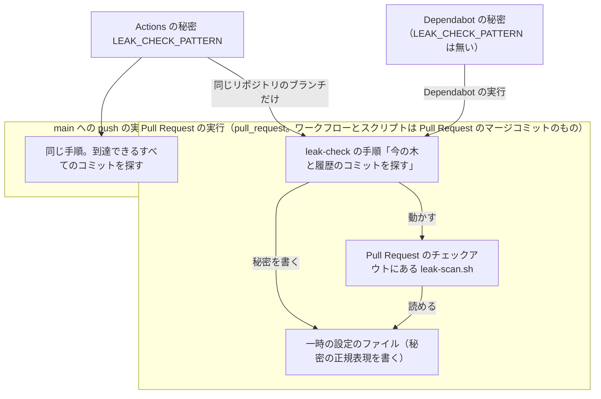
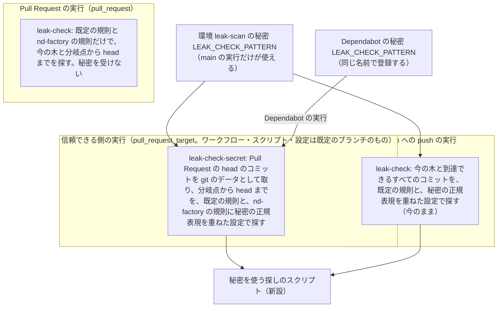
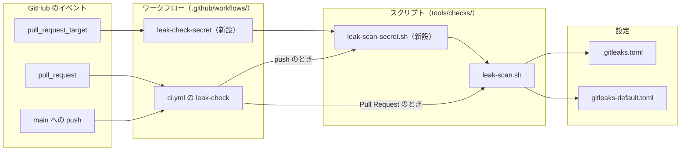
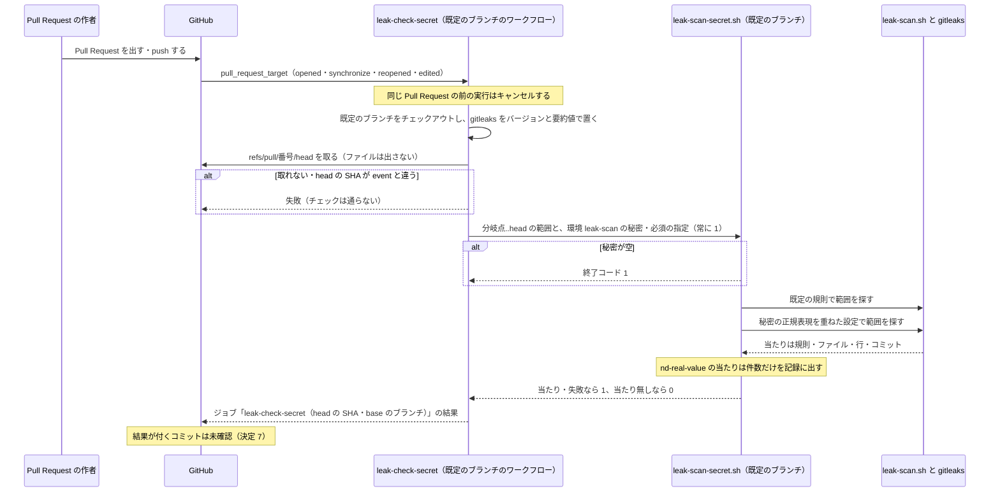

# 漏れの検査: 実際の値の規則での探しを Pull Request のコードから隔て、fork と Dependabot の Pull Request もマージの前に探す（#96 #101）

漏れの検査（CI の `leak-check`）は、実際の値の正規表現（CI の秘密 `LEAK_CHECK_PATTERN`）を Pull Request の側の実行の中で使っている。そのため、fork の Pull Request は探されず、Dependabot の Pull Request は秘密が無いために落ち、同じリポジトリのブランチの Pull Request では秘密が Pull Request のコードから読める。秘密を使う探しを、既定のブランチのワークフロー・スクリプト・設定だけで動く新しいジョブ（`pull_request_target` で起動し、Pull Request のコミットは git のデータとして取るだけにする）へ移し、Pull Request の側の `leak-check` には秘密を渡さない。秘密は既定のブランチの実行だけが読める環境（GitHub Actions の environment）に置く。新しいジョブの結果をマージの判定に使うのは、検証用のリポジトリで振る舞いを確かめ、NDF が結果の出どころを確かめられるようになった後の、2 本目の Pull Request からにする（決定 7・10）。採らなかった起動の形（`workflow_run`・マージキュー・GitHub の secret scanning など）は決定 1・2 に、調べた文書と実測は末尾の「外部の調査」にある。

## 今の姿

何が起きたか・目的・受け入れ条件は要求仕様（[issue-96-requirements.md](./issue-96-requirements.md)、正は #96 の本文。[issue-101-requirements.md](./issue-101-requirements.md)、正は #101 の本文）にある。この文書は「どう解くか」と「なぜその解き方か」だけを書く。

変更する位置は、`.github/workflows/ci.yml` の `leak-check` の手順「今の木と履歴のコミットを探す」（コミット fa6aa1b の 146〜184 行目）である。設計に要る今の構造は次のとおり。

| 実行 | 受ける秘密 | 秘密の正規表現での探し | 必須にする条件（変数 `LEAK_CHECK_REQUIRE_PATTERN` が `1` のとき） |
| --- | --- | --- | --- |
| 同じリポジトリのブランチからの Pull Request | Actions の秘密 | 分岐点から head までの全コミット。秘密を書いた設定のファイルを、Pull Request のチェックアウトのスクリプトが読む | 必須 |
| fork からの Pull Request | 無し | 探さない | 必須にしない |
| Dependabot が起動した Pull Request | Dependabot の秘密だけ | 秘密が空なので探せない | 必須（そのため毎回落ちる） |
| main への push | Actions の秘密 | 到達できるすべてのコミット | 必須 |

マージの方法は squash である（`.ndf/project.json` の `merge.commit`）。squash では Pull Request の途中のコミットは main に入らないので、Pull Request の時に探さなかったコミットは main への push でも探されない。

**2 つの課題を 1 本にまとめたのは、原因が同じ 1 か所にあるためである。** 秘密を使う探しが Pull Request の側の実行（`pull_request`）の中にあり、秘密を受けられるかと、動くコードを信頼できるかが、Pull Request の出所（fork・Dependabot・同じリポジトリのブランチ）で変わる。#96 は fork で秘密を受けられないことと、同じリポジトリのブランチで秘密が Pull Request のコードに渡ることを、#101 は Dependabot で秘密を受けられないことを扱う。探しを出所に左右されない信頼できる側の実行へ移すと、両方が同じ変更で直る。#96 の要求も「Dependabot が起動した実行で秘密を使う探しがどう動くかは、この課題の仕組みを決めるときに #101 とそろえる」としている。

## 文脈と制約

- リポジトリは公開で、fork から誰でも Pull Request を出せる。実際の値の正規表現そのもの（運用する環境の名前などを含む）を、リポジトリ・CI の記録・Pull Request の作者が書いたコードに渡さない（MVV の Value 7）
- CI は AWS の資格情報を持たない。ワークフローの `permissions` は最上位を `contents: read` だけにし、ジョブで広げない（`tools/test/ci-definition.test.ts` が落とす）
- 動作（`uses:`）はコミットの SHA で固定し、gitleaks はバージョンと要約値で固定して取る（#1 の決定 3・5）
- ワークフローの点検（zizmor v1.32.0）は `--offline --no-ignores --config .github/zizmor.yml` で打つ。`--no-ignores` を付けて打つと、行の中の `zizmor: ignore` も設定の `rules.<id>.ignore` も効かない。効くのは、点検を丸ごと外す `rules.<id>.disable` だけである（2026-11-24 に v1.32.0 を手元で打って確認した。外部の調査の LIB2）
- main にはブランチの保護もルールセットも無い。2026-11-24 に、`gh api repos/devbasex/nd-factory/branches/main/protection` は 404 を返し、`gh api repos/devbasex/nd-factory/rulesets` は空だった。GitHub の画面や API からのマージは、どのチェックが落ちていても止まらない。必須のチェックで止まるのは、NDF（このリポジトリの開発を進めるツール）が行うマージだけである
- NDF は、マージの前に Pull Request の head のコミットに付いたチェックを名前だけで読み、必須のチェックの一覧と照らす。同じ名前のチェックが複数あれば、最も新しい 1 件だけを数える。チェックを出したワークフローのファイルと起動のイベントは見ない（devbasex/ai-plugins の `plugins/ndf/src/ndf/adapters/ci.py` の `read`・`latest` と、`plugins/ndf/src/ndf/domains/release/land.py` の `_runs`。2026-11-24 に main を読んで確認）
- Pull Request の作者は、`pull_request` で動くワークフローを Pull Request の中で足せる。そのジョブに `leak-check-secret` と名前を付ければ、同じ名前のチェックを head のコミットに付けられる。名前だけで受け入れると、信頼できる側の探しを通らずにマージできる
- 公開のリポジトリでは、GitHub の既定のイベントポリシーが `pull_request_target` を止める。今は評価のモード（実行は止めず記録だけ）で、2026-12-02 から適用される（STD2）
- Dependabot を有効にすること・秘密と変数の登録そのものは範囲の外である（両課題の「含まない」）

## 解き方の全体像

- Pull Request ごとに、新しいチェック `leak-check-secret` が既定のブランチのコードだけで動く。fork・同じリポジトリのブランチ・Dependabot のどの Pull Request でも、途中のコミットを含む全コミットを、実際の値の規則でマージの前に探す。必須のチェックにするのは導入の 2 本目の Pull Request からである（決定 10）
- NDF は、`leak-check-secret` の結果を、名前だけでなく、出したワークフローのファイル・起動のイベント・探した head の SHA と base のブランチで確かめてから受け入れる。NDF にその機能を足す依頼は、承認を得てから devbasex/ai-plugins へ出す（決定 7）
- Pull Request の側の `leak-check` は秘密を一切受けない。秘密の正規表現を書いた設定のファイルを、Pull Request のコードが読む経路が無くなる
- `leak-check-secret` は、Pull Request の出所と起動した人によらず、秘密が空なら必ず落ちる。変数 `LEAK_CHECK_REQUIRE_PATTERN` は main への push の `leak-check` だけが読む。Dependabot の実行には同じ名前の Dependabot の秘密が渡るので、秘密の欠けでは落ちない
- 実際の値の正規表現は、既定のブランチ（main）の実行だけが読める環境 `leak-scan` の秘密に置く。Pull Request の側のワークフローを書き換えても読めない（決定 9）
- 秘密を使う探し（`leak-check-secret` と main への push の `leak-check`）は、実際の値の規則の当たりを件数だけで出し、ファイル・行・コミットを出さない。公開の Pull Request から、どの行が正規表現に当たるかを試せないようにする（決定 8）
- 秘密の正規表現を重ねる処理と必須の判定は、新設する 1 本のスクリプトにまとめ、main への push の `leak-check` と `leak-check-secret` の両方がそれを呼ぶ
- 持ち主の操作（環境 `leak-scan` の秘密と Dependabot の秘密の登録・`pull_request_target` を許すイベントポリシー）は、新設する運用の文書（`docs/operations/ci-checks.md`）と `AGENTS.md` に書く

## 構成要素

| 要素 | 責務 |
| --- | --- |
| 信頼できる側の漏れの検査のワークフロー（`.github/workflows/leak-check-secret.yml`、新設） | `pull_request_target`（`opened`・`synchronize`・`reopened`・`edited`）だけで起動し、環境 `leak-scan` の秘密を受け、既定のブランチをチェックアウトする。Pull Request の head を `refs/pull/<番号>/head` から git の参照として取り、event の head の SHA と一致することを確認してから、秘密を使う探しのスクリプトに分岐点から head までの範囲と、必須の指定（常に `1`）を渡す。ジョブの表示名に、探した head の SHA と base のブランチを入れる（決定 7）。Pull Request のコミットのファイルを動かさず、依存を入れない（`npm ci`・`setup-node` を持たない） |
| 秘密を使う探しのスクリプト（`tools/checks/leak-scan-secret.sh`、新設） | 探す対象（`dir` か `git`）を引数で、秘密の正規表現と必須の指定を環境変数で受ける。秘密があれば、一時の設定のファイルを、探す作業ツリーの外に作る。その設定は `.gitleaks.toml` を `[extend] path` で読み、規則 `nd-real-value` を足す。秘密が空のとき、必須なら失敗する。必須でなければ `.gitleaks.toml` だけで進む（main への push で、持ち主が変数を設定する前だけ起きる）。続けて `leak-scan.sh` を、受けた対象で 2 回打つ。1 回目は既定の規則で、2 回目はその設定で探す。`git` で範囲を受ければその範囲、受けなければ到達できるすべてのコミットを探す。`nd-real-value` の当たりは件数だけを出す（決定 8）。正規表現を記録に出さない |
| 今の木と履歴の探しのスクリプト（`tools/checks/leak-scan.sh`） | 変えない。gitleaks の 1 回の探しと、当たりを規則・ファイル・行・コミットだけで出す |
| CI の `leak-check` のジョブ（`.github/workflows/ci.yml`） | Pull Request の実行では秘密を受けず、`leak-scan.sh` を直に呼び、既定の規則と `.gitleaks.toml` だけで今の木（`dir`）と分岐点から head まで（`git --range`）を探す（今の既定の規則と nd-factory の規則の探しのまま）。main への push の実行では、環境 `leak-scan` の秘密と変数を受け、秘密を使う探しのスクリプトを `dir` と `git`（範囲なし）で 1 回ずつ呼ぶ。今と同じく、今の木と到達できるすべてのコミットを、それぞれ 2 つの設定で探す |
| ワークフローの点検の設定（`.github/zizmor.yml`） | `dangerous-triggers` の点検を外し、理由と課題の番号を注に書く。外した点検の代わりは CI の定義のテストが持つ |
| CI の定義のテスト（`tools/test/ci-definition.test.ts`） | 必須のチェックの宣言と、Pull Request で起動するジョブ（`pull_request` と `pull_request_target`）の集合の一致を見る。ワークフローごとに許す起動のイベントの一覧を持ち、一覧の外のイベントがあれば落とす。信頼できる側の漏れの検査の形（決定 4）と、秘密を受ける手順と必須の条件の分け方（決定 3）を、ワークフローの定義から読んで落とす |
| 漏れの検査の結合のテスト（`tools/test/leak-scan.integration.test.ts`） | 秘密を使う探しのスクリプトを、作り物の正規表現と、途中のコミットで足して後で消した作り物のリポジトリで動かす |
| ワークフローの点検の結合のテスト（`tools/test/workflow-audit.integration.test.ts`） | `dangerous-triggers` 以外の点検が今の設定で外れていないことを保つ |
| 必須のチェックの宣言（`.ndf/project.json`） | 導入の 2 本目の Pull Request で、`required_checks` に `leak-check-secret` を、NDF が出どころを確かめる形で足し、`ci.workflows` に新しいワークフローを足す。1 本目（実装の Pull Request）では変えない（決定 10） |
| NDF のマージの判定（devbasex/ai-plugins、このリポジトリの外） | 必須のチェックを、名前に加えて、出したワークフローのファイル・起動のイベント・表示名の head の SHA と base のブランチで受け入れる機能。この変更では作らず、依頼を出す（決定 7） |
| 運用の文書（`docs/operations/ci-checks.md`、新設）と指示書（`AGENTS.md`） | 持ち主が秘密を登録して検査を必須にする手順（環境 `leak-scan` の作成と、その秘密・同じ名前の Dependabot の秘密・変数・`pull_request_target` を許すイベントポリシー・導入の 2 本目の Pull Request へ進む条件）と、秘密を使う探しがどこで動くか。`nd-real-value` に当たったときに、持ち主が手元で当たりの場所を引く手順 |
| プラットフォームの設計（`docs/design/platform.md` の「設計の決まりを縛る検査」） | 漏れの検査の行に、実際の値の規則での探しが Pull Request ごとに信頼できる側で動くことを足す |

図には CI の中で動くものだけを描き、テスト・点検の設定・宣言・文書の行は含めない。`leak-check-secret` が読む `.gitleaks.toml`・`gitleaks-default.toml`・2 本のスクリプトは、どれも既定のブランチのチェックアウトにあるものである。Pull Request のコミットは git の参照としてだけ取り込まれ、作業ツリーに出ない。

## 処理の流れ

NDF が受け入れるのは、今の head と今の base に対応する、信頼できる側の実行の結果だけである。その条件と、条件を満たさない結果を受け入れない仕組みは決定 7 にある。

- 新しいコミットが push されると、GitHub が `synchronize` で同じワークフローを起こし、新しい head で探しをやり直す。ジョブの表示名の head の SHA が変わるので、前の head の結果は今の head の結果として数えられない
- Pull Request のマージ先（base のブランチ）を変えると、GitHub が `edited` で同じワークフローを起こし、新しい base との分岐点から head までを探し直す。表示名の base のブランチが変わるので、前の base の結果は数えられない。`edited` は題や本文を直したときにも起きるので、そのときも探し直す
- base のブランチにコミットが増えても、head が同じなら分岐点は変わらず、探す範囲も変わらない。そのため、base のブランチの SHA ではなく名前で照らす

GitHub が `pull_request_target` の実行の結果をどのコミットに付けるかは、文書から決められなかった（GitHub のイベントの文書では、この実行の `GITHUB_SHA` は既定のブランチの最新のコミットである。STD1）。必須のチェックの文書（STD4）は数えられるイベントを挙げるだけで、Pull Request の head に付くことの根拠にはならない。そのため、結果の取り方を head のコミットに付くことに頼らない形にし（決定 7）、採用の前に検証用のリポジトリで確かめる（決定 10）。

## 非機能の実現方式

| 大項目 | 要求の条件 | 実現方式 | 確かめ方 |
| --- | --- | --- | --- |
| セキュリティ | 秘密の正規表現と書き込みの権限が、Pull Request の作者が書いたコードに渡らない（#96 の受け入れ条件 3・4） | 秘密は環境 `leak-scan` の秘密に置き、その環境を使えるブランチを main だけにする（決定 9）。秘密は `leak-check-secret`（既定のブランチのワークフロー）と main への push の `leak-check` の、秘密を使う探しの手順の環境変数だけで受ける。`leak-check-secret` は既定のブランチをチェックアウトし、Pull Request の head は git の参照として取るだけで、依存を入れずにファイルを動かさない。Pull Request から来る値（番号・SHA）は環境変数で渡し、形を検査してから使う。`permissions` は `contents: read` だけ | CI の定義のテスト（決定 3・4 の行） |
| セキュリティ | 秘密を使う探しが失敗したときは通さない側に倒す（#96 の受け入れ条件 6） | `leak-check-secret` のジョブと手順に `if:` と `continue-on-error` を置かない（条件で飛ばしたジョブは成功と報告されるため。STD4）。取り込み・SHA の一致・範囲の読み取り・gitleaks のどこで失敗しても、終了コード 0 以外で終える | CI の定義のテストと、結合のテストの失敗の経路の行 |
| セキュリティ | 実際の値の正規表現は、Dependabot の秘密に登録する場合も、リポジトリ・CI の記録・課題に出ない（#101） | 正規表現は探す木の外の一時の設定のファイルにだけ書き、終了時に消す。出力は、`nd-real-value` の当たりは件数だけ、ほかの規則の当たりは今の `leak-scan.sh` の形（規則・ファイル・行・コミット）にする（決定 8） | 結合のテスト（出力に作り物の正規表現・当たった値・`nd-real-value` の当たりのファイルと行が現れない） |
| セキュリティ | 公開の記録には、実際の値の規則に当たった箇所を出さない（要求には無く、設計で足した条件。決定 8） | 当たりのファイル・行・コミットを出さない。ただし、公開する成否と件数から、候補の語が正規表現に当たるかは推測できる。このリポジトリは公開なので、成否と件数は誰でも見られる。この閲覧の範囲と推測の危険（決定 8 の代償）を受け入れることを、設計の承認の条件にする（人へ残す判断）。正規表現に含む語そのものを外部の作者から隠すことは、この設計の条件にしない | 結合のテスト（上の行と同じ） |
| 運用・保守性 | 当たりの出力は今の `leak-scan.sh` の形（規則・ファイル・行・コミット）のままにし、持ち主が当たりの場所を引ける（#96） | 既定の規則と nd-factory の規則の当たりは今の形で出す。`nd-real-value` の当たりは、持ち主が手元で秘密を渡して `leak-scan-secret.sh --details` を打ち、場所を引く（運用の文書に手順を書く。`--details` はワークフローで使わず、CI の定義のテストが落とす）。#96 の要求の文から外れるので、要求の変更として承認を受ける（人へ残す判断） | 結合のテスト |

## 決定の記録

決定の根拠に挙げる Value は、プロジェクト MVV（バージョン 3。本文は [.ndf/mvv.md](../.ndf/mvv.md)）の判断の基準である。この設計で使うものの要約と、この設計との関係を次に書く。

| 項目 | 要約 | この設計との関係 |
| --- | --- | --- |
| Value 7 | リポジトリは公開なので、運用する環境の名前などの実際の値と秘密の値を、リポジトリ・課題・PR・CI の記録に置かない。混入は検査で機械的に止める | 実際の値の正規表現を Pull Request のコードと記録から隔て、全コミットをマージの前に探す |
| Value 8 | CI は GitHub のワークフローで検査だけを行い、AWS の資格情報を持たない | 新しいワークフローにも AWS の資格情報と書き込みの権限を持たせない |
| Value 13 | 同じ規則・処理は 1 か所に置き、ほかから参照する | 秘密を重ねる処理を 1 本のスクリプトにまとめる |
| Value 14 | 変更のたびに自動のテストと静的解析を通す。依存を新しく保ち、脆弱性の知らせに早く応じる。設計の判断は理由と採らなかった案とともに残す | Dependabot の Pull Request を通せるようにする。点検を外す範囲と、それを補う自動のテストを設計に記録する |
| Value 17 | 目先の手間より、堅牢で長く保守しやすい形を選ぶ | 持ち主の手順と NDF への依頼が増えても、秘密を隔てる形を選ぶ |

### 決定 1: 秘密の正規表現を Pull Request のコードから隔てたままマージの前に全コミットを探すため、`pull_request_target` の新しいジョブで、既定のブランチのコードだけを動かし、Pull Request のコミットは git のデータとして取る

- **質問**: fork の Pull Request でも秘密を受け、同じリポジトリのブランチの Pull Request でも秘密を Pull Request のコードに渡さずに、途中のコミットを含む全コミットをマージの前に探すには、どの起動の形を使うか
- **選んだ案**: ワークフロー `.github/workflows/leak-check-secret.yml` を新設し、`pull_request_target`（`opened`・`synchronize`・`reopened` と、base の変更を受ける `edited`。決定 7）で起動する。ジョブ `leak-check-secret` は `actions/checkout` を `ref` なし（既定のブランチ）・`fetch-depth: 0`・`persist-credentials: false` で打つ。続けて `git fetch` で `refs/pull/<番号>/head` を参照として取り込む。取り込んだ head が event の head の SHA と一致することを確かめてから、分岐点から head までを、既定のブランチの `tools/checks/leak-scan-secret.sh` で探す。分岐点は `git merge-base <base.sha> <head.sha>` で求める。`concurrency` は Pull Request の番号ごとにし、前の実行をキャンセルする
- 採らなかった案: `workflow_run` で Pull Request の CI の後に信頼できる側で探す（`workflow_run` のチェックは、Pull Request の必須のチェックとして数えられない（STD4）。結果を Pull Request に付けるには `statuses: write` の権限が要り、#96 の受け入れ条件 4 に反する。zizmor の `dangerous-triggers` にも当たる）
- 採らなかった案: マージキュー（`merge_group`）で探す（マージキューの実行は Pull Request のコードを秘密つきで動かすので、#96 の受け入れ条件 3 に反する。squash のキューでは途中のコミットが残らない）
- 採らなかった案: GitHub の secret scanning の独自のパターンと push protection に正規表現を置く（fork への push は fork のリポジトリで受けるので、このリポジトリの push protection が掛からない。当たりは警告で、マージの前のチェックにならない。PRD1）
- 採らなかった案: マージの方法を rebase かマージのコミットに変え、途中のコミットを main への push で探す（マージの前に止めるという #96 の目的を満たさない。同じリポジトリのブランチで、秘密が Pull Request のコードに渡る経路も残る）
- **代償**: zizmor が「ほぼ常に危険」とする起動のきっかけを 1 つ持つ。Pull Request のファイルを動かさなくても、引数や環境変数への注入でコードを動かされる経路があり得る（LIB2）。そのため、決定 4 の形を CI の定義のテストで縛り続ける。2026-12-02 に既定のイベントポリシーが適用された後は、持ち主が `pull_request_target` を許すイベントポリシーを作るまで、このチェックは起動されず、結果が無い。必須のチェックにした後（決定 10）は、そのためにマージが止まる
- 作り方: 標準に倣う・自前で作る
- 比べた候補: STD1 / STD2 / STD4 / PRD1 / PRD2 / LIB1
- 根拠: Value 7 / Value 17（MVV バージョン 3）。混入は検査で機械的に止める（Value 7）。手順が増えても、秘密を隔てる堅牢な形を選ぶ（Value 17）。外部の調査は STD1・STD2

### 決定 2: Dependabot の Pull Request も同じ探しを通してマージできるよう、`LEAK_CHECK_PATTERN` を同じ名前で Dependabot の秘密にも登録し、起動した人で分ける条件を置かない

- **質問**: Dependabot が起動した実行で、実際の値の規則をどう扱うか（Dependabot の秘密に登録して探すか、fork と同じく必須にしないか）
- **選んだ案**: 持ち主が環境 `leak-scan` の秘密（決定 9）と同じ名前・同じ値で Dependabot の秘密 `LEAK_CHECK_PATTERN` を登録する。ワークフローは `secrets.LEAK_CHECK_PATTERN` を 1 か所で読み、`github.actor` や `dependabot[bot]` で分ける条件を持たない。Dependabot の Pull Request の全コミットは、ほかの Pull Request と同じく Pull Request の時（`leak-check-secret`）に探す。人が Dependabot のブランチへ push して起動した実行は、環境の秘密を受けて同じ探しをする
- 採らなかった案: `github.actor == 'dependabot[bot]'` の実行を fork と同じく必須にしない（Dependabot の Pull Request の途中のコミットがマージの前に探されず、squash の後は main からも辿れない。起動した人での判定は、人が同じブランチへ push すると外れる）
- 採らなかった案: `pull_request_target` の実行には Dependabot でも Actions の秘密が渡ると見て、Dependabot の秘密を登録しない（GitHub の文書は、Dependabot が起動した実行で使える秘密は Dependabot の秘密だけと書く。一方で、`pull_request_target` はこの制限を持たないとも書く。どちらが当たるかを文書から決められない。STD3）
- **代償**: 持ち主が同じ値を 2 か所に登録し、値を変えるときも 2 か所を直す。参照の検査の秘密 `REF_CHECK_TERMS` と同じ運用になる
- 根拠: Value 7 / Value 14（MVV バージョン 3）。Dependabot の Pull Request も実際の値の規則で探す（Value 7）。依存の更新の Pull Request を止めない（Value 14）。外部の調査は STD3

### 決定 3: Pull Request のコードが秘密を読めないよう、Pull Request の側の `leak-check` には秘密を渡さず、必須にする条件は出所で分けない

- **質問**: 今の `leak-check` の、秘密を受ける手順と必須にする条件を、新しいジョブとどう分けるか
- **選んだ案**: `ci.yml` の `leak-check` を、Pull Request の実行の手順（秘密を受けない。既定の規則と `.gitleaks.toml` で今の木と分岐点から head までを探す）と、main への push の手順（`if: github.event_name == 'push'`。秘密と必須の変数を受け、秘密を使う探しのスクリプトで到達できるすべてのコミットを探す）の 2 つに分ける。今の式の `github.event.pull_request.head.repo.full_name == github.repository` の条件は消す。`leak-check-secret` は変数 `LEAK_CHECK_REQUIRE_PATTERN` を読まず、必須の指定を常に `1` にしてスクリプトに渡す。秘密が空なら、Pull Request の出所によらず終了コード 1 で落ちる。`pull_request_target` では fork の Pull Request も秘密を受けるので、秘密が空なのは持ち主が登録していないときだけである。変数は main への push の `leak-check` だけが読む
- 採らなかった案: 同じリポジトリのブランチの Pull Request では、今の手順で秘密を受け続ける（Pull Request のチェックアウトのスクリプトが秘密の正規表現を読め、#96 の受け入れ条件 3 に反する）
- 採らなかった案: `leak-check-secret` でも fork の Pull Request は必須にしない（fork も秘密を受けられるので分ける理由が無く、登録を忘れたときに fork の Pull Request だけが探されずに通る。#96 の受け入れ条件 6 の、通さない側に倒す約束に反する）
- 採らなかった案: `leak-check-secret` も変数で必須にするかを決め、変数が空なら `.gitleaks.toml` だけで成功させる（必須のチェックにした後に変数が空だと、実際の値の規則が走らないまま成功と数えられ、#96 の受け入れ条件 1・2 を満たさない。持ち主が秘密を登録する前は失敗が続くが、必須のチェックにする前なのでマージは止まらない。決定 10）
- **代償**: 秘密が空で必須のときに落ちるチェックが、同じリポジトリのブランチの Pull Request では `leak-check` から `leak-check-secret` に移る。`leak-check` の手順が、Pull Request の実行の手順と main への push の手順に分かれ、条件で分ける箇所が 1 つ増える
- 根拠: Value 7（MVV バージョン 3）。秘密を Pull Request のコードに渡さず、探しの欠けを成功と数えない

### 決定 4: 危険な起動のきっかけの点検を外しても同じ危険を止めるため、zizmor の `dangerous-triggers` を設定で外し、使える場所と形を CI の定義のテストで縛る

- **質問**: `pull_request_target` は zizmor の `dangerous-triggers` に当たる（v1.32.0 で終了コード 14。LIB2）。ワークフローの点検（#96 の受け入れ条件 10）を通すために、点検をどう扱うか
- **選んだ案**: `.github/zizmor.yml` で `dangerous-triggers` を `disable: true` にし、理由と課題の番号（#96）を注に書く。代わりに、CI の定義のテストが、許す起動のイベントを一覧で持ち、次のどれかに当たれば落とす。禁止の起動を挙げるのではなく、許す起動を挙げるので、点検していない起動（`workflow_run`・`issue_comment` など）を足すと落ちる
  - `leak-check-secret.yml` の `on` に `pull_request_target` のほかの起動がある。または `types` に `opened`・`synchronize`・`reopened`・`edited` のほかがある
  - ほかのワークフローの `on` に、`push`・`pull_request`・`schedule`・`workflow_dispatch` のほかの起動がある（2026-11-24 の `ci.yml` と `ndf-contract.yml` が使う起動だけを許す）
  - `leak-check-secret.yml` が、次のどれかに当たる
    - `uses:` に、SHA で固定した `actions/checkout` のほかの動作がある
    - `run:` で、gitleaks を置く手順・`git`・既定のブランチのチェックアウトの `tools/checks/leak-scan-secret.sh` のほかを動かす。`--details` を渡す
    - `actions/checkout` に `ref`・`repository`・`allow-unsafe-pr-checkout` を渡す
    - `persist-credentials` が偽でない
    - `setup-node`・`npm`・`npx` を使う
    - `GITHUB_ENV`・`GITHUB_OUTPUT` に書く
    - gitleaks を置く手順を除いて、`GITHUB_PATH` に書く
    - `${{ github.event.* }}` を `run:` の中に直に書く
    - `if:` か `continue-on-error` がある
    - `permissions` が `contents: read` だけでない
    - 秘密を受ける手順が探しの手順のほかにある。ジョブが環境 `leak-scan` を使わない
    - ジョブの表示名に、event の head の SHA と base のブランチが入っていない（決定 7）
- 採らなかった案: `--no-ignores` をやめ、`rules.dangerous-triggers.ignore` でこの 1 本だけを外す（行の中の `zizmor: ignore` も効くようになり、#1 の決定 5 が `--no-ignores` で塞いだ、点検を行の注で外す経路が戻る）
- 採らなかった案: 点検の当たりを残したまま通す（`workflow-audit` が落ち、#96 の受け入れ条件 10 に反する）
- **代償**: zizmor が `dangerous-triggers` で当てる起動のきっかけを将来増やしても（v1.31.0 では `issue_comment` が増えた）、CI の定義のテストに手で足すまでは落ちない。zizmor のバージョンを上げるときは、zizmor の文書にある点検の対象の一覧と、テストの一覧を見比べる
- 作り方: ライブラリやサービスを使う・自前で作る
- 比べた候補: LIB2 / STD1
- 根拠: Value 8 / Value 14（MVV バージョン 3）。CI に AWS の資格情報を持たせない（Value 8）。点検を外す範囲と、それを補う自動のテストを設計に記録する（Value 14）。外部の調査は LIB2

### 決定 5: 秘密を重ねる処理を 1 か所に置くため、重ねた設定を組んで探す処理を新しいスクリプトにまとめ、push と `leak-check-secret` の両方から呼ぶ

- **質問**: 秘密の正規表現を重ねた一時の設定を組む処理と必須の判定（今は `ci.yml` の手順の中のシェル）を、2 つのジョブでどう持つか
- **選んだ案**: `tools/checks/leak-scan-secret.sh` を新設し、今の手順の中のシェル（`'''` を含む正規表現を拒む・重ねた設定を組む・必須の判定・一時のファイルを消す）を移す。最初の引数で探す対象を受け、既定の規則と重ねた設定（秘密が無く必須でなければ `.gitleaks.toml`）の 2 回で探す。呼び分けは次のとおり。

  | 呼ぶ所 | 呼び方 | 探すもの |
  | --- | --- | --- |
  | main への push の `leak-check` | `leak-scan-secret.sh dir` の後に `leak-scan-secret.sh git` | 今の木と、到達できるすべてのコミット（今の `dir` 2 回・`git` 2 回と同じ） |
  | `leak-check-secret` | `leak-scan-secret.sh git --range <分岐点>..<head>` だけ | 分岐点から head までのコミット。作業ツリーは既定のブランチのものなので `dir` は打たない。head の木の中身は、範囲のコミットの差分として探される |

  `leak-check-secret` も既定の規則と nd-factory の規則で範囲を探すので、Pull Request が `.gitleaks.toml` の許可を書き換えても、既定のブランチの設定で探される
- 採らなかった案: 2 つのワークフローの手順に同じシェルをコピーする（同じ処理を 2 か所に持ち、片方だけを直す食い違いが起きる。Value 13）
- 採らなかった案: `leak-check-secret` では秘密の正規表現の規則だけで探す（Pull Request が `.gitleaks.toml` に足した許可で nd-factory の規則の当たりを外したとき、マージの前に既定のブランチの設定で探す実行が無くなる）
- **代償**: スクリプトが 1 本増え、結合のテストの対象が増える
- 根拠: Value 13 / Value 7（MVV バージョン 3）。同じ処理を 1 か所に置く（Value 13）。既定のブランチの設定で探す実行を残す（Value 7）

### 決定 6: 持ち主の操作の手順を今の設定と一緒に読めるよう、運用の文書 `docs/operations/ci-checks.md` を新設し、`AGENTS.md` の行を直す

- **質問**: 秘密を登録して検査を必須にする持ち主の操作（#101 の受け入れ条件 6）を、どこに書くか
- **選んだ案**: `docs/operations/ci-checks.md` を新設し、次の 4 つを書く。
  - 参照の検査と漏れの検査で、持ち主が GitHub の設定で行う操作（環境 `leak-scan` とその秘密 `LEAK_CHECK_PATTERN`・同じ名前の Dependabot の秘密・変数 `LEAK_CHECK_REQUIRE_PATTERN`・`pull_request_target` を許すイベントポリシー・今ある `REF_CHECK_TERMS` の 2 か所の登録）
  - それぞれの検査が、どの実行で秘密を受けるかと、残る経路（決定 9 の代償）
  - `leak-check-secret` を必須にする 2 本目の Pull Request へ進む条件（決定 10）
  - `nd-real-value` に当たったときに、手元で `leak-scan-secret.sh --details` を打って場所を引く手順と、失敗が続く外部の Pull Request を閉じる運用（決定 8）

  あわせて、`AGENTS.md` の「秘密とインフラの値を置かない」の行を、秘密を使う探しが `leak-check-secret` と main への push で動くことに直し、運用の文書へリンクする
- 採らなかった案: #1 の設計（`docs/design-process/issue-1/design.md`）の「人へ残す判断」の行を直す（その文書は経緯の記録である。`docs/design-process/issue-1/README.md` は、検査を足した後はその文書を更新しない、と決めている）
- **代償**: `docs/operations/` の文書が 1 本増える
- 根拠: Value 7 / Value 13（MVV バージョン 3）。秘密の置き場所と渡し方を持ち主が迷わず行える（Value 7）。手順を 1 か所に書く（Value 13）

### 決定 7: 同じ名前のチェックや古い head の結果でマージさせないため、NDF は信頼できる側の実行の結果だけを、出どころと探した head・base で確かめて受け入れる

- **質問**: `leak-check-secret` の結果を、どういう条件で受け入れるか。Pull Request の側の同じ名前のチェックと、前の head・前の base の結果をどう退けるか
- **選んだ案**: NDF が次のすべてを満たす結果だけを、`leak-check-secret` が通ったと数える。どれかを満たす結果が無ければ「未報告」として待ち、時間を過ぎたら止める
  - 結果を出した実行のワークフローのファイルが `.github/workflows/leak-check-secret.yml` で、起動のイベントが `pull_request_target` である（check run から check suite を経て workflow run を引き、その `path` と `event` で確かめる）
  - ジョブの表示名にある head の SHA が今の head の SHA と一致し、base のブランチが今の base のブランチと一致する。表示名は `leak-check-secret (<head の SHA> → <base のブランチ>)` の形で、信頼できる側のワークフローが event の値から組む
  - 条件を満たす結果が複数あれば最も新しいものを数え、それが成功である

  結果は head のコミットに付いたチェックからではなく、このワークフローの `pull_request_target` の実行の一覧から引く。結果が付くコミットが既定のブランチの最新のコミットでも、Pull Request の head でも、同じ手順で引ける。Pull Request の側のワークフローは `pull_request_target` で起動されず、既定のブランチの `leak-check-secret.yml` も書き換えられないので、この条件を満たす結果を作れない
- 採らなかった案: `required_checks` に名前だけで足す（今の NDF の読み方では、Pull Request の作者が足した同じ名前のジョブの結果が、最も新しい 1 件として数えられる。文脈と制約の 2・3 行目）
- 採らなかった案: 信頼できる側のジョブが commit status か check run を Pull Request の head に書く（`statuses: write` か `checks: write` の権限が要り、#96 の受け入れ条件 4 に反する）
- 採らなかった案: GitHub のルールセットで必須のチェックの発行元を GitHub Actions に限る（Pull Request の側のワークフローも GitHub Actions が出すので、区別できない）
- **代償**: NDF（devbasex/ai-plugins）に、必須のチェックを出どころで確かめる機能が要る。依頼の起票は他のリポジトリへの公開（C5）なので、設計の承認の後に人の承認を得て出す。機能が入るまで、`leak-check-secret` を必須のチェックにしない（決定 10）。その間、実際の値の規則での探しはマージを止めない（今の fork の Pull Request と同じ状態が、同じリポジトリのブランチにも広がる）
- 作り方: 自前で作る（NDF の機能として）
- 根拠: Value 7（MVV バージョン 3）。検査を名前の偽装で迂回させない。外部の調査は STD1・STD4

### 決定 8: 公開の Pull Request から実際の値の正規表現の中身を探らせないため、`nd-real-value` の当たりは件数だけを出し、探しは誰の Pull Request でも承認なしに動かす

- **質問**: 誰でも出せる fork の Pull Request で秘密の正規表現を使って探すとき、結果のどこまでを公開の記録・チェック・通知に出すか。探しを起こせる人を限るか
- **選んだ案**: `leak-scan-secret.sh` は `leak-scan.sh` の標準出力を記録に出さず、`--report` の JSON を探す木の外に受けて整形する。`nd-real-value` の当たりは件数だけを出し、ファイル・行・コミットを出さない。既定の規則と nd-factory の規則（中身は公開の `.gitleaks.toml` と `gitleaks-default.toml`）の当たりは、今の形で出す。CI の記録・チェックの結論・GitHub の通知に出るのは、成功か失敗かと、この件数だけである。持ち主は手元で秘密を渡して `leak-scan-secret.sh --details` を打ち、当たりの場所を引く。探しは、fork・同じリポジトリのブランチ・Dependabot のどの Pull Request でも、承認なしに起動する
- 採らなかった案: 当たりを今の形（規則・ファイル・行・コミット）で出す（候補の語を 1 行ずつ並べたコミットを含む Pull Request を 1 本出すだけで、どの行が当たったかから正規表現に含まれる語を読み取れる）
- 採らなかった案: 必須のレビュアーを置いた環境で、外部の作者の Pull Request の探しを人の承認の後にだけ動かす（Dependabot と同じリポジトリのブランチの Pull Request も含めて、すべての Pull Request が人を待つ。外部の作者だけを分けるには起動した人で分ける条件が要り、決定 2 と #101 の受け入れ条件 4 に反する）
- **代償**: 1 本の Pull Request で「当たりがあるか」と件数は分かる。候補の語を 1 本ずつ Pull Request にして出せば、推した語が正規表現に当たるかを確かめられる。1 本で試せる語の数は件数から推せる範囲に限られ、Pull Request は持ち主に見える。この危険は残し、持ち主が失敗の続く外部の Pull Request を見たら閉じる運用を運用の文書に書く。当たりの場所を CI で引けなくなり、持ち主が手元で打つ手間が増える。#96 の前提 1 と非機能の条件（規則・ファイル・行・コミットで出す）から外れるので、要求の変更として承認を受ける
- 根拠: Value 7（MVV バージョン 3）。実際の値を CI の記録と公開の Pull Request から読ませない

### 決定 9: 同じリポジトリに書き込める人のレビュー前の実行からも秘密を読ませないため、実際の値の正規表現を、main の実行だけが使える環境の秘密に置く

- **質問**: 書き込みの権限を持つ人は、`pull_request` のワークフローを Pull Request の中で書き換えて、Actions の秘密を読む手順を足せる。この経路を塞ぐか
- **選んだ案**: 持ち主が環境 `leak-scan` を作り、使えるブランチ（deployment branch policy）を `main` だけにして、`LEAK_CHECK_PATTERN` をその環境の秘密に登録する。リポジトリの Actions の秘密には置かない（2026-11-24 の時点で未登録。登録していれば消す）。`leak-check-secret` のジョブと、main への push の `leak-check` のジョブだけが `environment: leak-scan` を持つ。`pull_request_target` の実行は既定のブランチの文脈で動くので、環境を使える。Pull Request の側の実行は Pull Request のマージの参照（`refs/pull/<番号>/merge`）で動くので、ワークフローを書き換えて環境を指しても使えず、秘密を受けられない。Dependabot が起動した実行では、環境の秘密の代わりに同じ名前の Dependabot の秘密が渡る（決定 2）
- 採らなかった案: この経路を範囲の外にする（#96 の目的の「秘密の正規表現が Pull Request の側のコードに渡らない」と両立しない）
- 採らなかった案: 必須のレビュアーを置いた環境にする（main への push のたびに人を待つ。決定 8 の採らなかった案と同じ理由）
- **代償**: 次の経路は残る。運用の文書に書く
  - main に直に push できる人は、main の上のワークフローを書き換えて秘密を読める。main にはブランチの保護が無いので、書き込みの権限を持つ人が当たる（決定 11）
  - Dependabot の秘密は環境に置けない。Dependabot が起動した `pull_request` の実行では、Dependabot の Pull Request のコード（更新した依存の `npm ci` を含む）が Dependabot の秘密を読める。今の `REF_CHECK_TERMS` と同じ経路である。依存の乗っ取りで秘密の正規表現が漏れたときは、持ち主が正規表現を見直す
  - 環境の使えるブランチの条件が `pull_request_target` の実行を通し、Pull Request の側の実行を通さないことは、文書を読んでの推定である。検証用のリポジトリで確かめる（決定 10）
- 根拠: Value 7（MVV バージョン 3）。秘密を Pull Request のコードから隔てる

### 決定 10: 実装の Pull Request を NDF でマージできるよう、導入を 2 本の Pull Request に分け、必須のチェックへの追加は確認の後にする

- **質問**: 新しいワークフローは、それを足す Pull Request 自身では起動されない（`pull_request_target` は既定のブランチのワークフローを動かすため）。`required_checks` をいつ変え、今の `leak-check` からいつ切り替えるか
- **選んだ案**: 次の順に進める
  1. 持ち主が、作り物の値だけを使う検証用の公開リポジトリで、この設計のワークフローを動かして確かめる。確かめる項目: fork の Pull Request の head が取り込めること、結果がどのコミットに付くか、決定 7 の条件で正しい head の成功・失敗・未報告を区別できること、Pull Request の側の同じ名前のジョブを退けられること、base を変えると探し直すこと、環境の秘密を Pull Request の側の実行が受けられないこと（決定 9）
  2. 実装の Pull Request（1 本目）で、ワークフロー・スクリプト・`ci.yml` の変更・テスト・文書を入れる。`.ndf/project.json` の `required_checks` と `ci.workflows` は変えない。Pull Request の側の `leak-check` は、このマージから秘密を受けなくなる。必須のチェックは今の 7 つのままなので、NDF でマージできる
  3. 持ち主が、環境 `leak-scan` とその秘密・Dependabot の秘密・変数・`pull_request_target` を許すイベントポリシーを設定する
  4. 1 本目のマージの後の Pull Request で、`leak-check-secret` が今の head を探して成功したことを、持ち主が実行の記録で確かめる
  5. NDF に決定 7 の機能が入った後、2 本目の Pull Request で `required_checks` に `leak-check-secret` を出どころの条件つきで足し、`ci.workflows` に新しいワークフローを足す。2 本目の Pull Request では、1 本目で入ったワークフローが起動するので、チェックの欠けで止まらない
- 2 本目へ進む条件: 手順 1 と 4 の確認が済み、手順 3 の設定があり、NDF が決定 7 の条件で結果を受け入れられる。1 つでも欠ければ 2 本目を出さない
- 採らなかった案: 実装の Pull Request で `required_checks` も変える（その Pull Request では `leak-check-secret` が起動されず、NDF のマージがチェックの欠けで止まる）
- 採らなかった案: 2 本目まで、Pull Request の側の `leak-check` で秘密を受け続ける（その間、同じリポジトリのブランチの Pull Request のコードが秘密の正規表現を読める。#96 が塞ぐ経路を残す）
- **代償**: 1 本目のマージから 2 本目のマージまで、実際の値の規則での探しはマージを止めない。その間は、`leak-check-secret` の失敗を持ち主が見てマージを止め、main への push の `leak-check` が到達できるすべてのコミットを今と同じく探す
- 根拠: Value 7 / Value 14（MVV バージョン 3）。秘密を隔てることを先に行い（Value 7）、マージを止める検査は確かめてから入れる（Value 14）

### 決定 11: この変更が保証するのは NDF が行うマージだけにし、GitHub のブランチの保護とルールセットは作らない

- **質問**: #96 は、必須のチェックが変わるときは「`.ndf/project.json` の `required_checks` と GitHub のブランチの保護」を同じ変更で直すとしている。GitHub の画面や API からのマージも止めるか
- **選んだ案**: 止めるのは NDF が行うマージだけにする。このリポジトリのマージは NDF が行う（`.ndf/project.json` の `merge.actor` が `ndf`）。main にはブランチの保護もルールセットも無いので、#96 の「GitHub のブランチの保護」の側に直す設定は無く、この変更でも作らない。書き込みの権限を持つ人が GitHub の画面からマージすると、今のほかの必須のチェックと同じく、`leak-check-secret` が落ちていてもマージできる
- 採らなかった案: ルールセットで main に `leak-check-secret` を必須にする（決定 7 のとおり、ルールセットは同じ名前のチェックを出どころで区別できず、偽のチェックで通る。ほかの 7 つの必須のチェックも GitHub では必須でなく、この検査だけを足すのは、リポジトリ全体のマージの経路の決定になる）
- **代償**: GitHub の画面からのマージと、main への直の push は止まらない。どちらも書き込みの権限を持つ人だけが行え、今と同じである。#96 の要求の文と食い違うので、要求の変更として承認を受ける（人へ残す判断）
- 根拠: Value 7（MVV バージョン 3）。検査で止める範囲を、実際にマージを行う経路で定める

## 影響と危険

- **働く範囲**: このリポジトリの CI だけ。画面・API・設置のコマンド・利用者のプロジェクトのリポジトリは変わらない
- **プロジェクトごとに違うもの**: 実際の値の正規表現は環境 `leak-scan` の秘密と Dependabot の秘密（同じ名前）、必須にするかは変数で受け、リポジトリに置かない
- **当たるモード**: このリポジトリに出るすべての Pull Request（fork・同じリポジトリのブランチ・Dependabot）と main への push

壊れうる箇所と扱い:

| 箇所 | 起きること | 扱い |
| --- | --- | --- |
| 実装の Pull Request 自身 | `pull_request_target` は既定のブランチのワークフローを動かすので、新しいワークフローを足す Pull Request ではまだ `leak-check-secret` が起動されない | 実装の Pull Request では `required_checks` を変えず、今の 7 つの必須のチェックで NDF がマージする。`leak-check-secret` を必須にするのは、持ち主が信頼できる側の結果を確かめた後の 2 本目の Pull Request である（決定 10） |
| 1 本目と 2 本目の Pull Request の間 | 実際の値の規則での探しがマージを止めない | 持ち主が `leak-check-secret` の失敗を見てマージを止める。main への push の `leak-check` は今と同じく探す（決定 10） |
| Pull Request の側に足した同じ名前のジョブ | 作者が `pull_request` のワークフローに `leak-check-secret` という名前のジョブを足すと、同じ名前のチェックが head に付く | NDF は出どころ（ワークフローのファイルと `pull_request_target`）と表示名の head・base で確かめるので、数えない（決定 7）。NDF にその機能が入るまで必須にしない |
| base のブランチの変更 | head が同じでも、分岐点と探す範囲が変わる | `edited` で探し直し、表示名の base のブランチで照らす（決定 7） |
| 外部の作者が当たりの有無で正規表現を探る | 候補の語を入れた Pull Request を出し、成功か失敗かで語が当たるかを試す | 当たりの場所は出さない。1 本ずつ試す経路は残る（決定 8） |
| イベントポリシーの適用（2026-12-02） | 持ち主が `pull_request_target` を許すポリシーを作らないと、`leak-check-secret` が起動されない。必須のチェックにした後は、未報告のまま、すべての Pull Request のマージが止まる | 通さない側に倒れるので漏れは起きない。運用の文書の手順の最初に置く |
| 同じリポジトリのブランチで `ci.yml` を書き換える Pull Request | 書き込みの権限を持つ人は、`pull_request` のワークフローを書き換えて秘密を読む手順を足せる | 秘密を main だけが使える環境に置くので、Pull Request の側の実行では読めない（決定 9）。main に直に push できる人の経路は残る（決定 9・11） |
| `refs/pull/<番号>/head` の取り込みの間の push | event の後に作者が push すると、取り込んだ head が event の SHA と違う | その実行は失敗し、新しい push の `synchronize` の実行が新しい head で探す |
| 既定の規則と nd-factory の規則の探し | `leak-check` は今と同じ範囲を探し、`leak-check-secret` も既定のブランチの設定で同じ範囲を探すので、同じ当たりが 2 つのチェックに出る | 二重に出ても通さない側なので残す（決定 5） |

受け入れ条件の読み方を書く。どれも条件の文そのものは変えない。文を変える必要があるものは、下の「人へ残す判断」に要求の変更として挙げる。

- #96 の受け入れ条件 1・2 の「必須のチェックが落ちる」は、2 本目の Pull Request で `leak-check-secret` を必須にした後に満たす（決定 10）。保証が始まるのは、持ち主が環境の秘密を登録し、2 本目の Pull Request がマージされた時である。必須にした後は、秘密が空なら `leak-check-secret` が必ず落ちるので、秘密なしで成功と数えられる期間は無い（決定 3）
- #96 の「今の利用者への影響と互換」の「GitHub のブランチの保護」は、main に保護が無いので直す設定が無い。この変更でも作らない（決定 11）
- #101 の受け入れ条件 2 の「今と同じく…落ちる」は、同じリポジトリのブランチの Pull Request では `leak-check-secret` が落ちることで満たす（決定 3）。main への push は今と同じく `leak-check` が落ちる
- #101 の受け入れ条件 3 の「fork からの Pull Request は、秘密が空でも実際の値の規則を必須にしない」は、Pull Request の側の `leak-check` についての条件として読む。`leak-check` はどの出所でも秘密を受けず、実際の値の規則を必須にしない。`leak-check-secret` は fork の Pull Request も秘密を受けるので、秘密が空なら落とす（#96 の受け入れ条件 6、決定 3）。Pull Request 全体の合否の条件ではない
- #101 の受け入れ条件 4 は「Dependabot の実行を見分ける条件を使う場合」の条件で、決定 2 はその条件を使わない。CI の定義のテストは、漏れの検査のワークフローに起動した人で処理を分ける条件があれば失敗する
- #101 の検証手段とリリース後の確認の「最初の Dependabot の Pull Request で `leak-check` が通ることを見る」は、`leak-check-secret` について確かめる。`leak-check` は秘密を受けないので、通っても秘密を使う探しが動いた証拠にならない。最初の Dependabot の Pull Request で、`leak-check-secret` が対象の head の履歴を実際の値の規則で探して成功したことを、実行の記録で確かめる

## テスト設計

| 受け入れ条件・不変条件 | どの振る舞いで縛るか | どう壊したら落ちるべきか |
| --- | --- | --- |
| #96-1・#96-2: 途中のコミットで足して後で消した、秘密の正規表現にだけ当たる値がマージの前に落ちる | 結合のテストで、作り物の正規表現と、その値を足すコミットと消すコミットを持つ作り物のリポジトリを作り、秘密を使う探しのスクリプトに分岐点から head の範囲を渡すと、終了コード 1 で当たりが出る。CI の定義のテストで、`leak-check-secret` が `pull_request_target` で起動し、分岐点から head の範囲をそのスクリプトに渡し、出所で分ける条件を持たない | 範囲を head の木だけにする・`-m`（`leak-scan.sh` が gitleaks に渡す、マージのコミットの差分も出す指定）を外す・fork の Pull Request を飛ばす条件を足すと落ちる |
| #96-3: 秘密を使う手順は既定のブランチのワークフロー・スクリプト・設定だけを動かす | CI の定義のテストで、決定 4 の形（`checkout` の `ref` なし・`setup-node` と `npm` なし・Pull Request の値を `run:` に直に書かない・危険な起動のきっかけはこの 1 本だけ）と、`ci.yml` の Pull Request の実行の手順が `secrets.LEAK_CHECK_PATTERN` を受けないこと | `checkout` に `ref: ${{ github.event.pull_request.head.sha }}` を足す・`npm ci` を足す・Pull Request の手順に秘密を戻すと落ちる |
| #96-4: 秘密を使うジョブのトークンは書き込みの権限を持たない | CI の定義のテストの、最上位とジョブの `permissions` が `contents: read` だけの検査が、新しいワークフローにも掛かる | `pull-requests: write` を足すと落ちる |
| #96-5: 新しい push と base の変更で探しがやり直され、前の head・前の base の結果でマージできない | CI の定義のテストで、`pull_request_target` の `types` が `opened`・`synchronize`・`reopened`・`edited` のちょうど 4 つであること、`concurrency` が Pull Request の番号ごとであること、ジョブの表示名に event の head の SHA と base のブランチが入ること。結果を受け入れる条件（決定 7）は、検証用のリポジトリで確かめ（決定 10 の手順 1）、NDF の側のテストで縛る | `types` から `synchronize` か `edited` を外す・表示名から head の SHA を外すと落ちる |
| 決定 7: Pull Request の側の同じ名前のチェックではマージできない | 検証用のリポジトリで、Pull Request の側に `leak-check-secret` という名前の成功するジョブを足した Pull Request を作り、NDF が未報告か失敗として止めることを確かめる（決定 10 の手順 1） | — |
| 決定 4: 秘密を受けるワークフローは `pull_request_target` だけで起動し、信頼できるコードだけを動かす | CI の定義のテストで、ワークフローごとの起動の許可の一覧と、`leak-check-secret.yml` の `uses:`・`run:` の許可の一覧に当たらないものが無いこと | `leak-check-secret.yml` に `workflow_run` か `issue_comment` を足す・ほかのワークフローに `pull_request_target` を足す・`actions/setup-node` を足すと落ちる |
| 決定 8: `nd-real-value` の当たりは件数だけを出す | 結合のテストで、作り物の正規表現に当たるリポジトリを探すと、出力に `nd-real-value` の件数が出て、当たりのファイル・行・コミットが出ない。`--details` を渡したときだけ場所が出る。CI の定義のテストで、ワークフローが `--details` を渡さない | 整形を外して `leak-scan.sh` の出力をそのまま出す・ワークフローに `--details` を足すと落ちる |
| 決定 9: 秘密は環境 `leak-scan` から受ける | CI の定義のテストで、`secrets.LEAK_CHECK_PATTERN` を読むジョブが `environment: leak-scan` を持ち、それが `leak-check-secret` と main への push の `leak-check` だけであること。Pull Request の側の実行で環境の秘密が空になることは検証用のリポジトリで確かめる | `environment` を外す・Pull Request の実行の手順で秘密を読むと落ちる |
| #96-6: コミットを取れない・探しが途中で失敗すると通らない | 結合のテストで、読めない範囲・gitleaks の失敗で終了コードが 0 以外。CI の定義のテストで、ジョブと手順に `if:` と `continue-on-error` が無く、head の SHA の一致を確認する手順がある | `continue-on-error: true` を足す・範囲の読み取りの失敗を 0 で終えると落ちる |
| #96-7・#101 の非機能: 出力に秘密の正規表現と当たった値が出ない | 結合のテストで、秘密を使う探しのスクリプトの標準出力と標準エラーに、作り物の正規表現の文字列と当たった値が現れない | 重ねた設定のファイルの中身を出す・`--paths` を渡すと落ちる |
| #96-8: 既定の規則と nd-factory の規則で fork の Pull Request の全コミットを探す | CI の定義のテストで、`ci.yml` の `leak-check` の Pull Request の手順が、出所の条件なしに分岐点から head の範囲を既定の規則と `.gitleaks.toml` で探す。今の結合のテストを残す | 範囲を外す・fork で飛ばす条件を足すと落ちる |
| #96-9: main への push は今の木と到達できるすべてのコミットを両方の規則で探す | CI の定義のテストで、push の手順が秘密を使う探しのスクリプトを `dir` と、範囲なしの `git` で呼ぶ。結合のテストで、`dir` で今の木を、範囲なしの `git` で履歴のすべてを探す | push の手順から `dir` の呼び出しを外す・`before..after` の範囲を渡すと落ちる |
| #96-10: ワークフローの点検が当たり無しで通る | `workflow-audit` のジョブ。ワークフローの点検の結合のテストで、`dangerous-triggers` のほかの点検（`unpinned-uses` など）が今の設定で当たる | `.github/zizmor.yml` でほかの点検を外すと落ちる |
| #101-1: Dependabot の Pull Request で `秘密 LEAK_CHECK_PATTERN が無い` の誤りで落ちない | 結合のテストで、秘密あり・必須の組では落ちずに探しへ進む。CI の定義のテストで、秘密の名前が `LEAK_CHECK_PATTERN` の 1 つだけ（Dependabot の秘密と同じ名前）。実際の Dependabot の Pull Request ではリリース後に確認する | 秘密の名前を Dependabot 用に分ける・Pull Request の側の `leak-check` に秘密と必須の判定を戻すと落ちる |
| #101-2: Dependabot 以外の同じリポジトリのブランチの Pull Request と main への push は、必須で秘密が空なら終了コード 1 | 結合のテストで、秘密が空・必須の組で終了コード 1 と誤りの行。CI の定義のテストで、push の手順が必須の変数を受け、`leak-check-secret` が必須の指定を固定の `1` で渡す | 必須の判定を外す・push の手順から必須の変数を外す・`leak-check-secret` の必須の指定を変数にすると落ちる |
| #101-3: fork の Pull Request は秘密が空でも `leak-check` で実際の値の規則を必須にしない | CI の定義のテストで、`ci.yml` の `leak-check` の Pull Request の手順が秘密も必須の変数も受けない | Pull Request の手順に必須の変数を足すと落ちる |
| #101-4: 人が Dependabot のブランチへ push した実行は Dependabot の実行として扱われない | CI の定義のテストで、漏れの検査の 2 つのワークフローに `github.actor`・`github.triggering_actor`・`dependabot` を使う条件が無い | `if: github.actor != 'dependabot[bot]'` を足すと落ちる |
| #101-5: Dependabot の Pull Request のコミットが探される時点が設計書に書いてある | この設計の決定 2（Pull Request の時に `leak-check-secret` で探す） | — |
| #101-6: 持ち主の操作の手順に Dependabot の秘密の登録が書いてある | 運用の文書 `docs/operations/ci-checks.md` と `AGENTS.md`（決定 6）。文書の検査は持たず、レビューで見る | — |
| #101-7: CI の定義のテストが受け入れ条件 1〜3 の条件分けを定義から読む | 上の #101-1〜3 の CI の定義のテストの行 | — |

## 設計の結果

| 課題 | 扱い | 統合先 | 触るファイル |
| --- | --- | --- | --- |
| #96 | 実装する | — | 1 本目（実装）: `.github/workflows/leak-check-secret.yml`（新設）、`.github/workflows/ci.yml`、`.github/zizmor.yml`、`tools/checks/leak-scan-secret.sh`（新設）、`tools/test/ci-definition.test.ts`、`tools/test/leak-scan.integration.test.ts`、`tools/test/workflow-audit.integration.test.ts`、`AGENTS.md`、`docs/operations/ci-checks.md`（新設）、`docs/design/platform.md`。2 本目: `.ndf/project.json`（決定 10） |
| #101 | マージする | #96 | — |

## 人へ残す判断

次の操作は、NDF の共通原則が「AI が自分で進めずに必ず人の承認を求める操作」と定めるレッドラインに当たる（一覧は [全体の設計のレッドラインの表](../docs/design/overview.md)）。この設計で当たるのは次の 3 つである。

- C1: 秘密（トークン・キー・資格情報）に触れる。漏れると取り消せないため
- C5: 他のリポジトリへ公開する（課題を起こすことを含む）。他者が読む内容を外へ出すため
- C7: 利用者の設定（`.ndf/`）と指示書（`AGENTS.md`）を書き換える。設定には書き手の意図が入っているため

| 判断 | 当たるレッドライン | なぜ当たるか |
| --- | --- | --- |
| 環境 `leak-scan`（使えるブランチは main だけ）を作り、`LEAK_CHECK_PATTERN` をその秘密に登録し、リポジトリの Actions の秘密には置かない（持ち主が GitHub の設定で行う。決定 9） | C1 | 運用する環境の実際の値という秘密の置き場所と、受け取れる実行を変える |
| Dependabot の秘密 `LEAK_CHECK_PATTERN` を環境の秘密と同じ値で登録する（実装のマージの後に持ち主が GitHub の設定で行う） | C1 | 実際の値という秘密を、もう 1 か所に置く |
| `pull_request_target` を許す Actions のイベントポリシーを作る（持ち主が GitHub の設定で行う） | C1 | fork から起こせる実行が、環境の秘密を受けられるようになる |
| devbasex/ai-plugins へ、必須のチェックを出どころ（ワークフローのファイル・起動のイベント）と表示名の head・base で受け入れる機能の依頼を起票する（決定 7） | C5 | 他のリポジトリへ課題を公開する |
| 2 本目の Pull Request で `.ndf/project.json` の必須のチェックに `leak-check-secret` を足す。実装の Pull Request で `AGENTS.md` の「秘密とインフラの値を置かない」の行を直す | C7 | 利用者の設定と指示書を書き換える |

次は要求の変更である。設計の承認のときに、要求を出した人の承認を受ける。承認されたら #96・#101 の本文と、このリポジトリの写し（`issues/issue-96-requirements.md`・`issues/issue-101-requirements.md`）に同じ変更を入れる。

| 要求 | 今の文 | 変える案 | 理由 |
| --- | --- | --- | --- |
| #96 の前提 1 と非機能の条件（運用・保守性） | 当たりは規則・ファイル・行・コミットだけで出す | 実際の値の規則の当たりは件数だけを CI に出し、場所は持ち主が手元で引く。公開する成否と件数は誰でも見られ、そこから候補の語が当たるかを推測できることを受け入れる | 決定 8 |
| #96 の「今の利用者への影響と互換」 | `required_checks` と GitHub のブランチの保護を同じ変更で直す | `required_checks` を直す。マージを止めるのは NDF が行うマージで、GitHub のブランチの保護とルールセットは作らない | 決定 11 |
| #96 の受け入れ条件 1・2 | マージの前に必須のチェックが落ちる | 持ち主が環境の秘密を登録し、`leak-check-secret` を必須にする 2 本目の Pull Request をマージした後、マージの前に必須のチェックが落ちる | 決定 10 |
| #96 の目的と非機能の条件（セキュリティ） | 秘密の正規表現が Pull Request の側のコードに渡らない | 加えて、残る経路（main に直に push できる人・Dependabot の Pull Request のコード）を明記する | 決定 9 |
| #101 の受け入れ条件 3 | fork からの Pull Request は、今と同じく、秘密が空でも実際の値の規則を必須にしない | Pull Request の側の `leak-check` は fork でも秘密を要求しない。信頼できる側の検査に秘密が必要な場合の合否は、#96 と統合した受け入れ条件で定める | 受け入れ条件の読み方の 4 行目 |
| #101 の検証手段とリリース後の確認の計画 | 最初の Dependabot の Pull Request で `leak-check` が通ることを見る | 最初の Dependabot の Pull Request で、`leak-check-secret` が対象の head の履歴を実際の値の規則で探して成功したことを確かめる | 受け入れ条件の読み方の 6 行目 |

## 未確認のまま残ること

| 項目 | 内容 |
| --- | --- |
| Dependabot が起動した `pull_request_target` の実行が受ける秘密 | GitHub の文書からは、環境の秘密か Dependabot の秘密かを決められない（STD3）。決定 2 はどちらでも同じ値が渡る形にした。最初の Dependabot の Pull Request の `leak-check-secret` が秘密の欠けで落ちないことで分かる（リリース後の確認） |
| このリポジトリのイベントポリシーの今の状態 | 既定のポリシーが当たっているか、持ち主が作ったポリシーがあるかを、API で確認していない。持ち主が運用の文書の手順を行うときに、設定の画面で分かる |
| `leak-check-secret` の結果がどのコミットに付くか | STD4 は数えられるイベントを挙げるだけで、付くコミットを書いていない。STD1 では、この実行の `GITHUB_SHA` は既定のブランチの最新のコミットである。決定 7 は付くコミットに頼らない取り方にしたが、検証用のリポジトリで確かめる（決定 10 の手順 1） |
| 環境の使えるブランチの条件が、`pull_request_target` の実行を通し、Pull Request の側の実行を通さないこと | 文書を読んでの推定。検証用のリポジトリで確かめる（決定 10 の手順 1） |
| fork の Pull Request の `refs/pull/<番号>/head` を、資格情報を残さないチェックアウトから取り込めること | 公開のリポジトリなので取り込めると見ているが、実行していない。検証用のリポジトリで確かめる（決定 10 の手順 1） |

## 外部の調査

| 種類 | 調べるか | 理由 |
| --- | --- | --- |
| 標準・仕様 | 調べる | GitHub Actions の `pull_request_target`・Dependabot の実行・必須のチェックの数え方は、GitHub の文書が決める |
| 主要な製品 | 調べる | 秘密のパターンでの探しを GitHub と GitLab がマージの前にどう掛けているかを比べる |
| ライブラリとサービス | 調べる | 今使う gitleaks と zizmor が、この起動の形で使えるか・点検がどう当たるかを決める |

### 標準・仕様

| # | 標準・仕様 | 何を定めているか | 設計への反映 | 出典 |
| --- | --- | --- | --- | --- |
| STD1 | GitHub Docs「Events that trigger workflows」の `pull_request_target` と「Securely using pull_request_target」 | `pull_request_target` は既定のブランチの文脈で動き、ワークフローと `ref` なしの `actions/checkout` は既定のブランチのもの。秘密と既定のブランチの `GITHUB_TOKEN` を受ける。既定の起動は `opened`・`synchronize`・`reopened`。Pull Request のコードを（`git fetch` で取ったものも含め）動かすと危険で、取ったコードはデータとして扱う。トークンの権限は最小にする | 決定 1・4（既定のブランチのチェックアウト、取り込んだコミットを動かさない、`contents: read`） | https://docs.github.com/en/actions/reference/workflows-and-actions/events-that-trigger-workflows ・ https://docs.github.com/en/actions/reference/security/securely-using-pull_request_target （2026-11-24） |
| STD2 | 同「Default policy for `pull_request_target`」 | 公開のリポジトリで、既定のイベントポリシーが `pull_request_target` を止める。今は評価のモードで、2026-12-02 から適用する。続けて使うには、明示して許すイベントポリシーを作る | 決定 1 の代償・影響と危険・人へ残す判断（持ち主がポリシーを作る） | https://docs.github.com/en/actions/reference/security/securely-using-pull_request_target （2026-11-24） |
| STD3 | GitHub Docs「Troubleshooting Dependabot on GitHub Actions」 | Dependabot が起動した `push`・`pull_request` などの実行は fork と同じ扱いで、読み取りだけのトークンを受け、使える秘密は Dependabot の秘密だけ。直し方として `pull_request_target` を含む 2 つのワークフローに分ける形と、同じ名前で Dependabot の秘密を登録する形を挙げる | 決定 2（同じ名前で 2 か所に登録し、起動した人で分けない） | https://docs.github.com/en/code-security/reference/supply-chain-security/troubleshoot-dependabot/dependabot-on-actions （2026-11-24） |
| STD4 | GitHub Docs「Troubleshooting required status checks」 | 必須のチェックは最新のコミットで通る必要がある。Pull Request で数えられるジョブのチェックは `push`・`pull_request`・`pull_request_review`・`pull_request_target`・`deployment`・`deployment_status` で起動したものだけ（`workflow_run` は入らない）。条件で飛ばしたジョブは成功と報告される | 決定 1（`workflow_run` を採らない）・非機能（`if:` を置かない）・処理の流れ（新しい head で数え直す） | https://docs.github.com/en/pull-requests/how-tos/merge-and-close-pull-requests/troubleshooting-required-status-checks （2026-11-24） |

### 主要な製品

| # | 製品 | どう解いているか | 設計への反映 | 出典 |
| --- | --- | --- | --- | --- |
| PRD1 | GitHub の secret scanning と push protection | 独自のパターンはリポジトリの Secret Protection で持ち、push protection はそのリポジトリへの push で止める。当たりは警告として出る | 決定 1 で採らない（fork への push はこのリポジトリで受けず、マージの前のチェックにならない） | #1 の設計の外部の調査の PRD1（`docs/design-process/issue-1/design.md`、2026-11-21） |
| PRD2 | GitLab の Secret Detection | パイプラインで gitleaks の規則を使って探す | 決定 1（規則を gitleaks の設定に持ち、CI で探す形を保つ） | #1 の設計の外部の調査の PRD2（`docs/design-process/issue-1/design.md`、2026-11-21） |

### ライブラリとサービス

| # | 候補 | バージョン | ライセンス | 最後のリリースの日付 | 終了のアナウンス | 要件を満たすか | 出典 |
| --- | --- | --- | --- | --- | --- | --- | --- |
| LIB1 | gitleaks（CLI） | v8.30.1 | MIT | 2026-03-21 | 無し | 満たす。`gitleaks git --log-opts` は git の履歴を読むだけで、探す範囲のコミットのファイルを動かさない。取り込んだ参照の範囲をそのまま渡せる | #1 の設計の外部の調査の LIB1（2026-11-21）・`tools/checks/leak-scan.sh` |
| LIB2 | zizmor | v1.32.0 | MIT | 2026-11-02 | 無し | 使い続ける。`dangerous-triggers` は `pull_request_target`・`workflow_run`・`issue_comment`（v1.31.0 から）を当て、Pull Request のコードを動かさないだけでは安全と言えない（引数・環境変数への注入）と書く。点検に設定の項目は無い。v1.32.0 を要約値で照合して取り、`pull_request_target` の作り物のワークフローを `--offline --no-ignores --config .github/zizmor.yml` で打つと終了コード 14。`rules.dangerous-triggers.ignore` は `--no-ignores` の下で効かず（14）、`--no-ignores` なしでは効いた（0）。`rules.dangerous-triggers.disable: true` は `--no-ignores` の下でも効いた（0） | https://github.com/zizmorcore/zizmor/blob/main/docs/audits.md ・ https://github.com/zizmorcore/zizmor/blob/main/docs/configuration.md ・ https://github.com/zizmorcore/zizmor/blob/main/docs/usage.md （2026-11-24）。配布の v1.32.0 を手元で打った（2026-11-24） |

### 確かめられなかったこと

| 対象 | 試した手段 | 結果と理由 |
| --- | --- | --- |
| Dependabot が起動した `pull_request_target` の実行が受ける秘密 | STD3 の文書と、検索の語 `GitHub Actions Dependabot pull_request_target secrets "base ref" created by Dependabot GITHUB_TOKEN` | 今の文書は、Dependabot の実行で使える秘密は Dependabot の秘密だけと書く一方、`pull_request_target` はこの制限を持たないとも書く。古いバージョンの文書は「Pull Request の基のブランチを Dependabot が作ったとき」に限っていた。どちらが今当たるかを文書から決められない |
| `pull_request_target` のチェックが付くコミット | 検索の語 `pull_request_target workflow check run attached to pull request head commit required status check branch protection` と STD4 | Pull Request で数えられることは STD4 にあるが、付くコミットを直に書いた文書は見つからなかった |

調べた量: 候補 8 件・取得の試み 10 回。
