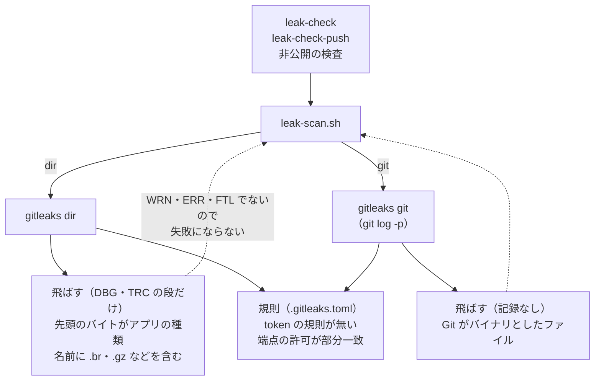
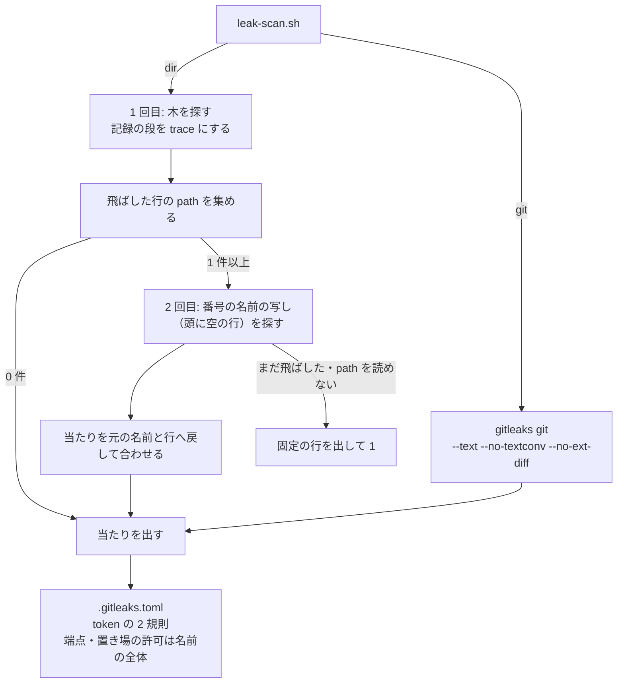
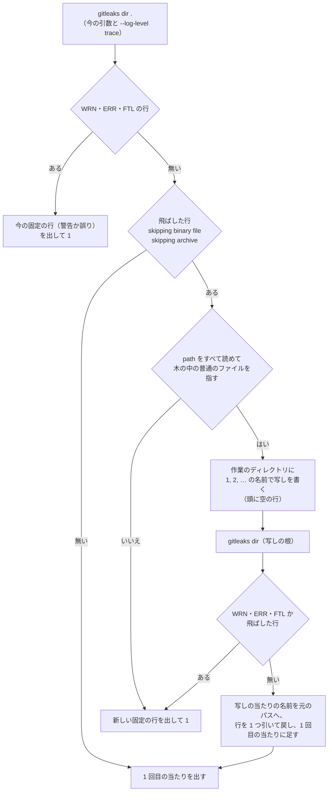

# 漏れの検査: サービスの token・バイナリのファイルの中の秘密・作り物に見せた端点を、今の木と履歴で止める（#98）

Pull Request の漏れの検査（`leak-check`）は、サービス自身の token、gitleaks が中身を読まずに飛ばすファイルの中の秘密、資源の名前に `example.com` を含む端点を通してしまい、詳細設計の 1 行もコードと食い違っている。nd-factory の規則（`.gitleaks.toml`）に token の 2 つの規則を足し、端点と S3 の置き場の作り物の許可を名前の全体に当てる形に替える。`leak-scan.sh` は、履歴を Git の `--text` で読み、今の木では gitleaks が飛ばしたファイルを番号の名前の写しで探し直し、それでも読めなければ当たりが無くても失敗にする。採らなかった案は「決定の記録」に、調べた外部の資料は末尾の「外部の調査」にある。

省いた文書: 実行計画（課題 1・PR 1）
省いた文書: 並列の計画（レーン 1）

## 今の姿

何が起きたか・目的・受け入れ条件は要求仕様（[issue-98-requirements.md](./issue-98-requirements.md)、正は #98 の本文）にある。この文書は「どう解くか」と「なぜその解き方か」だけを書く。

漏れの検査の 3 つの探し（Pull Request の `leak-check`・main への push の `leak-check-push`・非公開の検査 `leak-check-secret`）は、どれも `tools/checks/leak-scan.sh` を通して gitleaks 8.30.1 を打つ。抜けは、規則の側（`.gitleaks.toml`）と、gitleaks が中身を読まずに飛ばす所の 2 か所にある。

2026-11-25 に、手元に置いた gitleaks 8.30.1 で、乱数から作った作り物の値だけを使って次を実測した。

| # | 抜け | 根本原因 | 実測 |
| --- | --- | --- | --- |
| 1 | サービスの token が当たらない | 委任の token（`ndfd_…`）と手元のマシンの登録の token（`ndfm_…`）の規則が、既定の規則にも `.gitleaks.toml` にも無い | 要求の「事象」1 のとおり |
| 2 | 履歴で、バイナリのファイルの中の秘密が当たらない | gitleaks の履歴の探しは `git log -p` のパッチを読み、`Binary files … differ` の項目をアーカイブでなければ記録を出さずに飛ばす（`sources/git.go`）。Git がバイナリとするのは、中身に NUL を含むファイルと、`.gitattributes` で `-diff`・`binary` を付けたファイルである | 途中のコミットで足して消した 5 つのファイルのうち、NUL を含むファイル・ELF の頭を持つファイル・`-diff` を付けたテキストのファイルの 3 つが当たらない |
| 3 | 今の木で、gitleaks が種類や名前で飛ばすファイルの中の秘密が当たらない | gitleaks の今の木の探しは、(a) 先頭のバイトが application の種類（ELF・RTF・`MZ` で始まる exe など）に合うファイルを DBG の段で、(b) 名前のどこかに `.br`・`.gz`・`.zip` などを含むファイルをアーカイブとして TRC の段で、中身を読まずに飛ばす（`sources/file.go`。アーカイブは名前だけで見分ける）。`leak-scan.sh` は WRN・ERR・FTL の段だけを見るので、失敗にならない | ELF の頭・RTF の頭・`MZ` で始まるテキスト・名前が `notes.zip` のテキストの 4 つが当たらない。NUL を含むだけのファイルは当たる。今の main の `packages/core/test/log.browser.test.ts` も、名前が `.br` を含むので (b) で飛ばされている |
| 4 | 資源の名前に `example.com` を含む端点が当たらない | `nd-aws-endpoint` の許可 `example\.com` が、資源の部分の一部に合えば端点の全体を許す | 要求の「事象」3 のとおり |
| 5 | 詳細設計が、秘密の形のデータを読む処理を 1 つだけ書く | 生成物を作るスクリプト（`packages/contracts/scripts/artifacts.ts` の 453 行目）が同じデータで公開用のダミーデータを検査することが、詳細設計の行（`docs/design/detail.md` の 291 行目）に無い | 要求の「事象」4 のとおり |

受け入れ条件 3 の「NUL を含みバイナリと判定されるファイル」は、gitleaks の判定が NUL ではなく先頭のバイトの種類で決まるので、NUL を含み ELF の頭を持つファイルで作る。

### 同じ形の箇所

4 の部分一致の許可は、`.gitleaks.toml` のほかの規則にもある。許可の正規表現は、規則が秘密として取り出した部分に当たる。

| 規則 | 許可に渡る部分 | 部分一致で起きること | 扱い |
| --- | --- | --- | --- |
| `nd-aws-account-id`・`nd-aws-account-id-joined` | 12 桁の数 | 数だけなので、`123456789012` のほかの許可は当たり得ない。`123456789012` は 12 桁の全体と同じ | 変えない |
| `nd-aws-arn` | ARN の全体 | 資源の欄が `<名前>` などを含めば ARN を許す。ただしアカウントの 12 桁は `nd-aws-account-id` が別に当てる | 変えない |
| `nd-aws-arn-s3` | 置き場の名前 | 4 と同じ抜け（`arn:aws:s3:::data-example.com-logs` を許す。実測） | 全体に当てる |
| `nd-aws-resource-id` | `vpc-` などと 16 進 | 16 進の中に `123456789012` が並ぶ ID だけが許される | 変えない |
| `nd-aws-endpoint` | 資源の部分 | 4 の抜け | 全体に当てる |

## 文脈と制約

- `leak-scan.sh` の引数と終了コードの意味（0 当たり無し・1 当たりかスキャンの失敗・2 引数の誤り）は変えない
- gitleaks は 8.30.1 のまま使う（`tools/checks/install-gitleaks.sh` が固定する版）。飛ばしたときの記録の文言は、この版のものである
- 非公開の検査の流れ（`leak-check-secret.yml`・`leak-scan-secret.sh`・`export-tree.sh` が何をどの順で探すか）は変えない。`leak-scan.sh` の変更で非公開の検査の結果が変わることは範囲に含む
- `--paths` を渡さなければ、出力にファイルの名前を出さない。当たった値は `--paths` を渡しても出さない。gitleaks は DBG と TRC の段の記録に、当たった値（`finding=`）を載せる（`detect/detect.go` の 720 行目）
- テストに置く token と秘密は、テストの実行中に乱数から作る（要求の前提 2）
- 変更の後のリポジトリ自身が通る。Pull Request の `leak-check` は木と分岐点からの範囲を、マージの後の `leak-check-push` は main の全履歴を `.gitleaks.toml` で探す。この設計の規則と `--text` の案で、今の木と main の全 97 コミットを探し、新しい当たりは 0 件だった（gitleaks は `--config` に渡した設定のファイルを探さないので、試しの設定を別の場所に置いたときの `.gitleaks.toml` 自身の当たりは数えない）
- 既定の規則の設定（`tools/checks/gitleaks-default.toml`）は `useDefault` で gitleaks の既定の全体の許可を読み、`.bin`・`.pdf`・画像・`node_modules/`・`package-lock.json` などを名前で外す。今の結合テストはこの扱いを約束にしている

## 解き方の全体像

- `.gitleaks.toml` に `nd-delegation-token`・`nd-machine-token` を足し、`nd-aws-endpoint`・`nd-aws-arn-s3` の許可を名前の全体に当てる形に替える
- 履歴の探しは gitleaks の `--log-opts` に `--text --no-textconv --no-ext-diff` を足し、Git のバイナリの判定と `.gitattributes` によらず、範囲の各コミットで変えたすべてのファイルの足した行を探す
- 今の木の探しは、gitleaks が中身を読まずに飛ばしたファイルを記録から集め、頭に空の行を 1 つ足した写しを番号の名前で置いて探し直し、当たりを元の名前と行へ戻す。写しでも飛ばしたときと、飛ばしたファイルを特定できないときは、当たりが 0 件でも 1 で終える
- `leak-scan-secret.sh` は、この新しい失敗の行を、今の読み飛ばしの行と同じく失敗として見分ける
- 詳細設計の「秘密の形のデータ」の行は、データを読む処理として、実行時の `redact` と生成時のダミーデータの検査の 2 つを書く

## 処理の流れ

今の木の探し（`dir`）の流れを示す。履歴の探し（`git`）は、gitleaks に渡す `--log-opts` が増えるだけで、流れは今と同じである。

- 当たりがあれば、失敗の行の有無によらず当たりを出して 1 で終える（今の扱いと同じ）
- 段を上げた gitleaks の記録は、作業のディレクトリ（`mktemp -d`。終わりに消す）の中のファイルに受ける。`--paths` を渡したときに標準エラーへ出すのは、INF・WRN・ERR・FTL の段の行だけにする
- 段の判定は、色の制御の列を外した行の 2 つ目の語（時刻の次）で行う。DBG・TRC の行の本文に `WRN` などの語があっても、警告と見なさない

## 決定の記録

### 決定 1: サービスの token を形が少し変わっても止めるため、秘密の部分の長さで当てる 2 つの規則を `.gitleaks.toml` に置く

- **質問**: 委任の token と手元のマシンの登録の token を、どの形で、どの設定のファイルで当てるか
- **選んだ案**: `.gitleaks.toml` に `nd-delegation-token`（`ndfd_`）と `nd-machine-token`（`ndfm_`）の 2 つの規則を足す。形は「語の境の後の頭、英数字と `_`・`-` の並び、`.`、同じ並び、`.`、base64url の文字が 32 字以上」とする。ID の部分の形（`usr_` と UUID など）は問わない。許可は持たない（プレースホルダー `<…>`・`${…}` は文字の種類で外れ、`EXAMPLE` のような短い作り物は 32 字に届かない）
- 採らなかった案: 今の token の形（`usr_<UUIDv7>`・秘密の部分 43 字）に正確に合わせる（ID の形や長さが変わったときと、記録に途中まで写った token を逃す）
- 採らなかった案: 既定の規則の設定（`tools/checks/gitleaks-default.toml`）に置く（このファイルの冒頭のコメントが、既定の規則の許可を外すためだけに使うと決めている。要求の起票者の推定 S2）
- **代償**: `ndfd_`・`ndfm_` で始まり、3 つ目の部分が 32 字以上の base64url の文字の、token でない文字列も当たる。今の木と main の全履歴には無い（実測）
- 作り方: ライブラリやサービスを使う
- 比べた候補: LIB1 / LIB2
- 根拠: Value 7（MVV バージョン 3）

### 決定 2: 履歴でバイナリのファイルを飛ばさせないため、gitleaks に Git の `--text` を渡す

- **質問**: 履歴の探しで、Git がバイナリとしたファイルの中身をどう探すか
- **選んだ案**: `leak-scan.sh` が gitleaks に渡す `--log-opts` に `--text --no-textconv --no-ext-diff` を足す。Git はすべてのファイルをテキストとしてパッチに出すので（STD1）、NUL を含むファイルも `-diff` の属性のファイルも、足した行が gitleaks に渡る。gitleaks は `Binary files … differ` の項目を受け取らないので、飛ばす経路を通らない。探す対象は、Git のバイナリの判定と `.gitattributes` によらず、範囲の各コミットで足したか変えたすべてのファイルになる（受け入れ条件 2 の「パッチの表示に頼らない」をこの形で満たす）。当たりのコミットと行の報告は今のまま
- 採らなかった案: 範囲の各コミットの blob を書き出し、ファイルとして探す（非公開の検査の `history` と同じ形）（blob の全行を探すので、前から在る行も、そのファイルを変えたコミットの当たりとして重ねて出る。範囲を持たない main への push の探しでは、書き出す量が履歴の全体になる）
- 採らなかった案: 鍵の格納ファイルの拡張子（`.p12`・`.pfx`・`.jks`・`.keystore` など）を拒む（拡張子の無いファイルとほかの拡張子のバイナリを逃す。中身を探せば、拡張子を拒む必要が無い）
- **代償**: 足したバイナリのファイルの全バイトがパッチに載るので、大きなバイナリを足した範囲ほど探す時間が延びる。今の main の全履歴に、Git がバイナリとする項目は 0 件である（`git log -m --numstat`）
- 作り方: ライブラリやサービスを使う
- 比べた候補: STD1 / LIB1 / LIB2
- 根拠: Value 7・Value 15（MVV バージョン 3）。STD1

### 決定 3: 今の木で飛ばされたファイルを探すため、gitleaks の記録から集めて番号の名前の写しで探し直す

- **質問**: 今の木で gitleaks が中身を読まずに飛ばすファイル（先頭のバイトの種類・アーカイブに見える名前）を、どう探すか
- **選んだ案**: 1 回目は今と同じく木を探し、gitleaks の記録の段を trace にする。記録から、DBG の `skipping binary file` と TRC の `skipping archive` の行の `path=` の値を集める（値は最後の項目で、空白などを含むときは Go の引用の形になる）。1 件以上あれば、作業のディレクトリに `1`・`2`・… の名前で、頭に空の行を 1 つ足した写しを置き、同じ設定と引数で 2 回目を探す。頭の空の行で先頭のバイトの種類が合わなくなり、`.` を持たない番号の名前でアーカイブと見なされなくなる。2 回目の当たりは、番号を元のパスへ、行の番号を 1 つ引いて戻し、1 回目の当たりに足す
- 採らなかった案: 木のすべてのファイルを写して探す（名前を保てば `.br` を含む名前が再び飛ばされる。名前を替えれば、既定の全体の許可（`package-lock.json`・`node_modules/` など）と名前で当てる規則が効かなくなる）
- 採らなかった案: NUL を含むファイルを `leak-scan.sh` が自分で選んで探し直す（gitleaks は NUL では飛ばさず、先頭のバイトの種類と名前で飛ばすので、RTF・`MZ` で始まるテキスト・`.br` を含む名前を逃す。実測）
- 採らなかった案: gitleaks の `--max-archive-depth` でアーカイブを開く（gitleaks はアーカイブを名前だけで見分けるので、`log.browser.test.ts` を Brotli として開こうとして誤りになる）
- **代償**: 飛ばしたファイルの特定を、gitleaks 8.30.1 の記録の文言に頼る。版を上げて文言が変わると集められず、飛ばしたファイルが再び探されなくなる。実物の gitleaks で ELF の頭・RTF の頭・`.br` を含む名前のファイルを当てる結合テストが `leak-check` の中で走るので、版を上げる Pull Request で落ちる。写しは番号の名前なので、飛ばしたファイルには名前で当てる既定の規則（`.p12` の名前など）が効かない（今も効いていない）
- 作り方: 自前で作る・ライブラリやサービスを使う
- 比べた候補: LIB1 / LIB2 / PRD1
- 根拠: Value 7・Value 17（MVV バージョン 3）

### 決定 4: 探し直しても読めないファイルを見逃さないため、当たりの有無によらず固定の行で失敗にする

- **質問**: 探し直しても中身を読めないファイルや、飛ばしたファイルを特定できないときをどう扱い、何を出すか
- **選んだ案**: 次のどれかに当たれば、当たりの有無によらず 1 で終える。(1) 2 回目でも飛ばした行がある。(2) 飛ばした行の `path=` の値を読めないか、木の中の普通のファイル（シンボリックリンクでない）を指さない。(3) 写しを書けない。出すのは、ファイルの名前を含まない固定の 1 行（例: `leak-scan: gitleaks が中身を読まずに飛ばしたファイルを探せなかった`）と、`--paths` を渡していなければ今の「伏せた」行である。今の WRN・ERR・FTL の扱い（`leak-scan: gitleaks が警告か誤りを出した`）は変えない
- 採らなかった案: 飛ばしたファイルがあれば、探し直さずに失敗にする（今の main の `log.browser.test.ts` で必ず落ち、ファイルの名前を変えさせることになる）
- 採らなかった案: 新しい失敗も今の行（`leak-scan: gitleaks が警告か誤りを出した`）で出す（gitleaks は警告を出していないので行の意味と食い違い、CI の検査の手順の失敗の行の表で原因を引けなくなる）
- **代償**: 写しの頭の空の行の後に、別の種類の印が並ぶよう作ったファイルは、探せずに失敗で止まる（通らないが見逃さない）
- 根拠: Value 7（MVV バージョン 3）

### 決定 5: 実在の名前の一部を作り物の印で隠せないよう、端点と S3 の置き場の許可を名前の全体に当てる

- **質問**: 端点と S3 の置き場の作り物の許可を、どの形で名前の全体に当てるか。ほかの規則の許可も直すか（要求の未決 1）
- **選んだ案**: `nd-aws-endpoint` と `nd-aws-arn-s3` の許可を、名前（端点の資源の部分・置き場の名前）の全体に合う次の 5 つに替える。どれも `^…$` で全体に合わせる
  1. `acme` で始まり、名前の文字（英数字と `.`・`_`・`-`）とプレースホルダーだけでできている名前（AGENTS.md の作り物の接頭辞）
  2. プレースホルダー（`<名前>`・`${名前}`）と区切り（`.`・`-`）だけでできている名前
  3. 予約済みのドメイン `example.com`・`example.net`・`example.org` か、その下の名前（STD2）
  4. 大文字の `EXAMPLE` を含み、名前の文字だけでできている名前（AWS の文書の作り物の印。S3 の置き場の名前は小文字だけなので（STD3）、大文字を含む名前は実在の名前の写しではない）
  5. 個別の許可 `<prefix>-<environment>-login`（`docs/operations/idp-and-apps.md` の Cognito のドメインの形。理由を添える）

  ほかの規則の許可は変えない（「同じ形の箇所」の表）
- 採らなかった案: プレースホルダーを含めば許す（`real-<env>` のように、実在の名前の一部を残した端点を通す）
- 採らなかった案: 6 つの規則の許可をすべて全体の形にそろえる（数か 16 進だけの規則では部分一致と全体一致の結果が同じで、ARN のアカウントは別の規則が当てるので、止まる値が増えない）
- **代償**: 4 は `EXAMPLE` を含めば許すので、小文字の実在の名前に大文字の印を混ぜて書いた名前は通る。5 は、文書の形を変えたら外す。今の木と main の全履歴の作り物の値（`acme-bucket`・`<bucket>`・`${AssetsBucket}`・`assets.example.com`・`nd-EXAMPLE-logs`・`EXAMPLE1234`・`<prefix>-<environment>-login` など）は、この 5 つで当たりが 0 件になる（実測）
- 作り方: 標準に倣う
- 比べた候補: STD2 / STD3
- 根拠: Value 7（MVV バージョン 3）。STD2・STD3

### 決定 6: 既定の規則の誤検知の扱いを保つため、gitleaks の既定の全体の許可は外さない

- **質問**: 既定の規則の設定が読む gitleaks の既定の全体の許可（`.bin`・`.pdf`・画像・`node_modules/` などを名前で外す）を、バイナリを探す変更に合わせて外すか
- **選んだ案**: 外さない。要求の「事象」2 の `blob.bin` を既定の規則で探すと、直した後も名前の許可で当たらない。受け入れ条件 2・3 の結合テストは、許可に当たらない名前のファイルで作る。名前が許可に当たるファイルも、`.gitleaks.toml`（全体の許可を持たない）の規則では探す
- 採らなかった案: 既定の全体の許可を読まない設定にする（gitleaks の `[extend]` は `useDefault`・`path`・`disabledRules` だけを持ち、全体の許可は足し合わされる（LIB1 の README）。外すには既定の規則を写して持つことになり、gitleaks の版を上げるたびに写し直す。`package-lock.json` などの誤検知が戻り、今の結合テストの約束も変わる）
- **代償**: 名前が `.bin`・`.pdf`・画像などのファイルの中の秘密は、既定の規則（AWS の鍵・GitHub の token など）では探さない
- 根拠: Value 7・Value 13（MVV バージョン 3）。LIB1

### 決定 7: main への push の探しが新しい失敗を件数と分けて出せるよう、`leak-scan-secret.sh` の見分ける文言に足す

- **質問**: 決定 4 の新しい失敗の行を、非公開の検査と main への push の探し（`--count-only`）がどう見分けるか
- **選んだ案**: `leak-scan-secret.sh` が失敗を見分ける固定の文言（今は「警告か誤り」と「報告を読めない」の 2 つ）に、新しい行を足す。何をどの順で探すかは変えない
- 採らなかった案: `leak-scan-secret.sh` を変えない（当たりと新しい失敗が同時に起きると、`--count-only` は件数の行だけを出し、探せた範囲だけの件数だと分からない）
- **代償**: 要求の対象範囲の「含まない」（非公開の検査の流れの変更）に近い所を触る。流れは変えず、`leak-scan.sh` の変更で非公開の検査の結果が変わる分として扱う。CI の検査の手順の失敗の行の表も同じ変更で直す
- 根拠: Value 7・Value 13（MVV バージョン 3）

## 影響と危険

- **働く範囲**: このリポジトリの漏れの検査だけである。`leak-scan.sh` を通す 3 つの探し（`leak-check`・`leak-check-push`・非公開の検査）のすべてに効く。利用先のリポジトリでは働かない
- **プロジェクトごとに違うもの**: 無い。設定のファイルと引数は今のまま受ける
- **当たるモード**: 開発の工程のモードによらない。すべての Pull Request と main への push の漏れの検査に効く

壊れうる箇所と扱いは次のとおりである。

| 箇所 | 起きること | 扱い |
| --- | --- | --- |
| 今まで通っていた Pull Request | token・名前に `example.com` を含む置き場・バイナリのファイルの中の秘密で、新しく落ちることがある | 今の木と main の全履歴には新しい当たりが無い（実測）。マージした後の `leak-check-push` も落ちない |
| 探す時間 | 履歴はバイナリの全バイトがパッチに載る。今の木は、飛ばしたファイルがあるときだけ 2 回目が走る（今の main では 1 ファイル） | 「未確認のまま残ること」 |
| gitleaks の版を上げる変更 | 飛ばしたときの記録の文言が変わると、集められなくなる | 実物の gitleaks を使う結合テストが、版を上げる Pull Request の `leak-check` で落ちる（決定 3） |
| 一時のファイル | 段を上げた gitleaks の記録は、当たった値を含む | 作業のディレクトリの中に受けて終わりに消し、DBG・TRC の行は `--paths` でも出さない |
| 圧縮された中身 | アーカイブを開かないので、zip などの中の秘密は、今の木でも履歴でもバイト列としてしか探さない | 今の木と main の全履歴にアーカイブは無い（名前で `.br` を含むテキスト 1 つだけ）。開く変更は別の課題にする |
| 既定の全体の許可 | `.bin`・`.pdf`・画像などの名前のファイルは、既定の規則では探さない | 決定 6 |
| 同じファイルを触る別の課題 | fork の Pull Request と秘密の正規表現の扱い（ https://github.com/devbasex/nd-factory/issues/96 ）も、漏れの検査の文書とワークフローを触りうる | 要求の対象範囲のとおり、その課題の変更をこの課題に含めない。同時に進めるときは `leak-scan.sh` と仕様書の重なりをマージの順で解く |

## テスト設計

結合テストは `tools/test/leak-scan.integration.test.ts` に足し、実物の gitleaks で打つ。当てる値はすべて実行中に乱数から作る。

| 受け入れ条件 | どの振る舞いで縛るか | どう壊したら落ちるべきか |
| --- | --- | --- |
| 1 | 委任の token と登録の token を置いた木を `dir .gitleaks.toml` で探すと、それぞれ `nd-delegation-token`・`nd-machine-token` の当たりになり 1 で終える。同じ値を途中のコミットで足して消した履歴を `git .gitleaks.toml --range` で探しても当たる | 規則のどちらかを消すと落ちる。秘密の部分の長さの下限を作った値より長くすると落ちる |
| 2 | 途中のコミットで、NUL を含み ELF の頭を持つファイルと、`.gitattributes` で `-diff` を付けたテキストのファイルに秘密を入れ、後のコミットで消した履歴を `git --range` で探すと、2 つとも当たり 1 で終える | `--text` を外すと落ちる |
| 3 | NUL を含み ELF の頭を持つファイル、RTF の頭のファイル、名前に `.br` を含むテキストのファイルに秘密を入れた木を `dir` で探すと、元のパスと元の行の番号で当たり、1 で終える | 2 回目を消すと落ちる。行の番号を戻さないと落ちる。番号を元のパスへ戻さないと落ちる |
| 4 | 2 回目でも飛ばした行が出るとき（偽の gitleaks）と、`path=` の値を読めない飛ばしの行のとき、当たりが 0 件でも 1 で終え、新しい固定の行を出す。`--paths` を渡さなければ出力にファイルの名前が出ない。今の WRN の扱い（`dir`・`git` とも）はそのまま通る | 2 回目の飛ばしを見ないように壊すと落ちる。固定の行に名前を足すと落ちる |
| 4 | 段を上げても、`--paths` を渡したときの出力に当たった値と DBG・TRC の行が出ない | 記録をそのまま出すように壊すと落ちる |
| 5 | `data-example.com-logs` の形の S3 の端点と置き場の ARN、`real-<名前>` の形の端点を置いた木で、`nd-aws-endpoint`・`nd-aws-arn-s3` が当たる | 許可を部分一致に戻すと落ちる |
| 6 | 今の「作り物の値だけの木では当たらない」の 2 つのテストが、変えずに当たり無しで通る。`<prefix>-<environment>-login` の端点を足しても通る | 許可の 5 つのどれかを消すと落ちる |
| 7 | この課題の Pull Request の `leak-check` が成功する | 新しい規則か許可が今の木か範囲に当たると落ちる（CI で見る） |
| 8 | 詳細設計の「秘密の形のデータ」の行が、実行時の `redact` と生成時のダミーデータの検査の 2 つを書き、gitleaks の設定がこのデータを読まず生成もしないことを残す | 文書なのでテストを持たない。設計 Pull Request と実装の Pull Request のレビューで見る |
| 決定 7 | `leak-scan-secret.sh --count-only` で、当たりと新しい失敗が同時に起きると、件数の行に加えて失敗の行を出す | 見分ける文言から新しい行を外すと落ちる |

## 設計の結果

| 課題 | 扱い | 統合先 | 触るファイル |
| --- | --- | --- | --- |
| #98 | 実装する | — | `.gitleaks.toml`、`tools/checks/leak-scan.sh`、`tools/checks/leak-scan-secret.sh`、`tools/test/leak-scan.integration.test.ts`、`docs/design/detail.md`、`docs/specifications/leak-check.md`、`docs/operations/ci-checks.md` |

## 未確認のまま残ること

| 項目 | 内容 |
| --- | --- |
| CI の探しの時間 | 今の木の 2 回目と、履歴の `--text` で `leak-check` がどれだけ延びるかは測っていない。この課題の Pull Request の `leak-check` の実行時間で分かる（今のジョブの上限は 15 分） |

## 外部の調査

| 種類 | 調べるか | 理由 |
| --- | --- | --- |
| 標準・仕様 | 調べる | Git がバイナリをどう出すか、作り物の名前に使えるドメイン、AWS の資源の名前の文字の規則が、決定 2・5 の前提になる |
| 主要な製品 | 調べる | ほかの秘密の探しの道具が、バイナリとアーカイブをどう扱うかを比べる |
| ライブラリとサービス | 調べる | 使っている gitleaks 8.30.1 が何をどの段の記録で飛ばすかが決定 2・3 の前提になり、置き換えの候補とも比べる |

### 標準・仕様

| # | 標準・仕様 | 何を定めているか | 設計への反映 | 出典 |
| --- | --- | --- | --- | --- |
| STD1 | Git の `git diff` の選択肢 | `--text` は「すべてのファイルをテキストとして扱う」。`--no-textconv` は外部のテキストへの変換を使わない | 決定 2 で `--log-opts` に足す | https://git-scm.com/docs/git-diff （2026-11-25） |
| STD2 | RFC 2606（予約済みのドメイン名） | `example.com`・`example.net`・`example.org` を例のために予約する | 決定 5 の許可 3 | https://www.rfc-editor.org/rfc/rfc2606.txt （2026-11-25） |
| STD3 | Amazon S3 の汎用の置き場の名前の規則 | 置き場の名前は小文字・数字・`.`・`-` だけでできる | 決定 5 の許可 4（大文字を含む名前は実在の置き場の名前の写しではない） | https://docs.aws.amazon.com/AmazonS3/latest/userguide/bucketnamingrules.html （2026-11-25） |

### 主要な製品

| # | 製品 | どう解いているか | 設計への反映 | 出典 |
| --- | --- | --- | --- | --- |
| PRD1 | TruffleHog | バイナリ・文書・ほかの形のファイルも探し、アーカイブを大きさの上限つきで開く（`--archive-max-size`） | バイナリを探す方向は同じにする。アーカイブを開くのは、この課題では採らず別の課題にする（影響と危険） | https://raw.githubusercontent.com/trufflesecurity/trufflehog/main/README.md （2026-11-25） |

### ライブラリとサービス

| # | 候補 | バージョン | ライセンス | 最後のリリースの日付 | 終了のアナウンス | 要件を満たすか | 出典 |
| --- | --- | --- | --- | --- | --- | --- | --- |
| LIB1 | gitleaks | 8.30.1（使っている版で、最新の版） | MIT | 2026-03-21 | 無し | 満たす。独自の規則で token を当てられる。履歴は `--log-opts` で Git の `--text` を渡せる。今の木は先頭のバイトの種類（DBG）と名前のアーカイブ（TRC）で飛ばすので、記録から集めて探し直す。`[extend]` は全体の許可を足し合わせ、外す項目を持たない | `gh api repos/gitleaks/gitleaks/releases/latest`、https://github.com/gitleaks/gitleaks/blob/v8.30.1/sources/git.go 、https://github.com/gitleaks/gitleaks/blob/v8.30.1/sources/file.go 、https://github.com/gitleaks/gitleaks/blob/v8.30.1/detect/detect.go 、https://github.com/gitleaks/gitleaks/blob/v8.30.1/README.md 、https://github.com/mholt/archives/blob/v0.1.2/brotli.go （2026-11-25） |
| LIB2 | TruffleHog | 3.100.1 | AGPL-3.0 | 2026-11-23 | 無し | 置き換えは範囲の外（要求は gitleaks の版も変えない）。3 つの探しと結合テストを作り直すことになる | `gh api repos/trufflesecurity/trufflehog/releases/latest`（2026-11-25） |

### 確かめられなかったこと

| 対象 | 試した手段 | 結果と理由 |
| --- | --- | --- |
| GitHub の secret scanning がバイナリのファイルを探すか | https://docs.github.com/en/code-security/secret-scanning/introduction/about-secret-scanning を取得し、`binar` で探した | 取得できたが、バイナリの扱いの記述が見つからなかった。比べる製品から外した |

調べた量: 候補 6 件・取得の試み 21 回。
