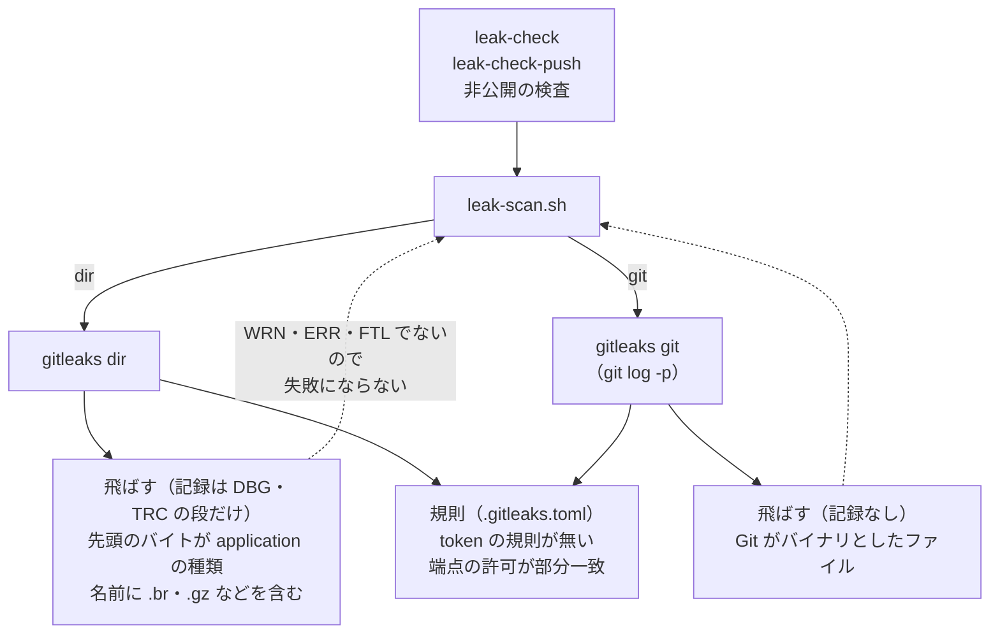
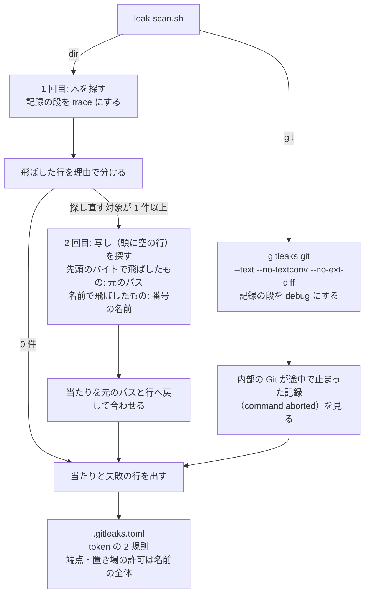
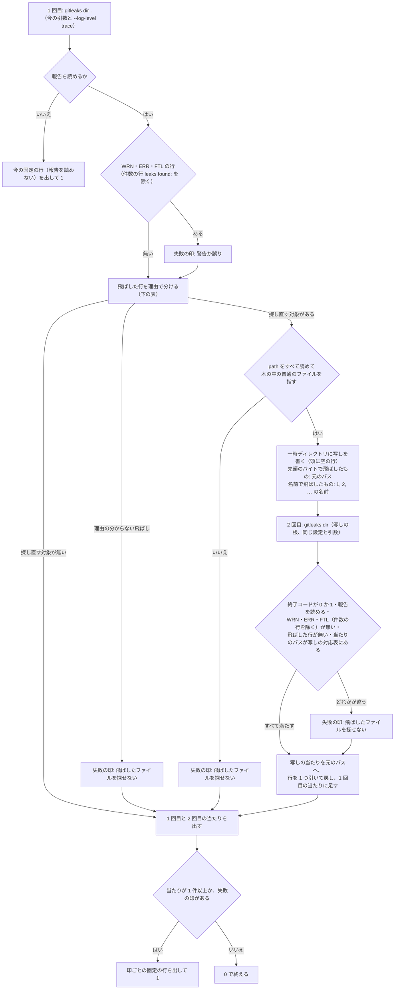

# 漏れの検査: サービスの token・バイナリのファイルの中の秘密・作り物に見せた端点を、今の木と履歴で止める（#98）

Pull Request の漏れの検査（`leak-check`）は、サービス自身の token、gitleaks が中身を読まずに飛ばすファイルの中の秘密、資源の名前に `example.com` を含む端点を通してしまい、詳細設計の 1 行もコードと食い違っている。nd-factory の規則（`.gitleaks.toml`）に token の 2 つの規則を足す。端点と S3 の置き場の作り物の許可は、名前の全体に当て、用途を説明できる作り物の名前とプレースホルダーだけに絞る。資源の ID の規則からは、関係の無いアカウント ID の例の許可を外す。`leak-scan.sh` は、履歴を Git の `--text` で読み、gitleaks の内部の Git が途中で止まったら失敗にする。今の木では、gitleaks が中身を読まずに飛ばしたファイルを写しにして探し直す。それでも読めないとき、飛ばした理由が分からないとき、探し直しの結果を取れないときは、当たりが無くても失敗にする。採らなかった案は「決定の記録」に、調べた外部の資料は末尾の「外部の調査」にある。

省いた文書: 実行計画（課題 1・PR 1）
省いた文書: 並列の計画（レーン 1）

## 今の姿

何が起きたか・目的・受け入れ条件は要求仕様（[issue-98-requirements.md](./issue-98-requirements.md)、正は #98 の本文）にある。この文書は「どう解くか」と「なぜその解き方か」だけを書く。

漏れの検査には 3 つの探しがある。Pull Request の `leak-check`、main への push の `leak-check-push`、非公開の検査 `leak-check-secret` である。どれも `tools/checks/leak-scan.sh` を通して gitleaks 8.30.1 を打つ。抜けは、規則の側（`.gitleaks.toml`）と、gitleaks が中身を読まずに飛ばす所の 2 か所にある。

2026-11-25 に、手元に置いた gitleaks 8.30.1 で、乱数から作った作り物の値だけを使って次を実測した。

| # | 抜け | 根本原因 | 実測 |
| --- | --- | --- | --- |
| 1 | サービスの token が当たらない | 委任の token（`ndfd_…`）と手元のマシンの登録の token（`ndfm_…`）の規則が、既定の規則にも `.gitleaks.toml` にも無い | 要求の「事象」1 のとおり |
| 2 | 履歴で、バイナリのファイルの中の秘密が当たらない | gitleaks の履歴の探しは `git log -p` のパッチを読み、`Binary files … differ` の項目をアーカイブでなければ記録を出さずに飛ばす（`sources/git.go`）。Git がバイナリとするのは、中身に NUL を含むファイルと、`.gitattributes` で `-diff`・`binary` を付けたファイルである | 途中のコミットで足して消した 5 つのファイルのうち、NUL を含むファイル・ELF の頭を持つファイル・`-diff` を付けたテキストのファイルの 3 つが当たらない。既定の全体の許可に名前が当たらないファイル（拡張子の無い `nulfile`）に NUL と `aws_secret_access_key` の行を入れて足して消した履歴でも、既定の規則の当たりは 0 件で、`--log-opts` に `--text --no-textconv --no-ext-diff` を足すと `generic-api-key` が 1 件当たる。要求の「事象」2 の `blob.bin` は、名前が既定の全体の許可（`.bin`）にも当たるので、この測り方では履歴の読み方による抜けと区別できない |
| 3 | 今の木で、gitleaks が種類や名前で飛ばすファイルの中の秘密が当たらない | gitleaks の今の木の探しは、(a) 先頭のバイトが application の種類（ELF・RTF・`MZ` で始まる exe など）に合うファイルを DBG の段で、(b) 名前のどこかに `.br`・`.gz`・`.zip` などを含むファイルをアーカイブとして TRC の段で、中身を読まずに飛ばす（`sources/file.go`。アーカイブは名前だけで見分ける）。`leak-scan.sh` は WRN・ERR・FTL の段だけを見るので、失敗にならない | ELF の頭・RTF の頭・`MZ` で始まるテキスト・名前が `notes.zip` のテキストの 4 つが当たらない。NUL を含むだけのファイルは当たる。今の main の `packages/core/test/log.browser.test.ts` も、名前の `.browser` が `.br` を含むので (b) で飛ばされている |
| 4 | 資源の名前に `example.com` を含む端点が当たらない | `nd-aws-endpoint` の許可 `example\.com` が、資源の部分の一部に合えば端点の全体を許す | 要求の「事象」3 のとおり |
| 5 | 詳細設計が、秘密の形のデータを読む処理を 1 つだけ書く | 生成物を作るスクリプト（`packages/contracts/scripts/artifacts.ts` の 453 行目）が同じデータで公開用のダミーデータを検査することが、詳細設計の行（`docs/design/detail.md` の 291 行目）に無い | 要求の「事象」4 のとおり |

今の木の探し（`dir`）で gitleaks が飛ばすかは、NUL ではなく先頭のバイトの種類で決まる（NUL を含むだけのファイルは今も当たる）。そこで、受け入れ条件 3 の「NUL を含みバイナリと判定されるファイル」のテストのファイルは、NUL を含み ELF の頭を持つ形で作る。

### 同じ形の箇所

4 の部分一致の許可は、`.gitleaks.toml` のほかの規則にもある。許可の正規表現は、規則が秘密として取り出した部分に当たる。

| 規則 | 許可に渡る部分 | 部分一致で起きること | 扱い |
| --- | --- | --- | --- |
| `nd-aws-account-id`・`nd-aws-account-id-joined` | 12 桁の数 | 数だけなので、`123456789012` のほかの許可は当たり得ない。`123456789012` は 12 桁の全体と同じ | 変えない |
| `nd-aws-arn` | ARN の全体 | 資源の欄が `<名前>` などを含めば ARN を許す。ただしアカウントの 12 桁は `nd-aws-account-id` が別に当てる | 変えない |
| `nd-aws-arn-s3` | 置き場の名前 | 4 と同じ抜け（`arn:aws:s3:::data-example.com-logs` を許す。実測） | 全体に当て、用途を説明できる名前に絞る（決定 5） |
| `nd-aws-resource-id` | `vpc-` などと 16 進 | 16 進の中に `123456789012` が並ぶ実在の ID も許される。アカウント ID の例をこの規則で許す理由は無い。ほかの許可（`^acme`・`example\.com`・プレースホルダー・`EXAMPLE`）は、16 進と `-` だけの値には当たり得ない | 許可をすべて外す（決定 5） |
| `nd-aws-endpoint` | 資源の部分 | 4 の抜け | 全体に当て、用途を説明できる名前に絞る（決定 5） |

## 文脈と制約

- `leak-scan.sh` の引数と終了コードの意味（0 当たり無し・1 当たりかスキャンの失敗・2 引数の誤り）は変えない
- gitleaks は 8.30.1 のまま使う（`tools/checks/install-gitleaks.sh` が固定する版）。飛ばしたときの記録の文言は、この版のものである
- 非公開の検査の流れ（`leak-check-secret.yml`・`leak-scan-secret.sh`・`export-tree.sh` が何をどの順で探すか）は変えない。`leak-scan.sh` の変更で非公開の検査の結果が変わることは範囲に含む
- `--paths` を渡さなければ、出力にファイルの名前を出さない。当たった値は `--paths` を渡しても出さない。記録の段を DBG・TRC まで上げると、gitleaks の記録に当たった値（`finding=`）が載るので（`detect/detect.go` の 720 行目）、その記録はそのまま出さない
- テストに置く token と秘密は、テストの実行中に乱数から作る（要求の前提 2）
- 変更の後のリポジトリ自身が通る。Pull Request の `leak-check` は木と分岐点からの範囲を、マージの後の `leak-check-push` は main の全履歴を `.gitleaks.toml` で探す。2026-11-25 に、この設計の規則と許可（決定 1・5）を写した試しの設定と、`--log-opts` に `--text` などを足した `leak-scan.sh` で、今の main（`69fd0b9`）の木と全 97 コミットを探すと、新しい当たりは 0 件だった。この測定は、今の木の探し直し（決定 3・4）を含まず、最終の設定でもない。マージしてよいかは、テスト設計の「マージの前の確認」で決める。測るときは試しの設定を木の外に置いたので、木の中の `.gitleaks.toml` も探す対象に入った。この `.gitleaks.toml` 自身の当たりは数えていない。CI では `.gitleaks.toml` を `--config` に渡し、gitleaks は `--config` に渡した設定のファイルを探さないためである
- 既定の規則の設定（`tools/checks/gitleaks-default.toml`）は、`useDefault` で gitleaks の既定の全体の許可を読む。この許可は `.bin`・`.pdf`・画像・`node_modules/`・`package-lock.json` などを名前で外す。今の結合テストは、この扱いを前提に、これらのファイルが当たらないことを確かめている

## 解き方の全体像

- `.gitleaks.toml` に `nd-delegation-token`・`nd-machine-token` を足す。`nd-aws-endpoint`・`nd-aws-arn-s3` の許可を、名前の全体に当て、用途を説明できる名前に絞る。`nd-aws-resource-id` の許可を外す
- 履歴の探しは、gitleaks の `--log-opts` に `--text --no-textconv --no-ext-diff` を足す。Git のバイナリの判定と `.gitattributes` によらず、範囲の各コミットで足したか変えたファイルすべてについて、足した行を探す。gitleaks の内部の `git log` が途中で止まったときは、当たりが 0 件でも 1 で終える
- 今の木の探しは、gitleaks が中身を読まずに飛ばしたファイルを記録から集め、飛ばした理由で分ける。探し直す対象は、頭に空の行を 1 つ足した写しにして探し直し、当たりを元のパスと行へ戻す。写しでも飛ばしたとき、理由の分からない飛ばしがあるとき、2 回目の結果を取れないときは、当たりが 0 件でも 1 で終える
- どちらの探しでも、取れた当たりは失敗の有無によらず出す
- `leak-scan-secret.sh` は、今失敗として見分けている 2 つの行（「警告か誤り」と「報告を読めない」）と同じく、新しい 2 つの失敗の行（飛ばしたファイルを探せない・内部の Git が途中で止まった）も失敗として見分ける
- 詳細設計の「秘密の形のデータ」の行は、データを読む処理として、実行時の `redact` と生成時のダミーデータの検査の 2 つを書く

## 処理の流れ

失敗の条件に当たっても、途中で止めずに最後まで進み、取れた当たりをすべて出してから失敗の行を出す。図の「失敗の印」は、その条件に当たったことを覚えておき、最後に 1 で終えることを表す。

今の木の探し（`dir`）の流れは次のとおりである。

1 回目の記録の飛ばした行は、gitleaks 8.30.1 の文言（[sources/files.go](https://github.com/gitleaks/gitleaks/blob/v8.30.1/sources/files.go)・[sources/file.go](https://github.com/gitleaks/gitleaks/blob/v8.30.1/sources/file.go)・`detect/detect.go`）で次のように分ける。対象外とするのは、意図して外したものと、リポジトリの中身として読むものが無いものだけである。それ以外で中身を読まなかったものは、探し直すか失敗にする。

| 記録の文言 | 段 | 扱い | 理由 |
| --- | --- | --- | --- |
| `skipping binary file` | DBG | 探し直す（元のパスの写し） | 先頭のバイトの種類で飛ばした。頭に空の行を足せば読める |
| `skipping archive: exceeds max archive depth` | TRC | 探し直す（番号の名前の写し） | 名前でアーカイブと見なした。名前を保つと再び飛ばされる |
| `skipping file: global allowlist`・`skipping directory: global allowlist` | DBG | 対象外 | 設定の全体の許可で意図して外した（決定 6） |
| `skipping finding: …` | TRC | 対象外 | ファイルは読めている。当たりを規則の許可やエントロピーの判定で外した記録である |
| `skipping empty file` | DBG | 対象外 | 中身が無い |
| `skipping symlink: follow symlinks disabled`・`skipping symlink: target is directory` | DBG | 対象外 | リンク自身は中身を持たない。指す先が木の中のファイルなら、そのファイルとして別に探される |
| WRN・ERR の段の `skipping …`（大きすぎる・読めない・アーカイブの種類が分からないなど） | WRN・ERR | 失敗（今の「警告か誤り」） | 今の扱いのまま |
| 上のどれでもない、`skipping` で始まる DBG・TRC の行 | DBG・TRC | 失敗（飛ばしたファイルを探せない） | gitleaks の版を上げて文言が増えたときに、黙って通さない |

履歴の探し（`git`）は、gitleaks に渡す `--log-opts` に `--text --no-textconv --no-ext-diff` を足し、記録の段を debug にする。gitleaks 8.30.1 は、内部の `git log` が 0 以外で終えたとき、その誤りを DBG の段の `command aborted` だけで記録し、当たりが無ければ 0 で終える（[sources/git.go](https://github.com/gitleaks/gitleaks/blob/v8.30.1/sources/git.go) の `Fragments`）。そこで、この行があれば、当たりの有無によらず新しい固定の行（例: `leak-scan: gitleaks の内部の git が途中で止まり、履歴を最後まで探せなかった`）を出して 1 で終える。内部の Git の標準エラーの行（ERR の段の `[git] …`）は、今の「警告か誤り」で失敗になる。

- 件数の行（`leaks found: <件数>`）は、今の `log_has_skipped` と同じく、行の全体がその形のときだけ除く。1 回目と 2 回目のどちらに当たりがあっても、この行で失敗の印を立てない
- 段を上げた gitleaks の記録は、同じ一時ディレクトリの中のファイルに受ける。`--paths` を渡したときに標準エラーへ出すのは、INF・WRN・ERR・FTL の段の行だけにする。`--paths` を渡さないときは、今と同じく gitleaks の記録を出さない
- 段の判定は、色を付ける制御の文字の並び（ANSI のエスケープシーケンス）を外した行の 2 つ目の語（時刻の次）で行う。DBG・TRC の行の本文に `WRN` などの語があっても、警告と見なさない

## 決定の記録

各決定の「根拠」に挙げた Value は、プロジェクト MVV（バージョン 3。[.ndf/mvv.md](https://github.com/devbasex/nd-factory/blob/main/.ndf/mvv.md)）の次の項目である。

| Value | 中身（要約） | この設計で効く所 |
| --- | --- | --- |
| 7 公開を前提に、値を置かない | 公開のリポジトリに、インフラの実際の値と秘密の値を置かない。例・テスト・見本には作り物の値だけを使い、混入は漏れの検査などで機械的に止める | すべての決定。止める値を増やし、探せなかったときに通さない |
| 13 重複と冗長を作らない | 同じ規則・定数・処理は 1 か所に置き、ほかから参照する。定義から作れるものは手で写さない | 決定 6（gitleaks の既定の規則を写して持たない）・決定 7（失敗の見分けを `leak-scan-secret.sh` の 1 か所の文言の一覧に足す） |
| 15 車輪の再発明をしない | 広く使われ保守が活発なライブラリやサービスを設計の時点で調べ、あれば使う。自前の実装は避け、調べた候補と選んだ理由を設計文書に書く | 決定 2（Git の `--text` を使い、blob を自前で書き出さない）。候補は「外部の調査」にある |
| 17 目先の手間より、長く良い形を選ぶ | より堅牢で長く保守しやすい作り方を選ぶ。書き換える手間は、選ばない理由にしない | 決定 3（飛ばしたファイルを名前の変更で避けさせず、検査の側で探し直す） |

### 決定 1: サービスの token を形が少し変わっても止めるため、秘密の部分の長さで当てる 2 つの規則を `.gitleaks.toml` に置く

- **質問**: 委任の token と手元のマシンの登録の token を、どの形で、どの設定のファイルで当てるか
- **選んだ案**: `.gitleaks.toml` に `nd-delegation-token`（`ndfd_`）と `nd-machine-token`（`ndfm_`）の 2 つの規則を足す。形は「語の境（`\b`）の後に頭（`ndfd_` か `ndfm_`）、英数字と `_`・`-` の並び、`.`、同じ並び、`.`、base64url の文字が 32 字以上」とする。ID の部分の形（`usr_` と UUID など）は問わない。許可は持たない（プレースホルダー `<…>`・`${…}` は文字の種類で外れ、`EXAMPLE` のような短い作り物は 32 字に届かない）
- 採らなかった案: 今の token の形（`usr_<UUIDv7>`・秘密の部分 43 字）に正確に合わせる（ID の形や長さが変わったときと、記録に途中まで写った token を逃す）
- 採らなかった案: 既定の規則の設定（`tools/checks/gitleaks-default.toml`）に置く（このファイルの冒頭のコメントが、既定の規則の許可を外すためだけに使うと決めている。要求の起票者の推定 S2）
- **代償**: `ndfd_`・`ndfm_` で始まり、3 つ目の部分が 32 字以上の base64url の文字の、token でない文字列も当たる。今の木と main の全履歴には無い（実測）
- 作り方: ライブラリやサービスを使う
- 比べた候補: LIB1 / LIB2
- 根拠: Value 7（MVV バージョン 3）

### 決定 2: 履歴でバイナリのファイルを飛ばさせないため、gitleaks に Git の `--text` を渡す

- **質問**: 履歴の探しで、Git がバイナリとしたファイルの中身をどう探すか
- **選んだ案**: `leak-scan.sh` が gitleaks に渡す `--log-opts` に `--text --no-textconv --no-ext-diff` を足す。履歴の足した行は、引き続き `git log -p` のパッチから読む。Git がバイナリと判定したファイルも、`--text` で足した行をパッチに出させる（STD1）。gitleaks は `Binary files … differ` の項目を受け取らないので、飛ばす経路を通らない。探す対象は、Git のバイナリの判定と `.gitattributes` によらず、範囲の各コミットで足したか変えたすべてのファイルの、足した行になる。当たりのコミットと行の報告は今のまま。内部の `git log` が途中で止まったときの扱いは「処理の流れ」にある
- **受け入れ条件 2 の読み方**: 条件 2 の「スキャンの対象は `git log -p` のパッチの表示に頼らずに決める」を、「Git がバイナリと判定した結果（`Binary files … differ` の表示）によって、探す対象から外れるファイルを作らない」という意味で扱う。この案は、パッチを読むことはやめないが、Git のバイナリの判定が働かないので、この意味で条件を満たす。そう読む根拠は、起票者の元の文が「パッチの表示の形に頼らず、バイナリ扱いのファイルを含めて探す」と、対象を外す原因をバイナリの扱いに絞って書いていることである。パッチに現れない内容（前のコミットから在る行など）まで探すことは、条件 2 に含めない。この読み方は起票者に確かめていないので、設計の承認の前に確かめる（「未確認のまま残ること」）。起票者がパッチを読まない方式を求めるときは、下の「範囲の各コミットの blob を書き出す」案に替える
- 採らなかった案: 範囲の各コミットの blob を書き出し、ファイルとして探す（非公開の検査が履歴を探すときの `history` と同じ形）（blob の全行を探すので、前から在る行も、そのファイルを変えたコミットの当たりとして重ねて出る。範囲を持たない main への push の探しでは、書き出す量が履歴の全体になる）
- 採らなかった案: 鍵の格納ファイルの拡張子（`.p12`・`.pfx`・`.jks`・`.keystore` など）を拒む（拡張子の無いファイルとほかの拡張子のバイナリを逃す。中身を探せば、拡張子を拒む必要が無い）
- **代償**: 足したバイナリのファイルの全バイトがパッチに載るので、大きなバイナリを足した範囲ほど探す時間が延びる。今の main の全履歴に、Git がバイナリとする項目は 0 件である（`git log -m --numstat`）。内部の `git log` の失敗を、gitleaks 8.30.1 の DBG の記録の文言（`command aborted`）で見分けるので、版を上げて文言が変わると見分けられなくなる。偽の `git` で途中で止める結合テストが、版を上げる Pull Request で落ちる
- 作り方: ライブラリやサービスを使う
- 比べた候補: STD1 / LIB1 / LIB2
- 根拠: Value 7・Value 15（MVV バージョン 3）。STD1

### 決定 3: 今の木で飛ばされたファイルを探すため、gitleaks の記録から集めて写しで探し直す

- **質問**: 今の木で gitleaks が中身を読まずに飛ばすファイル（先頭のバイトの種類・アーカイブに見える名前）を、どう探すか
- **選んだ案**: 1 回目は今と同じく木を探す。このとき gitleaks の記録の段を trace にする。記録の飛ばした行を「処理の流れ」の表で分け、探し直す対象の行の `path=` の値を集める（値は最後の項目で、空白などを含むときは Go の引用の形になる）。1 件以上あれば、一時ディレクトリ（`mktemp -d`。終わりに消す）に、頭に空の行を 1 つ足した写しを置き、同じ設定と引数で 2 回目を探す。写しの名前は、飛ばした理由で替える
  - 先頭のバイトの種類で飛ばしたファイル（`skipping binary file`）は、木の根からの元の相対パスに置く。頭の空の行で先頭のバイトの種類が合わなくなる。パスが元と同じなので、パスを条件にする規則（`.p12` の名前などで当てる規則）と、規則の許可のうちパスで外すものが、元のパスのまま効く
  - 名前でアーカイブと見なしたファイル（`skipping archive`）は、`1`・`2`・… の名前で置く。名前を保つと再び飛ばされるためである。`.` を持たない番号の名前は、アーカイブと見なされない
  - 2 回目の当たりは、写しのパスを元のパスへ、行の番号を 1 つ引いて戻し、1 回目の当たりに足す。戻す先は、写しを書くときに作った対応表で引く
- 採らなかった案: 飛ばしたファイルをすべて番号の名前の写しにする（名前を条件にする規則と許可が、先頭のバイトで飛ばしたファイルにも効かなくなる。`.p12` などの鍵の格納ファイルは先頭のバイトで飛ばされやすく、名前で当てる規則が効かないと、公開のリポジトリに入っても通りうる）
- 採らなかった案: 木のすべてのファイルを写して探す（名前を保てば `.br` を含む名前が再び飛ばされる。名前を替えれば、既定の全体の許可（`package-lock.json`・`node_modules/` など）と名前で当てる規則が効かなくなる）
- 採らなかった案: NUL を含むファイルを `leak-scan.sh` が自分で選んで探し直す（gitleaks は NUL では飛ばさず、先頭のバイトの種類と名前で飛ばすので、RTF・`MZ` で始まるテキスト・`.br` を含む名前を逃す。実測）
- 採らなかった案: gitleaks の `--max-archive-depth` でアーカイブを開く（gitleaks はアーカイブを名前だけで見分けるので、`log.browser.test.ts` を Brotli として開こうとして誤りになる）
- **代償**: 飛ばしたファイルの特定を、gitleaks 8.30.1 の記録の文言に頼る。版を上げて文言が変わると集められず、飛ばしたファイルが再び探されなくなる。実物の gitleaks で ELF の頭・RTF の頭・`.br` を含む名前のファイルを当てる結合テストが `leak-check` の中で走るので、版を上げる Pull Request で落ちる。名前でアーカイブと見なしたファイルの写しは番号の名前なので、パスを条件にする規則と許可が効かない（今は中身もパスも探していない）。パスで外す許可が効かないことは当たりが増える側に働くが、パスで当てる規則が効かないことは見逃す側に働く。今の main の木で名前でアーカイブと見なされるのは `log.browser.test.ts` の 1 つだけで、パスで当てる規則の対象（鍵の格納ファイルの名前など）ではない
- 作り方: 自前で作る・ライブラリやサービスを使う
- 比べた候補: LIB1 / LIB2 / PRD1
- 根拠: Value 7・Value 17（MVV バージョン 3）

### 決定 4: 探し直しても読めないファイルを見逃さないため、当たりの有無によらず固定の行で失敗にする

- **質問**: 探し直しても中身を読めないファイルや、飛ばしたファイルを特定できないときをどう扱い、何を出すか
- **選んだ案**: 次のどれかに当たれば、当たりの有無によらず 1 で終える。取れた当たりは先に出す
  1. 1 回目の記録に、対象外とも探し直す対象とも分けられない飛ばした行がある（「処理の流れ」の表の最後の行）
  2. 探し直す対象の行の `path=` の値を読めないか、木の中の普通のファイル（シンボリックリンクでない）を指さない
  3. 写しを書けない
  4. 2 回目の gitleaks が 0 と 1 のほかの終了コードで終える
  5. 2 回目の報告が無いか、JSON の配列として読めない
  6. 2 回目の記録に、WRN・ERR・FTL の行（件数の行を除く）か、飛ばした行（対象外の行を除く）がある
  7. 2 回目の当たりのパスが、写しの対応表に無い

  出すのは、ファイルの名前を含まない固定の 1 行（例: `leak-scan: gitleaks が中身を読まずに飛ばしたファイルを探せなかった`）である。`--paths` を渡していなければ、今と同じくファイルの名前を伏せたことを知らせる行（`leak-scan: ファイルの名前は伏せた。…`）も出す。今の WRN・ERR・FTL の扱い（`leak-scan: gitleaks が警告か誤りを出した`）は変えない。履歴の探しで内部の `git log` が途中で止まったときの行は、「処理の流れ」にある
- 採らなかった案: 飛ばしたファイルがあれば、探し直さずに失敗にする（今の main の `log.browser.test.ts` で必ず落ち、ファイルの名前を変えさせることになる）
- 採らなかった案: 新しい失敗も今の行（`leak-scan: gitleaks が警告か誤りを出した`）で出す（gitleaks は警告を出していないので行の意味と食い違い、CI の検査の手順の失敗の行の表で原因を引けなくなる）
- **代償**: 頭に空の行を足した後でも、gitleaks が先頭のバイトから別の種類と判定するよう作ったファイルは、探せずに失敗で止まる（通らないが見逃さない）
- 根拠: Value 7（MVV バージョン 3）

### 決定 5: 実在の名前を作り物の例として通さないよう、端点と S3 の置き場の許可を名前の全体に当て、用途を説明できる名前に絞る

- **質問**: 端点と S3 の置き場の作り物の許可を、どの形で名前の全体に当てるか。ほかの規則の許可も直すか（要求の未決 1）
- **選んだ案**: `nd-aws-endpoint` と `nd-aws-arn-s3` の許可を、名前（端点の資源の部分・置き場の名前）の全体に `^…$` で合わせる次の許可に替える。3 と 5 は、サービスの部分まで含めて決めるため、当てた文字列の全体（`regexTarget = "match"`）に `^…$` で合わせる。許可ごとに、なぜその名前が作り物と言えるかを `.gitleaks.toml` の許可の `description` に書く

  | # | 許可 | 置く規則 | 作り物と言える理由 |
  | --- | --- | --- | --- |
  | 1 | `acme` で始まり、名前の文字（英数字と `.`・`_`・`-`）とプレースホルダーだけでできている名前 | 両方 | AGENTS.md が作り物の名前の接頭辞を `acme` と決めている |
  | 2 | プレースホルダー（`<名前>`・`${名前}`）と区切り（`.`・`-`）だけでできている名前 | 両方 | 実際の値の文字を含まない |
  | 3 | CloudFront の端点で、名前が `EXAMPLE` と数字だけのもの（`EXAMPLE1234.cloudfront.net` の形） | `nd-aws-endpoint` | 既存の結合テスト（`tools/test/leak-scan.integration.test.ts` の「作り物の値だけの木では当たらない」）が置く端点。CloudFront の配信の名前は `d` で始まるので、この形の実在の配信は無い。ほかのサービスの端点（`EXAMPLE1234.execute-api.…` など）には当てない |
  | 4 | `assets.example.com` と `nd-EXAMPLE-logs` の 2 つの名前だけ | `nd-aws-arn-s3` | 同じ結合テストが置く作り物の置き場の名前。名前を 1 つずつ書き、似た形の名前は許さない |
  | 5 | Cognito の端点で、名前が `<prefix>-<environment>-login` のもの（`<prefix>-<environment>-login.auth.<リージョン>.amazoncognito.com`） | `nd-aws-endpoint` | `docs/operations/idp-and-apps.md` が Cognito のドメインの形を示す例。置き換え記号と、設置のコマンドが付ける固定の語 `login` だけでできている |

  `nd-aws-resource-id` の許可は、すべて外す。この規則が取り出すのは `vpc-` などの頭と 16 進なので、アカウント ID の例（`123456789012`）を部分一致で許すと、16 進の中にその並びを持つ実在の ID を通す。ほかの許可（`^acme`・`example\.com`・プレースホルダー・`EXAMPLE`）は、この形の値に当たり得ない。今の木と main の全履歴に、この規則の形の値は無い。正当な作り物の ID が要るようになったら、その ID だけを許す許可を理由とともに足す

  ほかの規則（アカウント ID の 2 規則・`nd-aws-arn`）の許可は変えない（「同じ形の箇所」の表）
- **例外の許可（3〜5）を外すとき**: 例外の元になった表記（3・4 は結合テストの値、5 は `docs/operations/idp-and-apps.md` の Cognito のドメインの形）を変える Pull Request の作者が、例外を外せるかを確かめる。main への push の探し（`leak-check-push`）は main の全履歴を探すので、旧い表記が main の履歴に残る間は外さない。外せないときは、許可の `description` に、今の木では使っていないが main の履歴に残ることを書き足す。どの例外も、ほかの規則には置かない（5 は端点だけの例で、S3 の置き場の ARN には現れない）
- 採らなかった案: プレースホルダーを含めば許す（`real-<env>` のように、実在の名前の一部を残した端点を通す）
- 採らなかった案: 予約済みのドメイン `example.com`・`example.net`・`example.org` か、その下の名前を許す（STD2）。予約で作り物と言えるのは、そのホスト名自体を調べるときだけである。S3 の置き場の名前は誰でも付けられるので（STD3）、`logs.example.com` という名前の置き場や、その端点 `logs.example.com.s3.amazonaws.com` は実在しうる
- 採らなかった案: 大文字の `EXAMPLE` を含む名前を許す。S3 の置き場の名前は小文字だけだが（STD3）、DNS の名前は大文字と小文字を区別しないので、実在の名前に大文字の印を混ぜて書いた端点が通る
- 採らなかった案: アカウント ID の 2 規則と `nd-aws-arn` の許可も全体の形にそろえる。アカウント ID の規則が取り出すのは 12 桁の数だけで、部分一致と全体一致の結果が同じである。`nd-aws-arn` のアカウントの欄は、アカウント ID の規則が別に当てる
- **代償**: 1 は `acme` で始まる実在の名前を通す。AGENTS.md の約束に頼る。新しい作り物の名前を文書やテストに足すときは、1・2 の形にするか、例外の許可を理由とともに足すことになる。2026-11-25 に、この許可を写した試しの設定で今の main の木と全 97 コミットを探すと、作り物の値の当たりは 0 件だった。同じ設定で、`data-example.com-logs` の置き場の ARN と端点・`real-<env>` の端点・`logs.example.com` の置き場の端点・`real-EXAMPLE-x` の CloudFront の端点・`EXAMPLE1234.execute-api.us-west-2.amazonaws.com` は当たった
- 作り方: 標準に倣う
- 比べた候補: STD2 / STD3
- 根拠: Value 7（MVV バージョン 3）。STD2・STD3

### 決定 6: 既定の規則の誤検知の扱いを保つため、gitleaks の既定の全体の許可は外さない

- **質問**: 既定の規則の設定が読む gitleaks の既定の全体の許可（`.bin`・`.pdf`・画像・`node_modules/` などを名前で外す）を、バイナリを探す変更に合わせて外すか
- **選んだ案**: 外さない。要求の「事象」2 の `blob.bin` を既定の規則で探すと、直した後も名前の許可で当たらない。受け入れ条件 2・3 の結合テストは、許可に当たらない名前のファイルで作る。名前が許可に当たるファイルも、`.gitleaks.toml`（全体の許可を持たない）の規則では探す
- 採らなかった案: 既定の全体の許可を読まない設定にする（gitleaks の `[extend]` は `useDefault`・`path`・`disabledRules` だけを持ち、全体の許可は足し合わされる（LIB1 の README）。外すには既定の規則を写して持つことになり、gitleaks の版を上げるたびに写し直す。`package-lock.json` などの誤検知が戻り、今の結合テストの約束も変わる）
- **代償**: 名前が `.bin`・`.pdf`・画像などのファイルの中の秘密は、既定の規則（AWS の鍵・GitHub の token など）では探さない
- 根拠: Value 7・Value 13（MVV バージョン 3）。LIB1

### 決定 7: main への push の探しが新しい失敗を件数と分けて出せるよう、`leak-scan-secret.sh` の見分ける文言に足す

- **質問**: 新しい 2 つの失敗の行（決定 4 の、飛ばしたファイルを探せない行と、履歴の探しで内部の `git log` が途中で止まった行）を、非公開の検査と main への push の探しがどう見分けるか。この 2 つは `leak-scan-secret.sh` を通して `leak-scan.sh` を呼び、出力の固定の文言で失敗を見分ける（main への push では件数だけを出す `--count-only` で呼ぶ）
- **選んだ案**: `leak-scan-secret.sh` が失敗を見分ける固定の文言（今は「警告か誤り」と「報告を読めない」の 2 つ）に、新しい 2 つの行を足す。何をどの順で探すかは変えない
- 採らなかった案: `leak-scan-secret.sh` を変えない（当たりと新しい失敗が同時に起きると、`--count-only` は件数の行だけを出し、探せた範囲だけの件数だと分からない）
- **代償**: 要求の対象範囲の「含まない」（非公開の検査の流れの変更）に近い所を触る。流れは変えず、`leak-scan.sh` の変更で非公開の検査の結果が変わる分として扱う。CI の検査の手順の失敗の行の表も同じ変更で直す
- 根拠: Value 7・Value 13（MVV バージョン 3）

## 影響と危険

- **働く範囲**: このリポジトリの漏れの検査だけである。`leak-scan.sh` を通す 3 つの探し（`leak-check`・`leak-check-push`・非公開の検査）のすべてに効く。利用先のリポジトリでは働かない
- **プロジェクトごとに違うもの**: 無い。設定のファイルと引数は今のまま受ける
- **当たるモード**: 開発の工程のモードによらない。すべての Pull Request と main への push の漏れの検査に効く

壊れうる箇所と扱いは次のとおりである。

| 箇所 | 起きること | 扱い |
| --- | --- | --- |
| 今まで通っていた Pull Request | token・名前に `example.com` を含む置き場・バイナリのファイルの中の秘密で、新しく落ちることがある | 試しの設定と `--text` で今の main の木と全履歴を探し、新しい当たりは 0 件だった（「文脈と制約」）。この測定は、今の木の探し直しと最終の設定を含まないので、マージの後の `leak-check-push` が落ちないとまでは言えない。マージの前に、テスト設計の「マージの前の確認」で、最終のマージの候補の木と全履歴を探す |
| 探す時間 | 履歴はバイナリの全バイトがパッチに載る。今の木は、飛ばしたファイルがあるときだけ 2 回目が走る（今の main では 1 ファイル） | 「未確認のまま残ること」 |
| gitleaks の版を上げる変更 | 飛ばしたときの記録の文言が変わると、集められなくなる | 実物の gitleaks を使う結合テストが、版を上げる Pull Request の `leak-check` で落ちる（決定 3） |
| 一時のファイル | 段を上げた gitleaks の記録は、当たった値を含む | 一時ディレクトリの中に受けて終わりに消し、DBG・TRC の行は `--paths` でも出さない |
| 圧縮された中身 | アーカイブを開かないので、zip などの中の秘密は、今の木でも履歴でもバイト列としてしか探さない | 今の木と main の全履歴にアーカイブは無い（名前で `.br` を含むテキスト 1 つだけ）。開く変更は別の課題にする |
| 既定の全体の許可 | `.bin`・`.pdf`・画像などの名前のファイルは、既定の規則では探さない | 決定 6 |
| 同じファイルを触る別の課題 | fork の Pull Request と秘密の正規表現の扱い（ https://github.com/devbasex/nd-factory/issues/96 ）も、漏れの検査の文書とワークフローを触りうる | 要求の対象範囲のとおり、その課題の変更をこの課題に含めない。同時に進めるときは `leak-scan.sh` と仕様書の重なりをマージの順で解く |

## テスト設計

結合テストは `tools/test/leak-scan.integration.test.ts` に足し、実物の gitleaks で打つ。当てる値はすべて実行中に乱数から作る。

| 受け入れ条件 | どの振る舞いで縛るか | どう壊したら落ちるべきか |
| --- | --- | --- |
| 1 | 委任の token と登録の token を置いた木を `dir .gitleaks.toml` で探すと、それぞれ `nd-delegation-token`・`nd-machine-token` の当たりになり 1 で終える。同じ値を途中のコミットで足して消した履歴を `git .gitleaks.toml --range` で探しても当たる | 規則のどちらかを消すと落ちる。秘密の部分の長さの下限を作った値より長くすると落ちる |
| 2 | 途中のコミットで、NUL を含み ELF の頭を持つファイルと、`.gitattributes` で `-diff` を付けたテキストのファイルに秘密を入れ、後のコミットで消した履歴を `git --range` で探すと、2 つとも当たり 1 で終える。どちらのファイルも、名前が既定の全体の許可に当たらないもの（拡張子の無い名前）にする | `--text` を外すと落ちる |
| 2・4 | 内部の `git log` を途中で 0 以外で終える偽の `git` を `PATH` に置いて `git --range` で探すと、当たりが 0 件でも 1 で終え、内部の Git が途中で止まった固定の行を出す。偽の `git` を置かずに当たりが 0 件の範囲を探すと 0 で終える | `command aborted` の行を見ないように壊すと落ちる |
| 3 | NUL を含み ELF の頭を持つファイル、RTF の頭のファイル、名前に `.br` を含むテキストのファイルに秘密を入れた木を `dir` で探すと、元のパスと元の行の番号で当たり、1 で終える | 2 回目を消すと落ちる。行の番号を戻さないと落ちる。写しのパスを元のパスへ戻さないと落ちる |
| 3 | 先頭のバイトで飛ばされるファイルで、元のパスを条件にする規則と許可が効く。パスだけで当てる規則（例: `\.p12$`）を足した設定で、ELF の頭を持つ `keys/a.p12` が当たる。同じ設定に、`keys/` の下をパスで外す規則の許可を足すと、同じファイルの当たりが外れる | 先頭のバイトで飛ばしたファイルも番号の名前の写しにすると落ちる |
| 3・4 | 1 回目と 2 回目の両方に当たりがある木（テキストのファイルと ELF の頭のファイルに秘密）で、両方の当たりを出して 1 で終え、「警告か誤り」と「飛ばしたファイルを探せない」の行を出さない | 件数の行（`leaks found:`）を失敗と見なすと落ちる。1 回目の当たりで 2 回目を止めると落ちる |
| 4 | 2 回目でも飛ばした行が出るとき（偽の gitleaks）と、`path=` の値を読めない飛ばしの行のとき、当たりが 0 件でも 1 で終え、新しい固定の行を出す。`--paths` を渡さなければ出力にファイルの名前が出ない。件数の行のほかの WRN（`dir`・`git` とも）は、今と同じく「警告か誤り」で 1 になる | 2 回目の飛ばしを見ないように壊すと落ちる。固定の行に名前を足すと落ちる |
| 4 | 偽の gitleaks で、2 回目が 0 と 1 のほかの終了コードで終えるとき・報告を書かないとき・JSON の配列でない報告を書くとき・写しの対応表に無いパスの当たりを書くときは、どれも 1 で終え、新しい固定の行を出す。2 回目が当たり 0 件の報告を書いて 0 で終えるときは、1 回目に当たりが無ければ 0 で終える | 2 回目の終了コードか報告を見ないように壊すと落ちる |
| 4 | 1 回目の記録に、「処理の流れ」の表に無い `skipping` の DBG の行（偽の gitleaks）があると、当たりが 0 件でも 1 で終える。表の対象外の行（全体の許可・空のファイル・シンボリックリンク・`skipping finding`）だけなら 0 で終える | 知らない飛ばしの行を対象外にすると落ちる |
| 4 | 段を上げても、`--paths` を渡したときの出力に当たった値と DBG・TRC の行が出ない | 記録をそのまま出すように壊すと落ちる |
| 5 | `data-example.com-logs` の形の S3 の端点と置き場の ARN、`real-<名前>` の形の端点、`<乱数>.example.com` の置き場の端点、`<乱数>-EXAMPLE-<乱数>` の CloudFront の端点、`EXAMPLE<数字>` の API Gateway の端点を置いた木で、`nd-aws-endpoint`・`nd-aws-arn-s3` が当たる。16 進の中に `123456789012` を含む資源の ID が `nd-aws-resource-id` で当たる | 許可を部分一致に戻すと落ちる。予約済みのドメインか `EXAMPLE` を含む名前の許可を戻すと落ちる。資源の ID の規則に `123456789012` の許可を戻すと落ちる |
| 6 | 今の「作り物の値だけの木では当たらない」の 2 つのテストが、変えずに当たり無しで通る。`<prefix>-<environment>-login` の端点を足しても通る | 決定 5 の許可のどれかを消すと落ちる |
| 7 | この課題の Pull Request の `leak-check` が成功する | 新しい規則か許可が今の木か範囲に当たると落ちる（CI で見る） |
| 7（マージの前の確認） | 規則と gitleaks の動かし方を変える Pull Request なので、`docs/operations/ci-checks.md` の「正当な当たりを規則単位で外す」の表の「main の木か履歴」の行と、「規則を変える Pull Request をマージの直前に確かめる」に従い、マージの前に、最終のマージの候補（`refs/pull/<番号>/merge` の SHA）の木と、そこから到達できる全履歴を、その候補の設定とスクリプトで探す。新しい当たりも、飛ばしたファイルを探せない行も、内部の Git が止まった行も出ないことを確かめてからマージする。探した後に main か head が進んだら、探し直す | Pull Request の必須のチェックは分岐点からの範囲しか探さないので、main の過去のコミットだけにある内容は、この確認でしか分からない |
| 8 | 詳細設計の「秘密の形のデータ」の行が、実行時の `redact` と生成時のダミーデータの検査の 2 つを書き、gitleaks の設定がこのデータを読まず生成もしないことを残す | 文書なのでテストを持たない。設計 Pull Request と実装の Pull Request のレビューで見る |
| 決定 7 | `leak-scan-secret.sh --count-only` で、当たりと新しい失敗が同時に起きると、件数の行に加えて失敗の行を出す | 見分ける文言から新しい行を外すと落ちる |

## 設計の結果

| 課題 | 扱い | 統合先 | 触るファイル |
| --- | --- | --- | --- |
| #98 | 実装する | — | `.gitleaks.toml`、`tools/checks/leak-scan.sh`、`tools/checks/leak-scan-secret.sh`、`tools/test/leak-scan.integration.test.ts`、`docs/design/detail.md`、`docs/specifications/leak-check.md`、`docs/operations/ci-checks.md` |

## 未確認のまま残ること

| 項目 | 内容 |
| --- | --- |
| CI の探しの時間 | 今の木の 2 回目と、履歴の `--text` で `leak-check` がどれだけ延びるかは測っていない。この課題の Pull Request の `leak-check` の実行時間で分かる（今のジョブの上限は 15 分） |
| 受け入れ条件 2 の読み方 | 決定 2 の「受け入れ条件 2 の読み方」（Git のバイナリの判定で探す対象から外れるファイルを作らない、という意味で扱う）が起票者の意図に合うかは確かめていない。設計の承認の前に起票者に確かめ、合えば要求の正本（#98 の本文）の条件 2 をその意味の文に直す。合わなければ決定 2 を blob を書き出す案に替える |
| 名前が既定の全体の許可に当たるファイル | 決定 6 のとおり、名前が `.bin`・`.pdf`・画像などのファイルの中の一般の認証情報は、既定の規則では探さない。要求の「事象」2 の `blob.bin` もこれに当たる。このファイルを要求の対象から外すか、既定の規則で探す設計に替えるかは、起票者の判断を待っている |

## 外部の調査

| 種類 | 調べるか | 理由 |
| --- | --- | --- |
| 標準・仕様 | 調べる | Git がバイナリをどう出すか、作り物の名前に使えるドメイン、AWS の資源の名前の文字の規則が、決定 2・5 の前提になる |
| 主要な製品 | 調べる | ほかの秘密の探しの道具が、バイナリとアーカイブをどう扱うかを比べる |
| ライブラリとサービス | 調べる | 使っている gitleaks 8.30.1 が何をどの段の記録で飛ばすかが決定 2・3 の前提になり、置き換えの候補とも比べる |

### 標準・仕様

| # | 標準・仕様 | 何を定めているか | 設計への反映 | 出典 |
| --- | --- | --- | --- | --- |
| STD1 | Git の `git diff` の選択肢 | `--text` は「すべてのファイルをテキストとして扱う」。`--no-textconv` は外部のテキストへの変換を使わない | 決定 2 で `--log-opts` に足す | https://git-scm.com/docs/git-diff （2026-11-25） |
| STD2 | RFC 2606（予約済みのドメイン名） | `example.com`・`example.net`・`example.org` を例のために予約する | 決定 5 の許可 3 | https://www.rfc-editor.org/rfc/rfc2606.txt （2026-11-25） |
| STD3 | Amazon S3 の汎用の置き場の名前の規則 | 置き場の名前は小文字・数字・`.`・`-` だけでできる | 決定 5 の許可 4（大文字を含む名前は実在の置き場の名前の写しではない） | https://docs.aws.amazon.com/AmazonS3/latest/userguide/bucketnamingrules.html （2026-11-25） |

### 主要な製品

| # | 製品 | どう解いているか | 設計への反映 | 出典 |
| --- | --- | --- | --- | --- |
| PRD1 | TruffleHog | バイナリ・文書・ほかの形のファイルも探し、アーカイブを大きさの上限つきで開く（`--archive-max-size`） | バイナリを探す方向は同じにする。アーカイブを開くのは、この課題では採らず別の課題にする（影響と危険） | https://raw.githubusercontent.com/trufflesecurity/trufflehog/main/README.md （2026-11-25） |

### ライブラリとサービス

| # | 候補 | バージョン | ライセンス | 最後のリリースの日付 | 終了のアナウンス | 要件を満たすか | 出典 |
| --- | --- | --- | --- | --- | --- | --- | --- |
| LIB1 | gitleaks | 8.30.1（使っている版で、最新の版） | MIT | 2026-03-21 | 無し | 満たす。独自の規則で token を当てられる。履歴は `--log-opts` で Git の `--text` を渡せる。今の木は先頭のバイトの種類（DBG）と名前のアーカイブ（TRC）で飛ばすので、記録から集めて探し直す。`[extend]` は全体の許可を足し合わせ、外す項目を持たない | `gh api repos/gitleaks/gitleaks/releases/latest`、https://github.com/gitleaks/gitleaks/blob/v8.30.1/sources/git.go 、https://github.com/gitleaks/gitleaks/blob/v8.30.1/sources/file.go 、https://github.com/gitleaks/gitleaks/blob/v8.30.1/detect/detect.go 、https://github.com/gitleaks/gitleaks/blob/v8.30.1/README.md 、https://github.com/mholt/archives/blob/v0.1.2/brotli.go （2026-11-25） |
| LIB2 | TruffleHog | 3.100.1 | AGPL-3.0 | 2026-11-23 | 無し | 置き換えは範囲の外（要求は gitleaks の版も変えない）。3 つの探しと結合テストを作り直すことになる | `gh api repos/trufflesecurity/trufflehog/releases/latest`（2026-11-25） |

### 確かめられなかったこと

| 対象 | 試した手段 | 結果と理由 |
| --- | --- | --- |
| GitHub の secret scanning がバイナリのファイルを探すか | https://docs.github.com/en/code-security/secret-scanning/introduction/about-secret-scanning を取得し、`binar` で探した | 取得できたが、バイナリの扱いの記述が見つからなかった。比べる製品から外した |

調べた量: 候補 6 件・取得の試み 21 回。
