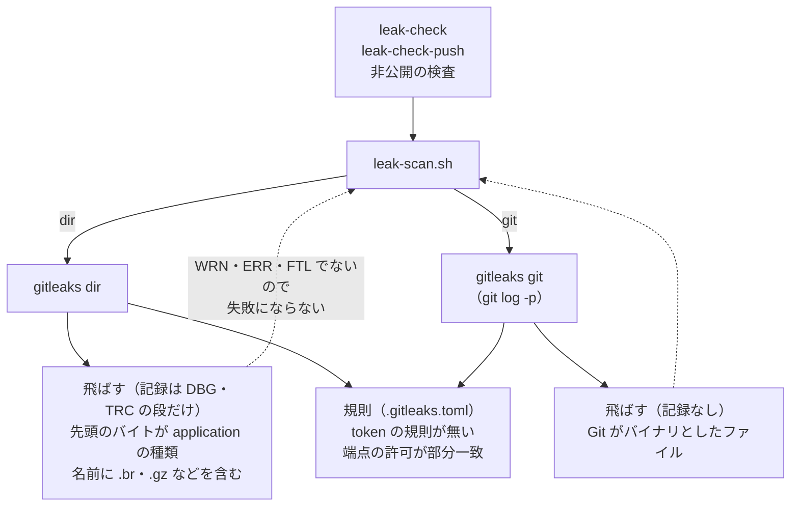
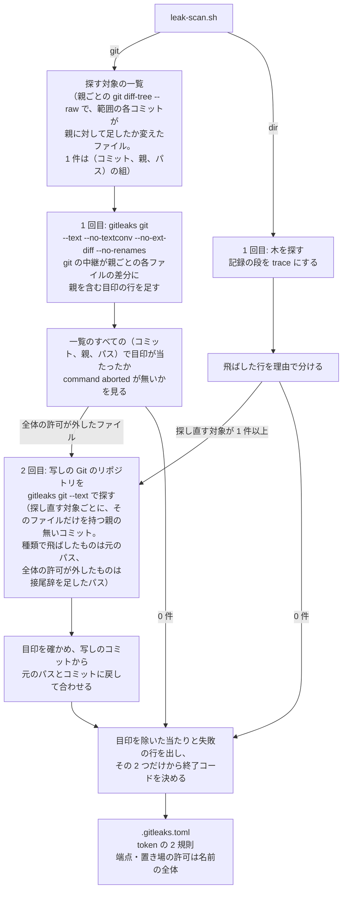
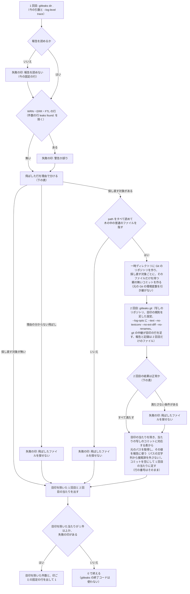

# 漏れの検査: サービスの token・バイナリのファイルの中の秘密・作り物に見せた端点を、今の木と履歴で止める（#98）

Pull Request の漏れの検査（`leak-check`）は、サービス自身の token、gitleaks が中身を読まずに飛ばすファイルの中の秘密、資源の名前に `example.com` を含む端点を通してしまい、詳細設計の 1 行もコードと食い違っている。nd-factory の規則（`.gitleaks.toml`）に token の 2 つの規則を足す。端点と S3 の置き場の作り物の許可は、名前の全体に当て、用途を説明できる作り物の名前とプレースホルダーだけに絞る。資源の ID の規則からは、関係の無いアカウント ID の例の許可を外す。`leak-scan.sh` は、履歴で探すファイルの一覧を、パッチではなく Git のコミットごとのファイルの一覧（`git diff-tree --raw`）から作る。gitleaks には履歴を Git の `--text` で読ませる。gitleaks が打つ `git log` の出力には、後述の `git` の中継（gitleaks が打つ `git log` の出力に目印の行を足す小さなスクリプト。以下「中継」）が、各ファイルの差分の末尾に探し終えたことを確かめる目印の行を足す。一覧のすべてのファイルで目印が当たったことを確かめる。今の木では、gitleaks が中身を読まずに飛ばしたファイルを、探し直すファイルを一時の Git リポジトリに複製したもの（以下「写し」）にして、同じ確かめ方で探し直す。写しのリポジトリの中の、1 つのファイルだけを持つ親の無いコミットを「写しのコミット」、そのファイルのパスを「写しのパス」と呼ぶ。gitleaks の既定の全体の許可が名前で外したファイルも、名前に接尾辞を足した写しのパスで、既定の規則で探し直す。探し直しても読めないとき、飛ばした理由が分からないとき、目印が当たらないファイルがあるとき、探し直しの結果を取れないときは、当たりが無くても失敗にする。採らなかった案は「決定の記録」に、調べた外部の資料は末尾の「外部の調査」にある。

省いた文書: 実行計画（課題 1・PR 1）
省いた文書: 並列の計画（レーン 1）

## 今の姿

何が起きたか・目的・受け入れ条件は要求仕様（[issue-98-requirements.md](./issue-98-requirements.md)、正は #98 の本文）にある。この文書は「どう解くか」と「なぜその解き方か」だけを書く。

漏れの検査には 3 つの探しがある。Pull Request の `leak-check`、main への push の `leak-check-push`、非公開の検査 `leak-check-secret` である。どれも `tools/checks/leak-scan.sh` を通して gitleaks 8.30.1 を打つ。抜けは、規則の側（`.gitleaks.toml`）と、gitleaks が中身を読まずに飛ばす所の 2 か所にある。

2026-11-25 に、手元に置いた gitleaks 8.30.1 で、乱数から作った作り物の値だけを使って次を実測した。

| # | 抜け | 根本原因 | 実測 |
| --- | --- | --- | --- |
| 1 | サービスの token が当たらない | 委任の token（`ndfd_…`）と手元のマシンの登録の token（`ndfm_…`）の規則が、既定の規則にも `.gitleaks.toml` にも無い | 要求の「事象」1 のとおり |
| 2 | 履歴で、バイナリのファイルの中の秘密が当たらない | gitleaks の履歴の探しは `git log -p` のパッチを読み、`Binary files … differ` の項目をアーカイブでなければ記録を出さずに飛ばす（`sources/git.go`）。Git がバイナリとするのは、中身に NUL を含むファイルと、`.gitattributes` で `-diff`・`binary` を付けたファイルである | 途中のコミットで足して消した 5 つのファイルのうち、NUL を含むファイル・ELF の頭を持つファイル・`-diff` を付けたテキストのファイルの 3 つが当たらない。既定の全体の許可に名前が当たらないファイル（拡張子の無い `nulfile`）に NUL と `aws_secret_access_key` の行を入れて足して消した履歴でも、既定の規則の当たりは 0 件で、`--log-opts` に `--text --no-textconv --no-ext-diff` を足すと `generic-api-key` が 1 件当たる。要求の「事象」2 の `blob.bin` は、名前が既定の全体の許可（`.bin`）にも当たるので、この測り方では履歴の読み方による抜けと区別できない |
| 3 | 今の木で、gitleaks が種類や名前で飛ばすファイルの中の秘密が当たらない | gitleaks の今の木の探しは、(a) 先頭のバイトが application の種類（ELF・RTF・`MZ` で始まる exe など）に合うファイルを DBG の段で、(b) 名前のどこかに `.br`・`.gz`・`.zip` などを含むファイルをアーカイブとして TRC の段で、中身を読まずに飛ばす（`sources/file.go`。アーカイブは名前だけで見分ける）。`leak-scan.sh` は WRN・ERR・FTL の段だけを見るので、失敗にならない | ELF の頭・RTF の頭・`MZ` で始まるテキスト・名前が `notes.zip` のテキストの 4 つが当たらない。NUL を含むだけのファイルは当たる。今の main の `packages/core/test/log.browser.test.ts` も、名前の `.browser` が `.br` を含むので (b) で飛ばされている |
| 4 | 資源の名前に `example.com` を含む端点が当たらない | `nd-aws-endpoint` の許可 `example\.com` が、資源の部分の一部に合えば端点の全体を許す | 要求の「事象」3 のとおり |
| 5 | 詳細設計が、秘密の形のデータを読む処理を 1 つだけ書く | 生成物を作るスクリプト（`packages/contracts/scripts/artifacts.ts` の 453 行目）が同じデータで公開用のダミーデータを検査することが、詳細設計の行（`docs/design/detail.md` の 291 行目）に無い | 要求の「事象」4 のとおり |

今の木の探し（`dir`）で gitleaks が飛ばすかは、NUL ではなく先頭のバイトの種類で決まる（NUL を含むだけのファイルは今も当たる）。そこで、受け入れ条件 3 の結合テストは、条件の文のとおり NUL を含むだけのファイルを置くほかに、gitleaks が実際に飛ばす形（NUL を含み ELF の頭を持つファイルなど）も置く。NUL を含むだけのファイルは条件 3 を文のとおりに確かめ、ELF の頭のファイルは探し直しの経路を確かめる。

要求の「事象」2 の `blob.bin` は、履歴の読み方による抜け（2）だけでなく、ファイル名でも検査から外れる。決定 2 で Git の差分に中身を出しても、初回の検査では gitleaks が `.bin` をファイル名で除外する（gitleaks の既定の全体の許可）。決定 6 で、除外されたファイルを再検査する。

### 同じ形の箇所

4 の部分一致の許可は、`.gitleaks.toml` のほかの規則にもある。許可の正規表現は、規則が秘密として取り出した部分に当たる。

| 規則 | 許可に渡る部分 | 部分一致で起きること | 扱い |
| --- | --- | --- | --- |
| `nd-aws-account-id`・`nd-aws-account-id-joined` | 12 桁の数 | 数だけなので、`123456789012` のほかの許可は当たり得ない。`123456789012` は 12 桁の全体と同じ | 変えない |
| `nd-aws-arn` | ARN の全体 | 資源の欄が `<名前>` などを含めば ARN を許す。ただしアカウントの 12 桁は `nd-aws-account-id` が別に当てる | 変えない |
| `nd-aws-arn-s3` | 置き場の名前 | 4 と同じ抜け（`arn:aws:s3:::data-example.com-logs` を許す。実測） | 全体に当て、用途を説明できる名前に絞る（決定 5） |
| `nd-aws-resource-id` | `vpc-` などと 16 進 | 16 進の中に `123456789012` が並ぶ実在の ID も許される。アカウント ID の例をこの規則で許す理由は無い。ほかの許可（`^acme`・`example\.com`・プレースホルダー・`EXAMPLE`）は、16 進と `-` だけの値には当たり得ない | 許可をすべて外す（決定 5） |
| `nd-aws-endpoint` | 資源の部分 | 4 の抜け | 全体に当て、用途を説明できる名前に絞る（決定 5） |

## 文脈と制約

- `leak-scan.sh` の引数と終了コードの意味（0 当たり無し・1 当たりかスキャンの失敗・2 引数の誤り）は変えない
- gitleaks は 8.30.1 のまま使う（`tools/checks/install-gitleaks.sh` が固定する版）。飛ばしたときの記録の文言は、この版のものである
- 非公開の検査の流れ（`leak-check-secret.yml`・`leak-scan-secret.sh`・`export-tree.sh` が何をどの順で探すか）は変えない。`leak-scan.sh` の変更で非公開の検査の結果が変わることは範囲に含む
- `--paths` を渡さなければ、出力にファイルの名前を出さない。当たった値は `--paths` を渡しても出さない。記録の段を DBG・TRC まで上げると、gitleaks の記録に当たった値（`finding=`）が載るので（`detect/detect.go` の 720 行目）、その記録はそのまま出さない
- テストに置く token と秘密は、テストの実行中に乱数から作る（要求の前提 2）
- 変更の後のリポジトリ自身が通る。Pull Request の `leak-check` は木と分岐点からの範囲を、マージの後の `leak-check-push` は main の全履歴を `.gitleaks.toml` で探す。最終の設定で今の main を探した結果は、まだ無い。マージしてよいかは、テスト設計の「マージの前の確認」で決める
  - 参考の測定: 2026-11-25 に、決定 5 より前の版の許可（`acme` で始まる名前を許していた）と決定 1 の規則を写した試しの設定と、`--log-opts` に `--text` などを足した `leak-scan.sh` で、今の main（`69fd0b9`）の木と全 97 コミットを探すと、新しい当たりは 0 件だった。この測定は、今の木の探し直し（決定 3・4）、目印の確かめ（決定 2）、全体の許可が外したファイルの探し直し（決定 6）を含まない
  - 今の決定 5 では、今の木の `acme` の置き場と端点の例が当たる。これらは同じ Pull Request で書き換える（決定 5）
  - 測るときは試しの設定を木の外に置いたので、木の中の `.gitleaks.toml` も探す対象に入った。この `.gitleaks.toml` 自身の当たりは数えていない。CI では `.gitleaks.toml` を `--config` に渡し、gitleaks は `--config` に渡した設定のファイルを探さないためである
- 既定の規則の設定（`tools/checks/gitleaks-default.toml`）は、`useDefault` で gitleaks の既定の全体の許可を読む。この許可は `.bin`・`.pdf`・画像・`node_modules/`・`package-lock.json` などを名前で外す（[config/gitleaks.toml](https://github.com/gitleaks/gitleaks/blob/v8.30.1/config/gitleaks.toml) の `[allowlist]`）。`[extend]` には全体の許可を外す項目が無い。今の結合テストの「既定の全体の許可がパスで外すファイルの値は当てず、同じ中身を外さないパスに置けばそちらだけ当たる」（`img/logo.png`）は、この扱いを前提にしている。決定 6 でこの扱いを変えるので、このテストは「名前を変えずに当たる」へ書き換える

## 解き方の全体像

- `.gitleaks.toml` に `nd-delegation-token`・`nd-machine-token` を足す。`nd-aws-endpoint`・`nd-aws-arn-s3` の許可を、名前の全体に当て、AWS が作成を禁じた名前・プレースホルダー・用途を説明できる個別の名前に絞る。`nd-aws-resource-id` の許可を外す
- 履歴の探しは、探す対象（範囲の各コミットで足したか変えたファイル）を `git diff-tree --raw` で決める。gitleaks の `--log-opts` には `--text --no-textconv --no-ext-diff --no-renames` を足し、Git のバイナリの判定と `.gitattributes` によらず足した行を出させる。gitleaks が打つ `git log` の出力に、`leak-scan.sh` の中継が各ファイルの差分の末尾に目印の行を足す。対象のどれか 1 つでも目印が当たらなければ、当たりが 0 件でも 1 で終える（決定 2）
- 今の木の探しは、gitleaks が中身を読まずに飛ばしたファイルを記録から集め、飛ばした理由で分ける。探し直す対象は、一時の Git のリポジトリに、対象ごとにそのファイルだけを持つ親の無いコミットとして写す。`gitleaks git` に `--text` を渡して探し、目印の行で探し終えたことを確かめる。写しでも飛ばしたとき、理由の分からない飛ばしがあるとき、目印が当たらないとき、2 回目の結果を取れないときは、当たりが 0 件でも 1 で終える
- 既定の全体の許可が名前で外したファイルは、今の木でも履歴でも、元のパスの後ろに接尾辞を足した名前で写しの Git のリポジトリに置き、既定の規則で探し直す（決定 6）
- どちらの探しでも、取れた当たりは失敗の有無によらず出す。終了コードと件数は、目印の当たりを除いた当たりと失敗の印だけから `leak-scan.sh` が決め、gitleaks の終了コードと件数の行は使わない
- `leak-scan-secret.sh` は、今失敗として見分けている 2 つの行（「警告か誤り」と「報告を読めない」）と同じく、新しい 2 つの失敗の行（飛ばしたファイルを探せない・履歴を最後まで探し終えたことを確かめられない）も失敗として見分ける
- 詳細設計の「秘密の形のデータ」の行は、データを読む処理として、実行時の `redact` と生成時のダミーデータの検査の 2 つを書く

## 処理の流れ

失敗の条件に当たっても、途中で止めずに最後まで進み、取れた当たりをすべて出してから失敗の行を出す。図の「失敗の印」は、その条件に当たったことを覚えておき、最後に 1 で終えることを表す。

今の木の探し（`dir`）の流れは次のとおりである。

図の判定「2 回目の結果は正常か」は、決定 4 の条件のうち次の表の条件のすべてを満たすかを見る。決定 4 の 1〜3 は、図の前の段（d・e・w）で見る。

| 決定 4 の番号 | 条件 | 満たさないときの扱い |
| --- | --- | --- |
| 1 | 1 回目の記録に、対象外とも探し直す対象とも分けられない飛ばした行が無い（図の d） | 失敗の印「飛ばしたファイルを探せない」を立て、2 回目へ進まず出力へ進む |
| 2 | 探し直す対象の `path` をすべて読め、木の中の普通のファイルを指す（図の e） | 失敗の印「飛ばしたファイルを探せない」を立て、2 回目へ進まず出力へ進む |
| 3 | 写しのリポジトリを作れ、写しを書け、コミットできる（図の w） | 失敗の印「飛ばしたファイルを探せない」を立てる |
| 4 | 2 回目の gitleaks の終了コードが 0 か 1 | 失敗の印「飛ばしたファイルを探せない」を立て、取れた当たりを出す |
| 5 | 2 回目の報告を読める | 同上 |
| 6 | WRN・ERR・FTL の行（件数の行を除く）が無い | 同上 |
| 6 | `command aborted` の行が無い | 同上 |
| 6 | 飛ばした行が無い（表の対象外の行と、接尾辞を足しても全体の許可に当たる写しの行を除く） | 同上 |
| 8 | 写しのコミットのすべてで目印が当たった（接尾辞を足しても全体の許可に当たる写しを除く） | 同上 |
| 7 | 当たりの（写しのコミット、パス）が写しの一覧にある | 同上 |

1 回目の記録の飛ばした行は、gitleaks 8.30.1 の文言（[sources/files.go](https://github.com/gitleaks/gitleaks/blob/v8.30.1/sources/files.go)・[sources/file.go](https://github.com/gitleaks/gitleaks/blob/v8.30.1/sources/file.go)・`detect/detect.go`）で次のように分ける。対象外とするのは、意図して外したものと、リポジトリの中身として読むものが無いものだけである。それ以外で中身を読まなかったものは、探し直すか失敗にする。

| 記録の文言 | 段 | 扱い | 理由 |
| --- | --- | --- | --- |
| `skipping binary file` | DBG | 探し直す（写しの Git のリポジトリ） | 先頭のバイトの種類で飛ばした。履歴のパッチのテキストとして読めば、種類を判定されない |
| `skipping archive: exceeds max archive depth` | TRC | 探し直す（写しの Git のリポジトリ） | 名前でアーカイブと見なした。履歴のパッチのテキストとして読めば、名前でアーカイブと見なされない |
| `skipping file: global allowlist` | DBG・TRC | 探し直す（写しの Git のリポジトリ。元のパスの後ろに接尾辞 `.leak-scan` を足したパス） | 設定の全体の許可が名前で外した。中身に秘密があっても探されない（決定 6） |
| `skipping directory: global allowlist` | DBG | 対象外 | 依存のディレクトリ（`node_modules/`・`vendor/` など）を、ディレクトリごと意図して外した（決定 6） |
| `skipping file: matches config or baseline path` | TRC | 対象外 | `--config` に渡した設定のファイル自身（基準の報告を渡したときはそのファイルも）を、gitleaks が探す対象から外した（[detect/detect.go](https://github.com/gitleaks/gitleaks/blob/v8.30.1/detect/detect.go#L294-L298)）。CI は木の中の `.gitleaks.toml` を `--config` に渡すので、毎回この行が出る |
| `skipping file: rule allowlist` | TRC | 対象外 | 規則ごとの許可がパスかコミットで外した。ファイルは読めていて、その規則だけを当てない（[detect/detect.go](https://github.com/gitleaks/gitleaks/blob/v8.30.1/detect/detect.go#L386-L390)） |
| `skipping finding: …` | TRC | 対象外 | ファイルは読めている。当たりを規則の許可やエントロピーの判定で外した記録である |
| `skipping empty file`・`skipping empty fragment` | DBG・TRC | 対象外 | 中身が無い |
| `skipping finding links: …` | DBG | 対象外（2 回目だけに出る） | 写しのリポジトリにリモートが無いので、当たりのリンクを作らなかった。ファイルは読めている |
| `skipping symlink: follow symlinks disabled`・`skipping symlink: target is directory` | DBG | 対象外 | リンク自身は中身を持たない。指す先が木の中のファイルなら、そのファイルとして別に探される |
| WRN・ERR の段の `skipping …`（大きすぎる・読めない・アーカイブの種類が分からないなど） | WRN・ERR | 失敗（今の「警告か誤り」） | 今の扱いのまま |
| 上のどれでもない、`skipping` で始まる DBG・TRC の行 | DBG・TRC | 失敗（飛ばしたファイルを探せない） | gitleaks の版を上げて文言が増えたときに、黙って通さない |

履歴の探し（`git`）が最後まで終えたかは、gitleaks の内部の Git の終了コードだけでは分からない。Git が 0 で終えても、gitleaks がパッチを読む部品（go-gitdiff）が途中で読むのをやめることがあるためである（下の 2 つ目）。そこで、次の 2 つを両方確かめる。

1. **内部の Git が途中で止まっていない**: gitleaks 8.30.1 は、内部の `git log` が 0 以外で終えたとき、その誤りを DBG の段の `command aborted` だけで記録し、当たりが無ければ 0 で終える（[sources/git.go](https://github.com/gitleaks/gitleaks/blob/v8.30.1/sources/git.go) の `Fragments`）。そこで記録の段を trace にし、この行があれば失敗にする。内部の Git の標準エラーの行（ERR の段の `[git] …`）は、今の「警告か誤り」で失敗になる
2. **探す対象のすべてのファイルを、gitleaks が読み終えた**: go-gitdiff 0.9.1 の `Parse` は、ファイルの見出しを解析できないとそのファイルを黙って飛ばし、差分の本体を解析できないとそこで読むのをやめる。どちらも誤りを呼び出し元へ返さない（[gitdiff/parser.go](https://github.com/gitleaks/go-gitdiff/blob/v0.9.1/gitdiff/parser.go#L18)）。Git は出力を書き終えて 0 で終えるので、1 では見分けられない。そこで、決定 2 の目印の行で、ファイルごとに読み終えたことを確かめる

どちらかに当たれば、当たりの有無によらず新しい固定の行（例: `leak-scan: 履歴を最後まで探し終えたことを確かめられなかった`）を出して 1 で終える。今の木の探し直し（2 回目）でも、同じ 2 つを確かめ、当たれば「飛ばしたファイルを探せない」の行で 1 で終える。

目印の行による確かめ方は次のとおりである。今の木の探し直しと、全体の許可が外したファイルの探し直しも、同じ確かめ方を使う。

- **探す対象の一覧**: 対象の 1 件は（コミット、親、パス）の組である。マージのコミットでは、同じパスでも親ごとの差分を別の対象にする。パッチの表示は使わず、次の手順で作る。
  1. 範囲の各コミットと親を `git rev-list --parents` で取る（範囲が無ければ `HEAD` から到達できるすべて）
  2. コミットごと、親ごとに `git diff-tree -r -z --raw --no-renames <親> <コミット>` を打つ。親の無いコミットは `git diff-tree -r -z --raw --no-renames --root <コミット>` を打つ
  3. 打った結果から、その親に対して足したか変えたファイル（`A`・`M`・`T`）のパスと新しい blob を取る
  4. 親の欄に、マージのコミットでは親のハッシュを、親が 1 つか無いコミットでは `none` を入れる。中継が見る `git log -m -p` の出力は、マージのコミットにだけ親を示すためである
  5. 次の表のものを除く

  | 除くもの | 除く理由 | 除く先 |
  | --- | --- | --- |
  | サブモジュール（モード `160000`） | 中身を持たない | 一覧から除く |
  | 新しい blob が空のファイル | 足した行が無い | 目印の確かめから除く |
  | モードだけを変えたファイル（古い blob と新しい blob が同じ） | 足した行が無い | 目印の確かめから除く |
- **目印の規則**: 目印の行は、実行ごとに乱数から作った文字列に、親の欄と固定の語 `end` を続けたもの（`leak-scan-marker-<32 字の 16 進>-<親の欄>-end`）である。この形だけに当たる規則 `leak-scan-marker` を、一時ディレクトリの設定のファイルに置く。規則の `secretGroup` で、秘密として伏せる部分を末尾の `end` だけにする。gitleaks の `--redact` は秘密の部分だけを伏せるので、報告の `Match` に親の欄が残り、目印の当たりを（コミット、親、パス）で引ける。2026-11-25 に実物の gitleaks 8.30.1 で、2 つの親の両方と中身が違うマージのコミットを `--redact=100` で探し、同じファイルの 2 つの目印の `Match` に、それぞれの親のハッシュが残ることを確かめた。この設定は `[extend] path` で渡された設定を読み、gitleaks にはこの設定を `--config` で渡す。渡された設定の規則と許可はそのまま効く。gitleaks の `[extend]` は 2 段まで読むので、`gitleaks-default.toml`（既定を読む）と、非公開の検査の重ねた設定（`.gitleaks.toml` を読む）も読める（[config/config.go](https://github.com/gitleaks/gitleaks/blob/v8.30.1/config/config.go) の `maxExtendDepth`）
- **git の中継**: 一時ディレクトリに `git` という名前の小さなスクリプトを置き、gitleaks を打つときだけ `PATH` の先頭に足す。中継は、`log -p` で呼ばれたときだけ、本物の Git（中継を足す前に `command -v git` で決めたパス）の出力を読み、各ファイルの差分の最後の hunk の後ろに、目印の行を 1 行足す hunk を足す。親の欄は、`-m` がマージのコミットの親ごとの差分の頭に出す `commit <コミット> (from <親>)` の行から読み、`(from …)` の無いコミットでは `none` にする。ほかの呼び出しは本物の Git にそのまま渡す。差分の中の行は必ず ` `・`+`・`-`・`\` で始まり、hunk の行の数は `@@` の見出しにあるので、中継はファイルの境を中身に惑わされずに見分けられる。読めない形の行があれば、中継は 0 以外で終える（gitleaks は `command aborted` を記録するので、1 で失敗になる）。中継は、目印を足したファイルの（コミット、親、パス）を一時のファイルに書く。パスは Git の引用の形（`"…"` と `\` の並び）を戻してから書く
- **渡された設定のファイル**: gitleaks は `--config` に渡した設定のファイル自身を探さない（[detect/detect.go](https://github.com/gitleaks/gitleaks/blob/v8.30.1/detect/detect.go#L294-L298)）。ここでは `--config` に、木の中の `.gitleaks.toml` ではなく、目印の規則を足した一時の設定を渡す。そのため、木の中の `.gitleaks.toml` は「渡された設定のファイル」と見なされず、探す対象に入ってしまう。今の振る舞い（設定のファイル自身を探さない）を保つため、渡された設定のファイルが探す木の中にあれば、中継はその差分を出力から除き、探す対象の一覧からも除く
- **照らし合わせ**: 探す対象の一覧と、中継の一覧・gitleaks の記録・報告を、次の 4 項目で突き合わせる。
  - **確認 1（中継の一覧）**: 探す対象の一覧の、目印の確かめから除いたもの以外の（コミット、親、パス）が、すべて中継の一覧にあることを確かめる
  - **確認 2（目印の当たり）**: 確認 1 の対象のすべてに、コミットとパスが同じで `Match` の親の欄も同じ `leak-scan-marker` の当たりがあることを確かめる。マージのコミットの同じパスで、一方の親の目印だけが当たっても、もう一方の親の対象は当たり無しとして扱う
  - **当たりが無い対象の振り分け**: 確認 2 で当たりが無かった対象を、次の表のとおりに扱う。gitleaks 8.30.1 は `skipping file: global allowlist` の行にコミットの SHA も出す（[detect/detect.go](https://github.com/gitleaks/gitleaks/blob/v8.30.1/detect/detect.go#L261-L282)）ので、パスだけでは照合しない。同じパスの別のコミットの行は使えない

    | 当たりが無い対象の状況 | 扱い |
    | --- | --- |
    | gitleaks の記録に、同じコミットと同じパスの組の `skipping file: global allowlist` がある | 決定 6 の探し直しに回す |
    | 記録の行からコミットとパスの組を読めない（一致を確かめられない） | 探し直しに回さず失敗にする |
    | 上の 2 つのどちらでもない | 失敗にする |

  - **出力からの除外**: `leak-scan-marker` の当たりは、出力と `--report` から除き、件数にも数えない（下の「終了コードと件数」）
- **変更後のバイナリの blob 全体の探し**: gitleaks の Git モードは hunk ごとに足した行だけを探すので、変更前からあった行と今回足した行にまたがる秘密（複数行の鍵など）は、目印が当たっても探されない。そこで、探す対象のうちバイナリのものは、足した行の探しに加えて、そのコミットの変更後の blob 全体も探す。テキストのファイルの複数行の秘密は、この設計の範囲外とする（今の `git` の探しと同じ）。履歴の探しは、次の 3 つに分かれる。

  | 探し | 対象 | 方法 | 当たりの出し方 |
  | --- | --- | --- | --- |
  | 足した行の探し | 探す対象の一覧のすべて | 1 回目の `gitleaks git` が、hunk ごとに足した行を探す | 元のコミット・元のパス・元の行の番号のまま出す |
  | blob 全体の探し | 探す対象のうちバイナリのもの（下の判定の条件）。全体の許可が名前で外すファイルは含めない | そのコミットの変更後の blob（`git diff-tree` の一覧の新しい blob を `git cat-file blob` で読む）を、決定 3 の写しのリポジトリに、親の無い写しのコミットとして置いて探す | 元のコミットと元のパスで出す |
  | 全体の許可で外れたファイルの探し（決定 6） | `.bin`・`.pdf`・画像など、全体の許可が元のパスを外すファイル。足した行の探しで目印が当たらず、記録に同じコミットとパスの組の `skipping file: global allowlist` が出たものである。接尾辞を足しても全体の許可に当たるパス（依存のディレクトリなど）は、決定 6 のとおり対象外にする | blob 全体を、接尾辞を足した写しのパスに置いて、既定の規則で探す。blob の全行を探すので、blob 全体の探しを兼ねる | 写しのコミットから元のパス（接尾辞を外したもの）と元のコミットに戻して出す |

  - **バイナリと判定する条件**: 次の 3 つのどれか 1 つに当たれば、バイナリとして扱う。どの条件に当たっても、読む blob は同じで、`git diff-tree` の一覧にある新しい blob を `git cat-file blob` で読む

    | 条件 | 確かめ方 |
    | --- | --- |
    | Git が数えられないファイル | `git diff-tree -r -z --numstat --no-renames`（親の無いコミットは `--root` を付ける）の追加行の欄が `-` |
    | `-diff` 属性が付いたファイル | 元のリポジトリで `git check-attr diff -- <パス>` が `unset` を返す |
    | NUL を含むファイル | blob に NUL のバイトがある |

  - **写しに置くパス**: 元のパスのまま置く。接尾辞 `.leak-scan` は足さない。パスを条件にする規則と許可が、足した行の探しと同じ結果になるためである
  - **元のコミットの許可**: 写しのコミットのハッシュは元と違うので、そのままではコミットを条件にする許可（決定 5 の許可 5）が元のコミットに効かない。決定 3 の中継が、写しの探しで `git log` の出力の `commit <写しのハッシュ>` の行を元のコミットのハッシュに書き換える。gitleaks は許可を報告の前に当たりごとのコミットで評価するので（[detect/detect.go](https://github.com/gitleaks/gitleaks/blob/v8.30.1/detect/detect.go)）、報告の時点で戻すのでは間に合わない。書き換えれば、元のコミットに対する許可が写しの検査にも同じに効き、報告のコミットも元のままになる
- 1 回目に足した `--log-opts` の `--no-renames` は、名前を変えたファイルを、消したファイルと足したファイルとして出させる。`git diff-tree --no-renames` の一覧と同じ単位にそろえるためである。名前を変えたファイルは、中身の全体を足した行として探す

gitleaks の記録と報告は、今の木と履歴のどちらの探しでも、次のとおりに扱う。

- 件数の行（`leaks found: <件数>`）は、今の `log_has_skipped` と同じく、行の全体がその形のときだけ除く。1 回目と 2 回目のどちらに当たりがあっても、この行で失敗の印を立てない
- 段を上げた gitleaks の記録は、同じ一時ディレクトリの中のファイルに受ける。`--paths` を渡したときに標準エラーへ出すのは、INF・WRN・ERR・FTL の段の行だけにする。ただし件数の行は、目印の当たりを含む gitleaks の生の件数なので出さない。`--paths` を渡さないときは、今と同じく gitleaks の記録を出さない
- **終了コードと件数**: `leak-scan.sh` の終了コードと件数は、目印の当たりを除いた当たりと失敗の印だけから決める。gitleaks は目印の当たりも当たりとして数えるので、秘密の無い普通の変更でも 1 で終え、件数の行に目印の数を出す。2026-11-25 に実物の gitleaks 8.30.1 で、秘密の無い 2 つのコミットの履歴を目印つきで探すと、1 で終えて `leaks found: 4` を出し、報告の 4 件はすべて `leak-scan-marker` だった。秘密の無い ELF の頭のファイル 1 つを置いた写しのリポジトリでも、1 で終えて `leaks found: 1` を出した。どちらも、目印を除いた当たりは 0 件で、目印は対象のすべてで当たった。そこで次のとおりにする
  - gitleaks の終了コードは、0 か 1 なら「最後まで動いた」とだけ見なし、当たりの有無の判断には使わない。0 と 1 のほかなら失敗の印を立てる（今の木の探し直しでは決定 4 の 4）
  - 目印を除いた当たりが 1 件以上か、失敗の印があれば 1 で終える。どちらも無ければ、gitleaks が 1 で終えていても 0 で終える。今の `finish` の、当たりが無いときに gitleaks の終了コードをそのまま返す処理は使わない
  - 出す件数は `leak-scan: 当たり <目印を除いた件数> 件` だけにする。gitleaks の件数の行（`leaks found: <件数>`）は、`--paths` を渡しても出さない
- gitleaks の生の報告（`--report-path`）と記録は、実行ごとに別のファイルに受ける（例: `report-1.json`・`log-1`・`report-2.json`・`log-2`）。2 回目を打つ前に、2 回目の報告のファイルが無いことを確かめる。2 回目の報告のファイルが無いか読めないときは、1 回目の報告で代えずに「飛ばしたファイルを探せない」で失敗にする。今の `finish` のように報告と記録のパスを 1 つの変数で持ち回らない
- 段の判定は、色を付ける制御の文字の並び（ANSI のエスケープシーケンス）を外した行の 2 つ目の語（時刻の次）で行う。DBG・TRC の行の本文に `WRN` などの語があっても、警告と見なさない

## 決定の記録

各決定の「根拠」に挙げた Value は、プロジェクト MVV（バージョン 3。[.ndf/mvv.md](https://github.com/devbasex/nd-factory/blob/main/.ndf/mvv.md)）の次の項目である。

| Value | 中身（要約） | この設計で効く所 |
| --- | --- | --- |
| 7 公開を前提に、値を置かない | 公開のリポジトリに、インフラの実際の値と秘密の値を置かない。例・テスト・見本には作り物の値だけを使い、混入は漏れの検査などで機械的に止める | すべての決定。止める値を増やし、探せなかったときに通さない |
| 13 重複と冗長を作らない | 同じ規則・定数・処理は 1 か所に置き、ほかから参照する。定義から作れるものは手で写さない | 決定 6（gitleaks の既定の規則を写して持たない）・決定 7（失敗の見分けを `leak-scan-secret.sh` の 1 か所の文言の一覧に足す） |
| 15 車輪の再発明をしない | 広く使われ保守が活発なライブラリやサービスを設計の時点で調べ、あれば使う。自前の実装は避け、調べた候補と選んだ理由を設計文書に書く | 決定 2（Git の `--text` を使い、blob を自前で書き出さない）。候補は「外部の調査」にある |
| 17 目先の手間より、長く良い形を選ぶ | より堅牢で長く保守しやすい作り方を選ぶ。書き換える手間は、選ばない理由にしない | 決定 3（飛ばしたファイルを名前の変更で避けさせず、検査の側で探し直す） |

### 決定 1: サービスの token を形が少し変わっても止めるため、秘密の部分の長さで当てる 2 つの規則を `.gitleaks.toml` に置く

- **質問**: 委任の token と手元のマシンの登録の token を、どの形で、どの設定のファイルで当てるか
- **選んだ案**: `.gitleaks.toml` に `nd-delegation-token`（`ndfd_`）と `nd-machine-token`（`ndfm_`）の 2 つの規則を足す。形は「語の境（`\b`）の後に頭（`ndfd_` か `ndfm_`）、英数字と `_`・`-` の並び、`.`、同じ並び、`.`、base64url の文字が 32 字以上」とする。ID の部分の形（`usr_` と UUID など）は問わない。許可は持たない（プレースホルダー `<…>`・`${…}` は文字の種類で外れ、`EXAMPLE` のような短い作り物は 32 字に届かない）
- 採らなかった案: 今の token の形（`usr_<UUIDv7>`・秘密の部分 43 字）に正確に合わせる（ID の形や長さが変わったときと、記録に途中まで写った token を逃す）
- 採らなかった案: 既定の規則の設定（`tools/checks/gitleaks-default.toml`）に置く（このファイルの冒頭のコメントが、既定の規則の許可を外すためだけに使うと決めている。要求の起票者の推定 S2）
- **代償**: `ndfd_`・`ndfm_` で始まり、3 つ目の部分が 32 字以上の base64url の文字の、token でない文字列も当たる。今の木と main の全履歴には無い（実測）
- 作り方: ライブラリやサービスを使う
- 比べた候補: LIB1 / LIB2
- 根拠: Value 7（MVV バージョン 3）

### 決定 2: 履歴で探す対象をパッチと別に決め、そのすべてを gitleaks が読み終えたことを目印の行で確かめる

- **質問**: 履歴の探しで、Git がバイナリとしたファイルの中身をどう探し、探す対象をどう決め、すべて探し終えたことをどう確かめるか
- **選んだ案**: 次の 3 つを組み合わせる。仕組みの詳しい形は「処理の流れ」にある
  1. **探す対象をパッチの表示に頼らずに決める**: 範囲の各コミットが足したか変えたファイルを、`git diff-tree --raw` のファイルの一覧（パスと blob）から決める。受け入れ条件 2 の「スキャンの対象は `git log -p` のパッチの表示に頼らずに決める」を、文のとおりに満たす
  2. **バイナリのファイルの中身も gitleaks に読ませる**: `leak-scan.sh` が gitleaks に渡す `--log-opts` に `--text --no-textconv --no-ext-diff --no-renames` を足す。Git がバイナリと判定したファイルも、足した行をパッチに出させる（STD1）。gitleaks は `Binary files … differ` の項目を受け取らないので、飛ばす経路を通らない。足した行を探し、当たりのコミットと行の番号を元のリポジトリのまま報告する点は今と同じである
  3. **1 の対象のすべてを読み終えたことを確かめる**: gitleaks が打つ `git log` の出力に、`leak-scan.sh` の中継が、ファイルごとに目印の行を 1 行足す。1 の対象のどれか 1 つでも、中継の出力に無いか、目印が当たらなければ、当たりの有無によらず 1 で終える。gitleaks のパッチを読む部品（go-gitdiff）が途中で黙って読むのをやめても、Git が 0 で終えても、これで見分けられる
- 採らなかった案: パッチを読むだけにして、探す対象の決め方と読み終えたことの確かめを持たない（この設計の前の版）。受け入れ条件 2 の文を「バイナリの判定で対象から外れない」と読み替えないと満たせない。go-gitdiff が途中で読むのをやめたとき、Git は 0 で終えるので見逃す
- 採らなかった案: 範囲の各コミットの blob を書き出し、ファイルとして `gitleaks dir` で探す（非公開の検査が履歴を探すときの `history` と同じ形）。`gitleaks dir` は先頭のバイトの種類と名前で飛ばすので、決定 3 の探し直しが履歴の全体に要る。blob の全行を探すので、前から在る行も、そのファイルを変えたコミットの当たりとして重ねて出る。当たりのコミットを gitleaks が知らないので、コミットを条件にする許可（決定 5 の許可 5）が効かない。範囲を持たない main への push の探しでは、書き出す量が履歴の全体になる
- 採らなかった案: 範囲の各コミットの変更を写しの Git のリポジトリに作り直し、目印をファイルに足して探す。写しのコミットは元と別のハッシュになるので、コミットを条件にする許可（決定 5 の許可 5）が効かない。中継で出力に足せば、元のコミットのハッシュのまま探せる
- 採らなかった案: 鍵の格納ファイルの拡張子（`.p12`・`.pfx`・`.jks`・`.keystore` など）を拒む（拡張子の無いファイルとほかの拡張子のバイナリを逃す。中身を探せば、拡張子を拒む必要が無い）
- **代償**: 足したバイナリのファイルの全バイトがパッチに載るので、大きなバイナリを足した範囲ほど探す時間が延びる。今の main の全履歴に、Git がバイナリとする項目は 0 件である（`git log -m --numstat`）。`--no-renames` で、名前を変えたファイルは中身の全体を足した行として探すので、名前の変更が多い範囲ほど時間が延びる。中継は `git log -p` の出力の形（ファイルの見出し・`@@` の見出し・行の頭の 1 字）を読むので、Git がこの形を変えると中継が読めずに失敗で止まる（通らないが見逃さない）。内部の `git log` の失敗を、gitleaks 8.30.1 の記録の文言（`command aborted`）で見分けるので、版を上げて文言が変わると見分けられなくなる。テスト用の偽の `git` で途中で止める結合テストが、版を上げる Pull Request で落ちる。目印で確かめる部分は文言に頼らない
- 作り方: ライブラリやサービスを使う・自前で作る（中継と照らし合わせ）
- 比べた候補: STD1 / LIB1 / LIB2
- 根拠: Value 7・Value 15（MVV バージョン 3）。STD1

### 決定 3: 今の木で飛ばされたファイルを探すため、gitleaks の記録から集めて写しで探し直す

- **質問**: 今の木で gitleaks が中身を読まずに飛ばすファイル（先頭のバイトの種類・アーカイブに見える名前）を、どう探すか
- **選んだ案**: 飛ばしたファイルを、一時の Git のリポジトリに元のパスのまま写し、gitleaks の履歴の探しで読み直す。履歴の探しは、テキストのパッチの足した行を、ファイルの種類もアーカイブに見える名前も確かめずに探すためである（[sources/git.go](https://github.com/gitleaks/gitleaks/blob/v8.30.1/sources/git.go#L327-L333) は Git がバイナリとした項目だけをアーカイブか確かめ、テキストのパッチは [L390-L404](https://github.com/gitleaks/gitleaks/blob/v8.30.1/sources/git.go#L390-L404) で元のパスと新しい側の行の番号のまま渡す）
  - 1 回目は今と同じく木を探す。このとき gitleaks の記録の段を trace にする
  - 記録の飛ばした行を「処理の流れ」の表で分け、探し直す対象の行から `path` を取る。記録の行の項目を解析して `path` の値を取り、項目の並びには頼らない（アーカイブの行には `path` のほかに `max_archive_depth` があり、規則の許可の行には `rule-id` などが続く）。値に空白などを含むときは Go の引用の形になる。取り方は、実物の gitleaks 8.30.1 の記録で結合テストが確かめる
  - 1 件以上あれば、一時ディレクトリ（`mktemp -d`。終わりに消す）に Git のリポジトリを作る。探し直す対象ごとに、そのファイル 1 つだけを持つ親の無いコミットを作り、写しと対象を 1 対 1 に対応させる。ファイルは、木の根からの元の相対パスに中身を変えずに置く（全体の許可が外したファイルは、元のパスに接尾辞を足したパスに置く。決定 6）。1 つのコミットにすべての写しを置くと、2 つの写しが同じパスになったときに一方が上書きされ、上書きされた側を探さずに通してしまう。たとえば、木に `a.bin`（全体の許可が外す）と、ELF の頭を持つ `a.bin.leak-scan`（種類で飛ばす）があると、どちらの写しも `a.bin.leak-scan` になる。履歴の探し直し（決定 6）でも、同じパスを変えた複数のコミットの blob が同じパスになる。対象ごとに別のコミットにすれば、写しのパスが同じでもコミットで区別できる
  - 写しのコミットは作業ツリーを使わずに作る。対象ごとに、中身を `git hash-object -w` で写しのリポジトリに入れ、写しのリポジトリのインデックスを `git read-tree --empty` で空にしてから `git update-index --add --cacheinfo` でそのファイルだけを登録し、`git write-tree` と `git commit-tree`（親を渡さない）でコミットを作る。コミットの本文に対象の番号を入れ、同じ中身とパスの対象でも別のコミットのハッシュにする。作ったコミットは `refs/leak-scan/<番号>` に置き、2 回目の `--log-opts` に `--all` を渡して、すべての写しのコミットを探させる。作者の名前と日時は環境変数（`GIT_AUTHOR_NAME` など）で固定の作り物の値を渡す。作者のメールアドレスだけは、対象の番号を入れた `<番号>@leak-scan.invalid` にする。報告の `Email` から対象を引くための印である（次の「元のコミットの許可」）。対象の番号から（元のコミット、親、元のパス、写しのパス）を引く表を、一時のファイルに持つ。`.gitattributes` は写さない
  - **写しのリポジトリは、元のリポジトリと切り離して扱う**: Git のフックから呼ばれたときなどは、呼び出し元の環境に元のリポジトリを指す `GIT_DIR`・`GIT_WORK_TREE`・`GIT_INDEX_FILE` などが残っている。これを引き継ぐと、写しのための `git update-index`・`git update-ref` などが元のリポジトリのインデックスと参照に書き込む。そこで、写しのリポジトリの初期化と、写しのコミットを作る操作と、2 回目の gitleaks（とその中で打たれる Git）のすべてを、次の環境で打つ。(1) `git rev-parse --local-env-vars` が挙げる変数（`GIT_DIR`・`GIT_WORK_TREE`・`GIT_INDEX_FILE`・`GIT_OBJECT_DIRECTORY`・`GIT_COMMON_DIR`・`GIT_CONFIG_PARAMETERS` など、リポジトリを指す変数の一覧を Git 自身が出す）をすべて外す。(2) 利用者とシステムの Git の設定を読まない（`GIT_CONFIG_GLOBAL=/dev/null`・`GIT_CONFIG_NOSYSTEM=1`）。利用者の設定が写しの中身を変えないためである。(3) Git には `-C <写しのディレクトリ>` を、gitleaks には写しのディレクトリを、明示して渡す。1 回目（元の木と元のリポジトリの探し）は、今と同じく呼び出し元の環境のまま打つ
  - 2 回目は、`gitleaks git` を写しのリポジトリに打つ。設定は、渡された設定に目印の規則を足した一時の設定（「処理の流れ」）にし、ほかの引数は 1 回目と同じにする。ただし、生の報告（`--report-path`）と記録は 2 回目だけのファイルに受け、1 回目のファイルを共用しない（「処理の流れ」）。`--log-opts` には決定 2 と同じ `--text --no-textconv --no-ext-diff --no-renames` を渡し、決定 2 の中継で各ファイルに目印の行を足す。探し直す対象のどれか 1 つでも目印が当たらなければ失敗にする。go-gitdiff が途中で読むのをやめたときに、探し直す対象の残りを見逃さないためである。パスが元のままなので、パスを条件にする規則（`.p12` の名前などで当てる規則）と、規則の許可のうちパスで外すものが、先頭のバイトで飛ばしたファイルにも名前でアーカイブと見なしたファイルにも効く
  - **元のコミットの許可**: 元のコミットの SHA を条件にする許可（決定 5 の許可 5）が、写しの探しでも効くように、中継が写しの `git log` の出力の `commit <写しのハッシュ>` の行を、`commit <元のコミットのハッシュ>` に書き換える。ハッシュは、その行の次の `Author:` の行のメールアドレスの番号から表で引く。gitleaks は許可を報告を作る前に当たりごとのコミットで評価するので（[detect/detect.go](https://github.com/gitleaks/gitleaks/blob/v8.30.1/detect/detect.go)）、報告のときに戻すのでは許可が写しのハッシュで評価されてしまう。書き換えると、報告の `Commit` も元のコミットになる。同じコミットの 2 つの写し（たとえば `a.bin` と元から `a.bin.leak-scan` で終わるファイル）は、`Commit` と `File` が同じになりうるので、報告の `Email` の番号で対象を区別する
  - 2026-11-25 に、手元の gitleaks 8.30.1 で確かめた。コミットを条件にする許可を持つ設定で、同じ形の秘密を持つ 2 つの元のコミット（許可に載せたものと載せないもの）を、それぞれ親の無い写しのコミットにして探した。書き換えが無いと、どちらも写しのハッシュで当たりになった。書き換えると、許可に載せたコミットの写しは当たりにならず、載せないコミットの写しは元のコミットのハッシュで当たりになった。規則ごとの許可（`condition = "AND"` で `commits` と `regexes` を並べたもの）でも同じで、許可の対象の秘密だけが外れ、目印の当たりは残った
  - 2 回目の当たりは、目印の当たりを除き、当たりの `Email` の番号から表で元のパスを取得し、その値を報告に使う。報告されたパスの文字列から接尾辞を一律に外さない（元から `.leak-scan` で終わるファイルの写しと、接尾辞を足した写しが同じパスになるため）。行の番号は変えずに、コミットを空にして 1 回目の当たりに足す。各写しは親の無いコミットで全行を足すので、パッチの新しい側の行の番号は元のファイルの行の番号と同じである。目印の行は各ファイルの最後の行の後ろに足すので、元の行の番号を変えない。パスだけで当てる規則の当たりは、gitleaks が行の番号を設定しない（`0` のまま。[detect/detect.go](https://github.com/gitleaks/gitleaks/blob/v8.30.1/detect/detect.go#L394-L414)）ので、そのまま出す
  - 2026-11-25 に、手元の gitleaks 8.30.1 で、乱数から作った作り物の token を入れた ELF の頭の `keys/a.p12`・テキストの `notes.zip`・テキストの `keys/b.p12.gz` を写しのリポジトリに置いて探した。3 つとも token の規則が元のパスと元の行の番号で当たり、パスだけの規則（`\.p12`）は `keys/a.p12` と `keys/b.p12.gz` に行の番号 0 で当たった
- 採らなかった案: 頭に空の行を 1 つ足した写しを置いて `gitleaks dir` で探し直す。先頭のバイトで飛ばしたファイルは元のパスに、名前でアーカイブと見なしたファイルは `1`・`2`・… の名前で置く（番号の写しと元のパスの写しが同じパスになりうる。木の根に `1` という名前の ELF の頭のファイルがあると、`foo.zip` の写し `1` が上書きされ、上書きされた側の中身を探さずに 0 で通る。番号の名前ではパスを条件にする規則が効かず、名前がアーカイブに見える鍵のファイルを逃す。行の番号を 1 つ引いて戻す必要があり、パスだけの当たりは行の番号を持たないので、一律に引くと負の行の番号を報告する）
- 採らなかった案: 木のすべてのファイルを写しのリポジトリに入れて探す（飛ばしたファイルが無い大半の探しでも、木の全体の写しとコミットで時間が延びる。シンボリックリンクの扱いなど、今の木の探しの結果が変わる）
- 採らなかった案: NUL を含むファイルを `leak-scan.sh` が自分で選んで探し直す（gitleaks は NUL では飛ばさず、先頭のバイトの種類と名前で飛ばすので、RTF・`MZ` で始まるテキスト・`.br` を含む名前を逃す。実測）
- 採らなかった案: gitleaks の `--max-archive-depth` でアーカイブを開く（gitleaks はアーカイブを名前だけで見分けるので、`log.browser.test.ts` を Brotli として開こうとして誤りになる）
- **代償**: 飛ばしたファイルの特定を、gitleaks 8.30.1 の記録の文言に頼る。2 回目は、gitleaks の履歴の探しがテキストのパッチの種類と名前を確かめないことに頼る。版を上げてどちらかが変わると、飛ばしたファイルが再び探されなくなるか、2 回目でも飛ばして失敗になる。実物の gitleaks で ELF の頭・RTF の頭・`.br` を含む名前・アーカイブに見える名前の鍵のファイルを当てる結合テストが `leak-check` の中で走るので、版を上げる Pull Request で落ちる。写しの Git のリポジトリを作るので、飛ばしたファイルがあるときは 1 回目の後に写しとコミットの時間がかかる（今の main では 1 ファイル）
- 作り方: 自前で作る・ライブラリやサービスを使う
- 比べた候補: LIB1 / LIB2 / PRD1
- 根拠: Value 7・Value 17（MVV バージョン 3）

### 決定 4: 探し直しても読めないファイルを見逃さないため、当たりの有無によらず固定の行で失敗にする

- **質問**: 探し直しても中身を読めないファイルや、飛ばしたファイルを特定できないときをどう扱い、何を出すか
- **選んだ案**: 次のどれかに当たれば、当たりの有無によらず 1 で終える。取れた当たりは先に出す
  1. 1 回目の記録に、対象外とも探し直す対象とも分けられない飛ばした行がある（「処理の流れ」の表の最後の行）
  2. 探し直す対象の行の `path` の値を読めないか、木の中の普通のファイル（シンボリックリンクでない）を指さない
  3. 写しの Git のリポジトリを作れないか、写しを書けないか、コミットできない
  4. 2 回目の gitleaks が 0 と 1 のほかの終了コードで終える
  5. 2 回目の報告のファイル（2 回目だけのファイル）が無いか、JSON の配列として読めない
  6. 2 回目の記録に、WRN・ERR・FTL の行（件数の行を除く）か、飛ばした行（対象外の行を除く）か、内部の Git が途中で止まった行（`command aborted`）がある
  7. 2 回目の当たりのパスが、探し直す対象の写しのパスの一覧に無い
  8. 探し直す対象のどれかに、目印の当たりが無い（全体の許可が外したファイルの写しで、接尾辞を足しても全体の許可に当たるものを除く。決定 6）

  出すのは、ファイルの名前を含まない固定の 1 行（例: `leak-scan: gitleaks が中身を読まずに飛ばしたファイルを探せなかった`）である。`--paths` を渡していなければ、今と同じくファイルの名前を伏せたことを知らせる行（`leak-scan: ファイルの名前は伏せた。…`）も出す。今の WRN・ERR・FTL の扱い（`leak-scan: gitleaks が警告か誤りを出した`）は変えない。履歴の探しで、内部の `git log` が途中で止まったときと、探す対象のどれかで目印が当たらなかったときの行は、「処理の流れ」にある
- 採らなかった案: 飛ばしたファイルがあれば、探し直さずに失敗にする（今の main の `log.browser.test.ts` で必ず落ち、ファイルの名前を変えさせることになる）
- 採らなかった案: 新しい失敗も今の行（`leak-scan: gitleaks が警告か誤りを出した`）で出す（gitleaks は警告を出していないので行の意味と食い違い、CI の検査の手順の失敗の行の表で原因を引けなくなる）
- **代償**: gitleaks の版が変わり、履歴の探しでもテキストのパッチを飛ばすようになると、探せずに失敗で止まる（通らないが見逃さない）
- 根拠: Value 7（MVV バージョン 3）

### 決定 5: 実在の名前を作り物の例として通さないよう、端点と S3 の置き場の許可を名前の全体に当て、作られえない名前と個別の名前に絞る

- **質問**: 端点と S3 の置き場の作り物の許可を、どの形で名前の全体に当てるか。ほかの規則の許可も直すか（要求の未決 1）
- **選んだ案**: `nd-aws-endpoint` と `nd-aws-arn-s3` の許可を、誰かが実際に作れる名前を通さない形に替える。名前（端点の資源の部分・置き場の名前）の全体に `^…$` で合わせる。1・3・4 は、サービスの部分まで含めて決めるため、当てた文字列の全体（`regexTarget = "match"`）に `^…$` で合わせる。許可ごとに、なぜその名前が作り物と言えるかを `.gitleaks.toml` の許可の `description` に書く

  | # | 許可 | 置く規則 | 作り物と言える理由 |
  | --- | --- | --- | --- |
  | 1 | S3 の置き場の名前が `amzn-s3-demo-` で始まり、その後ろが小文字と数字だけ（`-`・`.` を含まない）のもの（`amzn-s3-demo-bucket` の形） | `nd-aws-arn-s3`、`nd-aws-endpoint`（S3 の端点だけ） | AWS が、この接頭辞で始まる置き場を作れないと定め、例のために使っている（STD3）。接頭辞の後ろに `-`・`.` を許さないのは、アクセスポイントの別名を通さないためである（下の段落） |
  | 2 | プレースホルダー（`<名前>`・`${名前}`）と区切り（`.`・`-`）だけでできている名前 | 両方 | 実際の値の文字を含まない |
  | 3 | CloudFront の端点で、名前が `EXAMPLE` と数字だけのもの（`EXAMPLE1234.cloudfront.net` の形） | `nd-aws-endpoint` | 既存の結合テスト（`tools/test/leak-scan.integration.test.ts` の「作り物の値だけの木では当たらない」）が置く端点。CloudFront の配信の名前は `d` で始まるので、この形の実在の配信は無い。ほかのサービスの端点（`EXAMPLE1234.execute-api.…` など）には当てない |
  | 4 | Cognito の端点で、名前が `<prefix>-<environment>-login` のもの、または小文字・数字・`-` だけでできていて `cognito` を含むもの（リージョンは `<リージョン>` か `us-west-2`） | `nd-aws-endpoint` | `<prefix>-<environment>-login` は `docs/operations/idp-and-apps.md` が Cognito のドメインの形を示す例で、置き換え記号と、設置のコマンドが付ける固定の語 `login` だけでできている。`cognito` を含む名前は、AWS が Cognito の接頭辞のドメインに使うことを禁じている（STD5） |
  | 5 | 今の木から消した旧い作り物の名前の、正確な値と、その値を足したコミットの組 | 値を当てた規則 | main の履歴に残る値だけを、足したコミットに限って許す（許可に `commits` と `regexes` を並べ、`condition = "AND"` にする）。コミットを持たない今の木の探しと、新しいコミットでは当たる |

  許可 1 は、S3 のアクセスポイントの別名を通さないよう、接頭辞の後ろを小文字と数字だけに絞る。AWS はアクセスポイントの名前から `<アクセスポイントの名前>-<メタデータ>-s3alias` の形の別名を作り、この別名は置き場の名前の代わりに使える（STD4）。置き場の作成の制限（STD3）はこの別名に掛からないので、`amzn-s3-demo-` で始まる別名は実在しうる。別名は必ず `-s3alias` か `-ext-s3alias` で終わり、ほかの予約された末尾（`--ol-s3`・`.mrap`・`--x-s3`・`--table-s3`）も `-` か `.` を含む。接頭辞の後ろに `-`・`.` が無い名前は、これらのどれにも当たらない

  `acme` で始まる名前の許可は外す。AGENTS.md の作り物の接頭辞 `acme` は、S3 の置き場の名前や Cognito のドメインを予約しないので、`acme` で始まる実在の置き場や端点がありうる。特に `acme-test-login` は、設置のときに接頭辞を `acme`、環境を `test` にすると `infra/lib/naming.ts` が作る名前そのもので、テストの値と実際の端点を文字列で区別できない。

  この決定は、2 つの文書の今の決まりと食い違う。要求の受け入れ条件 6 は「`acme` で始まる名前」を許す今の結合テストが変更の後も通ることを求め、AGENTS.md の「秘密とインフラの値を置かない」は作り物の接頭辞を `acme` と決めている。食い違いを残すと、どちらに従った例やテストも、もう一方では `leak-check` で落ちる。そこで、この課題の Pull Request で次の 2 つを直す。要求の条件 6 を直すことは起票者に確かめる（「未確認のまま残ること」）。

  | 直す文書 | 直した後の決まり |
  | --- | --- |
  | 要求の受け入れ条件 6（#98 の本文と `issues/issue-98-requirements.md`） | 今の結合テストのうち、作り物の値とプレースホルダーを許す場合（`<名前>`・`${名前}`・作り物の端点など）が、変更の後も当たり無しで通る。S3 の置き場と端点の例は、決定 5 の許可 1〜4 の形に書き換えてから通す |
  | AGENTS.md の「秘密とインフラの値を置かない」の例の行 | 接頭辞 `acme` は残す。ただし、S3 の置き場の名前と端点の例には `acme` を使わず、`amzn-s3-demo-bucket` の形かプレースホルダーを使う。理由と許される形は `docs/specifications/leak-check.md` を参照させる |

  今の木で外した許可に頼る値は、同じ Pull Request で 1・2・4 の形に書き換える。2026-11-25 の時点では、`acme-bucket`・`acme-assets`・`assets.example.com`・`nd-EXAMPLE-logs` の置き場と、`acme-test-login` の Cognito の端点（`infra/test/app-stack-login.test.ts`・`infra/test/app-stack.test.ts`・`infra/test/nd-setup.test.ts`）が当たる。

  infra のテストの Cognito の端点は、許可 4 の名前に替えずに、端点の文字列をテストの中で組み立てる形に書き換える。許可 4 の `cognito` を含む名前は、AWS が Cognito のドメインとして受け付けない（STD5）。これを infra のテストの設定に使うと、設置できない設定を正しいものとしてテストが固定してしまう。infra のテストは次の形にする。

  - 設定は今のまま、AWS が受け付ける形（接頭辞 `acme`・環境 `test`）にする。ドメインの名前（`acme-test-login`）は、テンプレートの `AWS::Cognito::UserPoolDomain` の `Domain` の値として、今のとおり文字列で確かめる。ドメインの名前だけでは端点の規則（`.auth.<リージョン>.amazoncognito.com` まで含む形）に当たらない
  - 端点の期待値は、テストの中で、ドメインの名前の定数とリージョンから文字列の組み立て（`` `https://${domain}.auth.us-west-2.amazoncognito.com` ``）で作る。ソースに残る端点の名前は `${domain}` だけになり、許可 2 に当たる。設定からドメインの名前を作る処理と、端点の URL を組み立てる処理は、今のとおりテストで確かめられる

  `acme-cognito-login` のように `cognito` を含む名前は、漏れの検査の結合テスト（許可 4 が効くことを確かめるテスト）だけで使う。

  main の履歴に残る旧い値は 5 で許す。5 の値とコミットの組は、実装担当者が次の手順で求める。候補の設定で main の全履歴を検査し、旧い作り物の値が当たったコミットを特定する。そのコミットで当たった追加の行を確かめ、規則ごとに、当たった値とコミットの組を登録する。`git log -S` は使わない。`-S` はファイルの中の出現の回数が変わるコミットだけを返すので、旧い値を含む行を書き換えたコミットを拾えず、値を消したコミットも候補に入れる（STD6）

  `nd-aws-resource-id` の許可は、すべて外す。この規則が取り出すのは `vpc-` などの頭と 16 進なので、アカウント ID の例（`123456789012`）を部分一致で許すと、16 進の中にその並びを持つ実在の ID を通す。ほかの許可（`^acme`・`example\.com`・プレースホルダー・`EXAMPLE`）は、この形の値に当たり得ない。今の木と main の全履歴に、この規則の形の値は無い。正当な作り物の ID が要るようになったら、その ID だけを許す許可を理由とともに足す

  ほかの規則（アカウント ID の 2 規則・`nd-aws-arn`）の許可は変えない（「同じ形の箇所」の表）
- **例外の許可（3・4）を外すとき**: 例外の元になった表記（3 は結合テストの値、4 の `<prefix>-<environment>-login` は `docs/operations/idp-and-apps.md` の Cognito のドメインの形）を変える Pull Request の作者が、例外を外せるかを確かめる。main への push の探し（`leak-check-push`）は main の全履歴を探すので、旧い表記が main の履歴に残る間は、その値と足したコミットの組を 5 に移す。どの例外も、ほかの規則には置かない（4 は端点だけの例で、S3 の置き場の ARN には現れない）
- 採らなかった案: プレースホルダーを含めば許す（`real-<env>` のように、実在の名前の一部を残した端点を通す）
- 採らなかった案: 予約済みのドメイン `example.com`・`example.net`・`example.org` か、その下の名前を許す（STD2）。予約で作り物と言えるのは、そのホスト名自体を調べるときだけである。S3 の置き場の名前は誰でも付けられるので（STD3）、`logs.example.com` という名前の置き場や、その端点 `logs.example.com.s3.amazonaws.com` は実在しうる
- 採らなかった案: 大文字の `EXAMPLE` を含む名前を許す。S3 の置き場の名前は小文字だけだが（STD3）、DNS の名前は大文字と小文字を区別しないので、実在の名前に大文字の印を混ぜて書いた端点が通る
- 採らなかった案: アカウント ID の 2 規則と `nd-aws-arn` の許可も全体の形にそろえる。アカウント ID の規則が取り出すのは 12 桁の数だけで、部分一致と全体一致の結果が同じである。`nd-aws-arn` のアカウントの欄は、アカウント ID の規則が別に当てる
- 採らなかった案: `acme` で始まる名前を許す（AGENTS.md が作り物の接頭辞を `acme` と決めていても、S3 の置き場の名前と Cognito のドメインは誰でも付けられるので、`acme` で始まる実在の名前を通す）
- **代償**: S3 の置き場と端点の例に、AGENTS.md の `acme` を使えなくなる。新しい作り物の名前を文書やテストに足すときは、1・2 の形にするか、例外の許可を理由とともに足すことになる。この約束は `docs/specifications/leak-check.md` と AGENTS.md に書く。infra のテストの Cognito の端点は、ドメインの名前の定数から組み立てて書く。旧い `acme-test-login` の端点は、main の履歴に残る分だけを 5 で許す。2026-11-25 に、この設計の前の版の許可（`acme` で始まる名前と `assets.example.com` を許していた）を写した試しの設定で、`data-example.com-logs` の置き場の ARN と端点・`real-<env>` の端点・`logs.example.com` の置き場の端点・`real-EXAMPLE-x` の CloudFront の端点・`EXAMPLE1234.execute-api.us-west-2.amazonaws.com` が当たることを確かめた。この表の許可で今の木と履歴を探した結果は、テスト設計の「マージの前の確認」で確かめる
- 作り方: 標準に倣う
- 比べた候補: STD2 / STD3 / STD4 / STD5 / STD6
- 根拠: Value 7（MVV バージョン 3）。STD2・STD3・STD4・STD5・STD6

### 決定 6: 名前で外したファイルの中の秘密も止めるため、既定の全体の許可が外したファイルを、接尾辞を足した名前で探し直す

- **質問**: 既定の規則の設定が読む gitleaks の既定の全体の許可（`.bin`・`.pdf`・画像・`node_modules/` などを名前で外す）が外したファイルを、探す対象に入れるか
- **選んだ案**: 入れる。要求の「事象」2 の `blob.bin` のように、名前だけで外されたファイルの中の認証情報も、既定の規則で止める。設定の全体の許可はそのまま読み、外されたファイルを別に探し直す
  - 今の木では、1 回目の記録の `skipping file: global allowlist` の行の `path` を、探し直す対象に入れる。履歴では、目印が当たらず、記録に同じコミットとパスの組の `skipping file: global allowlist` があるものだけを、探し直す対象に入れる（「処理の流れ」）
  - 探し直す対象は、決定 3 の写しの Git のリポジトリに、元のパスの後ろに接尾辞 `.leak-scan` を足したパス（`blob.bin` なら `blob.bin.leak-scan`）で置く。中身は、今の木では木のファイル、履歴ではそのコミットの blob（`git cat-file blob`）をそのまま写す。名前の末尾で当てる許可（`.bin$`・`package-lock\.json$` など）は、接尾辞を足すと当たらなくなる
  - 接尾辞を足しても全体の許可に当たるファイルは、意図した除外として対象外にする。依存のディレクトリ（`node_modules/`・`vendor/` の下など）と、名前のどこかで当てる許可（`gitleaks\.toml` など）が当たる。今の木の探しでディレクトリごと外したもの（`skipping directory: global allowlist`）も、同じ理由で対象外にする
  - 当たりは、接尾辞を外した元のパスで出す。履歴では、そのコミットのハッシュで出す。行の番号は元のファイルの行の番号のままである。履歴の探し直しは blob の全行を探すので、そのコミットより前から在る行の当たりも、そのコミットの当たりとして出る
  - 履歴の探し直しの写しも、決定 3 の中継が `commit` の行を元のコミットのハッシュに書き換えるので、コミットを条件にする許可（決定 5 の許可 5）が元のコミットに効く
- 採らなかった案: 外さない（この設計の前の版）。`blob.bin` のような、要求の再現手順そのものの認証情報が、直した後も当たらない
- 採らなかった案: 既定の全体の許可を読まない設定にする。gitleaks の `[extend]` は `useDefault`・`path`・`disabledRules` だけを持ち、全体の許可を外す項目が無い（LIB1 の README）。外すには既定の規則を写して持つことになり、gitleaks の版を上げるたびに写し直す（Value 13）。依存のディレクトリの誤検知も戻る
- 採らなかった案: 名前の拡張子（`.bin`・`.pdf` など）だけを選んで探し直す。どの許可で外れたかを記録から知る手段が無いので、許可の正規表現を `leak-scan.sh` に写すことになる
- **代償**: 名前の末尾で外していた依存の固定のファイル（`package-lock.json`・`go.sum` など）と、画像・文書のファイルも、既定の規則で探すようになる。誤検知が出たら、今と同じく `docs/operations/ci-checks.md` の「正当な当たりを規則単位で外す」に従い、当てた規則の許可を `tools/checks/gitleaks-default.toml` に理由とともに足す。接尾辞を足したパスでは、パスを条件にする既定の規則と規則の許可が、元のパスと違う結果になりうる。探し直すファイルの数だけ、写しとコミットの時間が延びる（今の main の木では `package-lock.json` の 1 ファイル。`.gitleaks.toml` は接尾辞を足しても `gitleaks\.toml` に当たるので対象外）。全体の許可が外す名前の今の結合テスト（`img/logo.png`）は、当たる側へ書き換える
- 根拠: Value 7・Value 13（MVV バージョン 3）。LIB1

### 決定 7: main への push の探しが新しい失敗を件数と分けて出せるよう、`leak-scan-secret.sh` の見分ける文言に足す

- **質問**: 新しい 2 つの失敗の行（決定 4 の、飛ばしたファイルを探せない行と、履歴の探しで内部の `git log` が途中で止まったか目印が当たらないファイルがあったときの、履歴を最後まで探し終えたことを確かめられない行）を、非公開の検査と main への push の探しがどう見分けるか。この 2 つは `leak-scan-secret.sh` を通して `leak-scan.sh` を呼び、出力の固定の文言で失敗を見分ける（main への push では件数だけを出す `--count-only` で呼ぶ）
- **選んだ案**: `leak-scan-secret.sh` が失敗を見分ける固定の文言（今は「警告か誤り」と「報告を読めない」の 2 つ）に、新しい 2 つの行を足す。何をどの順で探すかは変えない
- 採らなかった案: `leak-scan-secret.sh` を変えない（当たりと新しい失敗が同時に起きると、`--count-only` は件数の行だけを出し、探せた範囲だけの件数だと分からない）
- **代償**: 要求の対象範囲の「含まない」（非公開の検査の流れの変更）に近い所を触る。流れは変えず、`leak-scan.sh` の変更で非公開の検査の結果が変わる分として扱う。CI の検査の手順の失敗の行の表も同じ変更で直す
- 根拠: Value 7・Value 13（MVV バージョン 3）

## 影響と危険

- **働く範囲**: このリポジトリの漏れの検査だけである。`leak-scan.sh` を通す 3 つの探し（`leak-check`・`leak-check-push`・非公開の検査）のすべてに効く。利用先のリポジトリでは働かない
- **プロジェクトごとに違うもの**: 無い。設定のファイルと引数は今のまま受ける
- **当たるモード**: 開発の工程のモードによらない。すべての Pull Request と main への push の漏れの検査に効く

壊れうる箇所と扱いは次のとおりである。

| 箇所 | 起きること | 扱い |
| --- | --- | --- |
| 今まで通っていた Pull Request | token・名前に `example.com` を含む置き場・バイナリのファイルの中の秘密で、新しく落ちることがある | 試しの設定と `--text` で今の main の木と全履歴を探し、新しい当たりは 0 件だった（「文脈と制約」）。この測定は、今の木の探し直しと最終の設定を含まないので、マージの後の `leak-check-push` が落ちないとまでは言えない。マージの前に、テスト設計の「マージの前の確認」で、最終のマージの候補の木と全履歴を探す |
| 探す時間 | 履歴はバイナリの全バイトがパッチに載り、名前を変えたファイルは中身の全体を探す。履歴の探す対象の一覧を作るために、範囲のコミットごとに `git diff-tree` を打つ。今の木は、飛ばしたファイルか全体の許可が外したファイルがあるときだけ 2 回目が走る（今の main では `log.browser.test.ts` と `package-lock.json` の 2 ファイル） | 「未確認のまま残ること」 |
| gitleaks の版を上げる変更 | 飛ばしたときの記録の文言が変わると、集められなくなる | 実物の gitleaks を使う結合テストが、版を上げる Pull Request の `leak-check` で落ちる（決定 3） |
| 一時のファイル | 段を上げた gitleaks の記録は、当たった値を含む。写しの Git のリポジトリは、飛ばしたファイルの中身を含む | どちらも一時ディレクトリの中に置いて終わりに消す。DBG・TRC の行は `--paths` でも出さない |
| 元のリポジトリ | Git のフックなど、`GIT_DIR`・`GIT_INDEX_FILE` などが設定された環境から呼ばれると、写しのための Git の操作が元のリポジトリに書き込みうる | 写しの操作と 2 回目の gitleaks では、`git rev-parse --local-env-vars` の変数をすべて外す（決定 3）。結合テストで、元の HEAD・ブランチ・インデックスが変わらないことを確かめる |
| 圧縮された中身 | アーカイブを開かないので、zip などの中の秘密は、今の木でも履歴でもバイト列としてしか探さない | 今の木と main の全履歴にアーカイブは無い（名前で `.br` を含むテキスト 1 つだけ）。開く変更は別の課題にする |
| 既定の全体の許可 | `package-lock.json` などの、名前の末尾で外していたファイルを既定の規則で探すので、誤検知が出うる | 決定 6。マージの前の確認で今の main の木と全履歴を探し、出たら当てた規則の許可を足す |
| 同じファイルを触る別の課題 | fork の Pull Request と秘密の正規表現の扱い（ https://github.com/devbasex/nd-factory/issues/96 ）も、漏れの検査の文書とワークフローを触りうる | 要求の対象範囲のとおり、その課題の変更をこの課題に含めない。同時に進めるときは `leak-scan.sh` と仕様書の重なりをマージの順で解く |

## テスト設計

結合テストは `tools/test/leak-scan.integration.test.ts` に足し、実物の gitleaks で打つ。当てる値はすべて実行中に乱数から作る。

| 受け入れ条件 | どの振る舞いで縛るか | どう壊したら落ちるべきか |
| --- | --- | --- |
| 1 | 委任の token と登録の token を置いた木を `dir .gitleaks.toml` で探すと、それぞれ `nd-delegation-token`・`nd-machine-token` の当たりになり 1 で終える。同じ値を途中のコミットで足して消した履歴を `git .gitleaks.toml --range` で探しても当たる | 規則のどちらかを消すと落ちる。秘密の部分の長さの下限を作った値より長くすると落ちる |
| 2 | 途中のコミットで、NUL を含むファイル（拡張子の無い名前）、NUL を含み ELF の頭を持つファイル、`.gitattributes` で `-diff` を付けたテキストのファイルに秘密を入れ、後のコミットで消した履歴を `git --range` で探すと、3 つとも当たり 1 で終える | `--text` を外すと落ちる |
| 2・6 | 要求の「事象」2 のとおり、途中のコミットで `text.txt` と、NUL の後ろに `aws_secret_access_key = "<40 文字>"` の行を置いた `blob.bin`（元の名前のまま）を足し、次のコミットで消した履歴を、既定の規則の設定（`tools/checks/gitleaks-default.toml`）で `git --range` で探すと、`blob.bin` が元のパスとそのコミットで当たり 1 で終える。同じ `blob.bin` を置いた木を `dir` で探しても当たる | 全体の許可が外したファイルの探し直し（決定 6）を消すと落ちる |
| 2 | 探す対象を `git diff-tree` の一覧で決め、パッチの表示に頼らない。テスト用の偽の `git`（`log -p` の出力から、あるファイルの差分を丸ごと除き、0 で終える）を置いて `git --range` で探すと、当たりが 0 件でも 1 で終え、履歴を最後まで探し終えたことを確かめられない固定の行を出す | 探す対象の一覧を中継の出力から作るように壊すと落ちる |
| 2・4 | 中継が行数の不一致を検出する: テスト用の偽の `git`（本物の Git の前に置き、`log -p` の出力の hunk の見出しの行の数を実際より多くする）を置いて `git --range` で探すと、中継が 0 以外で終え、gitleaks が `command aborted` を記録するので、当たりが 0 件でも 1 で終え、履歴を最後まで探し終えたことを確かめられない固定の行を出す。このテストは `command aborted` の検出を確かめるもので、目印の照らし合わせの検証には使わない | `command aborted` の行を見ないように戻すと落ちる |
| 2・4 | 中継と内部の Git が正常に終え、目印だけが欠ける: 本物の gitleaks を呼んで報告から対象 1 件の `leak-scan-marker` の当たりだけを除き、元の終了コードで終えるテスト用の偽の `gitleaks` を `PATH` に置き、`git --range` で探す。中継は行数の不一致を検出せず、内部の Git は 0 で終え、`command aborted` も出ない。それでも当たりが 0 件で 1 で終え、履歴を最後まで探し終えたことを確かめられない固定の行を出す。同じテスト用の偽の `gitleaks` を今の木の探し直し（2 回目）に使うと、「飛ばしたファイルを探せない」の行で 1 で終える | 目印の照らし合わせを消すと落ちる |
| 2 | マージのコミットの親別の対象: 2 つの親の両方と中身が違うマージのコミットを含む範囲で、テスト用の偽の `gitleaks` が片方の親の `leak-scan-marker` の当たり（`Match` の親の欄がその親）だけを報告から除く。もう片方の親の当たりが残っていても、当たりが 0 件で 1 で終え、履歴を最後まで探し終えたことを確かめられない固定の行を出す。目印を除かない場合は 0 で終える | 照らし合わせを（コミット、パス）だけにすると落ちる |
| 2・4 | 別のコミットの除外を流用できない: 同じパスを変えるコミット A と B を作る。テスト用の偽の `gitleaks` は、A の `skipping file: global allowlist` の行だけを記録に出し、B の `leak-scan-marker` の当たりと除外の行は出さない。`git --range` で探すと、`leak-scan.sh` は A の記録を B の除外根拠に使わず、当たりが 0 件でも終了コード 1 と、履歴を最後まで探し終えたことを確かめられない固定の行を返す。コミットを読めない除外の行でも同じ | 照合をパスだけに戻すと落ちる |
| 2・3 | 元のコミットに対する許可が写しの検査にも効く: 同じ形の秘密を持つバイナリのファイルを、2 つのコミット（X・Y）で足した履歴を探す。設定は、規則ごとの許可（`commits` に X を載せ、`regexes` を `condition = "AND"` で並べたもの）を持つ。実物の gitleaks で `git --range` で探すと、X では当たらず、Y では元のコミットのハッシュで当たり 1 で終える。X だけを範囲にすると、当たり 0 件で 0 で終える。全体の許可が外す `a.bin` を X と Y で足す履歴でも同じになる | 中継が `commit` の行を書き換えないと落ちる。報告のときに元のコミットへ戻すだけにすると落ちる |
| 2・6 | 全体の許可が外す名前の blob 全体の探し: 同じコミットで、全体の許可が外す `a.bin`（NUL を含む）の後半の行を足し、前半の行は前のコミットで足した履歴を、既定の規則の設定で `git --range` で探す。複数行の鍵が成立するので、そのコミットが `a.bin` の元のパスで当たり 1 で終える。同じ履歴で `.bin` でない名前（`a.dat`）でも、元のパスで当たる | blob 全体の探しを、全体の許可に当たる名前で外すと落ちる |
| 2 | 複数行の秘密が途中で成立する: 先頭コミットでバイナリのファイル（NUL を含む）に鍵の前半の行を置き、次のコミットで後半の行を足し、その次のコミットで消した履歴を `git --range` で探すと、2 つ目のコミットが当たり 1 で終える | blob 全体の探しを外すと落ちる |
| 2・6 | 同じパスの途中の版: 同じパスを 3 つのコミットで変え、真ん中のコミットの版にだけ秘密を入れた履歴（最後の版では消す）を、既定の規則の設定と `-diff` を付けたパスの両方で `git --range` で探すと、真ん中のコミットが当たり 1 で終える。名前が全体の許可に当たる `.bin` のパスで同じ履歴を作っても、真ん中のコミットで当たる。全体の許可が外す `a.bin` と、元から `a.bin.leak-scan` で終わるファイルを同じコミットで足す履歴でも、2 つの写しが別々の対象として探される | 写しを 1 つのコミットにまとめるか、コミットとパスの組を区別しないと落ちる |
| 2・4 | 内部の `git log` を途中で 0 以外で終えるテスト用の偽の `git` を `PATH` に置いて `git --range` で探すと、当たりが 0 件でも 1 で終え、履歴を最後まで探し終えたことを確かめられない固定の行を出す。テスト用の偽の `git` を置かずに当たりが 0 件の範囲を探すと 0 で終え、目印の当たりは出力にも `--report` にも出ない | `command aborted` の行を見ないように壊すと落ちる。目印の当たりを除かないと落ちる |
| 2 | 名前に空白と日本語を含むファイル、名前を変えたファイル、マージのコミットで足したファイル、モードだけを変えたファイル、空のファイルを含む範囲を `git --range` で探すと、当たりが 0 件なら 0 で終える | 中継がパスの引用を戻さないと落ちる。`--no-renames` を外すと落ちる。空のファイルかモードだけの変更を目印の確かめから除かないと落ちる |
| 2 | `.gitleaks.toml` を `--config` に渡し、`.gitleaks.toml` を変えるコミットを含む範囲を探すと、今と同じく `.gitleaks.toml` の差分を探さず、目印の確かめでも失敗にしない | 渡された設定のファイルを中継の出力から除かないと落ちる |
| 3 | NUL を含むだけのファイル（受け入れ条件 3 の文のとおりの形）、NUL を含み ELF の頭を持つファイル、RTF の頭のファイル、名前に `.br` を含むテキストのファイルに秘密を入れた木を `dir` で探すと、4 つとも元のパスと元の行の番号で当たり、1 で終える | 2 回目を消すと落ちる。2 回目の `--log-opts` から `--text` を外すと落ちる。写しを元のパスと違う所に置くと落ちる |
| 3 | 元のリポジトリと切り離す: 元のリポジトリの `GIT_DIR`・`GIT_WORK_TREE`・`GIT_INDEX_FILE` を環境に設定して（Git のフックから呼ばれたときと同じ形）、ELF の頭のファイルと `.bin` の名前のファイルを置いた木を `dir` で探す。探し直しが走って当たりを出し、探す前と後で、元のリポジトリの HEAD・すべてのブランチ・インデックスのファイルの中身が同じである | 写しの操作で `--local-env-vars` の変数を外さないと落ちる |
| 3・4 | 報告を分ける: 1 回目は当たり 0 件の報告を書き、2 回目は報告を書かずに 0 で終えるテスト用の偽の `gitleaks` で `dir` を探すと、1 で終え、「飛ばしたファイルを探せない」の行を出す | 2 回目の報告のパスを 1 回目と共用すると落ちる |
| 3 | 飛ばされるファイルで、元のパスを条件にする規則と許可が効く。パスだけで当てる規則（例: `\.p12`）を足した設定で、ELF の頭を持つ `keys/a.p12` と、名前でアーカイブと見なされるテキストの `keys/b.p12.gz` の 2 つが当たる。どちらの当たりも、`--report` の行の番号（`StartLine`・`EndLine`）が 0 である。同じ設定に、`keys/` の下をパスで外す規則の許可を足すと、2 つの当たりが外れ、0 で終えて「飛ばしたファイルを探せない」の行を出さない | 写しを番号の名前で置くと落ちる。行の番号を補正すると落ちる |
| 3 | 接尾辞の衝突: 全体の許可が外す `a.bin` と、ELF の頭を持つ元から `a.bin.leak-scan` で終わるファイルを別々の秘密で置いた木を、既定の規則の設定で `dir` で探すと、2 つの当たりが別々の元のパス（`a.bin` と `a.bin.leak-scan`）で報告される | 報告されたパスから接尾辞を一律に外すと落ちる |
| 3 | 木の根に、ELF の頭を持つ `1` という名前のファイルと、名前に `.zip` を含むテキストのファイル（`foo.zip`）を置き、それぞれに別の秘密を入れて `dir` で探すと、2 つとも元のパスで当たる | 写しを番号の名前で置き、同じパスの写しを上書きすると落ちる |
| 3 | 実物の gitleaks で、`--config` に木の中の設定のファイルを渡し、規則の許可がパスで外すファイルを置いた木を探すと、当たり無しで 0 で終え、「飛ばしたファイルを探せない」の行を出さない | 「処理の流れ」の表から、設定のファイルを外す行か規則の許可の行を消すと落ちる |
| 3・4 | 1 回目の報告が壊れていて（JSON でない）、記録は読める木で、ELF の頭のファイルに秘密を置いて `dir` で探すと、「報告を読めない」の行を出し、2 回目の当たりも出して 1 で終える | 報告を読めない時点で止めると落ちる |
| 3・4 | 1 回目と 2 回目の両方に当たりがある木（テキストのファイルと ELF の頭のファイルに秘密）で、両方の当たりを出して 1 で終え、「警告か誤り」と「飛ばしたファイルを探せない」の行を出さない | 件数の行（`leaks found:`）を失敗と見なすと落ちる。1 回目の当たりで 2 回目を止めると落ちる |
| 4 | 2 回目でも飛ばした行か `command aborted` の行が出るとき（テスト用の偽の `gitleaks`）と、`path` の値を読めない飛ばしの行のとき、当たりが 0 件でも 1 で終え、新しい固定の行を出す。`--paths` を渡さなければ出力にファイルの名前が出ない。件数の行のほかの WRN（`dir`・`git` とも）は、今と同じく「警告か誤り」で 1 になる | 2 回目の飛ばしを見ないように壊すと落ちる。固定の行に名前を足すと落ちる |
| 4 | テスト用の偽の `gitleaks` で、2 回目が 0 と 1 のほかの終了コードで終えるとき・報告を書かないとき・JSON の配列でない報告を書くとき・探し直す対象に無いパスの当たりを書くときは、どれも 1 で終え、新しい固定の行を出す。合成コミットを 1 件以上作るケースを 2 つに分ける: 2 回目の報告が、対象外を除くすべての写しのコミットの目印の当たりだけを含み、gitleaks が 0 か 1 で終えるときは、`leak-scan.sh` が 0 で終える。報告が空（目印の当たりが無い）で gitleaks が 0 で終えるときは、「飛ばしたファイルを探せない」の固定の行を出して 1 で終える | 2 回目の終了コードか報告を見ないように壊すと落ちる |
| 4 | 1 回目の記録に、「処理の流れ」の表に無い `skipping` の DBG の行（テスト用の偽の `gitleaks`）があると、当たりが 0 件でも 1 で終える。表の対象外の行（ディレクトリの全体の許可・設定のファイル・規則の許可・空のファイル・シンボリックリンク・`skipping finding`）だけなら 0 で終える | 知らない飛ばしの行を対象外にすると落ちる |
| 6 | 既定の全体の許可: `node_modules/` の下のファイルに秘密を入れた木と履歴は、既定の規則で当たらず 0 で終える。`img/logo.png` に秘密を入れた木と履歴は当たる（今の「既定の全体の許可がパスで外すファイルの値は当てず…」のテストを書き換える） | 接尾辞を足しても全体の許可に当たるファイルを失敗にすると落ちる。名前で外したファイルを探し直さないと落ちる |
| 4 | 段を上げても、`--paths` を渡したときの出力に当たった値と DBG・TRC の行が出ない | 記録をそのまま出すように壊すと落ちる |
| 5 | `data-example.com-logs` の形の S3 の端点と置き場の ARN、`real-<名前>` の形の端点、`<乱数>.example.com` の置き場の端点、`<乱数>-EXAMPLE-<乱数>` の CloudFront の端点、`EXAMPLE<数字>` の API Gateway の端点、`acme-<乱数>` の置き場の ARN と S3 の端点、`acme-<乱数>-login` と `acme-test-login` の Cognito の端点（`acme-test-login` の端点は、infra のテストが組み立てる端点と同じ値である）、接頭辞 `amzn-s3-demo-` を持つアクセスポイントの別名（`amzn-s3-demo-<乱数>-<乱数>-s3alias`）を置き場の名前の位置に含む S3 の端点と置き場の ARN を置いた木で、`nd-aws-endpoint`・`nd-aws-arn-s3` が当たる。許可 5 の値を、許可に並べていないコミットで足した履歴を `git --range` で探すと当たる。16 進の中に `123456789012` を含む資源の ID が `nd-aws-resource-id` で当たる | 許可を部分一致に戻すと落ちる。予約済みのドメインか `EXAMPLE` か `acme` を含む名前の許可を戻すと落ちる。許可 1 で接頭辞の後ろに `-` を許すと落ちる。許可 5 からコミットの条件を外すと落ちる。資源の ID の規則に `123456789012` の許可を戻すと落ちる |
| 6（決定 5 で直した後の条件） | 今の「作り物の値だけの木では当たらない」の 2 つのテストの置き場と端点の値を、決定 5 の許可の形に替えて、当たり無しで通る。許可 1 のテストには `amzn-s3-demo-bucket` を使う。許可 2 のテストには `<bucket>` を文字どおり使う。許可 3 のテストには `EXAMPLE1234.cloudfront.net` を、許可 4 のテストには `acme-cognito-login` と `<prefix>-<environment>-login` の Cognito の端点を使う。`acme-cognito-login` は AWS が Cognito のドメインに受け付けない名前で、許可 4 が効くことを確かめるためだけに置く。要求の条件 6 の今の文（`acme` で始まる名前を許す）は、この設計とは合わないので、決定 5 のとおり直す | 決定 5 の許可 1〜4 のどれかを消すと落ちる |
| 6（infra のテスト） | `infra/test/app-stack-login.test.ts`・`app-stack.test.ts`・`nd-setup.test.ts` は、AWS が受け付ける設定（接頭辞 `acme`・環境 `test`）のまま、テンプレートの `Domain` が `acme-test-login` であることと、Cognito の端点の URL がそのドメインの名前から組み立てられることを確かめる。端点の期待値はドメインの名前の定数からテストの中で組み立て、ソースに端点の文字列を書かない。この 3 つのファイルを含む今の木の `leak-check` が当たり無しで通る | 設定からドメインの名前を作る処理か、端点の URL を組み立てる処理を壊すと、infra のテストで落ちる。端点の文字列をソースに直に書き戻すと `leak-check` で落ちる |
| 7 | この課題の Pull Request の `leak-check` が成功する | 新しい規則か許可が今の木か範囲に当たると落ちる（CI で見る） |
| 7（マージの前の確認） | 規則と gitleaks の動かし方を変える Pull Request なので、`docs/operations/ci-checks.md` の「正当な当たりを規則単位で外す」の表の「main の木か履歴」の行と、「規則を変える Pull Request をマージの直前に確かめる」に従い、マージの前に、最終のマージの候補（`refs/pull/<番号>/merge` の SHA）の木と、そこから到達できる全履歴を、その候補の設定とスクリプトで探す。新しい当たりも、飛ばしたファイルを探せない行も、履歴を最後まで探し終えたことを確かめられない行も出ないことを確かめてからマージする。探した後に main か head が進んだら、探し直す | Pull Request の必須のチェックは分岐点からの範囲しか探さないので、main の過去のコミットだけにある内容は、この確認でしか分からない |
| 8 | 詳細設計の「秘密の形のデータ」の行が、実行時の `redact` と生成時のダミーデータの検査の 2 つを書き、gitleaks の設定がこのデータを読まず生成もしないことを残す | 文書なのでテストを持たない。設計 Pull Request と実装の Pull Request のレビューで見る |
| 決定 7 | `leak-scan-secret.sh --count-only` で、当たりと新しい失敗が同時に起きると、件数の行に加えて失敗の行を出す | 見分ける文言から新しい行を外すと落ちる |

## 設計の結果

| 課題 | 扱い | 統合先 | 触るファイル |
| --- | --- | --- | --- |
| #98 | 実装する | — | `.gitleaks.toml`、`tools/checks/leak-scan.sh`、`tools/checks/leak-scan-secret.sh`、`tools/test/leak-scan.integration.test.ts`、`docs/design/detail.md`、`docs/specifications/leak-check.md`、`docs/operations/ci-checks.md`。決定 5 で、今の木の `acme` の置き場と端点の例を書き換える `docs/specifications/ndf-contract-use.md`、`packages/contracts/test/ndf-contract-use.test.ts`、`packages/contracts/src/web-config.ts`（コメントの例だけ）、`infra/test/app-stack-login.test.ts`・`infra/test/app-stack.test.ts`・`infra/test/nd-setup.test.ts`（Cognito の端点を組み立てる形にする）。決定 5 の食い違いを直す `AGENTS.md`（「秘密とインフラの値を置かない」の例の行）と、要求の受け入れ条件 6（`issues/issue-98-requirements.md` と #98 の本文。起票者に確かめた後） |

## 未確認のまま残ること

| 項目 | 内容 |
| --- | --- |
| CI の探しの時間 | 今の木の 2 回目と、履歴の `--text` で `leak-check` がどれだけ延びるかは測っていない。この課題の Pull Request の `leak-check` の実行時間で分かる（今のジョブの上限は 15 分） |
| 受け入れ条件 6 と AGENTS.md を直すこと | 決定 5 は `acme` で始まる置き場と端点の許可を外すので、要求の受け入れ条件 6 の今の文と、AGENTS.md の作り物の接頭辞の決まりと食い違う。条件 6 を決定 5 の表のとおりに直すことを、設計の承認の前に起票者に確かめる。起票者が `acme` の許可を残すと決めたときは、決定 5 の「採らなかった案: `acme` で始まる名前を許す」に替え、変わるのは `.gitleaks.toml` の許可・テスト設計の 5 と 6・今の木の例の書き換え（設計の結果の `docs/specifications/ndf-contract-use.md` から infra のテストまで）・AGENTS.md を直さないこと、である。決定 1〜4・6・7 は変わらない |

## 外部の調査

| 種類 | 調べるか | 理由 |
| --- | --- | --- |
| 標準・仕様 | 調べる | Git がバイナリをどう出すか、作り物の名前に使えるドメイン、AWS の資源の名前の文字の規則が、決定 2・5 の前提になる |
| 主要な製品 | 調べる | ほかの秘密の探しの道具が、バイナリとアーカイブをどう扱うかを比べる |
| ライブラリとサービス | 調べる | 使っている gitleaks 8.30.1 が何をどの段の記録で飛ばすかが決定 2・3 の前提になり、置き換えの候補とも比べる |

### 標準・仕様

| # | 標準・仕様 | 何を定めているか | 設計への反映 | 出典 |
| --- | --- | --- | --- | --- |
| STD1 | Git の `git diff` の選択肢 | `--text` は「すべてのファイルをテキストとして扱う」。`--no-textconv` は外部のテキストへの変換を使わない | 決定 2 で `--log-opts` に足す | https://git-scm.com/docs/git-diff （2026-11-25） |
| STD2 | RFC 2606（予約済みのドメイン名） | `example.com`・`example.net`・`example.org` を例のために予約する | 決定 5 の採らなかった案（予約済みのドメインを許す案）。予約で作り物と言えるのは、そのホスト名自体を調べるときだけである | https://www.rfc-editor.org/rfc/rfc2606.txt （2026-11-25） |
| STD3 | Amazon S3 の汎用の置き場の名前の規則 | 置き場の名前は小文字・数字・`.`・`-` だけでできる。`amzn-s3-demo-` で始まる名前の置き場は作れず、AWS は例の説明だけにこの接頭辞を使う。名前の末尾の `-s3alias`・`--ol-s3`・`.mrap`・`--x-s3`・`--table-s3` は、別名やほかの種類の置き場のために予約されている | 決定 5 の許可 1。大文字の `EXAMPLE` を含む名前を許さない理由（決定 5 の採らなかった案） | https://docs.aws.amazon.com/AmazonS3/latest/userguide/bucketnamingrules.html （2026-11-25） |
| STD4 | Amazon S3 のアクセスポイントの名前と別名 | AWS はアクセスポイントの名前から `<名前>-<メタデータ>-s3alias`（S3 以外のデータを指すときは `-ext-s3alias`）の別名を作る。別名は、データの操作で置き場の名前の代わりに使える | 決定 5 の許可 1 で、接頭辞の後ろに `-`・`.` を許さない理由 | https://docs.aws.amazon.com/AmazonS3/latest/userguide/access-points-naming.html 、https://docs.aws.amazon.com/AmazonS3/latest/userguide/access-points-restrictions-limitations-naming-rules.html （2026-11-25） |
| STD5 | Amazon Cognito の利用者プールのドメイン | 接頭辞のドメインの名前に `aws`・`amazon`・`cognito` の文字を使えない | 決定 5 の許可 4 | https://docs.aws.amazon.com/cognito/latest/developerguide/cognito-user-pools-assign-domain.html （2026-11-25） |
| STD6 | Git の `git log` の `-S` と `-G` | `-S` は、指定した文字列の出現の回数が変わる変更だけを返す。`-G` は、追加か削除の行が正規表現に合う変更を返す | 決定 5 の許可 5 の組を `git log -S` で求めない理由 | https://git-scm.com/docs/git-log （2026-11-25） |

### 主要な製品

| # | 製品 | どう解いているか | 設計への反映 | 出典 |
| --- | --- | --- | --- | --- |
| PRD1 | TruffleHog | バイナリ・文書・ほかの形のファイルも探し、アーカイブを大きさの上限つきで開く（`--archive-max-size`） | バイナリを探す方向は同じにする。アーカイブを開くのは、この課題では採らず別の課題にする（影響と危険） | https://raw.githubusercontent.com/trufflesecurity/trufflehog/main/README.md （2026-11-25） |

### ライブラリとサービス

| # | 候補 | バージョン | ライセンス | 最後のリリースの日付 | 終了のアナウンス | 要件を満たすか | 出典 |
| --- | --- | --- | --- | --- | --- | --- | --- |
| LIB1 | gitleaks | 8.30.1（使っている版で、最新の版） | MIT | 2026-03-21 | 無し | 満たす。独自の規則で token を当てられる。履歴は `--log-opts` で Git の `--text` を渡せる。今の木は先頭のバイトの種類（DBG）と名前のアーカイブ（TRC）で飛ばすので、記録から集めて探し直す。`[extend]` は全体の許可を足し合わせ、外す項目を持たない。履歴のパッチを読む go-gitdiff 0.9.1 は、解析の誤りを呼び出し元へ返さずに読むのをやめることがあるので、目印の行で読み終えたことを確かめる | `gh api repos/gitleaks/gitleaks/releases/latest`、https://github.com/gitleaks/go-gitdiff/blob/v0.9.1/gitdiff/parser.go 、https://github.com/gitleaks/gitleaks/blob/v8.30.1/config/gitleaks.toml 、https://github.com/gitleaks/gitleaks/blob/v8.30.1/sources/git.go 、https://github.com/gitleaks/gitleaks/blob/v8.30.1/sources/file.go 、https://github.com/gitleaks/gitleaks/blob/v8.30.1/detect/detect.go 、https://github.com/gitleaks/gitleaks/blob/v8.30.1/README.md 、https://github.com/mholt/archives/blob/v0.1.2/brotli.go （2026-11-25） |
| LIB2 | TruffleHog | 3.100.1 | AGPL-3.0 | 2026-11-23 | 無し | 置き換えは範囲の外（要求は gitleaks の版も変えない）。3 つの探しと結合テストを作り直すことになる | `gh api repos/trufflesecurity/trufflehog/releases/latest`（2026-11-25） |

### 確かめられなかったこと

| 対象 | 試した手段 | 結果と理由 |
| --- | --- | --- |
| GitHub の secret scanning がバイナリのファイルを探すか | https://docs.github.com/en/code-security/secret-scanning/introduction/about-secret-scanning を取得し、`binar` で探した | 取得できたが、バイナリの扱いの記述が見つからなかった。比べる製品から外した |

調べた量: 候補 6 件・取得の試み 21 回。
