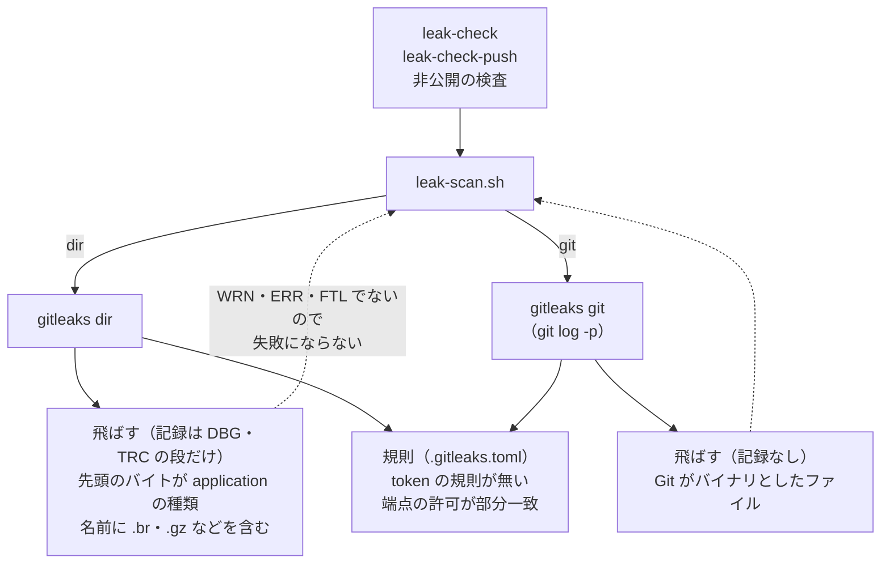
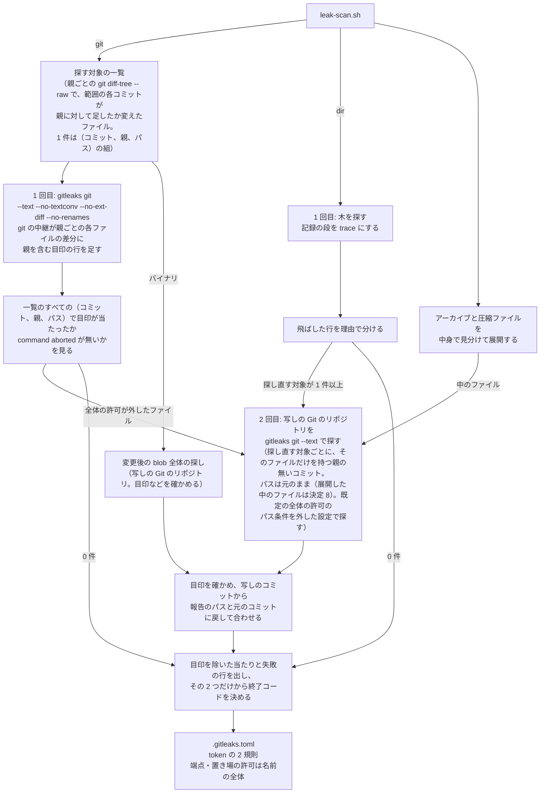
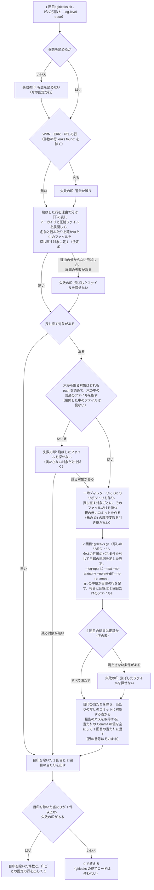

# 漏れの検査: サービスの token・バイナリのファイルの中の秘密・作り物に見せた端点を、今の木と履歴で止める（#98）

Pull Request の漏れの検査（`leak-check`）は、サービス自身の token、gitleaks が中身を読まずに飛ばすファイルの中の秘密、資源の名前に `example.com` を含む端点を通してしまい、詳細設計の 1 行もコードと食い違っている。`.gitleaks.toml` に token の規則を足し、端点・S3 の置き場の許可を名前の全体に当てて絞り、ARN の許可を資源の欄まで含めた例に絞り（資源の ID の規則は許可を外す）、詳細設計の行を直す。`leak-scan.sh` は、gitleaks が飛ばしたファイルと名前で外したファイルを探し直し、アーカイブと圧縮ファイルは展開して中のファイルを検査し、履歴では探す対象を Git のファイルの一覧で決めてすべて読み終えたことを確かめ、探せなかったときは当たりが無くても失敗にする。採らなかった案は[決定の記録](./issue-98-design-decisions.md)に、調べた外部の資料は末尾の「外部の調査」にある。

省いた文書: 実行計画（課題 1・PR 2。順序は「導入の順序」）
省いた文書: 並列の計画（レーン 1）

## 今の姿

何が起きたか・目的・受け入れ条件は要求仕様（[issue-98-requirements.md](./issue-98-requirements.md)、正は #98 の本文）にある。この文書は「どう解くか」と「なぜその解き方か」だけを書く。

この文書の呼び名は次のとおりである。

| 呼び名 | 指すもの |
| --- | --- |
| 全体の許可 | gitleaks の設定の global allowlist（`[allowlist]`）。この許可に当たって検査されないことを「外す」と呼ぶ |
| 目印 | 探し終えたことを確かめるために各ファイルの差分の末尾へ足す行。専用の規則で当てる（「処理の流れ」） |
| 中継 | gitleaks が打つ `git log` の出力に目印の行を足す小さなスクリプト（`git` の中継） |
| 写し | 探し直すファイル（アーカイブから展開した中のファイルを含む）を一時の Git リポジトリに複製したもの |
| 写しのコミット | 写しのリポジトリの中の、1 つのファイルだけを持つ親の無いコミット |
| 写しのパス | 写しのコミットが持つファイルのパス |
| 評価のパス | 展開した中のファイルに規則と許可を当てるパス（決定 8 の「2 つのパス」） |
| 報告のパス | 当たりに表示するパス。写しのパスと違うことがある（決定 8） |
| 対象番号・対応表 | 探し直す対象に振る番号と、その番号から元のコミット・パスなどを引く表（決定 3） |
| 飛ばした行 | gitleaks がファイルや当たりを飛ばしたことを知らせる記録（ログ）の行 |

漏れの検査には 3 つの探しがある。Pull Request の `leak-check`、main への push の `leak-check-push`、非公開の検査 `leak-check-secret` である。どれも `tools/checks/leak-scan.sh` を通して gitleaks 8.30.1 を打つ。抜けは、規則の側（`.gitleaks.toml`）と、gitleaks が中身を読まずに飛ばす所の 2 か所にある。

2026-11-25 に、手元に置いた gitleaks 8.30.1 で、乱数から作った作り物の値だけを使って次を実測した。

| # | 抜け | 根本原因 | 実測 |
| --- | --- | --- | --- |
| 1 | サービスの token が当たらない | 委任の token（`ndfd_…`）と手元のマシンの登録の token（`ndfm_…`）の規則が、既定の規則にも `.gitleaks.toml` にも無い | 要求の「事象」1 のとおり |
| 2 | 履歴で、バイナリのファイルの中の秘密が当たらない | gitleaks の履歴の探しは `git log -p` のパッチを読み、`Binary files … differ` の項目をアーカイブでなければ記録を出さずに飛ばす（`sources/git.go`）。Git がバイナリとするのは、中身に NUL を含むファイルと、`.gitattributes` で `-diff`・`binary` を付けたファイルである | 途中のコミットで足して消した 5 つのファイルのうち、NUL を含むファイル・ELF の頭を持つファイル・`-diff` を付けたテキストのファイルの 3 つが当たらない。既定の全体の許可に名前が当たらないファイル（拡張子の無い `nulfile`）に NUL と `aws_secret_access_key` の行を入れて足して消した履歴でも、既定の規則の当たりは 0 件で、`--log-opts` に `--text --no-textconv --no-ext-diff` を足すと `generic-api-key` が 1 件当たる。要求の「事象」2 の `blob.bin` は、名前が既定の全体の許可（`.bin`）にも当たるので、この測り方では履歴の読み方による抜けと区別できない |
| 3 | 今の木で、gitleaks が種類や名前で飛ばすファイルの中の秘密が当たらない | gitleaks の今の木の探しは、(a) 先頭のバイトが application の種類（ELF・RTF・`MZ` で始まる exe など）に合うファイルを DBG の段で、(b) 名前のどこかに `.br`・`.gz`・`.zip` などを含むファイルをアーカイブとして TRC の段で、中身を読まずに飛ばす（`sources/file.go`。アーカイブは名前だけで見分ける）。`leak-scan.sh` は WRN・ERR・FTL の段だけを見るので、失敗にならない | ELF の頭・RTF の頭・`MZ` で始まるテキスト・名前が `notes.zip` のテキストの 4 つが当たらない。NUL を含むだけのファイルは当たる。今の main の `packages/core/test/log.browser.test.ts` も、名前の `.browser` が `.br` を含むので (b) で飛ばされている |
| 4 | 資源の名前に `example.com` を含む端点が当たらない | `nd-aws-endpoint` の許可 `example\.com` が、資源の部分の一部に合えば端点の全体を許す | 要求の「事象」3 のとおり |
| 5 | 詳細設計が、秘密の形のデータを読む処理を 1 つだけ書く | 生成物を作るスクリプト（`packages/contracts/scripts/artifacts.ts` の 453 行目）が同じデータで公開用のダミーデータを検査することが、詳細設計の行（`docs/design/detail.md` の 291 行目）に無い | 要求の「事象」4 のとおり |

今の木の探し（`dir`）で gitleaks が飛ばすかは、NUL ではなく先頭のバイトの種類で決まる（NUL を含むだけのファイルは今も当たる）。そこで、受け入れ条件 3 の結合テストは次の 2 種類のファイルを置く。

| 置くファイル | 確かめること |
| --- | --- |
| NUL を含むだけのファイル（受け入れ条件 3 の文のとおりの形） | 受け入れ条件 3 を文のとおりに確かめる |
| gitleaks が実際に飛ばす形（NUL を含み ELF の頭を持つファイルなど） | 探し直しの経路を確かめる |

要求の「事象」2 の `blob.bin` は、履歴の読み方による抜け（2）だけでなく、ファイル名でも検査から外れる。決定 2 で Git の差分に中身を出しても、初回の検査では gitleaks が `.bin` をファイル名で除外する（gitleaks の既定の全体の許可）。決定 6 で、除外されたファイルを再検査する。

5 つの抜けのほかに、圧縮されたファイルの中身も読まれていない。gitleaks の既定はアーカイブを展開せず（`--max-archive-depth` の既定は 0。[cmd/root.go](https://github.com/gitleaks/gitleaks/blob/v8.30.1/cmd/root.go#L87)）、圧縮したバイト列には規則が当たらない。決定 8 で展開して検査する。

### 同じ形の箇所

4 の部分一致の許可は、`.gitleaks.toml` のほかの規則にもある。許可の正規表現は、規則が秘密として取り出した部分に当たる。

| 規則 | 許可に渡る部分 | 部分一致で起きること | 扱い |
| --- | --- | --- | --- |
| `nd-aws-account-id`・`nd-aws-account-id-joined` | 12 桁の数 | 数だけなので、許可 `123456789012` のほかの許可は当たり得ない。許可 `123456789012` は 12 桁なので、部分一致でも値の全体との一致になる | 変えない |
| `nd-aws-arn` | ARN の全体 | `example\.com`・`EXAMPLE`・`123456789012`・`<名前>` などが ARN のどこかにあれば、ARN の全体を許す。アカウントの欄を作り物にしただけの ARN は、資源の欄に実際の名前が残っていても通る | 全体に当て、資源の欄まで決まった例に絞る（決定 5） |
| `nd-aws-arn-s3` | 置き場の名前 | 4 と同じ抜け（`arn:aws:s3:::` に `data-example.com-logs` を続けた ARN を許す。実測） | 全体に当て、用途を説明できる名前に絞る（決定 5） |
| `nd-aws-resource-id` | `vpc-` などと 16 進 | 16 進の中に `123456789012` が並ぶ実在の ID も許される。アカウント ID の例をこの規則で許す理由は無い。ほかの許可（`^acme`・`example\.com`・プレースホルダー・`EXAMPLE`）は、16 進と `-` だけの値には当たり得ない | 許可をすべて外す（決定 5） |
| `nd-aws-endpoint` | 資源の部分 | 4 の抜け | 全体に当て、用途を説明できる名前に絞る（決定 5） |

## 文脈と制約

- `leak-scan.sh` の引数と終了コードの意味（0 当たり無し・1 当たりかスキャンの失敗・2 引数の誤り）は変えない
- gitleaks は 8.30.1 のまま使う（`tools/checks/install-gitleaks.sh` が固定する版）。飛ばしたときの記録の文言は、この版のものである
- 非公開の検査の流れ（`leak-check-secret.yml`・`leak-scan-secret.sh`・`export-tree.sh` が何をどの順で探すか）は変えない。`leak-scan.sh` の変更で非公開の検査の結果が変わることは範囲に含む
- `--paths` を渡さなければ、出力にファイルの名前を出さない。当たった値は `--paths` を渡しても出さない。記録の段を DBG・TRC まで上げると、gitleaks の記録に当たった値（`finding=`）が載るので（`detect/detect.go` の 720 行目）、その記録はそのまま出さない
- テストに置く token と秘密は、テストの実行中に乱数から作る（要求の前提 2）
- 変更の後のリポジトリ自身が通る。Pull Request の `leak-check` は木と分岐点からの範囲を、マージの後の `leak-check-push` は main の全履歴を `.gitleaks.toml` で探す。最終の設定で今の main を探した結果は、まだ無い。マージしてよいかは、テスト設計の「マージの前の確認」で決める
  - 参考の測定: 2026-11-25 に、今の main（`69fd0b9`）の木と全 97 コミットを探すと、新しい当たりは 0 件だった。使ったのは、試しの設定と、`--log-opts` に `--text` などを足した `leak-scan.sh` である。試しの設定には、この設計書の旧稿の許可と決定 1 の規則を写した。旧稿は、決定 5 が `acme` で始まる名前の許可を外す前の版で、`acme` で始まる名前を許していた。この測定は、今の木の探し直し（決定 3・4）、目印の確かめ（決定 2）、全体の許可が外したファイルの探し直し（決定 6）を含まない
  - 今の決定 5 では、今の木の `acme` の置き場と端点の例が当たる。これらは同じ Pull Request で書き換える（決定 5）
  - 測るときは試しの設定を木の外に置いたので、木の中の `.gitleaks.toml` も探す対象に入った。CI では `.gitleaks.toml` を `--config` に渡し、gitleaks は `--config` に渡した設定のファイルを探さない。そのため、この `.gitleaks.toml` 自身の当たりは数えていない
- 既定の規則の設定（`tools/checks/gitleaks-default.toml`）は、`useDefault` で gitleaks の既定の全体の許可を読む。この許可は `.bin`・`.pdf`・画像・`node_modules/`・`package-lock.json` などを名前で外す（[config/gitleaks.toml](https://github.com/gitleaks/gitleaks/blob/v8.30.1/config/gitleaks.toml) の `[allowlist]`）。`[extend]` には全体の許可を外す項目が無い。今の結合テストの「既定の全体の許可がパスで外すファイルの値は当てず、同じ中身を外さないパスに置けばそちらだけ当たる」（`img/logo.png`）は、この扱いを前提にしている。決定 6 でこの扱いを変えるので、このテストは「名前を変えずに当たる」へ書き換える

## 解き方の全体像

- `.gitleaks.toml` に `nd-delegation-token`・`nd-machine-token` を足す。`nd-aws-endpoint`・`nd-aws-arn-s3` の許可を、名前の全体に当て、AWS が作成を禁じた名前・プレースホルダー・用途を説明できる個別の名前に絞る。`nd-aws-resource-id` の許可を外す。`nd-aws-arn` の許可は、アカウントの欄が作り物で、資源の欄も作り物の例と分かる ARN だけにする
- 履歴の探し
  - 探す対象（範囲の各コミットで足したか変えたファイル）を `git diff-tree --raw` で決める。
  - gitleaks の `--log-opts` には `--text --no-textconv --no-ext-diff --no-renames` を足す。Git のバイナリの判定と `.gitattributes` によらず、足した行を出させるためである。
  - バイナリは、変更後の blob 全体も探す。変更前の blob も同じ方法で探し、行の削除だけで成立した当たりを残す（「処理の流れ」）。
  - gitleaks が打つ `git log` の出力に、`leak-scan.sh` の中継が各ファイルの差分の末尾に目印の行を足す。
  - 対象のどれか 1 つでも目印が当たらなければ、当たりが 0 件でも 1 で終える（決定 2）
- 今の木の探し
  - gitleaks が中身を読まずに飛ばしたファイルを記録から集め、飛ばした理由で分ける。
  - 探し直す対象は、一時の Git のリポジトリに、対象ごとにそのファイルだけを持つ親の無いコミットとして写す。`gitleaks git` に `--text` を渡して探し、目印の行で探し終えたことを確かめる。
  - 写しでも飛ばしたとき、理由の分からない飛ばしがあるとき、目印が当たらないとき、2 回目の結果を取れないときは、当たりが 0 件でも 1 で終える
- 既定の全体の許可が名前で外したファイルは、今の木でも履歴でも写しの Git のリポジトリに元のパスのまま置き、探し直す。
  - 探し直しの設定は、既定の設定から全体の許可のパス条件だけを外したものを読むので、規則と規則単位の許可は元のパスで評価される。
  - 探さないのは、設計で決めた対象外のパス（`--config` に渡した設定のファイル、依存のディレクトリの下の Git が追跡していないファイル、`.git`）だけである（決定 6）
- アーカイブと圧縮ファイルは、名前ではなく中身（先頭のバイト。ZIP は末尾のディレクトリ情報とメンバーの先頭も）で見分けて展開し、中のファイルを同じ写しのリポジトリで探す。展開できないときは、当たりが 0 件でも 1 で終える（決定 8）
- どちらの探しでも、取れた当たりは失敗の有無によらず出す。終了コードと件数は、目印の当たりを除いた当たりと失敗の印だけから `leak-scan.sh` が決め、gitleaks の終了コードと件数の行は使わない
- `leak-scan-secret.sh` は、新しい 2 つの失敗の行（飛ばしたファイルを探せない・履歴を最後まで探し終えたことを確かめられない）も失敗として見分ける。今見分けている 2 つの行（「警告か誤り」と「報告を読めない」）と同じ扱いである
- 詳細設計の「秘密の形のデータ」の行は、データを読む処理として、実行時の `redact` と生成時のダミーデータの検査の 2 つを書く

## 処理の流れ

失敗の条件に当たっても、途中で止めずに最後まで進み、取れた当たりをすべて出してから失敗の行を出す。図の「失敗の印」は、その条件に当たったことを覚えておき、最後に 1 で終えることを表す。

### 今の木の探し（`dir`）

流れは次のとおりである。

#### 2 回目の前と後に確かめること

探し直す対象は 2 種類あり、2 回目の前に確かめることが違う。展開した中のファイルは作業ツリーに書き出さないので、決定 4 の条件 2 を当てない。

| 対象の種類 | 2 回目の前に確かめること | 決定 4 の条件の番号 |
| --- | --- | --- |
| 木から取る対象（飛ばした行のファイルと、外れたディレクトリの下のファイル） | `path` を読めて、木の中の普通のファイルを指す | 2 |
| 展開した中のファイル | メンバー名が決定 8 の形で、中身を最後まで読める | 9 |

次の表は、決定 4 の条件の番号ごとに、満たすことと満たさないときの扱いを示す。1〜3 と 9 は図の前の段（d・e・w）で見る。図の判定「2 回目の結果は正常か」は、4〜8 のすべてを満たすかを見る。

| 決定 4 の番号 | 条件 | 満たさないときの扱い |
| --- | --- | --- |
| 1 | 1 回目の記録に、対象外とも探し直す対象とも分けられない飛ばした行が無い（図の d） | 失敗の印「飛ばしたファイルを探せない」を立てる。探し直す対象と分けられたものは 2 回目へ進める |
| 2 | 木から取る対象の `path` をすべて読め、木の中の普通のファイルを指す（図の e）。展開した中のファイルは含めない | 失敗の印「飛ばしたファイルを探せない」を立てる。満たさない対象を除き、残りは 2 回目へ進める |
| 3 | 写しのリポジトリを作れ、写しを書け、コミットできる（図の w） | 失敗の印「飛ばしたファイルを探せない」を立てる |
| 4 | 2 回目の gitleaks の終了コードが 0 か 1 | 失敗の印「飛ばしたファイルを探せない」を立て、取れた当たりを出す |
| 5 | 2 回目の報告を読める | 同上 |
| 6 | WRN・ERR・FTL の行（件数の行を除く）が無い | 同上 |
| 6 | `command aborted` の行が無い | 同上 |
| 6 | 飛ばした行が無い（表の対象外の行を除く） | 同上 |
| 7 | 当たりが、下の照合で対応表と一致する | 同上 |
| 8 | 対象番号のすべてで目印が当たった。空の中のファイルには対象番号を振らない（決定 8） | 同上 |
| 9 | アーカイブと圧縮ファイルをすべて最後まで展開でき、メンバー名がすべて決定 8 の形で、展開の合計が上限以内である（図の d） | 失敗の印「飛ばしたファイルを探せない」を立てる。確かめを通った中のファイルは 2 回目へ進める |

報告のパスは、木や Git から取る対象では元のパス、展開した中のファイルでは `<アーカイブのパス>!<中のパス>` である。

決定 4 の条件 7・8 の照合は、今の木と履歴のすべての写しの探しで共通である。写しのコミットは、作者のメールアドレスに対象番号を持つ（決定 3）。照合では、当たり（目印を含む）の `Email` から対象番号を取り、対応表を引く。番号が表にあり、`File` が表の写しのパスと同じで、`Commit` が期待する値と同じなら一致とする。期待する値は、履歴では元のコミット、今の木では写しのコミットである。履歴でも、変更前の blob の写し（「コミットへの帰属」）は写しのコミットを期待する。目印は対象番号ごとに確かめる。写しのパスが同じ別の番号の目印では代えない。

### 飛ばした行の分け方

1 回目の記録の飛ばした行は、gitleaks 8.30.1 の文言（[sources/files.go](https://github.com/gitleaks/gitleaks/blob/v8.30.1/sources/files.go)・[sources/file.go](https://github.com/gitleaks/gitleaks/blob/v8.30.1/sources/file.go)・`detect/detect.go`）で次のように分ける。対象外とするのは、意図して外したものと、リポジトリの中身として読むものが無いものだけである。それ以外で中身を読まなかったものは、探し直すか失敗にする。

| 記録の文言 | 段 | 扱い | 理由 |
| --- | --- | --- | --- |
| `skipping binary file` | DBG | 探し直す（写しの Git のリポジトリ） | 先頭のバイトの種類で飛ばした。履歴のパッチのテキストとして読めば、種類を判定されない |
| `skipping archive: exceeds max archive depth` | TRC | 探し直す（写しの Git のリポジトリ） | 名前でアーカイブと見なした。履歴のパッチのテキストとして読めば、名前でアーカイブと見なされない |
| `skipping file: global allowlist` | DBG・TRC | 決定 6 の対象外のパスなら対象外。ほかは探し直す（写しの Git のリポジトリ） | 設定の全体の許可が名前で外した。中身に秘密があっても探されない（決定 6） |
| `skipping directory: global allowlist` | DBG | 配下の普通のファイルを列挙し、決定 6 の対象外のパスを除いたすべてを探し直す対象にする。依存のディレクトリの下では、探す木の根が Git の作業ツリーの最上位で、追跡していないと確かめられたファイルだけを除く。空と確かめられたファイルも除く（決定 6）。列挙できないか、ファイルを読めなければ失敗（飛ばしたファイルを探せない） | 全体の許可の一部はパス全体に固定されていないので、依存でないディレクトリもディレクトリごと外れる（決定 6） |
| `skipping file: matches config or baseline path` | TRC | 対象外 | `--config` に渡した設定のファイル自身（基準の報告を渡したときはそのファイルも）を、gitleaks が探す対象から外した（[detect/detect.go](https://github.com/gitleaks/gitleaks/blob/v8.30.1/detect/detect.go#L294-L298)）。CI は木の中の `.gitleaks.toml` を `--config` に渡すので、毎回この行が出る |
| `skipping file: rule allowlist` | TRC | 対象外 | 規則ごとの許可がパスかコミットで外した。ファイルは読めていて、その規則だけを当てない（[detect/detect.go](https://github.com/gitleaks/gitleaks/blob/v8.30.1/detect/detect.go#L386-L390)） |
| `skipping finding: …` | TRC | 対象外 | ファイルは読めている。当たりを規則の許可やエントロピーの判定で外した記録である |
| `skipping empty file`・`skipping empty fragment` | DBG・TRC | 対象外 | 中身が無い |
| `skipping finding links: …` | DBG | 対象外（2 回目だけに出る） | 写しのリポジトリにリモートが無いので、当たりのリンクを作らなかった。ファイルは読めている |
| `skipping symlink: follow symlinks disabled`・`skipping symlink: target is directory` | DBG | 対象外 | リンク自身は中身を持たない。指す先が木の中のファイルなら、そのファイルとして別に探される |
| WRN・ERR の段の `skipping …`（大きすぎる・読めない・アーカイブの種類が分からないなど） | WRN・ERR | 失敗（今の「警告か誤り」） | 今の扱いのまま |
| 上のどれでもない、`skipping` で始まる DBG・TRC の行 | DBG・TRC | 失敗（飛ばしたファイルを探せない） | gitleaks の版を上げて文言が増えたときに、黙って通さない |

### 履歴の探し（`git`）の確かめ

#### 読み終えたかを確かめる 2 つのこと

履歴の探しが最後まで終えたかは、gitleaks の内部の Git の終了コードだけでは分からない。Git が 0 で終えても、gitleaks がパッチを読む部品（go-gitdiff）が途中で読むのをやめることがあるためである（下の 2 つ目）。そこで、次の 2 つを両方確かめる。

1. **内部の Git が途中で止まっていない**
   - gitleaks 8.30.1 は、内部の `git log` が 0 以外で終えても、その誤りを DBG の段の `command aborted` だけで記録する。当たりが無ければ 0 で終える（[sources/git.go](https://github.com/gitleaks/gitleaks/blob/v8.30.1/sources/git.go) の `Fragments`）。
   - そこで記録の段を trace にし、この行があれば失敗にする。
   - 内部の Git の標準エラーの行（ERR の段の `[git] …`）は、今の「警告か誤り」で失敗になる
2. **探す対象のすべてのファイルを、gitleaks が読み終えた**
   - go-gitdiff 0.9.1 の `Parse` は、ファイルの見出しを解析できないと、そのファイルを黙って飛ばす。差分の本体を解析できないと、そこで読むのをやめる。どちらも誤りを呼び出し元へ返さない（[gitdiff/parser.go](https://github.com/gitleaks/go-gitdiff/blob/v0.9.1/gitdiff/parser.go#L18)）。
   - Git は出力を書き終えて 0 で終えるので、上の 1 つ目の確認では見分けられない。
   - そこで、決定 2 の目印の行で、ファイルごとに読み終えたことを確かめる

どちらか一方でも確かめられなければ、当たりの有無によらず新しい固定の行（例: `leak-scan: 履歴を最後まで探し終えたことを確かめられなかった`）を出して 1 で終える。今の木の探し直し（2 回目）でも、同じ 2 つを確かめ、当たれば「飛ばしたファイルを探せない」の行で 1 で終える。

履歴の写しの探し（変更後の blob 全体の探し、全体の許可が外したファイルの探し直し、展開した中のファイルの探し）にも、決定 4 の 3〜9 を当てる。目印の欠落、`command aborted`、報告が無いか読めないことを含め、どれかを満たさないときや blob を読めないときは、上の履歴の固定の行で 1 で終える。「飛ばしたファイルを探せない」の行は出さない。取れた当たりは出す。

#### 目印の行による確かめ方

目印の行による確かめ方は次のとおりである。今の木の探し直しと、全体の許可が外したファイルの探し直しも、同じ確かめ方を使う。

- **探す対象の一覧**: 対象の 1 件は（コミット、親、パス）の組である。マージのコミットでは、同じパスでも親ごとの差分を別の対象にする。パッチの表示は使わず、次の手順で作る。
  1. 範囲の各コミットと親を `git rev-list --parents` で取る（範囲が無ければ `HEAD` から到達できるすべて）
  2. コミットごと、親ごとに `git diff-tree -r -z --raw --no-renames <親> <コミット>` を打つ。親の無いコミットは `git diff-tree -r -z --raw --no-renames --root <コミット>` を打つ
  3. 打った結果から、その親に対して足したか変えたファイル（`A`・`M`・`T`）のパス、古いモードと新しいモード、古い blob、新しい blob を取る。モードは古い側と新しい側を別々に判定する
     - 新しい側が通常のファイル（かシンボリックリンク）なら、探す対象にする
     - 古い側がサブモジュール（モード `160000`）なら、古い側のハッシュは blob ではないので読まず、比較の対象を空とする（足したファイルと同じ扱い）。サブモジュールを同じパスの通常のファイルに置き換えた型変更が、これに当たる
  4. 親の欄に、マージのコミットでは親のハッシュを、親が 1 つか無いコミットでは `none` を入れる。中継が見る `git log -m -p` の出力は、マージのコミットにだけ親を示すためである
  5. 次の表のものを除く

  | 除くもの | 除く理由 | 除く先 |
  | --- | --- | --- |
  | 新しい側がサブモジュール（モード `160000`） | 中身を持たない | 一覧から除く |
  | 新しい blob が空のファイル | 足した行が無い | 目印の確かめから除く |
  | モードだけを変えたファイル（古い blob と新しい blob が同じ） | 足した行が無い | 目印の確かめから除く |
- **目印の規則**
  - 目印の行は、実行ごとに乱数から作った文字列に、親の欄と固定の語 `end` を続けたものである（`leak-scan-marker-<32 字の 16 進>-<親の欄>-end`）。
  - この形だけに当たる規則 `leak-scan-marker` を、一時ディレクトリの設定のファイルに置く。
  - 規則の `secretGroup` で、秘密として伏せる部分を末尾の `end` だけにする。gitleaks の `--redact` は秘密の部分だけを伏せるので、報告の `Match` に親の欄が残り、目印の当たりを（コミット、親、パス）で引ける。
  - 2026-11-25 に実物の gitleaks 8.30.1 で、2 つの親の両方と中身が違うマージのコミットを `--redact=100` で探した。同じファイルの 2 つの目印の `Match` に、それぞれの親のハッシュが残ることを確かめた。
  - この設定は `[extend] path` で渡された設定を読み、gitleaks にはこの設定を `--config` で渡す。渡された設定の規則と許可はそのまま効く。
  - gitleaks の `[extend]` は 2 段まで読む。そのため、`gitleaks-default.toml`（既定を読む）と、非公開の検査の重ねた設定（`.gitleaks.toml` を読む）も読める（[config/config.go](https://github.com/gitleaks/gitleaks/blob/v8.30.1/config/config.go) の `maxExtendDepth`）
- **git の中継**
  - 一時ディレクトリに `git` という名前の小さなスクリプトを置き、gitleaks を打つときだけ `PATH` の先頭に足す。
  - 中継は、`log -p` で呼ばれたときだけ、本物の Git の出力を読む。本物の Git は、中継を足す前に `command -v git` で決めたパスである。そして各ファイルの差分の最後の hunk の後ろに、目印の行を 1 行足す hunk を足す。
  - 親の欄は、`-m` がマージのコミットの親ごとの差分の頭に出す `commit <コミット> (from <親>)` の行から読み、`(from …)` の無いコミットでは `none` にする。
  - ほかの呼び出しは本物の Git にそのまま渡す。
  - `log -p` には `--no-color` を足す。利用者の Git の設定が色を常に有効にしていても、コミットと差分の見出しを解析できるようにするためである。
  - 差分の中の行は必ず ` `・`+`・`-`・`\` で始まり、hunk の行の数は `@@` の見出しにあるので、中継はファイルの境を中身に惑わされずに見分けられる。
  - 読めない形の行があれば、中継は 0 以外で終える（gitleaks は `command aborted` を記録するので、1 で失敗になる）。
  - 中継は、目印を足したファイルの（コミット、親、パス）を一時のファイルに書く。パスは Git の引用の形（`"…"` と `\` の並び）を戻してから書く
- **渡された設定のファイル**
  - gitleaks は `--config` に渡した設定のファイル自身を探さない（[detect/detect.go](https://github.com/gitleaks/gitleaks/blob/v8.30.1/detect/detect.go#L294-L298)）。
  - ここでは `--config` に、木の中の `.gitleaks.toml` ではなく、目印の規則を足した一時の設定を渡す。そのため、木の中の `.gitleaks.toml` は「渡された設定のファイル」と見なされず、探す対象に入ってしまう。
  - 今の振る舞い（設定のファイル自身を探さない）を保つため、渡された設定のファイルが探す木の中にあれば、中継はその差分を出力から除き、探す対象の一覧からも除く
- **照らし合わせ**: 探す対象の一覧と、中継の一覧・gitleaks の記録・報告を突き合わせて、次の 4 つを行う。
  - **確認 1（中継の一覧）**: 探す対象の一覧の、目印の確かめから除いたもの以外の（コミット、親、パス）が、すべて中継の一覧にあることを確かめる
  - **確認 2（目印の当たり）**: 確認 1 の対象のすべてに、コミットとパスが同じで `Match` の親の欄も同じ `leak-scan-marker` の当たりがあることを確かめる。マージのコミットの同じパスで、一方の親の目印だけが当たっても、もう一方の親の対象は、目印が当たらなかったものとして扱う（下の「当たりが無い対象の振り分け」）
  - **当たりが無い対象の振り分け**: 確認 2 で当たりが無かった対象を、次の表のとおりに扱う。パスだけでは照合しない。gitleaks 8.30.1 は `skipping file: global allowlist` の行にコミットの SHA も出す（[detect/detect.go](https://github.com/gitleaks/gitleaks/blob/v8.30.1/detect/detect.go#L261-L282)）。そのため、同じパスの別のコミットの行は使えない

    | 当たりが無い対象の状況 | 扱い |
    | --- | --- |
    | gitleaks の記録に、同じコミットと同じパスの組の `skipping file: global allowlist` がある | 決定 6 の対象外のパスなら対象外にする。ほかは決定 6 の探し直しに回す |
    | 記録の行からコミットとパスの組を読めない（一致を確かめられない） | 探し直しに回さず失敗にする |
    | 上の 2 つのどちらでもない | 失敗にする |

  - **出力からの除外**: `leak-scan-marker` の当たりは、出力と `--report` から除き、件数にも数えない（下の「終了コードと件数」）
#### 変更後のバイナリの blob 全体の探し

- **blob 全体も探す理由**: gitleaks の Git モードは、hunk ごとに足した行だけを探す。そのため、変更前からあった行と今回足した行にまたがる秘密（複数行の鍵など）は、目印が当たっていても見つからない。そこで、探す対象のうちバイナリのものは、足した行の探しに加えて、そのコミットの変更後の blob 全体も探す。テキストのファイルの複数行の秘密は、この設計の範囲外とする（今の `git` の探しと同じ）。履歴の探しは、次の 4 つに分かれる。

  | 探し | 対象 | 方法 | 当たりの出し方 |
  | --- | --- | --- | --- |
  | 足した行の探し | 探す対象の一覧のすべて | 1 回目の `gitleaks git` が、hunk ごとに足した行を探す | 元のコミット・元のパス・元の行の番号のまま出す |
  | blob 全体の探し | 探す対象のうちバイナリのもの（下の判定の条件）。全体の許可が名前で外すファイルは含めない | そのコミットの変更後の blob（`git diff-tree` の一覧の新しい blob を `git cat-file blob` で読む）を、決定 3 の写しのリポジトリに、親の無い写しのコミットとして置いて探す | そのコミットで新しく成立した当たりだけ（下の「コミットへの帰属」）を、元のコミットと元のパスで出す |
  | 全体の許可で外れたファイルの探し（決定 6） | `.bin`・`.pdf`・画像など、全体の許可が元のパスを外すファイル。足した行の探しで目印が当たらず、記録に同じコミットとパスの組の `skipping file: global allowlist` が出たものである。決定 6 の対象外のパスは除く（履歴の対象はすべて追跡されているので、依存のディレクトリの下も除かない） | blob 全体を元のパスの写しに置き、全体の許可のパス条件を外した設定で探す。blob の全行を読ませるので、blob 全体の探しを兼ねる | そのコミットで新しく成立した当たりだけを、元のコミットと元のパスで出す |
  | 展開した中のファイルの探し（決定 8） | 探す対象のうち、アーカイブと圧縮ファイルの中のファイル | そのコミットの変更後の blob を展開し、空でない中のファイルを 1 つずつ写しにして、決定 8 の評価のパスで探す | 中のファイルの当たりをすべて、`<アーカイブのパス>!<中のパス>` と元のコミットで出す |

  - **コミットへの帰属**: blob の全体を読ませる 2 つの探し（blob 全体の探しと、全体の許可で外れたファイルの探し）では、そのコミットで新しく成立した当たりだけを残す。
    - blob の全体を読ませると、前のコミットから在る秘密にも当たる。そのまま出すと、旧い作り物の値が残るファイルの別の行を変えただけのコミットが当たりになり、値を足したコミットに限る許可（決定 5 の許可 5）が効かない。
    - 一方、足した行と重なるかだけで絞ると、行の削除で前後の行が隣り合い、複数行の秘密が成立した場合を捨てる。そこで、変更前の blob（`git diff-tree` の一覧の古い blob）も、同じパスの写しにして同じ設定で探し、当たりを比べる。
    - 変更後の blob の当たりは、次の表の上から順に判定する。

      | 当たり | 扱い |
      | --- | --- |
      | パスだけで当てる規則の当たり（行の番号 0） | 残す |
      | 開始から終了までの行が、そのコミットがその親に対して足した行と 1 行でも重なる | 残す |
      | 重ならず、変更前の blob に同じ当たりが無い | 残す |
      | 重ならず、変更前の blob に同じ当たりがある | 除く |

    - 「同じ当たり」は、規則の id が同じで、開始から終了までの行の中身（バイト列）が同じものである。行の番号は削除でずれ、値は伏せてあるので、どちらも照合に使わない。1 件の変更前の当たりは、1 件の変更後の当たりにだけ対応させる。
    - 足した行の番号は、`git diff-tree -p -U0 --text --no-renames` の `@@` の見出しから取る。
    - 足したファイル、古い blob が空のファイル、古い側がサブモジュールのファイルは、変更前の当たりが無いものとする。
    - 変更前の blob の当たりは比較にだけ使い、出力しない。変更前の blob を読めないか、その写しの探しが確かめを満たさないときは、変更後の当たりを除かずに出し、履歴の固定の行で失敗にする。
    - アーカイブの中のファイルは行の対応が取れないので、帰属させずにすべて出す

  - **バイナリと判定する条件**: 次の 3 つのどれか 1 つに当たれば、バイナリとして扱う。どの条件に当たっても、読む blob は同じで、`git diff-tree` の一覧にある新しい blob を `git cat-file blob` で読む

    | 条件 | 確かめ方 |
    | --- | --- |
    | Git が数えられないファイル | `git diff-tree -r -z --numstat --no-renames`（親の無いコミットは `--root` を付ける）の追加行の欄が `-` |
    | `-diff` 属性が付いたファイル | 元のリポジトリで `git check-attr --source=<スキャンするコミット> diff -- <パス>` が `unset` を返す。`--source`（Git 2.40 以降）が無いと作業ツリーの属性を読む。コマンドが失敗したら履歴の固定の行で失敗にする |
    | NUL を含むファイル | blob に NUL のバイトがある |

  - **写しに置くパス**: 元のパスのまま置く。パスを条件にする規則と許可が、足した行の探しと同じ結果になるためである
  - **元のコミットの許可**: 写しのコミットのハッシュは元と違うので、そのままではコミットを条件にする許可（決定 5 の許可 5）が元のコミットに効かない。決定 3 の中継が、写しの探しで `git log` の出力の `commit <写しのハッシュ>` の行を元のコミットのハッシュに書き換える。gitleaks は許可を報告の前に当たりごとのコミットで評価するので（[detect/detect.go](https://github.com/gitleaks/gitleaks/blob/v8.30.1/detect/detect.go)）、報告の時点で戻すのでは間に合わない。書き換えれば、元のコミットに対する許可が写しの検査にも同じに効き、報告のコミットも元のままになる。変更前の blob の写しは書き換えない。コミットを条件にする許可で変更前の当たりが外れると、変更後の当たりと比べられないためである
  - **重なった当たり**: 足した行の探しと blob 全体の探しは同じ箇所に当たる。元のコミット・パス・行に戻した後、（規則、コミット、パス、開始の行、終了の行）が同じ組の当たりが、足した行の探しで a 件、blob 全体の探しで b 件あれば、max(a, b) 件を出す。足し合わせると同じ当たりが二重になり、1 件にまとめると同じ行の 2 つの秘密が減るためである。値は伏せてあり、列は探し方でずれうるので、照合に使わない。件数は残した当たりを数える
- 1 回目に足した `--log-opts` の `--no-renames` は、名前を変えたファイルを、消したファイルと足したファイルとして出させる。`git diff-tree --no-renames` の一覧と同じ単位にそろえるためである。名前を変えたファイルは、中身の全体を足した行として探す

### 記録・報告・終了コード

gitleaks の記録と報告は、今の木と履歴のどちらの探しでも、次のとおりに扱う。

- 件数の行（`leaks found: <件数>`）は、今の `log_has_skipped` と同じく、行の全体がその形のときだけ除く。1 回目と 2 回目のどちらに当たりがあっても、この行で失敗の印を立てない
- 段を上げた gitleaks の記録は、同じ一時ディレクトリの中のファイルに受ける。`--paths` を渡したときに標準エラーへ出すのは、INF・WRN・ERR・FTL の段の行だけにする。ただし件数の行は、目印の当たりを含む gitleaks の生の件数なので出さない。`--paths` を渡さないときは、今と同じく gitleaks の記録を出さない
- **終了コードと件数**: `leak-scan.sh` の終了コードと件数は、目印の当たりを除いた当たりと失敗の印だけから決める。gitleaks は目印の当たりも当たりとして数えるので、秘密の無い普通の変更でも 1 で終え、件数の行に目印の数を出す。2026-11-25 に実物の gitleaks 8.30.1 で確かめた。秘密の無い 2 つのコミットの履歴を目印つきで探すと、1 で終えて `leaks found: 4` を出し、報告の 4 件はすべて `leak-scan-marker` だった。秘密の無い ELF の頭のファイル 1 つを置いた写しのリポジトリでも、1 で終えて `leaks found: 1` を出した。どちらも、目印を除いた当たりは 0 件で、目印は対象のすべてで当たった。そこで次のとおりにする
  - gitleaks の終了コードは、0 か 1 なら「最後まで動いた」とだけ見なし、当たりの有無の判断には使わない。0 と 1 のほかなら失敗の印を立てる（今の木の探し直しでは決定 4 の 4）
  - 目印を除いた当たりが 1 件以上か、失敗の印があれば 1 で終える。どちらも無ければ、gitleaks が 1 で終えていても 0 で終える。今の `finish` の、当たりが無いときに gitleaks の終了コードをそのまま返す処理は使わない
  - 出す件数は `leak-scan: 当たり <目印を除いた件数> 件` だけにする。gitleaks の件数の行（`leaks found: <件数>`）は、`--paths` を渡しても出さない
- gitleaks の生の報告（`--report-path`）と記録は、実行ごとに別のファイルに受ける（例: `report-1.json`・`log-1`・`report-2.json`・`log-2`）。2 回目（写しのリポジトリの探し）を打つ前に、2 回目の報告のファイルが無いことを確かめる。2 回目の報告のファイルが無いか読めないときは、1 回目の報告で代えずに失敗にする。出す固定の行は、下の表のとおり探しによって違う。今の `finish` のように報告と記録のパスを 1 つの変数で持ち回らない

  | 2 回目の報告が無いか読めない探し | 出す固定の行 |
  | --- | --- |
  | 今の木の探し直し | 「飛ばしたファイルを探せない」（例: `leak-scan: gitleaks が中身を読まずに飛ばしたファイルを探せなかった`） |
  | 履歴の写しの探し（変更後の blob 全体の探しと、全体の許可が外したファイルの探し直し） | 「履歴を最後まで探し終えたことを確かめられない」（例: `leak-scan: 履歴を最後まで探し終えたことを確かめられなかった`）。「飛ばしたファイルを探せない」の行は出さない |

- 段の判定は、色を付ける制御の文字の並び（ANSI のエスケープシーケンス）を外した行の 2 つ目の語（時刻の次）で行う。DBG・TRC の行の本文に `WRN` などの語があっても、警告と見なさない

## 決定の記録

決定 1〜8 の選んだ案・採らなかった案・代償は、[issue-98-design-decisions.md](./issue-98-design-decisions.md) にある。決定の見出しと、採らなかった案の主な 1 つは次のとおりである。ほかの案は決定の記録にある。

| 決定の見出し | 採らなかった案の例（理由） |
| --- | --- |
| 決定 1: サービスの token を形が少し変わっても止めるため、秘密の部分の長さで当てる 2 つの規則を `.gitleaks.toml` に置く | 今の token の形に正確に合わせる（ID の形や長さが変わった token を逃す） |
| 決定 2: 履歴で探す対象をパッチと別に決め、そのすべてを gitleaks が読み終えたことを目印の行で確かめる | パッチを読むだけにする（go-gitdiff が途中で読むのをやめたときに見逃す） |
| 決定 3: 今の木で飛ばされたファイルを探すため、gitleaks の記録から集めて写しで探し直す | 木のすべてのファイルを写しに入れて探す（大半の探しでも時間が延び、今の木の探しの結果が変わる） |
| 決定 4: 探し直しても読めないファイルを見逃さないため、当たりの有無によらず固定の行で失敗にする | 飛ばしたファイルがあれば探し直さずに失敗にする（今の main で必ず落ちる） |
| 決定 5: 実在の名前を作り物の例として通さないよう、端点と S3 の置き場の許可を名前の全体に当てて絞り、ARN の許可は資源の欄まで決まった例に絞る | `acme` で始まる名前を許す（実在の名前を通す） |
| 決定 6: 名前で外したファイルの中の秘密も止めるため、既定の全体の許可のパス条件を外した設定で、元のパスのまま探し直す | 全体の許可で外されたファイルを探し直さない（要求の `blob.bin` の認証情報を検出できない） |
| 決定 7: main への push の探しが新しい失敗を件数と分けて出せるよう、`leak-scan-secret.sh` の見分ける文言に足す | `leak-scan-secret.sh` を変えない（件数が探せた範囲だけのものだと分からない） |
| 決定 8: 圧縮された秘密を通さないため、アーカイブと圧縮ファイルを展開して中のファイルを検査する | gitleaks の `--max-archive-depth` で展開する（中身を読めなくても記録を出さずに 0 で終えることがある） |

## 影響と危険

- **働く範囲**: このリポジトリの漏れの検査だけである。`leak-scan.sh` を通す 3 つの探し（`leak-check`・`leak-check-push`・非公開の検査）のすべてに効く。利用先のリポジトリでは働かない
- **プロジェクトごとに違うもの**: 無い。設定のファイルと引数は今のまま受ける
- **当たるモード**: 開発の工程のモードによらない。すべての Pull Request と main への push の漏れの検査に効く

壊れうる箇所と扱いは次のとおりである。

| 箇所 | 起きること | 扱い |
| --- | --- | --- |
| 今まで通っていた Pull Request | token・名前に `example.com` を含む置き場・バイナリのファイルの中の秘密で、新しく落ちることがある | 試しの設定と `--text` で今の main の木と全履歴を探し、新しい当たりは 0 件だった（「文脈と制約」）。この測定は、今の木の探し直しと最終の設定を含まないので、マージの後の `leak-check-push` が落ちないとまでは言えない。マージの前に、テスト設計の「マージの前の確認」で、最終のマージの候補の木と全履歴を探す |
| 探す時間 | 履歴はバイナリの全バイトがパッチに載り、名前を変えたファイルは中身の全体を探す。履歴の探す対象の一覧を作るために、範囲のコミットごとに `git diff-tree` を打つ。アーカイブを見分けるために、探す対象のすべてのファイルの先頭と末尾のバイトを読み、どの形式にも当たらないファイルは中身の全体を読む。今の木は、飛ばしたファイル・全体の許可が外したファイル・展開した中のファイルがあるときだけ 2 回目が走る（今の main では `log.browser.test.ts` と `package-lock.json`。既定の規則の探しでは `.gitleaks.toml` も加わる） | 「未確認のまま残ること」 |
| gitleaks の版を上げる変更 | 飛ばしたときの記録の文言か、既定の設定の全体の許可の書き方が変わると、探し直せなくなる | 実物の gitleaks を使う結合テストが、版を上げる Pull Request の `leak-check` で落ちる（決定 3） |
| 一時のファイル | 段を上げた gitleaks の記録は、当たった値を含む。写しの Git のリポジトリは、飛ばしたファイルの中身を含む | どちらも一時ディレクトリの中に置いて終わりに消す。DBG・TRC の行は `--paths` でも出さない |
| 元のリポジトリ | Git のフックなど、`GIT_DIR`・`GIT_INDEX_FILE` などが設定された環境から呼ばれると、写しのための Git の操作が元のリポジトリに書き込みうる | 写しの操作と 2 回目の gitleaks では、`git rev-parse --local-env-vars` の変数をすべて外す（決定 3）。結合テストで、元の HEAD・ブランチ・インデックスが変わらないことを確かめる |
| 圧縮された中身 | 展開に使う `python3` が読めない形式（7z・rar・zstd など）や、壊れた・暗号化したアーカイブがあると、秘密が無くても失敗する | 決定 8。今の木と main の全履歴にアーカイブは無い（名前で `.br` を含むテキスト 1 つだけ）。PDF の内部の圧縮データのように、アーカイブでも圧縮ファイルでもない形式の中の圧縮は展開せず、バイト列として探す |
| 既定の全体の許可 | `package-lock.json` などの、名前の末尾で外していたファイルを既定の規則で探すので、誤検知が出うる | 決定 6。マージの前の確認で今の main の木と全履歴を探し、出たら当てた規則の許可を足す |
| 同じファイルを触る別の課題 | fork の Pull Request と秘密の正規表現の扱い（ https://github.com/devbasex/nd-factory/issues/96 ）も、漏れの検査の文書とワークフローを触りうる | 要求の対象範囲のとおり、その課題の変更をこの課題に含めない。同時に進めるときは `leak-scan.sh` と仕様書の重なりをマージの順で解く |

## テスト設計

表の「許可 1」〜「許可 5」と「ARN の許可」は、[決定の記録](./issue-98-design-decisions.md)の決定 5 の表の番号と呼び名である。

結合テストは `tools/test/leak-scan.integration.test.ts` に足し、実物の gitleaks で打つ。当てる値はすべて実行中に乱数から作る。

| 受け入れ条件 | どの振る舞いで縛るか | どう壊したら落ちるべきか |
| --- | --- | --- |
| 1 | 委任の token と登録の token を置いた木を `dir .gitleaks.toml` で探すと、それぞれ `nd-delegation-token`・`nd-machine-token` の当たりになり 1 で終える。同じ値を途中のコミットで足して消した履歴を `git .gitleaks.toml --range` で探しても当たる | 規則のどちらかを消すと落ちる。秘密の部分の長さの下限を作った値より長くすると落ちる |
| 2 | 途中のコミットで、NUL を含むファイル（拡張子の無い名前）、NUL を含み ELF の頭を持つファイル、`.gitattributes` で `-diff` を付けたテキストのファイルに秘密を入れ、後のコミットで消した履歴を `git --range` で探すと、3 つとも当たり 1 で終える | `--text` を外すと落ちる |
| 2 | 旧い値の残るファイルの別の行を変える: 先のコミットで、バイナリのファイル（NUL を含む）と `a.bin` に秘密の形の値の行を足し、後のコミットで別の行だけを変える。後のコミットだけを `git --range` で探すと 0 で終える。両方のコミットを探すと、先のコミットだけが当たる。先のコミットを値とコミットの組の許可に登録した設定で全履歴を探すと 0 で終える | コミットへの帰属を外すと落ちる |
| 2・6 | 要求の「事象」2 のとおり、途中のコミットで `text.txt` と、NUL の後ろに `aws_secret_access_key = "<40 文字>"` の行を置いた `blob.bin`（元の名前のまま）を足し、次のコミットで消した履歴を、既定の規則の設定（`tools/checks/gitleaks-default.toml`）で `git --range` で探すと、`blob.bin` が元のパスとそのコミットで当たり 1 で終える。同じ `blob.bin` を置いた木を `dir` で探しても当たる | 全体の許可が外したファイルの探し直し（決定 6）を消すと落ちる |
| 2 | 探す対象を `git diff-tree` の一覧で決め、パッチの表示に頼らない。テスト用の偽の `git`（`log -p` の出力から、あるファイルの差分を丸ごと除き、0 で終える）を置いて `git --range` で探すと、当たりが 0 件でも 1 で終え、履歴を最後まで探し終えたことを確かめられない固定の行を出す | 探す対象の一覧を中継の出力から作るように壊すと落ちる |
| 2・4 | 中継が行数の不一致を検出する: テスト用の偽の `git`（本物の Git の前に置き、`log -p` の出力の hunk の見出しの行の数を実際より多くする）を置いて `git --range` で探すと、中継が 0 以外で終え、gitleaks が `command aborted` を記録するので、当たりが 0 件でも 1 で終え、履歴を最後まで探し終えたことを確かめられない固定の行を出す。このテストは `command aborted` の検出を確かめるもので、目印の照らし合わせの検証には使わない | `command aborted` の行を見ないように戻すと落ちる |
| 2・4 | 中継と内部の Git が正常に終え、目印だけが欠ける: 本物の gitleaks を呼んで報告から対象 1 件の `leak-scan-marker` の当たりだけを除き、元の終了コードで終えるテスト用の偽の `gitleaks` を `PATH` に置き、`git --range` で探す。中継は行数の不一致を検出せず、内部の Git は 0 で終え、`command aborted` も出ない。それでも当たりが 0 件で 1 で終え、履歴を最後まで探し終えたことを確かめられない固定の行を出す。同じテスト用の偽の `gitleaks` を今の木の探し直し（2 回目）に使うと、「飛ばしたファイルを探せない」の行で 1 で終える | 目印の照らし合わせを消すと落ちる |
| 2 | マージのコミットの親別の対象: 2 つの親の両方と中身が違うマージのコミットを含む範囲で、テスト用の偽の `gitleaks` が片方の親の `leak-scan-marker` の当たり（`Match` の親の欄がその親）だけを報告から除く。もう片方の親の当たりが残っていても、当たりが 0 件で 1 で終え、履歴を最後まで探し終えたことを確かめられない固定の行を出す。テスト用の偽の `gitleaks` がどの目印の当たりも除かないときは、0 で終える | 照らし合わせを（コミット、パス）だけにすると落ちる |
| 2・4 | 別のコミットの除外を流用できない: 同じパスを変えるコミット A と B を作る。テスト用の偽の `gitleaks` は、A の `skipping file: global allowlist` の行だけを記録に出し、B の `leak-scan-marker` の当たりと除外の行は出さない。`git --range` で探すと、`leak-scan.sh` は A の記録を B の除外根拠に使わず、当たりが 0 件でも終了コード 1 と、履歴を最後まで探し終えたことを確かめられない固定の行を返す。コミットを読めない除外の行でも同じ | 照合をパスだけに戻すと落ちる |
| 2・4 | 履歴の写しの探し（blob 全体と、全体の許可が外したファイルの 2 つ）で、テスト用の偽の `gitleaks` が、目印の当たりを 1 件除く・`command aborted` を記録する・報告を書かない、をそれぞれ起こすと、どれも 1 で終え、履歴の固定の行を出し、「飛ばしたファイルを探せない」の行を出さない | 写しの探しの確かめを外すか、今の木の行を出すと落ちる |
| 2・4 | 同じ写しのパスになる 2 つの対象（同じパスを変えた 2 つのコミットの `a.bin`、同じ名前の項目を 2 つ持つ zip）で、テスト用の偽の `gitleaks` が片方の対象番号の目印だけを除くと 1 で終える | 写しのパスだけで照合すると落ちる |
| 2 | バイナリのファイルに足した秘密は、足した行の探しと blob 全体の探しの両方が当たっても 1 件で出る。同じ行の 2 つの秘密は 2 件で出る | 2 つの探しの当たりを足し合わせるか、行ごとに 1 件にすると落ちる |
| 2 | 途中のコミットの `.gitattributes` だけが `-diff` を付けるテキストのファイルで、前のコミットに鍵の前半、そのコミットに後半を足し、次のコミットで属性とファイルを消す。`git --range` で探すと、途中のコミットが当たる | 作業ツリーの属性を読むと落ちる |
| 2・3 | 元のコミットに対する許可が写しの検査にも効く: 同じ形の秘密を持つバイナリのファイルを、2 つのコミット（X・Y）で足した履歴を探す。設定は、規則ごとの許可（`commits` に X を載せ、`regexes` を `condition = "AND"` で並べたもの）を持つ。実物の gitleaks で `git --range` で探すと、X では当たらず、Y では元のコミットのハッシュで当たり 1 で終える。X だけを範囲にすると、当たり 0 件で 0 で終える。全体の許可が外す `a.bin` を X と Y で足す履歴でも同じになる | 中継が `commit` の行を書き換えないと落ちる。報告のときに元のコミットへ戻すだけにすると落ちる |
| 2・6 | 全体の許可が外す名前の blob 全体の探し: 同じコミットで、全体の許可が外す `a.bin`（NUL を含む）の後半の行を足し、前半の行は前のコミットで足した履歴を、既定の規則の設定で `git --range` で探す。複数行の鍵が成立するので、そのコミットが `a.bin` の元のパスで当たり 1 で終える。同じ履歴で `.bin` でない名前（`a.dat`）でも、元のパスで当たる | blob 全体の探しを、全体の許可に当たる名前で外すと落ちる |
| 2・6 | 行の削除だけで秘密が成立する: テスト用の設定に、隣り合う 2 行に当たる規則を足す。先頭のコミットで、バイナリのファイル（NUL を含む）に、1 行目・間の行・2 行目を置く。次のコミットで間の行だけを消し、その次のコミットでファイルを消す。`git --range` で探すと、2 つ目のコミットが当たり 1 で終える。名前が全体の許可に当たる `.bin` のパスでも同じになる。範囲の前から秘密が成立していて、範囲のコミットが別の行を消すだけの場合は、0 で終える | 足した行との重なりだけで当たりを除くと落ちる。変更前の当たりと比べずにすべて残すと落ちる |
| 2 | 複数行の秘密が途中で成立する: 先頭コミットでバイナリのファイル（NUL を含む）に鍵の前半の行を置き、次のコミットで後半の行を足し、その次のコミットで消した履歴を `git --range` で探すと、2 つ目のコミットが当たり 1 で終える | blob 全体の探しを外すと落ちる |
| 2・6 | 同じパスの途中の版: 同じパスを 3 つのコミットで変え、真ん中のコミットの版にだけ秘密を入れた履歴（最後の版では消す）を、既定の規則の設定と `-diff` を付けたパスの両方で `git --range` で探すと、真ん中のコミットが当たり 1 で終える。名前が全体の許可に当たる `.bin` のパスで同じ履歴を作っても、真ん中のコミットで当たる | 写しを 1 つのコミットにまとめるか、コミットとパスの組を区別しないと落ちる |
| 2・4 | 内部の `git log` を途中で 0 以外で終えるテスト用の偽の `git` を `PATH` に置いて `git --range` で探すと、当たりが 0 件でも 1 で終え、履歴を最後まで探し終えたことを確かめられない固定の行を出す。テスト用の偽の `git` を置かずに当たりが 0 件の範囲を探すと 0 で終え、目印の当たりは出力にも `--report` にも出ない | `command aborted` の行を見ないように壊すと落ちる。目印の当たりを除かないと落ちる |
| 2 | サブモジュールを同じパスの通常のバイナリのファイル（NUL を含む）に置き換えたコミットを `git --range` で探すと、秘密が無ければ 0 で終え、秘密があればそのコミットで当たり 1 で終える | 古い側のサブモジュールを blob として読むと落ちる。新しい側が通常のファイルの型変更を一覧から除くと落ちる |
| 2 | 名前に空白と日本語を含むファイル、名前を変えたファイル、マージのコミットで足したファイル、モードだけを変えたファイル、空のファイルを含む範囲を `git --range` で探すと、当たりが 0 件なら 0 で終える | 中継がパスの引用を戻さないと落ちる。`--no-renames` を外すと落ちる。空のファイルかモードだけの変更を目印の確かめから除かないと落ちる |
| 2 | 利用者の Git の設定（テスト用の `GIT_CONFIG_GLOBAL`）が `color.ui=always` と `color.diff=always` を持つ状態で `git --range` を打つと、秘密の無い範囲は 0 で終え、秘密を足したコミットは元のコミット・パス・行で当たる | 中継が色を無効にしないと落ちる |
| 2 | `.gitleaks.toml` を `--config` に渡し、`.gitleaks.toml` を変えるコミットを含む範囲を探すと、今と同じく `.gitleaks.toml` の差分を探さず、目印の確かめでも失敗にしない | 渡された設定のファイルを中継の出力から除かないと落ちる |
| 3 | NUL を含むだけのファイル（受け入れ条件 3 の文のとおりの形）、NUL を含み ELF の頭を持つファイル、RTF の頭のファイル、名前に `.br` を含むテキストのファイルに秘密を入れた木を `dir` で探すと、4 つとも元のパスと元の行の番号で当たり、1 で終える | 2 回目を消すと落ちる。2 回目の `--log-opts` から `--text` を外すと落ちる。写しを元のパスと違う所に置くと落ちる |
| 3 | 元のリポジトリと切り離す: 元のリポジトリの `GIT_DIR`・`GIT_WORK_TREE`・`GIT_INDEX_FILE` を環境に設定して（Git のフックから呼ばれたときと同じ形）、ELF の頭のファイルと `.bin` の名前のファイルを置いた木を `dir` で探す。探し直しが走って当たりを出し、探す前と後で、元のリポジトリの HEAD・すべてのブランチ・インデックスのファイルの中身が同じである | 写しの操作で `--local-env-vars` の変数を外さないと落ちる |
| 3・4 | 報告を分ける: 1 回目は当たり 0 件の報告を書き、2 回目は報告を書かずに 0 で終えるテスト用の偽の `gitleaks` で `dir` を探すと、1 で終え、「飛ばしたファイルを探せない」の行を出す | 2 回目の報告のパスを 1 回目と共用すると落ちる |
| 3 | 飛ばされるファイルで、元のパスを条件にする規則と許可が効く。パスだけで当てる規則（例: `\.p12`）を足した設定で、ELF の頭を持つ `keys/a.p12` と、名前でアーカイブと見なされるテキストの `keys/b.p12.gz` の 2 つが当たる。どちらの当たりも、`--report` の行の番号（`StartLine`・`EndLine`）が 0 である。同じ設定に、`keys/` の下をパスで外す規則の許可を足すと、2 つの当たりが外れ、0 で終えて「飛ばしたファイルを探せない」の行を出さない | 写しを番号の名前で置くと落ちる。行の番号を補正すると落ちる |
| 2・6 | `pnpm-lock.yaml` に Kubernetes の Secret の形を置いた木と履歴を既定の規則で探すと、`kubernetes-secret-yaml` が元のパスで 1 件当たる | 探し直しの写しのパスを変えると落ちる |
| 2・6 | ディレクトリを限った規則単位の許可: 同じ値を持つ `a.bin` を `docs/allowed/` と `docs/other/` に置き、`docs/allowed/` だけをパスで許す許可を既定の規則の設定に足して、木と履歴を探す。`docs/other/a.bin` だけが当たる | 写しを元のディレクトリと違う所に置くか、探し直しの設定が規則単位の許可を落とすと落ちる |
| 2・3 | コミットを条件にする許可に当たる値を持つ、ELF の頭のファイルを置いた木を `dir` で探すと、許可は効かずに当たり、報告の `Commit` は空である | 一時コミットのヘッダーを元のリポジトリのコミットに書き換えると落ちる |
| 3・4 | ELF の頭のファイルの秘密と、分けられない `skipping` の行、または読めない `path` の行（テスト用の偽の `gitleaks`）が同時にあると、秘密の当たりを出し、「飛ばしたファイルを探せない」の行で 1 で終える | 1 件の失敗で 2 回目の全体をやめると落ちる |
| 3 | 木の根に、ELF の頭を持つ `1` という名前のファイルと、名前に `.zip` を含むテキストのファイル（`foo.zip`）を置き、それぞれに別の秘密を入れて `dir` で探すと、2 つとも元のパスで当たる | 写しを番号の名前で置き、同じパスの写しを上書きすると落ちる |
| 3 | 実物の gitleaks で、`--config` に木の中の設定のファイルを渡し、規則の許可がパスで外すファイルを置いた木を探すと、当たり無しで 0 で終え、「飛ばしたファイルを探せない」の行を出さない | 「処理の流れ」の表から、設定のファイルを外す行か規則の許可の行を消すと落ちる |
| 3・4 | 1 回目の報告が壊れていて（JSON でない）、記録は読める木で、ELF の頭のファイルに秘密を置いて `dir` で探すと、「報告を読めない」の行を出し、2 回目の当たりも出して 1 で終える | 報告を読めない時点で止めると落ちる |
| 3・4 | 1 回目と 2 回目の両方に当たりがある木（テキストのファイルと ELF の頭のファイルに秘密）で、両方の当たりを出して 1 で終え、「警告か誤り」と「飛ばしたファイルを探せない」の行を出さない | 件数の行（`leaks found:`）を失敗と見なすと落ちる。1 回目の当たりで 2 回目を止めると落ちる |
| 4 | 2 回目でも飛ばした行か `command aborted` の行が出るとき（テスト用の偽の `gitleaks`）と、`path` の値を読めない飛ばしの行のとき、当たりが 0 件でも 1 で終え、新しい固定の行を出す。`--paths` を渡さなければ出力にファイルの名前が出ない。件数の行のほかの WRN（`dir`・`git` とも）は、今と同じく「警告か誤り」で 1 になる | 2 回目の飛ばしを見ないように壊すと落ちる。固定の行に名前を足すと落ちる |
| 4 | テスト用の偽の `gitleaks` で、2 回目が 0 と 1 のほかの終了コードで終えるとき・報告を書かないとき・JSON の配列でない報告を書くとき・探し直す対象に無いパスの当たりを書くときは、どれも 1 で終え、新しい固定の行を出す。写しのコミットを 1 件以上作るケースを 2 つに分ける: 2 回目の報告が、対象外を除くすべての写しのコミットの目印の当たりだけを含み、gitleaks が 0 か 1 で終えるときは、`leak-scan.sh` が 0 で終える。報告が空（目印の当たりが無い）で gitleaks が 0 で終えるときは、「飛ばしたファイルを探せない」の固定の行を出して 1 で終える | 2 回目の終了コードか報告を見ないように壊すと落ちる |
| 4 | 1 回目の記録に、「処理の流れ」の表に無い `skipping` の DBG の行（テスト用の偽の `gitleaks`）があると、当たりが 0 件でも 1 で終える。表の対象外の行（ディレクトリの全体の許可・設定のファイル・規則の許可・空のファイル・シンボリックリンク・`skipping finding`）だけなら 0 で終える | 知らない飛ばしの行を対象外にすると落ちる |
| 6 | 既定の全体の許可: `node_modules/` の下の追跡していないファイルに秘密を入れた木は、既定の規則で当たらず 0 で終える。`node_modules/` と `bower_components/` の下のファイルに秘密を入れて追跡した（`git add -f`）木と、途中のコミットで足して後で消した履歴は当たる。Git のリポジトリでないディレクトリに書き出した木の `node_modules/` の下も当たる。`vendor/acme/a.bin` に秘密を入れた木と履歴は当たる。`img/logo.png` に秘密を入れた木と履歴は当たる（今の「既定の全体の許可がパスで外すファイルの値は当てず…」のテストを書き換える） | 依存のディレクトリの追跡していないファイルを対象外にしないと落ちる。追跡しているファイルを名前だけで外すと落ちる。名前で外したファイルを探し直さないと落ちる。`vendor` の下を対象外にすると落ちる |
| 2・6 | パスの途中に全体の許可が当たる通常のファイル（`docs/gitleaks.toml.md`、`gitleaks.toml.d/` の下のファイル、`docs/verification-metadata.xml`）に秘密を入れた木と履歴を既定の規則で探すと、それぞれ元のパスで当たり 1 で終える | 探し直しの設定に全体の許可のパス条件を残すと落ちる。ディレクトリごと外れたファイルを列挙しないと落ちる |
| 4・6 | パス条件を外した設定を用意できないとき（gitleaks の隣の既定の設定のファイルが無い、または全体の許可の `paths` が見つからない）は、全体の許可が外すファイルがあれば 1 で終える | パス条件を外せなくても通すと落ちる |
| 2・6 | ファイル名を条件にする規則: 実行中に乱数から作ったパスワードを `<add key="ClearTextPassword" value="…" />` の行にした `NuGet.config` を、`gitleaks.toml.d/` の下に置いた木と履歴を既定の規則で探すと、`nuget-config-password` が元のパスで 1 件当たる。`acme.gem/NuGet.config` を置いた木を `dir` で探しても同じになる | 写しのファイル名を変えると落ちる |
| 3・6 | 全体の許可がディレクトリごと外す所（`gitleaks.toml.d/`）に、空のファイルと、秘密の無いファイルを置いた木を `dir` で探すと 0 で終える。同じディレクトリに読み取り権限の無いファイルを足して探すと、1 で終える | 空のファイルの写しを作って目印を求めると落ちる。読めないファイルを空と見なすと落ちる |
| 3・4 | 圧縮した秘密: 実行中に作った架空の秘密を圧縮して入れた zip・gzip・`tar.gz`・zip の中の zip・名前を `.dat` に変えた zip を置いた木を `dir` で探すと、それぞれ `<アーカイブのパス>!<中のパス>` で当たり 1 で終える。途中のコミットで足して後で消した履歴でも当たる。zip の中の `a.bin` と ELF の頭のファイルも当たる。zip の前に別のデータを足した 2 つの形（シェルスクリプトの行を前に置いたもの、ELF の頭のデータを前に置いたもの。どちらも秘密は圧縮したメンバーに入れる）も、木と履歴で同じように当たる | 末尾の ZIP のディレクトリ情報を確かめないと落ちる。展開を外すと落ちる。名前だけでアーカイブを見分けると落ちる |
| 4 | 末尾を失った自己展開 ZIP: シェルスクリプトの行か ELF の頭のデータを前に置いた zip（秘密は圧縮したメンバーに入れる）を、末尾のディレクトリ情報が無くなる位置で切る。作業ツリーに置いて `dir` で探しても、途中のコミットで足して後で消した履歴を `git --range` で探しても、当たりが 0 件で 1 で終え、今の木と履歴それぞれの固定の行を出す。前に置くデータの長さを調整して、最初のメンバーの先頭が 1 MiB の読み取りの区切りをまたぐ形も、同じ結果になる | メンバーの先頭を探すのをやめると落ちる。区切りごとに独立して探すと、またぐ形で落ちる |
| 4 | 展開の失敗: 途中で切れた zip と gzip・中身を壊した zip・暗号化した zip・7z の先頭のバイトを持つファイル・`zipfile` が読めない圧縮の方式（6 など）の zip・その zip の前に別のデータを足して末尾を切ったもの・上限の段数を超える入れ子・中身が NUL の無い UTF-8 のテキストでない `.br` という名前のファイルを、木と履歴に 1 つずつ置くと、当たりが 0 件でも 1 で終え、今の木と履歴それぞれの固定の行を出す。`--paths` を渡さなければファイルの名前を出さない | 展開の誤りを無視すると落ちる |
| 4 | 正常な zip: 秘密の無いファイルと空のファイルを入れた zip を置いた木を `dir` で探すと 0 で終える。同じ zip を途中のコミットで足した履歴を `git --range` で探しても 0 で終える | 展開した中のファイルに「木の中の普通のファイル」の確認を当てると落ちる。空のメンバーに目印を求めると落ちる |
| 4 | 旧形式の tar: `tar --format=v7` で作った、秘密を持つ tar とその gzip を、木と履歴で探すと、中のファイルが当たり 1 で終える。途中で切った v7 の tar を gzip にしたものは、当たりが 0 件でも 1 で終え、固定の行を出す | tar を `ustar` の文字列だけで見分けると落ちる |
| 4 | ディレクトリのメンバー: 秘密の無いディレクトリを `.` からまとめた tar（ルートのディレクトリ `./` を含む）を、木と履歴で探すと 0 で終える | ディレクトリを除く前にメンバー名を確かめると落ちる |
| 4 | ルート直下のメンバー: ファイル名を `(^\|/)app\.env$` の形で条件にする規則を足した設定で、ルート直下の `app.env` に秘密を入れた zip を木と履歴で探すと、その規則が `<アーカイブのパス>!app.env` で当たる | 評価のパスを `!` でつないだ名前にすると落ちる。報告に評価のパスを出すと落ちる |
| 4 | 展開の上限: 環境変数で上限を小さくして、上限を超えるメンバー 1 つの zip と、1 つずつは上限より小さく合計が超える複数のメンバーの zip を、木と履歴で探す。さらに、圧縮していない tar を 2 つ、同じように探す。1 つは、空のメンバーに上限を超える PAX の拡張ヘッダーを付けたもの、もう 1 つは、空のメンバーに上限を超える GNU の長い名前を付けたものである。どれも当たりが 0 件でも 1 で終え、今の木と履歴それぞれの固定の行を出す | 上限の判定を消すと落ちる。合計をメンバーごとに 0 に戻すと落ちる。`tarfile` に渡すストリームの上限を外すと、拡張ヘッダーと長い名前の tar で落ちる |
| 4 | 名前だけがアーカイブに見える通常のファイル（中身がテキストの `notes.zip`・`notes.br`）は、展開せずに通常の中身を探し、秘密があれば当たり、無ければ 0 で終える | 名前でアーカイブと決めると落ちる |
| 4 | 段を上げても、`--paths` を渡したときの出力に当たった値と DBG・TRC の行が出ない | 記録をそのまま出すように壊すと落ちる |
| 5 | `data-example.com-logs` の形の S3 の端点と置き場の ARN、`real-<名前>` の形の端点、`<乱数>.example.com` の置き場の端点、`<乱数>-EXAMPLE-<乱数>` の CloudFront の端点、`EXAMPLE<数字>` の API Gateway の端点、`acme-<乱数>` の置き場の ARN と S3 の端点、`acme-<乱数>-login` と `acme-test-login` の Cognito の端点（`acme-test-login` の端点は、infra のテストが組み立てる端点と同じ値である）、接頭辞 `amzn-s3-demo-` を持つアクセスポイントの別名（`amzn-s3-demo-<乱数>-<乱数>-s3alias`）を置き場の名前の位置に含む S3 の端点と置き場の ARN を置いた木で、`nd-aws-endpoint`・`nd-aws-arn-s3` が当たる。許可 5 の値を、許可に並べていないコミットで足した履歴を `git --range` で探すと当たる。16 進の中に `123456789012` を含む資源の ID が `nd-aws-resource-id` で当たる。アカウントの欄を `123456789012` にして、資源の欄を乱数の名前（`role/<乱数>`・`role/acme-<乱数>`・`<乱数>-EXAMPLE`・`<乱数>.example.com` を含む形と、`role/<名前>-<乱数>` の形）にした ARN が `nd-aws-arn` で当たる | 許可を部分一致に戻すと落ちる。予約済みのドメインか `EXAMPLE` か `acme` を含む名前の許可を戻すと落ちる。許可 1 で接頭辞の後ろに `-` を許すと落ちる。許可 5 からコミットの条件を外すと落ちる。ARN の許可をアカウントの欄か部分一致で許す形に戻すと落ちる。資源の ID の規則に `123456789012` の許可を戻すと落ちる |
| 6（決定 5 で直した後の条件） | 今の「作り物の値だけの木では当たらない」の 2 つのテストの置き場と端点の値を、決定 5 の許可の形に替えて、当たり無しで通る。許可 1 のテストには `amzn-s3-demo-bucket` を使う。許可 2 のテストには `<bucket>` を文字どおり使う。許可 3 のテストには `EXAMPLE1234.cloudfront.net` を、許可 4 のテストには `acme-cognito-login` と `<prefix>-<environment>-login` の Cognito の端点を使う。ARN は、資源の欄が置き換え記号の例（`role/${RoleName}`）と、決定 5 の ARN の一覧にある例（`role/acme-deploy`）を使う。`acme-cognito-login` は AWS が Cognito のドメインに受け付けない名前で、許可 4 が効くことを確かめるためだけに置く。要求の受け入れ条件 6 は、この形に書き換えてから通すと定めている（起票者の承認は未確認） | 決定 5 の許可 1〜4 のどれかを消すと落ちる |
| 6（infra のテスト） | `infra/test/app-stack-login.test.ts`・`app-stack.test.ts`・`nd-setup.test.ts` は、AWS が受け付ける設定（接頭辞 `acme`・環境 `test`）のまま、テンプレートの `Domain` が `acme-test-login` であることと、Cognito の端点の URL がそのドメインの名前から組み立てられることを確かめる。端点の期待値はドメインの名前の定数からテストの中で組み立て、ソースに端点の文字列を書かない。この 3 つのファイルを含む今の木の `leak-check` が当たり無しで通る | 設定からドメインの名前を作る処理か、端点の URL を組み立てる処理を壊すと、infra のテストで落ちる。端点の文字列をソースに直に書き戻すと `leak-check` で落ちる |
| 7 | この課題の Pull Request の `leak-check` が成功する | 新しい規則か許可が今の木か範囲に当たると落ちる（CI で見る） |
| 7（マージの前の確認） | 規則と gitleaks の動かし方を変える Pull Request なので、`docs/operations/ci-checks.md` の「正当な当たりを規則単位で外す」の表の「main の木か履歴」の行と、「規則を変える Pull Request をマージの直前に確かめる」に従い、マージの前に、最終のマージの候補（`refs/pull/<番号>/merge` の SHA）の木と、そこから到達できる全履歴を、その候補の設定とスクリプトで探す。新しい当たりも、飛ばしたファイルを探せない行も、履歴を最後まで探し終えたことを確かめられない行も出ないことを確かめてからマージする。加えて、非公開の検査が実際に使う設定とスクリプト（main の先頭のもの）で、候補のマージコミットの木と Pull Request の途中のコミットが通ることを、非公開の検査の成功で確かめる（`docs/operations/ci-checks.md` の M2・M3。非公開の検査がまだ有効でなければ、main の先頭のチェックアウトの `leak-scan-secret.sh` を手元で打って確かめる）。探した後に main か head が進んだら、探し直す | Pull Request の必須のチェックは分岐点からの範囲しか探さないので、main の過去のコミットだけにある内容は、この確認でしか分からない |
| 8 | 詳細設計の「秘密の形のデータ」の行が、実行時の `redact` と生成時のダミーデータの検査の 2 つを書き、gitleaks の設定がこのデータを読まず生成もしないことを残す | 文書なのでテストを持たない。設計 Pull Request と実装の Pull Request のレビューで見る |
| 決定 7 | `leak-scan-secret.sh --count-only` で、当たりと新しい失敗が同時に起きると、件数の行に加えて失敗の行を出す。履歴の写しの探しの失敗では、履歴の固定の行を出す | 見分ける文言から新しい行を外すと落ちる |

## 導入の順序

非公開の検査は、Pull Request の中の設定ではなく main の先頭の設定で探す。根拠は `docs/operations/ci-checks.md` の「正当な当たりを規則単位で外す」である。今の main の S3 の許可は `amzn-s3-demo-` の例を通さないので、この例と許可を同じ Pull Request に入れると、公開の `leak-check` が通っても非公開の検査で落ちる。そこで、2 本の Pull Request に分ける。

| 順 | Pull Request | 入れるもの |
| --- | --- | --- |
| 1 | 許可だけ | `nd-aws-arn-s3` と `nd-aws-endpoint` に、決定 5 の許可 1 を足す。今の許可は消さない。例・テスト・文書は入れない |
| 2 | 実装（1 のマージの後） | ほかのすべて。今の許可を決定 5 の形に絞り、許可 5 と ARN の許可もここで入れる |

許可 2〜4・許可 5・ARN の許可が通す値は、今の main の許可でも通る。そのため、先の Pull Request に分けなくても非公開の検査は落ちない。許可 5 は、`ci-checks.md` の「main の木か履歴」の行のとおり、規則を変える 2 本目に入れる。

ファイルと関数の粒度の設計は、詳細設計書（[issue-98-design-detail.md](./issue-98-design-detail.md)）にある。直す対象の `docs/design/detail.md` とは別の文書である。

## 設計の結果

| 課題 | 扱い | 統合先 | 触るファイル |
| --- | --- | --- | --- |
| #98 | 実装する（Pull Request は 2 本。「導入の順序」） | — | `.gitleaks.toml`、`tools/checks/leak-scan.sh`、`tools/checks/leak_scan/`（新設。検査の本体の Python のモジュール `main.py`・`model.py`・`gitleaks.py`・`tree.py`・`history.py`・`relay.py`・`copyrepo.py`・`archive.py`）、`tools/checks/leak-scan-secret.sh`、`tools/checks/install-gitleaks.sh`（既定の設定のファイルも固定の要約値で置く。決定 6）、`tools/test/leak-scan.integration.test.ts`、`docs/design/detail.md`、`docs/specifications/leak-check.md`、`docs/operations/ci-checks.md`。決定 5 で、今の木の `acme` の置き場と端点の例を書き換える `docs/specifications/ndf-contract-use.md`、`packages/contracts/test/ndf-contract-use.test.ts`、`packages/contracts/src/web-config.ts`（コメントの例だけ）、`infra/test/app-stack-login.test.ts`・`infra/test/app-stack.test.ts`・`infra/test/nd-setup.test.ts`（Cognito の端点を組み立てる形にする）。決定 5 の許可と食い違う例を直す `AGENTS.md`（「秘密とインフラの値を置かない」の例の行）。要求の受け入れ条件 6 は反映済み（起票者の承認は未確認） |

## 未確認のまま残ること

| 項目 | 内容 |
| --- | --- |
| CI の探しの時間 | 今の木の 2 回目と、履歴の `--text` で `leak-check` がどれだけ延びるかは測っていない。この課題の Pull Request の `leak-check` の実行時間で分かる（今のジョブの上限は 15 分） |
| 受け入れ条件 6 の変更の反映 | 受け入れ条件 6 の変更（S3 の置き場と端点の例を、決定 5 の許可の形に書き換えてから通す）は、#98 の本文と要求仕様に反映済みである。 |
| 要求仕様と #98 の本文の差 | 要求仕様の受け入れ条件 5・6 には、その後、許す形を直接並べて書いた。この書き直しは #98 の本文には未反映で、本文の受け入れ条件 5・6 は要求仕様と文が違う。 |
| 起票者の承認と AGENTS.md | 起票者の承認は #98 のコメントから確認できないので、設計の承認の前に確かめる。AGENTS.md は未修正で、この課題の Pull Request で直す。 |
| `acme` の許可を残すと決めたとき | 起票者が `acme` の許可を残すと決めたときは、決定 5 の「採らなかった案: `acme` で始まる名前を許す」に替える。変わるのは、#98 の本文と要求仕様の条件 5・6、`.gitleaks.toml` の許可、テスト設計の 5 と 6、今の木の例の書き換え（設計の結果の `docs/specifications/ndf-contract-use.md` から infra のテストまで）で、AGENTS.md は直さない。決定 1〜4・6〜8 は変わらない |

## 外部の調査

| 種類 | 調べるか | 理由 |
| --- | --- | --- |
| 標準・仕様 | 調べる | Git がバイナリをどう出すか、作り物の名前に使えるドメイン、AWS の資源の名前の文字の規則が、決定 2・5 の前提になる |
| 主要な製品 | 調べる | ほかの秘密の探しの道具が、バイナリとアーカイブをどう扱うかを比べる |
| ライブラリとサービス | 調べる | 使っている gitleaks 8.30.1 が何をどの段の記録で飛ばすかが決定 2・3 の前提になり、置き換えの候補とも比べる |

### 標準・仕様

| # | 標準・仕様 | 何を定めているか | 設計への反映 | 出典 |
| --- | --- | --- | --- | --- |
| STD1 | Git の `git diff` の選択肢 | `--text` は「すべてのファイルをテキストとして扱う」。`--no-textconv` は外部のテキストへの変換を使わない | 決定 2 で `--log-opts` に足す | https://git-scm.com/docs/git-diff （2026-11-25） |
| STD2 | RFC 2606（予約済みのドメイン名） | `example.com`・`example.net`・`example.org` を例のために予約する | 決定 5 の採らなかった案（予約済みのドメインを許す案）。予約で作り物と言えるのは、そのホスト名自体を調べるときだけである | https://www.rfc-editor.org/rfc/rfc2606.txt （2026-11-25） |
| STD3 | Amazon S3 の汎用の置き場の名前の規則 | 置き場の名前は小文字・数字・`.`・`-` だけでできる。`amzn-s3-demo-` で始まる名前の置き場は作れず、AWS は例の説明だけにこの接頭辞を使う。名前の末尾の `-s3alias`・`--ol-s3`・`.mrap`・`--x-s3`・`--table-s3` は、別名やほかの種類の置き場のために予約されている | 決定 5 の許可 1。大文字の `EXAMPLE` を含む名前を許さない理由（決定 5 の採らなかった案） | https://docs.aws.amazon.com/AmazonS3/latest/userguide/bucketnamingrules.html （2026-11-25） |
| STD4 | Amazon S3 のアクセスポイントの名前と別名 | AWS はアクセスポイントの名前から `<名前>-<メタデータ>-s3alias`（S3 以外のデータを指すときは `-ext-s3alias`）の別名を作る。別名は、データの操作で置き場の名前の代わりに使える | 決定 5 の許可 1 で、接頭辞の後ろに `-`・`.` を許さない理由 | https://docs.aws.amazon.com/AmazonS3/latest/userguide/access-points-naming.html 、https://docs.aws.amazon.com/AmazonS3/latest/userguide/access-points-restrictions-limitations-naming-rules.html （2026-11-25） |
| STD5 | Amazon Cognito の利用者プールのドメイン | 接頭辞のドメインの名前に `aws`・`amazon`・`cognito` の文字を使えない | 決定 5 の許可 4 | https://docs.aws.amazon.com/cognito/latest/developerguide/cognito-user-pools-assign-domain.html （2026-11-25） |
| STD6 | Git の `git log` の `-S` と `-G` | `-S` は、指定した文字列の出現の回数が変わる変更だけを返す。`-G` は、追加か削除の行が正規表現に合う変更を返す | 決定 5 の許可 5 の組を `git log -S` で求めない理由 | https://git-scm.com/docs/git-log （2026-11-25） |

### 主要な製品

| # | 製品 | どう解いているか | 設計への反映 | 出典 |
| --- | --- | --- | --- | --- |
| PRD1 | TruffleHog | バイナリ・文書・ほかの形のファイルも探し、アーカイブを大きさの上限つきで開く（`--archive-max-size`） | バイナリを探す方向は同じにする。アーカイブを開く点も同じにし、展開は Python の標準ライブラリで行う（決定 8） | https://raw.githubusercontent.com/trufflesecurity/trufflehog/main/README.md （2026-11-25） |

### ライブラリとサービス

| # | 候補 | バージョン | ライセンス | 最後のリリースの日付 | 終了のアナウンス | 要件を満たすか | 出典 |
| --- | --- | --- | --- | --- | --- | --- | --- |
| LIB1 | gitleaks | 8.30.1（使っている版で、最新の版） | MIT | 2026-03-21 | 無し | 満たす。独自の規則で token を当てられる。履歴は `--log-opts` で Git の `--text` を渡せる。今の木は先頭のバイトの種類（DBG）と名前のアーカイブ（TRC）で飛ばすので、記録から集めて探し直す。`[extend]` は全体の許可を足し合わせ、外す項目を持たないので、既定の設定のファイルから全体の許可のパス条件だけを外して `[extend] path` で読ませる。`--max-archive-depth` のアーカイブの展開は、中身を読めなくても記録を出さないことがある（決定 8）。履歴のパッチを読む go-gitdiff 0.9.1 は、解析の誤りを呼び出し元へ返さずに読むのをやめることがあるので、目印の行で読み終えたことを確かめる | `gh api repos/gitleaks/gitleaks/releases/latest`、https://github.com/gitleaks/go-gitdiff/blob/v0.9.1/gitdiff/parser.go 、https://github.com/gitleaks/gitleaks/blob/v8.30.1/config/gitleaks.toml 、https://github.com/gitleaks/gitleaks/blob/v8.30.1/sources/git.go 、https://github.com/gitleaks/gitleaks/blob/v8.30.1/sources/file.go 、https://github.com/gitleaks/gitleaks/blob/v8.30.1/detect/detect.go 、https://github.com/gitleaks/gitleaks/blob/v8.30.1/README.md 、https://github.com/mholt/archives/blob/v0.1.2/brotli.go （2026-11-25） |
| LIB2 | TruffleHog | 3.100.1 | AGPL-3.0 | 2026-11-23 | 無し | 置き換えは範囲の外（要求は gitleaks の版も変えない）。3 つの探しと結合テストを作り直すことになる | `gh api repos/trufflesecurity/trufflehog/releases/latest`（2026-11-25） |
| LIB3 | Python の標準ライブラリ（`zipfile`・`tarfile`・`gzip`・`bz2`・`lzma`） | CI のランナーと手元の `python3` | PSF License | 未確認 | 未確認 | 満たす。zip・tar・gzip・bzip2・xz を読め、壊れた中身を例外で知らせる。ほかの形式は読めないので失敗にする | https://docs.python.org/3/library/archiving.html |

### 確かめられなかったこと

| 対象 | 試した手段 | 結果と理由 |
| --- | --- | --- |
| GitHub の secret scanning がバイナリのファイルを探すか | https://docs.github.com/en/code-security/secret-scanning/introduction/about-secret-scanning を取得し、`binar` で探した | 取得できたが、バイナリの扱いの記述が見つからなかった。比べる製品から外した |

調べた量: 候補 7 件・取得の試み 21 回。
